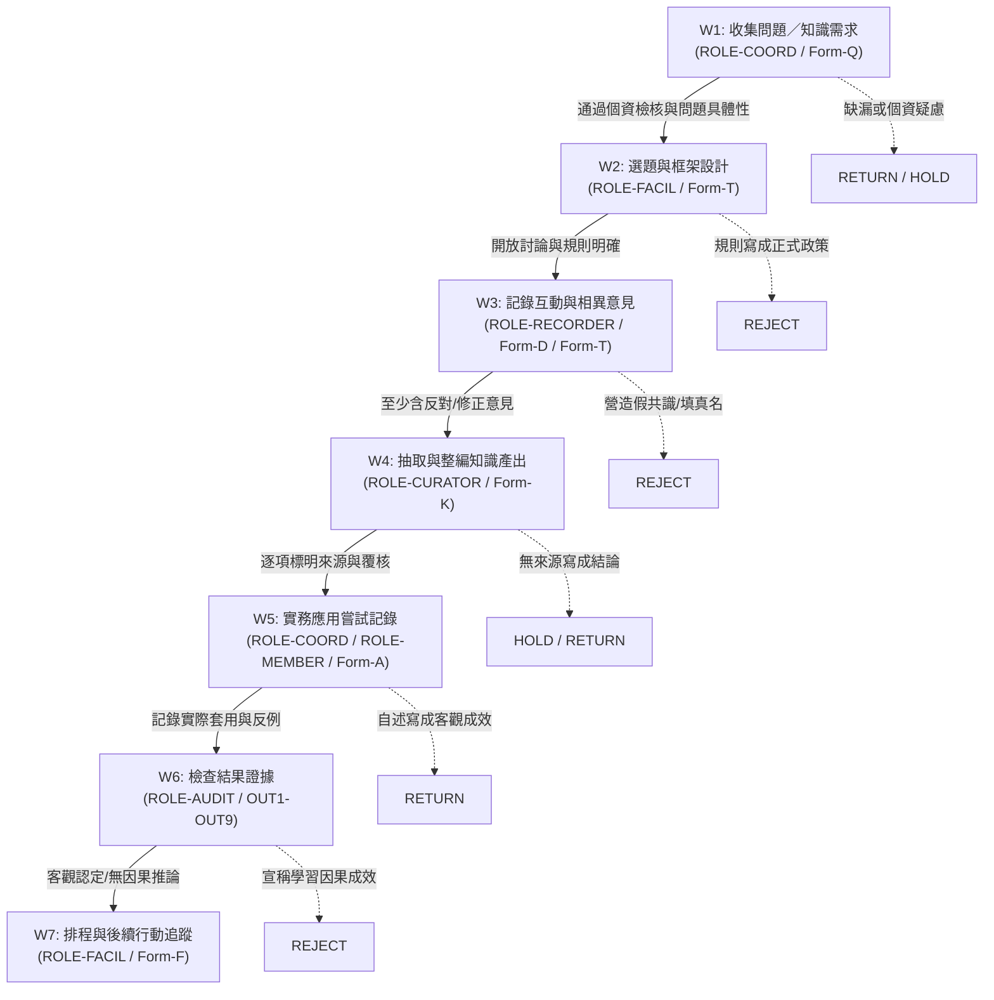

# DOCX 0085 R06 exact-SHA independent semantic review packet

READ ONLY. Recompute the conclusion from exact candidate bytes and primary sources. Do not edit workspace files. All synthetic entries remain SAMPLE/SYNTHETIC; REAL is UNKNOWN/HOLD. No real activity, approval, identity, signature, or third-party evidence may be inferred.

## Exact identity and hashes
```json
{
  "project_id": "TTQS_ONE",
  "doc_id": "0085",
  "official_requirement_id": "I17C-E04",
  "official_checkbox": "091",
  "candidate_revision": "R06",
  "candidate_state": "CANDIDATE_NOT_ACCEPTED",
  "formal_acceptance": "NOT_GRANTED",
  "candidate_docx_sha256": "4c2d459c8b02a333157db136774e452fb9c293e02cb525b9286f5d2d7d3740cc",
  "body_sha256": "cda67d0e3aeab29e3329255854d75dd94a9bf8591bc7253f126ad68e49c2bbad",
  "source_packet_sha256": "e9afdcf603ba14d95071a15ab77d41ca1fcd7dc00bb10b64aecdb4c919b02b3f",
  "unique_blueprint_sha256": "4fe718c40a4a46231863104853b7d5dad7ab48e7347d1d7639ef8fd49786b73e",
  "render_pdf_sha256": "0ab5c59488261e49fda7a94087b4dc1aaf648097aa3ca0502c55d92423c17d84",
  "render_manifest_sha256": "369017e6b1cdd4c8a7bcab09b379e1a5517e7978695ef9c592f03b74397c726b",
  "render_page_count": 37,
  "content_qa_receipt_sha256": "f38d8d0a7345ba153de438ce7dbdc71e0d45990a151e2b057c9e52083904df19"
}
```

## Producer visual scope (not the reviewer’s visual inspection)
Microsoft Word exported and rasterized 37 pages. The producer inspected all pages through four contact sheets and enlarged pages 19, 20, 21, 22, 24, 28, and 30–33. The §15.2 access matrix is a native 7×7 Word table. OpenCode must report semantic conclusions only unless it independently inspects page images; its visual scope is otherwise UNKNOWN.

## Prior exact-SHA review R05 (PARTIAL; historical, recheck all findings)
# 0085 R05 獨立語意審查（唯讀）

**審查對象（唯一綁定）**：`docs/ttqs-quality-20261016/quality-review/0085_R01/candidate/0085_R05.docx`  
**DOCX SHA-256**：`fa66d74fb011ebf3bcf96abd2d6639cad3704088acbb50815c81d65dc8f3024d`  
**本文所有結論僅對此 SHA 有效；不接受替代版本、Builder 回執或 R04 結論之繼承。**

**正式驗收狀態**：`NOT_GRANTED`  
**獨立審查總結論**：**PARTIAL**

---

## 一、审查范围与方法

| 项目 | 状态 |
|---|---|
| DOCX 直接解析 | 已完成（48 個表格、179 筆 Appendix E 資料列） |
| Body Markdown SHA | `a6d9677…02f73c2`，MATCH |
| Source Packet SHA | `e9afdcf…b02b3f`，MATCH |
| Unique Blueprint SHA | `4fe718c…86b73e`，MATCH |
| PDF SHA / 頁數 | `3ef6feb…f52163` / 36 頁（僅雜湊與頁數） |
| Render manifest SHA | `2e617b3…04f82c`，MATCH |
| 12 個上游來源 SHA-256 | 12/12 MATCH（獨立重算） |
| 12 個 Git blob | 12/12 MATCH |
| 頁面影像／版面視覺審查 | **未執行（UNKNOWN）** |
| Builder 回執作為證據 | **未採用** |

> 視覺版面（字型、表格框線、跨頁、欄寬、頁首頁尾實際渲染）**本人未自 PNG/影像逐頁檢視**；本審查之全部結論均為語意／文字層證據。PDF 僅驗證雜湊與 36 頁，不能替代視覺審查。

---

## 二、逐項審查結論

| # | 審查項目 | 結論 |
|---|---|---|
| 1 | 身分識別 I17C-E04／勾選項 091，與 0082/0083/0084/0086 之區辨 | **PASS** |
| 2 | 體裁、可用表單 Q/T/D/K/A/F/R、W1–W7、完整合成案例、179 列 Appendix E | **PARTIAL** |
| 3 | 數學與案例一致性（OPEN-01、DEC/FU/AP/OUT/KI） | **PARTIAL** |
| 4 | SAMPLE/SYNTHETIC 與 REAL=UNKNOWN/HOLD、NOT_EXECUTED、無虛構關聯事實 | **PASS** |
| 5 | 工作流可用性、駁回／保留控制、完整空白表單 | **PARTIAL** |
| 6 | R04 重大發現逐項複核 | **PASS** |
| 7 | 語意結論與視覺證據分離 | **PASS**（視覺本身 UNKNOWN） |

---

## 三、具體發現

### F1｜Appendix E 平價性（parity）1 筆不一致 — C-4 未滿足
- **位置**：§13.8／OUT1；Appendix E `R85-134`
- **證據**：§13.8 記載 `示例記載：…`；Appendix E `R85-134` 記載 `合成示範記載：…`。其餘 178/179 筆逐字 MATCH。
- **影響**：C-4 要求 179/179 完全一致，實際為 **178/179**。
- **修正**：統一兩處措辭（建議以「合成示範記載」為準），更新 `R85-134` 後重跑 C-4；並在附錄說明 C-4 的比對基準（是否容許前綴差異）。

### F2｜AP-05 缺活動系列代碼，且 `SYN-ACT-01` 未定義
- **位置**：§9／AP-05；§13.7／AP-05；Appendix E `R85-128`
- **證據**：§9/AP-05 要求「須含活動系列代碼」；§13.7 與 `R85-128` 僅寫 `KM-G01 於合成示範活動 SYN-ACT-01 前…`，未出現 `SYN-KM-SERIES-2026-C`；全篇未見 `SYN-ACT-01` 之定義。
- **影響**：表單自身規則與案例內容不一致，屬可用性與可追溯性缺陷。
- **修正**：於 §13.7 及 `R85-128` 補入系列代碼 `SYN-KM-SERIES-2026-C`，並在合成案例識別區定義 `SYN-ACT-01`（或改用既有已定義代碼）。

### F3｜閉環缺口：AP-08 標「待修正」但無對應處置；D03 無 KI/OUT/DEC 處置
- **位置**：§13.7／AP-08、`R85-131`；§13.4／D03、`R85-042`；§13.12；FU-01（`R85-143`–`R85-150`）
- **證據**：
  - AP-08 記載「設備確認…不適用」並標示「待修正」，但未見對應 FU/DEC/KI 修訂列。
  - FU-01 僅追蹤 OPEN-01（`R85-143`–`R85-150`）。
  - D03（`R85-042`）無 KI/OUT/DEC 處置紀錄。
  - §13.12 卻主張已形成閉環。
- **影響**：閉環主張與追蹤表不一致，屬可追溯性缺陷。
- **修正**：為 AP-08 與 D03 增列 FU 追蹤列及 DEC/OUT 處置，或將 §13.12 之閉環主張限定為「僅 OPEN-01 已閉環」。

### F4｜§15.2 存取矩陣為原始 Markdown 管線文字，非 Word 表格
- **位置**：§15.2
- **證據**：DOCX 文字層顯示為單一段落 `| 職務角色代碼 | … | |---|---|---| …`，未形成原生表格。
- **影響**：表格不可用、欄位對應難以閱讀；屬可用性缺陷。此為文字層證據，非版面影像判斷。
- **修正**：在 DOCX 中重建為原生 Word 表格，或改為條列式角色—權限對應。

### F5｜負向測試 NT-01/NT-08 範圍會誤判 §13 前言
- **位置**：§18.3／NT-01、NT-08；§13 前言 P108
- **證據**：NT-01 搜尋 `0084`、NT-08 搜尋 `SYN-0083-B01`「於 §13」；而 §13 前言 P108 同時含這兩者（作為非連結性說明文字）。
- **影響**：若照字面執行，測試將對合法前言產生偽陽性。
- **修正**：於 §18.3 明確排除 §13 前言／非連結性敘述，或將該等名稱移至 §18.2 並改以結構化欄位比對。

### F6｜§14 角色代碼串接無分隔
- **位置**：§14（HOLD 與 RETURN 列）
- **證據**：HOLD「允許宣告之角色」顯示 `ROLE-AUDITROLE-COORD`；RETURN 顯示 `ROLE-FACILROLE-COORDROLE-AUDIT`。
- **影響**：角色邊界不可辨識，易誤讀為單一角色代碼。
- **修正**：加入分隔符（如 `、` 或 `/`）或分行列出。

### F7｜M9 `4÷6=66.7%` 之母體定義過度陳述
- **位置**：§13.5／M9；§13.6.2 註；`R85-096`、`R85-101`、`R85-106`、`R85-116`
- **證據**：4 筆 KI 列標為「已定位覆核」，但其位置欄為 `(PENDING)`；§13.6.2 又稱在補齊頁碼前不得作為外部證據。以「已定位覆核」計入分子，與「位置待補」並存，語意不一致。
- **影響**：66.7% 易被理解為完整定位率，屬指標定義缺陷。
- **修正**：將 M9 重新標示為「章節層級覆核率」，另設「完整位置率」指標（目前應為 0/6 或另行定義），或在詞彙表明確定義「已定位覆核」。

### F8｜§13.5 M1–M4 與 Blueprint 偏離未記錄
- **位置**：Blueprint §13.5；R05 §13.5；§13.1；`R85-070`–`R85-077`
- **證據**：Blueprint 記 M1=9、M2=6、M3=66.7%、M4=3；R05 記 M1=1、M2=1、M3=100.0%、M4=0，並於 §13.1 稱「只記錄一個合成示範討論單位」。此為刻意偏離但未見 deviation 記錄。
- **影響**：可追溯性缺陷；驗收者無法區分「修正」與「未揭露偏離」。
- **修正**：於 Appendix D 或 §20 明列此偏離、理由與影響，或同步更新 Blueprint 版本。

---

## 四、R04 重大發現複核（R05 狀態）

| R04 發現 | R05 狀態 | 證據位置 |
|---|---|---|
| R01/R04 版本自我標示錯誤 | **已修正** | 頁首頁尾、§0.1、Appendix D 均為 R05 |
| D06/D07 字數錯誤 | **已修正** | D06=17、D07=23，與 TP-06／`R85-023`／`R85-057`／`R85-062` 一致 |
| 9 活動登錄不實 | **已移除／改述** | §13.1 改為單一合成示範討論單位 |
| KI-01／AP-10／OUT1 狀態過度宣稱 | **已修正** | KI-01 `AP-01（PARTIAL）`、AP-10 `PARTIAL`、OUT1 `PARTIAL/HOLD` |
| 69→75 欄位數錯誤 | **已修正** | §20.2 `12+12+12+12+10+8+9=75` |
| 禁用核准語彙 | **已修正** | 僅存禁止／否認／規則語境，無正面 `核定/核准/批准/已採納/本會規定` 主張 |
| C-5 ID 格式 | **已修正** | 正則 `^R85-\d{3}$`；179 筆全數有效、無範圍 ID |
| 虛構委員會／核准事實 | **已移除並明確否認** | §17 L5、§20.3 |
| `SELF-CHECKED` | **已移除** | §19 T-1–T-10 均為「R05 尚待驗證」；Appendix F 空白 |
| §20.1「真實發言」 | **已移除** | — |
| §20.4 狀態 | **已修正** | `CANDIDATE / NOT_ACCEPTED` |

**結論**：R04 之重大阻斷項在 R05 均已實質處理，未發現沿用 R04 錯誤結論之情形。

---

## 五、正面確認（已獨立驗證）

- 身分鏈一致：I17C-E04／勾選項 091，與 0082/0083/0084/0086 之區辨清楚，無混用。
- 官方 17c 文本與 §1.2.1／§1.2.2 相符（對照官方 PDF 第 6 頁抽取文字）。
- Appendix E ID `R85-001`–`R85-179` 連續且唯一；分組計數與 C-3 一致。
- 數學：`1÷1=100.0%`、`1−1=0`、`(2+2)÷8=50.0%`、`4+1+1=6`、`4÷6=66.7%` 算術正確（母體定義問題見 F7）。
- 無 `SELF-CHECKED`、無正面核准主張、無虛構委員會事實。
- 12/12 上游 SHA 與 12/12 Git blob 全部 MATCH。

---

## 六、限制與未採納事項

1. **視覺版面 UNKNOWN**：未檢視 PNG 或逐頁影像；表格框線、跨頁、字型、頁首頁尾渲染均未確認。
2. **PDF 僅驗證** SHA 與 36 頁，未作內容或版面比對。
3. **`SRC-P6`「目視核對」** 屬 Source Packet／Builder 之主張，**未作為獨立證據採納**。
4. **Render engine 之宣稱**（如特定引擎、字型嵌入）未經獨立驗證。
5. Builder 回執（`build_receipt_R05.json`、`builder_repair_R05.json`、`content_repair_R05.json`、`technical_review_R04.json`）均未作為證據。

---

## 七、結論

| 項目 | 結果 |
|---|---|
| 綁定 SHA | `fa66d74fb011ebf3bcf96abd2d6639cad3704088acbb50815c81d65dc8f3024d` |
| 身分／體裁／樣本分離／R04 複核 | 實質改善，無重大阻斷 |
| 仍阻擋 PASS 之項目 | F1（C-4 178/179）、F2、F3、F4、F5、F6、F7，及 F8 未記錄偏離 |
| **總結論** | **PARTIAL** |
| **正式驗收** | **NOT_GRANTED** |

本審查為唯讀作業，未修改任何工作區檔案；分析用暫存檔僅存在於 `C:\Users\J\AppData\Local\Temp\opencode`。上述結論不構成驗收核准，亦不替代視覺審查與正式簽核。


## Prior exact-SHA review R04 (PARTIAL; historical only)
# Independent Semantic Review — DOCX 0085 R04

**Overall verdict: PARTIAL** — structure and arithmetic are sound, but material semantic contradictions and traceability defects prevent PASS.

## 1. Identity binding

| Artefact | SHA-256 | Status |
|---|---|---|
| Reviewed DOCX `0085_R04.docx` | `e365e24550e5c898ce390c1e889caf7fdc20aa557acdfa2d3605722e903c4af3` | **binding reference** |
| Render PDF | `2959ca3d60add6bd17517b73897fb01ce4ea80896d04318ea734511d08a852a4` | matched |
| Candidate body Markdown | `f254328c319acc39d211b81c935e095dec6d771519442c94c6d06cf1b8a30917` | matched |
| Render manifest | `f7174f46ba6f97a7b8178d4d63942fef88b52ae91fef5a01c5b4644128b2fcfa` | matched |
| Official source packet | `e9afdcf603ba14d95071a15ab77d41ca1fcd7dc00bb10b64aecdb4c919b02b3f` | matched |
| Unique Blueprint | `4fe718c40a4a46231863104853b7d5dad7ab48e7347d1d7639ef8fd49786b73e` | matched |
| Supplied review packet | `0984e99c657f77bbb7a03a6234c17411d7d834c7964dafdb139f111efeab2df8` | matched |

All 12 source-document hashes independently recomputed: **12/12 MATCH**. The supplied `technical_review_R04.json` builder receipt was located but **not accepted as evidence**; every finding below was re-derived from the DOCX, body, packet, Blueprint, and render PNGs.

## 2. Per-check findings

### Check 1 — I17C-E04 / checkbox 091 purpose and distinction — **PASS (core) / defect (identity)**
- **Locator:** §0.1, title block; §1.1; Appendix D.
- **Evidence:** Mapping `DOCX 0085 → I17C-E04 → checkbox 091` is stated consistently and correctly; the document's purpose (post-training transfer/implementation evidence unit) is coherently distinguished from 0084 (design/plan) and 0086 (outcome/evaluation).
- **Defect:** §0.1 and the title label the document `R01`, while header, footer, and Appendix D label it `R04`.
- **Correction:** Replace every `R01` self-label with `R04`; add a version-control row stating "supersedes R01."

### Check 2 — Genre and form completeness — **PARTIAL**
- **Pass:** Correct genre; usable blank forms **Q/T/D/K/A/F/R** all present; workflow **W1–W7** all present; synthetic case and Appendix E structurally complete.
- **Locators/evidence:**
  - §13.3 / TP-06 claims D07 is "最長 62 字（D07）；8/8 則均 ≥15 字." Actual: **D07 = 23 chars; D06 = 14 chars**, i.e. below the stated 15-char minimum. Appendix E `R85-023`, `R85-057`, `R85-062` carry the same claim.
  - §13.5 / M1–M4 assert **9 activities / 6 with records / 3 without**, but no 9-row activity register exists anywhere; only §13.1 ("共 9 次活動") and AP-05 ("第 7 次活動") corroborate a count, not the register. Appendix E `R85-070`–`R85-077`.
- **Correction:** Correct D06/D07 character counts (or replace the sample text); add the missing 9-activity register with per-activity evidence IDs, or restate M1–M4 to match the records actually present. Update Appendix E rows accordingly.

### Check 3 — Math and cross-table consistency — **PARTIAL**
- **Pass:** Arithmetic checked and correct: `6÷9 = 66.7%`, `(2+2)÷8 = 50.0%`, `4÷6 = 66.7%`. OPEN-01 and DEC/FU dates are largely consistent. Appendix E parity is exact: **179 rows, continuous `R85-001`–`R85-179`, 179/179 value-cell matches, 0 mismatches, 0 missing locators.**
- **Fail-locators/evidence:**
  - §13.6.2 / KI-01 and KI-06 = `AP-01（COMPLETE）`
  - §13.7 / AP-10 = `PARTIAL`
  - §13.8 / OUT1 = `PARTIAL/HOLD`
  - Appendix E `R85-098`, `R85-133`, `R85-134`
  - The document's own **§9 AP-10 rule** says AP-07 PENDING requires PARTIAL, so KI stating COMPLETE is a self-rule violation.
  - §20.2 field count "12+12+12+6+10+8+9＝69" omits Form-K's six KI fields; correct total is **75**.
- **Correction:** Set KI-01/KI-06 to `PARTIAL` (or supply the missing completion evidence that satisfies §9 AP-10); align OUT1 and Appendix E; correct 69 → 75.

### Check 4 — SAMPLE/SYNTHETIC labelling and no fabricated approvals — **PARTIAL**
- **Pass:** Global `SAMPLE/SYNTHETIC` and `REAL=UNKNOWN/HOLD` labels are present and mostly applied; `NOT_EXECUTED` is used in the body.
- **Fail-locators/evidence:**
  - §20.1 item 3: "統計數據嚴格依據**真實發言與執行紀錄**計量" — direct contradiction of the SAMPLE/SYNTHETIC declaration.
  - §20.4: `STATUS = CANDIDATE COMPLETE（候選正文完工／自檢通過）`
  - §19 / T-7: all `SELF-CHECKED：通過` — self-attestation, not independent acceptance.
  - §20.2: "20 項負面檢驗全數通過" is false as written — NT-01, NT-03, NT-04, NT-05, NT-11 would match normative text or their own definitions.
- **Correction:** Rewrite §20.1 item 3 to "統計數據僅依據合成樣本計量；真實數據 = UNKNOWN/HOLD"; downgrade §20.4 to `CANDIDATE / NOT ACCEPTED`; scope negative tests to §13 sample values and attach an execution log with actual results (including expected failures).

### Check 5 — Workflow, triggers, human usability — **PARTIAL**
- **Pass:** W1–W7 workflow is sound; rejection/hold triggers are defined and internally coherent; the forms are usable.
- **Fail-locators/evidence:**
  - §2.2 / ROLE-FACIL: "核定 Form-F 後續排程" violates §2.4's explicit prohibition of the verb "核定."
  - §16.3 / C-5 instructs checking REG_ID for hyphen/range symbols, but every `R85-nnn` contains a hyphen — the test is ill-defined and would flag all 179 valid rows.
- **Correction:** Replace "核定" with "確認／安排"; redefine C-5 to test for range symbols/en-dashes rather than hyphens, and state the accepted ID pattern explicitly.

### Check 6 — Improper real-association claims — **FAIL**
- **Locators/evidence:**
  - §20.1 item 3: claims statistics derive from "真實發言與執行紀錄" — an affirmative real-world association claim contradicted by the document's own SAMPLE/SYNTHETIC status.
  - §17 / L5: invents "召開正式審查會並獲頒正式受領函文" — no such event is sourced in the packet.
  - §20.3: invents a "審查委員會" — no committee is established in the source packet or Blueprint.
- **Correction:** Delete the L5 approval narrative and the §20.3 committee reference, or reclassify them explicitly as fictional synthetic-scenario elements. Rewrite §20.1 item 3 as above. No real approval, receipt, committee, or execution may be asserted.

### Check 7 — Layout usability (layout evidence, separate from semantics) — **PARTIAL**
- **Pass:** 37 pages; pages 14, 16, and 32–37 landscape as intended; Appendix E header repeats on page 37; final row `R85-179` present; 6-column Appendix E readable.
- **Layout defects:**
  - `page-012.png` / `page-013.png`: the **R-06 row is split across the page break**, leaving an orphaned fragment at the top of page 13.
  - `page-014.png`: Form-T / Form-D headers are compressed into 2–3 lines and are cramped.
  - `page-016.png`: page contains only Form-F with a large blank area.
- **Correction:** Keep table rows together (`cantSplit`), widen Form-T/Form-D header cells or reduce header text, and reflow Form-F to avoid the near-empty page.
- **Note:** These are rendering/usability findings only; they are not counted as semantic PASS or FAIL.

## 3. Verified positives (independent)
- Identity mapping 0085 / I17C-E04 / checkbox 091 correct.
- Genre correct; 7 blank forms Q/T/D/K/A/F/R present; W1–W7 present.
- Arithmetic correct; OPEN-01/DEC/FU dates largely consistent.
- Appendix E: 179 continuous rows, 179/179 value parity, 0 mismatches.
- DOCX structure: 48 tables, 6 sections, 239 paragraphs.
- 12/12 source hashes match.

## 4. Acceptance statement

This review is **read-only**. No files were edited, regenerated, or moved. The review is bound exclusively to DOCX SHA-256 **`e365e24550e5c898ce390c1e889caf7fdc20aa557acdfa2d3605722e903c4af3`** and the matched artefacts listed in §1. The builder receipt was not accepted as evidence.

**Formal acceptance: NOT_GRANTED.** Overall result: **PARTIAL** — Check 1 passes at the semantic level; Checks 2–5 and 7 are PARTIAL; **Check 6 FAILS**. The blocking items before any re-review are the §20.1 "真實發言" claim, the §17/§20.3 invented approval bodies, the KI/AP/OUT COMPLETE-vs-PARTIAL contradiction, and the R01/R04 identity mislabel.


## R06 content verification receipt (Builder-side; evidence to independently verify, not accept)
{
  "project_id": "TTQS_ONE",
  "doc_id": "0085",
  "requirement_id": "I17C-E04",
  "checkbox": "091",
  "revision": "R06",
  "body_sha256": "cda67d0e3aeab29e3329255854d75dd94a9bf8591bc7253f126ad68e49c2bbad",
  "docx_sha256": "4c2d459c8b02a333157db136774e452fb9c293e02cb525b9286f5d2d7d3740cc",
  "docx_bytes": 190209,
  "register_rows": 179,
  "exact_parity_mismatches": 0,
  "mismatch_examples": [],
  "word_15_2_native_table": {
    "rows": 7,
    "cols": 7,
    "first": "職務角色代碼"
  },
  "checks": {
    "register_179_rows": true,
    "register_keys_contiguous": true,
    "register_exact_value_cell_parity": true,
    "word_15_2_native_7x7_table": true,
    "body_blueprint_sha_present": true,
    "sample_real_boundary_present": true,
    "m9_exact_locator_rate_explicit": true,
    "blueprint_deviation_recorded": true,
    "ap05_series_activity_code_present": true,
    "ap08_followup_open": true,
    "candidate_not_accepted": true
  },
  "all_checks_pass": true,
  "review_status": "PENDING_EXACT_SHA_INDEPENDENT_REVIEW",
  "state": "CANDIDATE_NOT_ACCEPTED",
  "checked_utc": "2026-10-19T14:57:27.457429+00:00"
}


## Official Source Packet R02 (complete)
# DOCX 0085｜I17C-E04｜官方方框 091｜來源包 R02

狀態：`SOURCE PACKET / BLUEPRINT INPUT`。本檔是 `UNIQUE_BLUEPRINT_0085_R02.md` 的施工輸入，不是協會政策、不是正式表單、不是已執行的社群討論紀錄、不是正式接受佐證。所有示範值一律 `SAMPLE / SYNTHETIC`；真實資料 `REAL=UNKNOWN/HOLD`；正式接受 `FORMAL_ACCEPTANCE=NOT_GRANTED`；執行狀態 `NOT_EXECUTED`。

## 1. 身分鎖（機器可讀）

```yaml
DOCX_NO: "0085"
ITEM_REQ: "I17C-E04"
CHECKBOX_NO: "091"
SERIES: "I17c 行為評估（多獨立作品，不合併）"
GENRE_PRIMARY: "知識管理社群：討論主題、互動與學習應用分析"
UPSTREAM_PAGE: "官方《TTQS 查核佐證文件資料表—訓練機構版》印刷第 6 頁 17c 行為評估"
NEIGHBOR_PREV: "0084 / I17C-E03 / 090"
NEIGHBOR_NEXT: "0086 / I17C-E05 / 092"
SERIES_SIBLINGS: "0082 / I17C-E01 / 088; 0083 / I17C-E02 / 089"
STATUS: "SOURCE PACKET / NOT_EXECUTED"
REAL: "UNKNOWN/HOLD"
FORMAL_ACCEPTANCE: "NOT_GRANTED"
```

- 文類：知識管理社群的**討論主題選擇、互動（含相異意見）記錄、共享／整編知識產出、實務應用與後續追蹤**之紀錄與分析工具。
- **編號混淆禁制**：DOCX `0085` 不等於官方方框 `085`（方框 085 為 I17b「課程評量及建議檢討」，依 0079 R02 修正對應 DOCX 0080），也不等於方框 `091` 所暗示的「文件 0091」；亦不得與相鄰的文件編號 `0084`（方框 090）、`0086`（方框 092）互換。文件號與方框號是兩套序列，不得互相替代。
- 對應出處：`UNIQUE_BLUEPRINT_0079_R02.md` 末段「R02 對照修正」明載「DOCX 0085 與 0086 實際對應 I17C-E04 與 I17C-E05」（本次已重讀原文核對，見 S6）。

## 2. 正式來源與位元組識別（本機逐一重算）

| # | 來源 | 位置 | Git blob | SHA-256 | 本件使用範圍 | 重算狀態 |
|---|---|---|---|---|---|---|
| S1 | Human Mission | `quality-review/0077_R01/inputs/upstream_snapshots/01_HUMAN_MISSION_AND_ACCEPTANCE.md` | `538bedb9d87e8465f43151933b4a5c1bfa4bbc4e` | `07c4b0beb30ebe9919818977d6eb0255e9f467955e9190e515ae3e2b963d1dd8` | 志工／社群性質組織的適切性、不得假造人員／執行／批准、完整可用示範、SAMPLE/REAL 界線 | `MATCH` |
| S2 | 文類寫作手冊 | `quality-review/0077_R01/inputs/upstream_snapshots/02_GENRE_WRITING_MANUAL.md` | `4ff863d9f534b6359fc1c7c1685bd8cce02da886` | `7fc23191efdb60ca4a9b48bc306799a9f15916b1160b63292d164bd4f4cf49aa` | 17c 五項成品分工（含知識社群討論記錄與分析）、行為量尺需前後比較與觀測來源、不得偽稱外部評核 | `MATCH` |
| S3 | 157 方框藍圖 | `quality-review/0077_R01/inputs/upstream_snapshots/03_157_CHECKBOX_BLUEPRINTS.md` | `8c2bbe7ca9dcbb03088a48934b9e57e7147ede63` | `ad03323d591cbea62814a8a59d233110587f2741bed8f944380b1faa2d04d216` | section `I17c` **row 091** 標題與四要素（特定來源定位、核心正文/示範、決策或結果、跨文件事實連結；不得以空白欄位交差） | `MATCH` |
| S4 | 官方佐證資料表 PDF | `quality-review/0077_R01/inputs/upstream_snapshots/official_evidence_table_source.pdf` | `9c7621decdad585b743bf2b3d949ee5518b7bee0` | `805386b77df045b396fabafed7a47d12491c25a0b5744edd9a04876caee34709` | 印刷第 6 頁 17c 行為評估之機構級評分說明與參考佐證清單 | `MATCH` |
| S5 | 同頁可讀影像 | `quality-review/0078_R01/evidence/official_evidence_table_page6-6.png` | `7cce2401a3230cb86875df79396538d0adea41d5` | `b7bd4c09b7d7e22993a1577647e10a421fb240222b46b531ba3f01ee047fa1d1` | 目視核對 PDF 印刷第 6 頁（本次已開啟檢視） | `MATCH` |
| S6 | 0079 藍圖（身分修正） | `quality-review/0079_R01/inputs/UNIQUE_BLUEPRINT_0079_R02.md` | `32143214c740bb41fb40a6b6a330089902840229` | `02ae81cb147d82f3a940be9e1747b483264aa0f9dcb15ffbd19e8a1611faa7b6` | **僅使用**其鄰件身分修正：DOCX 0085/0086 = I17C-E04/E05；其餘內容不引用 | `MATCH` |
| S7 | 0082 藍圖 | `quality-review/0082_R01/inputs/UNIQUE_BLUEPRINT_0082_R02.md` | `3679bfa41ef88ca1792234049f49f0127a923ed5` | `451acd1e197b916f2d14c03bd2651653892a4a7955119291e9628bdc5e27e602` | 0082=I17C-E01/088 之文類與邊界；N/O 與 0 之分離原則、自陳與因果界線 | `MATCH` |
| S8 | 0083 藍圖 | `quality-review/0083_R01/inputs/UNIQUE_BLUEPRINT_0083_R03.md` | `85e362aea519c3899a5145588e0aeb462897cc9e` | `21f76376621c5dd22d002a62202f41ea7335bbf872a965b0bbf8fb86955d0178` | 0083=I17C-E02/089 之文類與邊界；決策表、清冊 schema 與不變錨點 | `MATCH` |
| S9 | 0083 候選正文 | `quality-review/0083_R01/candidate/0083_R07_body.md` | `67aa18f5aee06a905e895f397653214c49ffccb8` | `4f150eb598cea245971f606deb8238a24d191517fb8b06b88545fa45414b9dd0` | 合成案例 `SYN-0083-B01` 不變錨點、17c 五作品表中「知識社群＝另件」的既有表述 | `MATCH` |
| S10 | 0084 來源包 | `quality-review/0084_R01/inputs/SOURCE_PACKET_0084_R01.md` | `40fa6f848342ae72a432b352f56f354d739d449d` | `6c2e928a889f0e01fe6aeca2ed0ed5b6a0dca6b3a12f591ba493a969dd4d3f1d` | 相鄰件 0084=I17C-E03/090 之身分、17c 機構級 0–3 界線 | `MATCH` |
| S11 | 0084 藍圖 | `quality-review/0084_R01/inputs/UNIQUE_BLUEPRINT_0084_R03.md` | `2bead32209a52adb9377b487fc373d5bbda135d0` | `49ac3786cdac0547bdab636663a280b5ef015e2b956ee2fefb157d674b66ed7e` | 0084 之邊界、角色碼、59 列清冊規格；「知識社群＝SEPARATE」 | `MATCH` |
| S12 | 0084 抽取正文 | `quality-review/0084_R01/evidence/docx_extracted_R11.md` | `4e86521b7188daf36eb75ebf392855b7eb413ab4` | `329dadf269064ddaecfcb0a731bb1d720a6eda6b56445a5ee3d8b558887ae848` | 已建置 0084 之 17c 五作品表、數學與狀態不變錨點（僅供一致性核對，非本件正文範本、非 REAL 證據） | `MATCH` |

路徑前綴一律為 `docs/ttqs-quality-20261016/`。重算方式：PowerShell `Get-FileHash -Algorithm SHA256` 與 `git hash-object`，於本機逐一執行；上表 12 項雜湊與 blob 與派發指示所列值**完全一致**。

## 3. 來源衝突檢查

1. **12/12 MATCH**：未發現 SHA-256 或 Git blob 不符，故本件不觸發來源層 `HOLD`。
2. **身分映射**：S6 原文已重讀，確認 DOCX 0085 = I17C-E04、DOCX 0086 = I17C-E05，與派發指示一致。方框 091 屬 section `I17c`（S3 line 225），標題「知識管理社群：討論主題、互動與學習應用分析」。
3. **次要映射來源缺件（HOLD，不推測）**：S7 §2.1 引用之需求清冊 `送審資料/05_填表建議_方法示範不等於實績/142份文件逐項檢查與填表建議.csv`（稱第 17、18 列）在本 checkout 中**不存在**（已以全庫 `*142*` 與 `送審資料` 目錄搜尋確認）。該 CSV 的逐列內容本次**未取得**，故凡依賴該 CSV 的細節一律標 `HOLD`，不臆測；本件身分映射改以 S6 為依據。
4. **分支與 HEAD**：派發時分支 `work/ttqs-one-document-quality-contract-20261016`；本機驗證 `git rev-parse HEAD` = `717f08733d4cda7d84af21db346e44f41f7854fb`（僅為觀測值）。分支會推進，**任何提案內容都不得寫死此 HEAD**。
5. **S9/S12 內容層**：S9 全文未提及 0085／I17C-E04／091；S12 全文亦未提及 0085／091，僅有「知識社群討論分析＝17c 其他獨立作品、各自獨立、不合併、SEPARATE」。此為**一致**（相鄰件把本件當獨立作品），不構成衝突。

## 4. 官方內容（可直接使用）

1. S3 section `I17c` **row 091**：「知識管理社群：討論主題、互動與學習應用分析」。四要素要求：特定來源定位、核心正文/示範、決策或結果、與其他文件的事實連結；除第三方原件索取型文件外**不得只交空白欄位**。
2. S4／S5（印刷第 6 頁，17c 行為評估）參考佐證清單逐字包含：「學員訓後動態調查表。」「參訓學員的學習成果實施行動計畫表追蹤紀錄。」「派訓單位主管對參訓學員的學習成效評估表。」「**知識管理社群討論。**」「神秘客實地稽核（外部稽核）課後機制等。」「其他：」。
3. 同頁 17c 之**機構級**評分說明：0 分未執行；1 分協助客戶執行課後行動計畫評估；2 分有機制並能展現辦理或追蹤客戶執行之相關紀錄；3 分相關紀錄能展現具體成效。**這是機構層評核語言**：不得填入社群成員或個人欄位，不得宣稱本會已得任何分數或等級；本件只提供文件層內容之對照（`UNSCORED`）。
4. S2 對 17c 的分工敘述：知識社群討論記錄與分析是 17c 的**獨立成品之一**，與結訓動態問卷、行動計畫追蹤、派訓主管量規、神秘客／外部稽核並列，不得互相代填。

## 5. 17c／17d 與相鄰文件界線

| 文件 | 要求／方框 | 文類 | 與本件關係 |
|---|---|---|---|
| 0082 | I17C-E01／088 | 學員訓後動態（行為轉移）問卷 | 同系列、**不同成品**；僅系列層連結，題項、資料、分母一律不共用 |
| 0083 | I17C-E02／089 | 學員行動計畫追蹤紀錄 | 同系列、**不同成品**；案例 `SYN-0083-B01` 與本件**無事實連結** |
| 0084 | I17C-E03／090 | 派訓主管職場觀察量規與回饋 | 同系列、**不同成品**；本件不得出現主管觀察級別或回饋對話 |
| **0085（本件）** | **I17C-E04／091** | **知識管理社群討論主題、互動與學習應用分析** | 本件 |
| 0086 | I17C-E05／092 | 神秘客實地稽核（外部稽核）方法與邊界 | 同系列、**不同成品**；本件不得出現外部稽核方法或第三方稽核原件宣稱 |
| 17d | 成果評估 | 就業／考照／品質／營運成果 | 另件；本件不得宣稱組織成果或訓練因果 |

## 6. 可引用的合成錨點（僅 SAMPLE；多數為**明確非連結**）

- 本件**不沿用** `SYN-0083-B01`／`SYN-0084-B01`／`LRN-B01`／`SYN-COURSE-0083-B`，也**不沿用** `SYN-0073-2026-A01`／`BTR-nn`。本件另立完全獨立合成案例 `SYN-0085-C01`（社群群體碼 `KM-G01`、參與者碼 `KM-P1`～`KM-P9`），並在正文寫明非連結。
- **可引用（僅作爲不變錨點的「不得矛盾」清單）**：0083 結訓日 `2026-03-06`、T1/T2/T3 `2026-04-03`／`2026-05-01`／`2026-05-29`、累計 83.3%、狀態 `PARTIAL`、`AID-01` 提供日 `2026-04-13`、`AID-02` 仍 `REQUESTED`；0084 O0–O3 `2026-03-05`／`2026-04-13`／`2026-05-01`／`2026-05-29`、級別 1/1/1/N-O 等。本件**不得改寫、不得引用為本件證據、不得換算**。
- 本件案例日期區間設為 `2026-06-15`～`2026-08-03`，晚於上述錨點，**不宣稱與其同一事件、同一課程或同一人**。
- 任何第三方原件（平台紀錄、成員名冊、會議簽到、外部回函）一律 `UNKNOWN/PENDING_REAL_SOURCE`，不偽造。

## 7. Blueprint / Writer 必須交付

1. `UNIQUE_BLUEPRINT_0085_R02.md`：身分鎖、來源矩陣與衝突檢查、文類目的與排除項、W1–W7 工作流、逐節大綱與逐欄位字典、空白可列印表單、完整合成案例（含相異意見與未決問題）、數學與口徑規則、決策與退件條件、隱私與記錄更正控制、跨文件一致性與負面測試、逐原子替換清冊與完整度測試、驗收矩陣。
2. 必須同時有**空白可列印表單**與**已完整填寫的合成示例**；只有空白表單即不合格。
3. 官方機構級 0–3 只能作 `UNSCORED` 對照，不得成為任何個人／社群評分欄。
4. 所有門檻、期限、角色、流程與示例結果標 `PROPOSED SAMPLE ONLY`；無效數據一律 `UNKNOWN/HOLD`，不得寫學習成效或因果。
5. **本來源包產製階段的歷史範圍**：當時不建置 DOCX、不修改其他檔案、不 commit／push／publish、不執行 Word／Computer Use、不呼叫其他模型。此限制隨來源包階段結案而解除；後續 DOCX Writer 依 `UNIQUE_BLUEPRINT_0085_R02.md` 與獨立 Writer 任務施工，不得把本句解讀為禁止建置 DOCX。

## 8. 狀態詞彙（沿用系列慣例）

`SAMPLE/SYNTHETIC`｜`PROPOSED SAMPLE ONLY`｜`NOT_EXECUTED`｜`HOLD`｜`RETURN`｜`REJECT`｜`REVERIFY`｜`NO_OPPORTUNITY`｜`REAL=UNKNOWN/HOLD`｜`FORMAL_ACCEPTANCE=NOT_GRANTED`｜`PENDING`（未定期限或未定位原件）。


## Unique Blueprint R02 (complete)
# DOCX 0085｜I17C-E04｜官方方框 091《知識管理社群：討論主題、互動與學習應用分析》唯一 Blueprint R02

> 全域狀態戳記：`BLUEPRINT_ONLY / CANDIDATE`；`REAL = UNKNOWN/HOLD`；`FORMAL_ACCEPTANCE = NOT_GRANTED`；`ALL_DEMO = SAMPLE / SYNTHETIC / PROPOSED / NOT_EXECUTED`。
> 本檔是施工輸入，**不是**協會文件、**不是**正式表單、**不是**已執行的社群討論紀錄、**不是**任何人的參與或核准、**不是**正式接受佐證。凡未經來源規定的門檻、期限、角色、流程與示例結果，一律標 `PROPOSED SAMPLE ONLY`。
> 歷史施工邊界（來源包／Blueprint 產製階段，已結案）：當時只交付 `SOURCE_PACKET_0085_R02.md` 與本檔，沒有建置 DOCX、修改其他檔案／收據／佇列／控制檔、commit／push／publish、執行 Word／Computer Use 或呼叫其他模型。這是已完成階段的工作範圍，不是後續 Writer 的禁令。DOCX Writer 依本 R02 藍圖產出人類可用的 0085 候選；新增施工與驗收證據另行留存，來源衝突一律 `HOLD`，不臆測。

> R02 修正：①官方 17c 2 分文字依來源 PDF 更正；②AP-07 定位仍為 PENDING 時，AP-10 改為 PARTIAL、OUT1 改為 PARTIAL/HOLD；③依 §16.2 排除 Form-K 六個 KI-01 結構識別鍵，附錄 E 由 185 列更正為 179 列並重編號／更新分組；④修正 KI-06 欄的 NO_OPPORTUNITY 與相鄰 KI-05 HOLD 被錯誤合併的標記；⑤C-5 改為檢查 REG_ID／定位碼不得範圍合併，保留單一來源格內本來就存在的日期或項目範圍值；⑥補正 FU-08 的替換值，使之與完整來源格逐字相等。來源矩陣及未受上述項目影響的案例值不變。

---

## 1. 身分鎖、來源矩陣與來源衝突檢查

### 1.1 機器可讀身分鎖（Blueprint 中繼資料；**不得**整段搬進 DOCX 人類正文）

```yaml
DOCX_NO: "0085"
ITEM_REQ: "I17C-E04"
CHECKBOX_NO: "091"
SERIES: "I17c 行為評估（多獨立作品，不合併）"
GENRE_PRIMARY: "知識管理社群：討論主題、互動與學習應用分析"
CORE_UNITS: ["問題／知識需求收集", "討論主題選題與框架", "互動與相異意見記錄", "知識產出整編與覆核", "實務應用嘗試", "結果證據檢查", "後續追蹤"]
UPSTREAM_PAGE: "官方《TTQS 查核佐證文件資料表—訓練機構版》印刷第 6 頁 17c 行為評估"
UPSTREAM_EVIDENCE_TEXT: "知識管理社群討論"
SIBLING_088: "0082 / I17C-E01 / 088 = 學員訓後動態（行為轉移）問卷"
SIBLING_089: "0083 / I17C-E02 / 089 = 學員行動計畫追蹤紀錄"
SIBLING_090: "0084 / I17C-E03 / 090 = 派訓主管學習成效評估：職場觀察量規和回饋"
NEIGHBOR_NEXT: "0086 / I17C-E05 / 092 = 神秘客實地稽核（外部稽核）"
OUTCOME_17D: "17d 組織成果＝另件，本件不得冒充"
CASE_ID: "SYN-0085-C01"
STATUS: "BLUEPRINT_ONLY / NOT_EXECUTED"
REAL: "UNKNOWN/HOLD"
FORMAL_ACCEPTANCE: "NOT_GRANTED"
ALL_DEMO: "SAMPLE/SYNTHETIC/PROPOSED/NOT_EXECUTED"
BRANCH_AT_DISPATCH: "work/ttqs-one-document-quality-contract-20261016"
HEAD_OBSERVED_AT_BLUEPRINT: "717f08733d4cda7d84af21db346e44f41f7854fb"
HEAD_POLICY: "觀測值，分支會推進；任何提案內容不得寫死此 HEAD"
```

**編號混淆禁制**：DOCX `0085` 是文件編號；`091` 是官方 157 方框流水號；`I17C-E04` 是項目要求。三者必須同時出現且不得互換。特別禁止：把本件寫成官方方框 `085`（方框 085 屬 I17b「課程評量及建議檢討」，依 0079 R02 修正對應 DOCX 0080）、把本件寫成文件 `0091`、把方框 `091` 誤植為 `090`／`092`、與 `0084`／`0086` 互換文類或表格。

### 1.2 來源定位與 SHA 矩陣（施工引用；本機重算）

| 來源 ID | 路徑（前綴 `docs/ttqs-quality-20261016/`） | Git blob | SHA-256 | 本件使用範圍 | 重算狀態 |
|---|---|---|---|---|---|
| SRC-MIS | `quality-review/0077_R01/inputs/upstream_snapshots/01_HUMAN_MISSION_AND_ACCEPTANCE.md` | `538bedb9d87e8465f43151933b4a5c1bfa4bbc4e` | `07c4b0beb30ebe9919818977d6eb0255e9f467955e9190e515ae3e2b963d1dd8` | 志工／社群組織適切性、不假造人員／執行／批准、完整可用示範、SAMPLE/REAL 界線 | `VERIFIED_LOCAL` |
| SRC-GEN | `quality-review/0077_R01/inputs/upstream_snapshots/02_GENRE_WRITING_MANUAL.md` | `4ff863d9f534b6359fc1c7c1685bd8cce02da886` | `7fc23191efdb60ca4a9b48bc306799a9f15916b1160b63292d164bd4f4cf49aa` | 17c 五成品分工、量尺需前後比較與觀測來源、不得偽稱外部評核 | `VERIFIED_LOCAL` |
| SRC-157 | `quality-review/0077_R01/inputs/upstream_snapshots/03_157_CHECKBOX_BLUEPRINTS.md` | `8c2bbe7ca9dcbb03088a48934b9e57e7147ede63` | `ad03323d591cbea62814a8a59d233110587f2741bed8f944380b1faa2d04d216` | section `I17c` **row 091** 標題與四要素、row 088/089/090/092 鄰界 | `VERIFIED_LOCAL` |
| SRC-PDF | `quality-review/0077_R01/inputs/upstream_snapshots/official_evidence_table_source.pdf` | `9c7621decdad585b743bf2b3d949ee5518b7bee0` | `805386b77df045b396fabafed7a47d12491c25a0b5744edd9a04876caee34709` | 印刷第 6 頁 17c 機構級評分與參考佐證清單 | `VERIFIED_LOCAL` |
| SRC-P6 | `quality-review/0078_R01/evidence/official_evidence_table_page6-6.png` | `7cce2401a3230cb86875df79396538d0adea41d5` | `b7bd4c09b7d7e22993a1577647e10a421fb240222b46b531ba3f01ee047fa1d1` | 目視核對 PDF 印刷第 6 頁（本次已開啟檢視） | `VERIFIED_LOCAL` |
| SRC-0079 | `quality-review/0079_R01/inputs/UNIQUE_BLUEPRINT_0079_R02.md` | `32143214c740bb41fb40a6b6a330089902840229` | `02ae81cb147d82f3a940be9e1747b483264aa0f9dcb15ffbd19e8a1611faa7b6` | **僅**鄰件身分修正（DOCX 0085/0086 = I17C-E04/E05） | `VERIFIED_LOCAL` |
| SRC-0082B | `quality-review/0082_R01/inputs/UNIQUE_BLUEPRINT_0082_R02.md` | `3679bfa41ef88ca1792234049f49f0127a923ed5` | `451acd1e197b916f2d14c03bd2651653892a4a7955119291e9628bdc5e27e602` | 0082 文類與邊界、N/O 與 0 分離、自陳與因果界線 | `VERIFIED_LOCAL` |
| SRC-0083B | `quality-review/0083_R01/inputs/UNIQUE_BLUEPRINT_0083_R03.md` | `85e362aea519c3899a5145588e0aeb462897cc9e` | `21f76376621c5dd22d002a62202f41ea7335bbf872a965b0bbf8fb86955d0178` | 0083 文類與邊界、決策表與清冊 schema、不變錨點 | `VERIFIED_LOCAL` |
| SRC-0083C | `quality-review/0083_R01/candidate/0083_R07_body.md` | `67aa18f5aee06a905e895f397653214c49ffccb8` | `4f150eb598cea245971f606deb8238a24d191517fb8b06b88545fa45414b9dd0` | 已建置 0083 之不變錨點與「知識社群＝另件」表述 | `VERIFIED_LOCAL` |
| SRC-0084P | `quality-review/0084_R01/inputs/SOURCE_PACKET_0084_R01.md` | `40fa6f848342ae72a432b352f56f354d739d449d` | `6c2e928a889f0e01fe6aeca2ed0ed5b6a0dca6b3a12f591ba493a969dd4d3f1d` | 相鄰件 0084 身分與機構級 0–3 界線 | `VERIFIED_LOCAL` |
| SRC-0084B | `quality-review/0084_R01/inputs/UNIQUE_BLUEPRINT_0084_R03.md` | `2bead32209a52adb9377b487fc373d5bbda135d0` | `49ac3786cdac0547bdab636663a280b5ef015e2b956ee2fefb157d674b66ed7e` | 0084 邊界、角色碼、清冊規格、「知識社群＝SEPARATE」 | `VERIFIED_LOCAL` |
| SRC-0084C | `quality-review/0084_R01/evidence/docx_extracted_R11.md` | `4e86521b7188daf36eb75ebf392855b7eb413ab4` | `329dadf269064ddaecfcb0a731bb1d720a6eda6b56445a5ee3d8b558887ae848` | 已建置 0084 之 17c 五作品表、數學與狀態錨點（僅核對用） | `VERIFIED_LOCAL` |

`blueprint_hash`、`artifact_SHA`、`fresh_review_source`：本 R01 不預先填值，於檔案定稿後以本檔 SHA-256 登錄；`artifact_SHA` 與 `fresh_review_source` 屬未來 DOCX 階段，維持 `PENDING`。

### 1.3 來源衝突檢查結果

| 檢查 | 結果 | 處置 |
|---|---|---|
| 12 項 SHA-256 與 Git blob 逐一重算 | **全部相符，未發現衝突** | 不觸發來源層 `HOLD` |
| row 091 標題與文類 | 與派發身分一致（知識管理社群：討論主題、互動與學習應用分析） | 通過 |
| 官方 p.6 參考佐證含「知識管理社群討論」 | 已由 PDF 與頁影像雙重確認 | 通過 |
| DOCX 0085/0086 = I17C-E04/E05 | 由 SRC-0079 末段原文重讀確認 | 通過 |
| 0082 藍圖引用之需求清冊 CSV（`送審資料/…/142份文件逐項檢查與填表建議.csv`） | **本 checkout 不存在**（全庫搜尋無此檔） | 依賴該 CSV 之細節一律 `HOLD`，不臆測；本件映射改依 SRC-0079 |
| 分支 HEAD | 觀測值 `717f0873…7854fb`；分支會推進 | 只記觀測，**不寫死**進任何提案內容 |
| SRC-0083C／SRC-0084C 是否提及本件 | 兩者皆**未**提及 0085／I17C-E04／091；僅把「知識社群討論」列為 17c 獨立作品 | 一致，無衝突 |

**衝突處理規則**：任一後續重算不符，該來源對應之映射即標 `HOLD`，停止推論並在本節補記差異，不得沿用舊值。

---

## 2. 文類目的、讀者、使用時點與排除項

### 2.1 目的（一句話鎖定）

記錄**知識管理社群**從「一個知識需求／問題」到「討論主題、互動與相異意見、可複用知識產出、實務應用嘗試、結果證據檢查、後續追蹤」的完整循環，使打開文件的人能直接看到：**討論了什麼、誰有不同意見、產出了什麼可定位的知識、有人怎麼用、證據在哪、還沒結什麼案**。

### 2.2 讀者與打開後能直接做什麼

| 讀者 | 打開後能直接做什麼 |
|---|---|
| 社群促進角色（`ROLE-FACIL`） | 受理知識需求、選題與框架、主持討論、處理相異意見與未決問題、排後續追蹤 |
| 紀錄角色（`ROLE-RECORDER`） | 逐輪記錄討論（日期、作者碼、立場、回應、定位），檢查立場分布與回應覆蓋 |
| 整編角色（`ROLE-CURATOR`） | 從討論抽取知識項目、逐項找來源定位、覆核與修正、標未決項、產出候選知識產出 |
| 協調角色（`ROLE-COORD`） | 受理需求、安排應用與補件、追蹤 PENDING 定位 |
| 複核角色（`ROLE-AUDIT`）） | 觸發 `HOLD／RETURN／REJECT／REVERIFY`、檢查口徑與隱私、驗清冊對等 |
| 未來 TTQS 評核委員 | 檢視 17c 參考佐證「知識管理社群討論」是否有**可用的主題、互動、應用分析**內容（機構級分數不在本件） |
| Human 核實者 | 隨機開檔核對 SAMPLE/REAL 界線與來源雜湊 |

> 上述角色是**流程位置**，全部 `PROPOSED SAMPLE ONLY`；不得暗示協會現有此編制、此職稱或此授權。

### 2.3 適用與不適用

| 本件適用 | 本件不適用（排除） |
|---|---|
| 一次知識需求→主題→討論→產出→應用→檢查→追蹤的**社群知識循環**紀錄 | 個別學員自填問卷、滿意度調查（0082／17a 領域） |
| 逐輪互動與**相異意見、未決問題**的如實登錄 | 個人行動計畫與次數追蹤（0083 領域） |
| 知識產出的來源定位、覆核、修正與未決標記 | 主管／觀察者對個人的行為評分與回饋對話（0084 領域） |
| 應用嘗試與**結果證據檢查**（無效數據即 `UNKNOWN/HOLD`） | 神秘客、外部稽核方法與第三方稽核原件（0086 領域） |
| 可列印空白表單＋完整合成示例 | 17d 組織成果、就業／考照／營運數字、訓練因果證明 |
| `NO_OPPORTUNITY` 如實登錄 | 既有平台建置、會員管理、名冊、簽到、既有會議主張 |

### 2.4 明確排除項（硬性）

本件**不是**：結案報告、課程評量檢討、行動計畫追蹤表、主管觀察量規、訓後動態問卷、滿意度調查、外部稽核報告、社群平台建置案、會員名冊、會議簽到簿、任何協會政策或已發布的社群規範。全文角色只用角色碼；不得出現「簽核／核准／核定／批准／已採納／本會規定」等暗示正式授權或既有政策的表述，僅可使用「記錄、登錄、確認已填、提案」等作業動詞。

---

## 3. 端對端工作流 W1–W7（`PROPOSED SAMPLE ONLY`）

| 步驟 | 輸入 | 主責角色 | 主要產出 | 通過關卡（全部滿足才往下） | 停住條件 |
|---|---|---|---|---|---|
| **W1 收集問題／知識需求** | 成員提出的疑問、服務情境中的不確定處 | `ROLE-COORD` | 已填 Form-Q（受理） | 問題句具體；個資檢核通過；有受理角色與日期；有受理定位 | 缺問題句→`RETURN`；未做個資檢核→`HOLD`；定位只寫「見附件」→`RETURN` |
| **W2 選題與框架** | 已受理需求 | `ROLE-FACIL` | 已填 Form-T（主題、問題、規則、起訖、邀請） | 對應需求案號；核心問題開放且可討論；規則含「須附理由與可定位來源」並標 `PROPOSED SAMPLE ONLY`；有發布定位 | 無對應需求→`RETURN`；規則寫成本會政策→`REJECT` |
| **W3 記錄互動與相異意見** | 開放中的討論 | `ROLE-RECORDER` | Form-D 逐輪記錄 | 每輪有日期、作者碼、立場、重點與回應、定位；日期落在起訖內且遞增；立場含支持／修正／反對／提問 | 日期倒置→`REVERIFY`；作者欄用真名→`REJECT`；只有「見附件」→`RETURN`；把反對改寫成共識→`REJECT` |
| **W4 抽取／修正知識產出** | 討論輪次記錄 | `ROLE-CURATOR` | Form-K（知識產出＋逐項覆核） | 每一項有內容、來源定位、來源輪次、覆核判定、覆核者與日期；無來源者標 `HOLD` 不得寫成結論 | 無來源仍寫成結論→`HOLD`／`RETURN`；抄襲未授權外部內容→`REJECT` |
| **W5 記錄實務應用** | 已覆核（或部分 `HOLD`）之產出 | `ROLE-COORD`／`ROLE-MEMBER` | Form-A（應用嘗試） | 使用者碼、日期、情境、產出引用、步驟、產物定位、自述、獨立佐證、狀態 | 無授權即附第三方資料→`REJECT`；自述寫成客觀成效→`RETURN`；定位 `PENDING` 即結案→`HOLD` |
| **W6 檢查結果證據** | Form-A 與可定位產物 | `ROLE-AUDIT` | §13.8 式結果判定 | 逐項回答：證據狀態、獨立佐證、結果證據、可計算量、因果聲明 | 無有效結果資料→一律 `UNKNOWN/HOLD`；宣稱學習成效／因果→`REJECT` |
| **W7 排程／進行後續** | 結果判定與未決項 | `ROLE-FACIL` | Form-F（後續排程） | 有追蹤類型、計畫日期、負責角色、輸入、完成條件、狀態、定位 | 期限無來源→標 `PENDING`；把計畫日期寫成完成日期→`REJECT`；未決問題寫成已結→`RETURN` |

**升級路徑（`PROPOSED SAMPLE ONLY`）**：第一線 `ROLE-RECORDER／ROLE-FACIL` → `ROLE-COORD` → `ROLE-AUDIT`；涉及個資或越權即時 `HOLD` 並通知 `ROLE-AUDIT`。任何角色都**不能**把自己的紀錄改判為「已正式接受」。

---

## 4. 正文逐節大綱（給 Writer；每一節都必須存在）

| 節 | 目的 | 必含內容 | Writer 不得 |
|---|---|---|---|
| §0 封面與 30 秒導引 | 一眼辨識文類與狀態 | 文件編號／要求／方框、一句話目的、狀態戳記、SAMPLE/REAL 指路 | 用浮水印占滿一頁而正文空白 |
| §1 身分鎖與來源矩陣 | 鎖定 0085／I17C-E04／091 | 1.1 機器可讀鎖、1.2 SHA 矩陣、1.3 衝突檢查 | 把機器中繼資料搬進人類正文 |
| §2 文類目的與排除 | 區分 17c 五作品 | 讀者表、適用／不適用、明確排除項 | 把本件說成問卷、計畫或稽核 |
| §3 工作流 W1–W7 | 可走通的作業 | 步驟、角色、關卡、停住條件、升級路徑 | 只寫「規劃→執行→紀錄」 |
| §4 逐節大綱 | Writer 導航 | 本表 | 省略任一節 |
| §5–§11 表單字典＋空白母版 | 可直接使用 | 每欄定義、格式／選項、缺漏處理、使用者動作；空白可列印母版見 §11A | 只給欄名不給選項與缺漏動作 |
| §12 數學、口徑與無機會規則 | 防錯算 | 分子分母、四捨五入、`NO_OPPORTUNITY`、禁止事項 | 用小樣本宣稱成效 |
| §13 完整合成案例 | 證據示範 | 13.1–13.11 全部已填表 | 用空白表充當示範 |
| §14 決策與退件 | 可執行判定 | `HOLD／RETURN／REJECT／REVERIFY／NO_OPPORTUNITY` 觸發表 | 期限不標 `PROPOSED` 或 `PENDING` |
| §15 隱私、存取、保存與記錄更正 | 保護與可更正 | 禁止欄位、存取角色、保存 `PENDING`、更正以新列追加 | 自創保存年限或政策 |
| §16 替換清冊規則與完整度測試 | 逐原子可替換 | schema、`R85-001`～`R85-179`、格位對等、完整度測試 | 範圍式 ID、跳號、漏列 |
| §17 發布關卡與狀態分層 | 不越權宣告 | 分層狀態、獨立審查要求、不可宣稱清單 | 自評 PASS 當成驗收 |
| §18 跨文件一致性與負面測試 | 與 0082/0083/0084/0086 對齊 | 事實鏈、明確非連結、≥16 項負面測試 | 共用他人事實或正文 |
| §19 驗收矩陣 | 十項測試 | 身分、文類、可用性、完成表、樣本完整、數學、跨文件、REAL/SAMPLE、清冊對等、退件行為 | 缺任一列 |
| §20 Writer 完成條件與自檢 | 交件門檻 | 完成條件、自檢結果、未執行項 | 標 READY／ACCEPTED |
| 附錄 A–F | 可追溯 | SHA 重貼、詞彙、缺漏矩陣、版本狀態、清冊全表、驗收矩陣 | 附錄缺漏 |

## 5. Form-Q 問題登記表（Form-Q；W1）

**目的**：把一次知識管理社群互動收斂成一個「可回答的知識問題」，並記錄提出者角色、預期產出與資料來源。
**角色**：`ROLE-RECORDER` 建表、`ROLE-FACIL` 核可問題範圍、提出者確認；`ROLE-COORD` 抽核。

| 欄位 ID | 欄位名 | 定義 | 格式／選項 | 缺漏處理 | 使用者動作 |
|---|---|---|---|---|---|
| QD-01 | 問題編號 | 該次討論問題的唯一編號 | 字串；樣式 `Q-YYMMDD-nn`；全域唯一 | 編號重複或空白 | 不得開始 W2；`RETURN` 提出者補號並查重 |
| QD-02 | 問題主旨 | 一句話描述要回答的知識問題 | 文字；≤40 字；不含結論性判斷 | 空白或寫成結論 | `RETURN`；不得由撰寫者代擬結論 |
| QD-03 | 問題背景 | 提出脈絡（誰在什麼情境遇到） | 文字；≤120 字；不得含真實姓名、e-mail、電話 | 空白 | `RETURN`；如無法匿名化 → `REJECT` 隱私 |
| QD-04 | 提出者角色 | 提出問題的職務角色代碼 | `ROLE-FACIL`／`ROLE-CURATOR`／`ROLE-RECORDER`／`ROLE-COORD`／`ROLE-MEMBER`／`ROLE-AUDIT` | 非選項值 | `RETURN`；不得填人名 |
| QD-05 | 提出日期 | 問題提出的日期 | `YYYY-MM-DD`；不得晚於文件基準日 | 格式錯誤或未來日期 | `REVERIFY`；超過基準日者不收 |
| QD-06 | 預期知識產出 | 期望形成的知識產物類型 | `SOP 條文`／`知識摘要`／`範例集條目`／`清單／檢核表`／`其他（具名）` | 空白或「其他」未具名 | `RETURN` |
| QD-07 | 建議參與角色 | 邀集哪些角色回應 | 角色代碼清單；≥2 種 | 僅 1 種 | `RETURN`；單一角色易成單一觀點 |
| QD-08 | 資料來源需求 | 需要比對的內部資料類型 | `SOP`／`紀錄模板`／`過往紀錄`／`其他（具名）` | 空白 | `RETURN` |
| QD-09 | 關聯 DOCX | 是否已有其他 DOCX 處理同一問題 | `無`／`有（DOCX 號碼，如 0083）` | 寫「有」但無號碼 | `RETURN`；跨文件重複見 §18 |
| QD-10 | 個資檢核 | QD-03/04 是否已去識別化 | `PASS`／`HOLD`／`REJECT` | 非選項值 | `REJECT` 或 `HOLD` 依 §15 |
| QD-11 | 狀態 | 本表狀態 | `DRAFT`／`SUBMITTED`／`ACCEPTED`／`RETURNED`／`REJECTED` | 空白 | 不得進入 W2 |
| QD-12 | 核可角色 | 核可問題範圍的角色代碼 | 角色代碼；須非提出者本人 | 與 QD-04 相同 | `RETURN`；需不同角色核可 |

**Form-Q 缺漏總則**：任何一欄缺漏 → `RETURN`；涉及個資無法去識別 → `REJECT`；涉及尚未存在之資料引用 → `HOLD`。表單不完整時 W2 的互動紀錄不得標為 `COMPLETE`。

## 6. Form-T 討論互動紀錄表（Form-T；W2）

**目的**：逐則記錄討論發言（含反對與提問），建立可稽核的討論軌跡。
**角色**：`ROLE-RECORDER` 錄入、`ROLE-FACIL` 主持、發言者角色確認。

| 欄位 ID | 欄位名 | 定義 | 格式／選項 | 缺漏處理 | 使用者動作 |
|---|---|---|---|---|---|
| TP-01 | 發言編號 | 討論序列編號 | `D01`…`Dnn`；連續不跳號 | 跳號或重複 | `RETURN` 補齊或重編 |
| TP-02 | 發言角色 | 發言者職務角色代碼 | 六項角色代碼（同 QD-04） | 非選項值 | `RETURN`；不得填人名 |
| TP-03 | 發言日期 | 該則發言日期 | `YYYY-MM-DD`；介於 QD-05 與文件基準日之間 | 早於 QD-05 或晚於基準日 | `REVERIFY` |
| TP-04 | 發言類型 | 该則功能 | `提問`／`回應`／`佐證`／`反對`／`修正`／`結論候選` | 空白 | `RETURN` |
| TP-05 | 發言主旨 | 一句話重點 | 文字；≤40 字 | 空白 | `RETURN` |
| TP-06 | 發言內容 | 內容摘要 | 文字；≤200 字；不得含個資、不得寫「見附件」 | 含個資 | `REJECT`；含「見附件」 | `RETURN` 改寫為可獨立理解摘要 |
| TP-07 | 引用資料 | 引用的內部資料名稱 | 具名（如 SOP 章節號）或 `無` | 寫「附件／另見」 | `RETURN` |
| TP-08 | 證據定位 | 內部資料的定位碼 | 章節／頁／段；未取得者標 `（PENDING）` | 未取得卻寫成已定位 | `HOLD`；不得升級 |
| TP-09 | 回應對象 | 回應的發言編號 | `Dnn` 或 `—` | 指向不存在編號 | `RETURN` |
| TP-10 | 未決標記 | 是否留下未決問題 | `OPEN-01`…／`—` | 標 `—` 但內容仍爭議 | `RETURN` 由 `ROLE-FACIL` 判定 |
| TP-11 | 去識別檢核 | 內容是否去識別化 | `PASS`／`HOLD`／`REJECT` | 非選項值 | 依 §15 |
| TP-12 | 錄入者角色 | 錄入者角色代碼 | 角色代碼 | 空白 | `RETURN` |

**Form-T 完整性檢測**：①編號連續；②至少 1 則 `反對` 或 `修正`（否則標 `FALSE-CONSENSUS-RISK` 並 `RETURN`）；③至少 1 則 `提問` 或 `未決標記`（反映真實進度）；④每則 TP-06 ≥15 字（不可只寫「同意」）。

## 7. Form-D 知識項目來源與定位表（Form-D；W3）

**目的**：把討論主張轉成可覆核的知識項目，並記錄每項的來源、定位與狀態。
**角色**：`ROLE-CURATOR` 編整、`ROLE-AUDIT` 覆核定位。

| 欄位 ID | 欄位名 | 定義 | 格式／選項 | 缺漏處理 | 使用者動作 |
|---|---|---|---|---|---|
| DR-01 | 來源文件 | 來源文件名稱或類型 | SOP／範本／手冊具名；或 `無（本組共識）` | 寫「附件」 | `RETURN`；來源不明者不得建知識項目 |
| DR-02 | 來源類型 | 來源種類 | `SOP`／`紀錄範本`／`經驗彙整`／`外部指引` | 空白 | `RETURN` |
| DR-03 | 來源定位 | 章節／頁／段 | 章節號＋頁碼＋段；未取得 → `（PENDING）` | 未取得卻寫已定位 | `HOLD`；該項目狀態不得為 `已覆核` |
| DR-04 | 主張摘要 | 討論後收斂的主張 | 文字；≤60 字；不得含「已證明」「必然導致」 | 含因果語 | `RETURN` 改為相關性描述 |
| DR-05 | 反對摘要 | 反對或修正意見摘要 | 文字；≤60 字；無反對時填 `本輪無反對（已查 Form-T）` | 空白 | `RETURN`；不得省略查證步驟 |
| DR-06 | 保留／未決 | 尚未收斂之處 | 文字或 `—` | 有爭議卻填 `—` | `RETURN`；不得營造共識 |
| DR-07 | 知識項目編號 | 產出物的項目編號 | `KI-01`…；連續 | 重複 | `RETURN` |
| DR-08 | 知識產物類型 | 產出物型態 | `SOP 條文`／`知識摘要`／`範例集條目`／`清單／檢核表` | 與 QD-06 差異未說明 | `RETURN` 說明差異 |
| DR-09 | 預計產出日期 | 預計定稿日 | `YYYY-MM-DD` | 早於討論日 | `REVERIFY` |
| DR-10 | 狀態 | 知識項目狀態 | `草稿`／`已覆核`／`HOLD`／`RETURN`／`REJECT` | 空白 | 不得送 Form-A |
| DR-11 | 覆核角色 | 覆核者角色代碼 | 角色代碼；須非 DR-12 | 同一人 | `RETURN`；需不同角色覆核 |
| DR-12 | 編整角色 | 編整者角色代碼 | 角色代碼 | 空白 | `RETURN` |

## 8. Form-K 知識項目表（Form-K；W3 產物）

**目的**：產出可被其他組引用的知識項目清單（本次為 6 項示範）。
**角色**：`ROLE-CURATOR` 編整、`ROLE-AUDIT` 覆核。

### 8.1 表頭（Form-K HDR；6 欄）

| 欄位 ID | 欄位名 | 定義 | 格式／選項 | 缺漏處理 | 使用者動作 |
|---|---|---|---|---|---|
| K1-01 | 知識項目表編號 | 表單編號 | `K-YYMMDD-nn` | 重複 | `RETURN` |
| K1-02 | 關聯問題編號 | 來源 QD-01 | `Q-YYMMDD-nn` | 查無對應 Form-Q | `RETURN` |
| K1-03 | 小組代碼 | 產出小組代碼 | 小組代碼；真實情境另附內部代碼 | 空白 | `RETURN` |
| K1-04 | 系列代碼 | 社群活動系列 | 系列代碼；不得跨系列混用 | 混用 | `RETURN` |
| K1-05 | 基準日 | 表單基準日 | `YYYY-MM-DD` | 晚於證據日 | `REVERIFY` |
| K1-06 | 編整／覆核角色 | 兩個角色代碼 | 編整 ≠ 覆核 | 相同 | `RETURN` |

### 8.2 知識項目列（Form-K KI；每列 6 欄）

| 欄位 ID | 欄位名 | 定義 | 格式／選項 | 缺漏處理 | 使用者動作 |
|---|---|---|---|---|---|
| KI-01 | 項目編號 | `KI-01`… | 連續 | 重複 | `RETURN` |
| KI-02 | 條文主旨 | 一句話 | ≤40 字 | 空白 | `RETURN` |
| KI-03 | 條文內容 | 具體做法文字 | ≤120 字；動詞開頭；不得含「見附件」 | 含「見附件」 | `RETURN` 改寫 |
| KI-04 | 來源定位 | Form-D 的 DR-03 定位 | 章節＋頁＋段；或 `（PENDING）` | 未取得卻寫已定位 | `HOLD`；不得標 `已覆核` |
| KI-05 | 覆核狀態 | `已定位覆核`／`已修正`／`HOLD` | 三選項 | 空白 | `RETURN` |
| KI-06 | 應用嘗試定位 | Form-A AP-01 定位 | `AP-nn` 或 `未執行（NO_OPPORTUNITY，理由碼）` | 寫「已應用」但無 AP-nn | `RETURN`；不得把計畫寫成已執行 |

**命名空間註記**：`KI-01`…`KI-06` 同時用於「列欄位 ID」（本節 6 個欄位）與「實例項目編號」（§13.6 的 6 個知識項目）。定位碼一律寫成 `§13.6/KI-<項目號>/KI-<欄號>`，例如 `§13.6/KI-01/KI-04`＝知識項目 KI-01 的「來源定位」欄；`§13.6/HDR/K1-04`＝表頭「系列代碼」欄。

## 9. Form-A 應用嘗試紀錄表（Form-A；W4–W5）

**目的**：記錄知識項目被嘗試使用的過程與產出，不主張成效因果。
**角色**：`ROLE-MEMBER`／`ROLE-FACIL` 執行嘗試、`ROLE-RECORDER` 錄入、`ROLE-AUDIT` 抽核。

| 欄位 ID | 欄位名 | 定義 | 格式／選項 | 缺漏處理 | 使用者動作 |
|---|---|---|---|---|---|
| AP-01 | 嘗試編號 | `AP-01`… | 連續 | 重複 | `RETURN` |
| AP-02 | 關聯知識項目 | 使用的 KI 編號 | `KI-01`… | 指向不存在 KI | `RETURN` |
| AP-03 | 嘗試日期 | 實際嘗試日 | `YYYY-MM-DD` | 晚於基準日 | `REVERIFY`；計畫日不得寫成已執行 |
| AP-04 | 嘗試者角色 | 執行者角色 | 角色代碼 | 空白 | `RETURN` |
| AP-05 | 嘗試情境 | 在什麼情境使用 | ≤80 字；含小組代碼 | 含個資 | `REJECT` |
| AP-06 | 產出物類型 | 產出了什麼 | `紀錄範本`／`檢核表`／`摘要`／`無（僅測試）` | 空白 | `RETURN` |
| AP-07 | 產出物定位 | 產出物存放位置 | 具名路徑／編號；未建立者 `（PENDING）` | 寫「另存」 | `RETURN` |
| AP-08 | 異常／反例 | 使用時發現的問題 | 文字或 `—`；鼓勵記錄失敗 | 一律填 `—` | `RETURN`；不得只記成功 |
| AP-09 | 數值紀錄 | 有數值才填 | 數值＋單位；無 → `無數值（NO_OPPORTUNITY：理由碼）` | 計畫數字寫成實績 | `REJECT` |
| AP-10 | 狀態 | `COMPLETE`／`PARTIAL`／`NOT_EXECUTED` | 三選項 | 空白 | `RETURN` |

## 10. Form-F 後續行動追蹤表（Form-F；W6–W7）

**目的**：追蹤討論後續，包含未決問題的處置。
**角色**：`ROLE-FACIL` 指派、`ROLE-COORD` 追蹤。

| 欄位 ID | 欄位名 | 定義 | 格式／選項 | 缺漏處理 | 使用者動作 |
|---|---|---|---|---|---|
| FU-01 | 追蹤編號 | `FU-01`… | 連續 | 重複 | `RETURN` |
| FU-02 | 來源 | 來自 Form-T / Form-K / Form-A | 三選項 | 空白 | `RETURN` |
| FU-03 | 關聯定位 | Dnn／KI-nn／AP-nn | 對應編號 | 查無 | `RETURN` |
| FU-04 | 行動內容 | 要做什麼 | ≤80 字；動詞開頭 | 寫成「持續關注」等空話 | `RETURN` |
| FU-05 | 負責角色 | 指派角色代碼 | 角色代碼 | 填人名 | `RETURN`；不得用真名 |
| FU-06 | 預定完成日 | `YYYY-MM-DD` | 日期 | 晚於文件期限未註明 | `RETURN`；超過者標 `OVERDUE-HOLD` |
| FU-07 | 狀態 | `OPEN`／`DONE`／`CANCELLED`／`OVERDUE-HOLD` | 四選項 | 空白 | `RETURN` |
| FU-08 | 完成證據 | 完成時的定位 | 定位碼或 `—` | 狀態 DONE 但無證據 | `RETURN` 降為 `OPEN` |

## 11. Form-R 問題回覆表（Form-R；W2–W3 併行）

**目的**：記錄提問者提問與回應者回應，保留未收斂處。
**角色**：`ROLE-FACIL`／`ROLE-CURATOR` 回應、`ROLE-RECORDER` 錄入。

| 欄位 ID | 欄位名 | 定義 | 格式／選項 | 缺漏處理 | 使用者動作 |
|---|---|---|---|---|---|
| RQ-01 | 問題編號 | `RQ-01`… | 連續 | 重複 | `RETURN` |
| RQ-02 | 提問角色 | 提問者角色 | 角色代碼 | 空白 | `RETURN` |
| RQ-03 | 提問內容 | ≤100 字 | 文字；不得含個資 | 個資 | `REJECT` |

| 欄位 ID | 欄位名 | 定義 | 格式／選項 | 缺漏處理 | 使用者動作 |
|---|---|---|---|---|---|
| R-01 | 回應者角色 | 回應者角色 | 角色代碼 | 與 RQ-02 同人不可考證 | 以角色代碼區分並註記 |
| R-02 | 回應內容 | ≤150 字；可含保留 | 文字 | 寫成共識結論但內容爭議 | `RETURN` |
| R-03 | 回應定位 | 引用章節＋頁 | 或 `（PENDING）` | 未取得寫已定位 | `HOLD` |
| R-04 | 保留／未決 | `有（OPEN-0n）`／`無` | 二選項 | 有爭議填 `無` | `RETURN`；不得假共識 |

## 11A. 空白可列印表單母版（供 Writer 與使用者直接列印；欄名與 §5–§11 字典一致）

> 以下皆為**空白母版**（`BLANK MASTER`）；已填示範見 §13。印出後手寫或於電子檔填入皆可；缺漏時依 §5–§11 的缺漏處理欄執行。

### 11A.1 Form-Q 問題登記表（空白）

| 欄位 ID | 值 |
|---|---|
| QD-01 問題編號 | |
| QD-02 問題主旨 | |
| QD-03 問題背景 | |
| QD-04 提出者角色 | |
| QD-05 提出日期 | |
| QD-06 預期知識產出 | |
| QD-07 建議參與角色 | |
| QD-08 資料來源需求 | |
| QD-09 關聯 DOCX | |
| QD-10 個資檢核 | |
| QD-11 狀態 | |
| QD-12 核可角色 | |

### 11A.2 Form-T 討論互動紀錄表（空白；每則一列）

| 發言編號 | 角色 | 日期 | 類型 | 主旨 | 內容（≤200 字） | 引用資料 | 證據定位 | 回應對象 | 未決標記 | 去識別檢核 | 錄入者 |
|---|---|---|---|---|---|---|---|---|---|---|---|
| | | | | | | | | | | | |

（欄位 ID 對照：TP-01…TP-12，依序由左至右。）

### 11A.3 Form-D 知識項目來源與定位表（空白；每項一列）

| 來源文件 | 來源類型 | 來源定位 | 主張摘要 | 反對摘要 | 保留／未決 | 知識項目編號 | 知識產物類型 | 預計產出日期 | 狀態 | 覆核角色 | 編整角色 |
|---|---|---|---|---|---|---|---|---|---|---|---|
| | | | | | | | | | | | |

（欄位 ID 對照：DR-01…DR-12，依序由左至右。）

### 11A.4 Form-K 知識項目表（空白）

表頭：

| 欄位 ID | 值 |
|---|---|
| K1-01 知識項目表編號 | |
| K1-02 關聯問題編號 | |
| K1-03 小組代碼 | |
| K1-04 系列代碼 | |
| K1-05 基準日 | |
| K1-06 編整／覆核角色 | |

項目列（每項一列）：

| 項目編號 | 條文主旨 | 條文內容 | 來源定位 | 覆核狀態 | 應用嘗試定位 |
|---|---|---|---|---|---|
| | | | | | |

（欄位 ID 對照：KI-01…KI-06，依序由左至右。）

### 11A.5 Form-A 應用嘗試紀錄表（空白；每次嘗試一表）

| 欄位 ID | 值 |
|---|---|
| AP-01 嘗試編號 | |
| AP-02 關聯知識項目 | |
| AP-03 嘗試日期 | |
| AP-04 嘗試者角色 | |
| AP-05 嘗試情境 | |
| AP-06 產出物類型 | |
| AP-07 產出物定位 | |
| AP-08 異常／反例 | |
| AP-09 數值紀錄 | |
| AP-10 狀態 | |

### 11A.6 Form-F 後續行動追蹤表（空白；每項行動一列）

| 追蹤編號 | 來源 | 關聯定位 | 行動內容 | 負責角色 | 預定完成日 | 狀態 | 完成證據 |
|---|---|---|---|---|---|---|---|
| | | | | | | | |

（欄位 ID 對照：FU-01…FU-08，依序由左至右。）

### 11A.7 Form-R 問題回覆表（空白）

| 問題編號 | 提問角色 | 提問內容 |
|---|---|---|
| | | |

| 回應者角色 | 回應內容 | 回應定位 | 保留／未決 | 回應日期 | 回應狀態 |
|---|---|---|---|---|---|
| | | | | | |

（欄位 ID 對照：RQ-01…RQ-03、R-01…R-06。）

## 12. 數值與 NO_OPPORTUNITY 規則（W5）

1. **只算已執行資料**：母數僅含 `COMPLETE`＋`PARTIAL` 的可驗證紀錄；`NOT_EXECUTED`、計畫值、範例值一律排除。
2. **算式明示**：每個百分比必須同時列出 `分子÷分母＝結果`；分母為 0 → `無數值（NO_OPPORTUNITY：分母 0）`，禁止寫 0% 或 100%。
3. **保留位數**：百分比四捨五入至小數點後 1 位；計數為整數。
4. **NO_OPPORTUNITY 理由碼**：`E-EMPTY`（無事件）／`E-NOT-TRIGGERED`（未觸發）／`E-PENDING`（資料未建立）／`E-PRIVACY`（個資不可用）；每筆必須附理由碼與發生期間。
5. **對比性**：同一指標跨期比較須註明兩期母數；母數不同不得宣稱「增加／減少」，僅能並列。
6. **因果禁止**：不得出現「導致」「使績效提升」「證明有效」；只能描述時間上相鄰與可能相關。
7. **17c 機構級**：本文件任何數字均不代表機構 17c 0–3 分；`OFFICIAL_17C_SCORE = UNSCORED (NOT IN THIS DOC)`（見 §2）。

## 13. 完整合成案例（`SAMPLE/SYNTHETIC`；`REAL=UNKNOWN/HOLD`）

> 本節所有值皆為 **`SAMPLE/SYNTHETIC`（合成示範，非實績）**。案例編號 `SYN-0085-C01` **刻意獨立**於 `SYN-0083-B01`、`LRN-B01`、`SYN-0073-2026-A01`、`BTR-nn`（見 §18 非連結聲明）。
> 全域戳記：`FORMAL_ACCEPTANCE = NOT_GRANTED`；`REAL = UNKNOWN/HOLD`；`OFFICIAL_17C_SCORE = UNSCORED (NOT IN THIS DOC)`。
> 定位碼凡標 `（PENDING）` 者＝本輪未執行證據抽取／核對，Writer 後續補齊前**不得**對外引用為證據。

### 13.1 案例基本資料（5 欄）

| 欄 | 值 |
|---|---|
| 案例編號 | `SYN-0085-C01`（SAMPLE/SYNTHETIC） |
| 小組代碼 | `KM-G01`（示範代碼；真實情境須另附內部可稽核代碼，`PENDING`） |
| 系列代碼 | `SYN-KM-SERIES-2026-C`（共 9 次活動） |
| 期間 | `2026-06-15` ～ `2026-08-03`（基準日 `2026-08-03`；`PROPOSED SAMPLE ONLY`） |
| 形式 | 線上異步討論串＋聚會後續串（**非**會議紀錄；不涉及機構員工、平台或真實成員） |

### 13.2 Form-Q 問題登記表（12 欄）

| 欄位 ID | 值 |
|---|---|
| QD-01 | `Q-260615-01` |
| QD-02 | 新伙伴第一次帶活動前，最少要完成哪些準備？ |
| QD-03 | KM-P3 於帶領新伙伴時發現準備步驟散在不同訊息中，不易一次查得。 |
| QD-04 | `ROLE-MEMBER` |
| QD-05 | `2026-06-15` |
| QD-06 | SOP 條文 |
| QD-07 | `ROLE-FACIL`、`ROLE-CURATOR`、`ROLE-RECORDER` |
| QD-08 | SOP、過往紀錄 |
| QD-09 | 無 |
| QD-10 | `PASS` |
| QD-11 | `ACCEPTED` |
| QD-12 | `ROLE-FACIL`（非提出者） |

### 13.3 Form-T 討論互動彙整（12 欄）

| 欄位 ID | 值 |
|---|---|
| TP-01 | `D01`–`D08`（8 則，連續不跳號） |
| TP-02 | 6 種角色皆出席發言（逐則見 §13.4） |
| TP-03 | `2026-06-15` ～ `2026-07-13`（皆介於 QD-05 與基準日之間） |
| TP-04 | 提問 1／支持 3／修正 2／反對 2（合計 8） |
| TP-05 | 例：D02「先做一份最小步驟清單有助新伙伴」 |
| TP-06 | 各則內容見 §13.4；本組最長 62 字（D07）；8/8 則均 ≥15 字 |
| TP-07 | SOP 第3章、紀錄範本 v2、過往訊息紀錄 |
| TP-08 | 全部引用之頁／段定位均為`（PENDING）` |
| TP-09 | D02→D01、D03→D02、D04→D03、D05→D04、D06→D04、D07→D03、D08→D07 |
| TP-10 | `OPEN-01`（僅 D01 一則，見 §13.4 與 §13.9） |
| TP-11 | `PASS`（8/8 則去識別化；僅使用代碼 KM-P1…KM-P9） |
| TP-12 | `ROLE-RECORDER` |

**Form-T 完整性自檢**：①編號連續 ✓；②含 `反對`2＋`修正`2 ✓（無 `FALSE-CONSENSUS-RISK`）；③含 `提問`1＋`OPEN-01`1 ✓；④每則 ≥15 字 ✓。

### 13.4 討論逐則明細（D01–D08；每則 5 欄＝40 欄）

逐則欄位：`TD-1 角色`／`TD-2 類型｜日期`／`TD-3 主旨`／`TD-4 引用定位`／`TD-5 未決標記`。

| 發言 | TD-1 角色 | TD-2 類型｜日期 | TD-3 主旨 | TD-4 引用定位 | TD-5 未決 |
|---|---|---|---|---|---|
| D01 | `ROLE-MEMBER` | 提問｜2026-06-15 | 新伙伴準備步驟散在多處，不易一次查得 | 過往訊息紀錄（PENDING） | `OPEN-01`：三項準備是否需固定順序 |
| D02 | `ROLE-FACIL` | 支持｜2026-06-22 | 先做一份最小步驟清單有助新伙伴 | SOP 第3章＋頁（PENDING） | — |
| D03 | `ROLE-CURATOR` | 支持｜2026-06-29 | 清單應放在單一入口，避免多處張貼 | SOP 第3章＋頁（PENDING） | — |
| D04 | `ROLE-RECORDER` | 修正｜2026-07-02 | 準備事項應分「前一日／當日」兩段，不要一長串 | 紀錄範本 v2＋頁（PENDING） | — |
| D05 | `ROLE-COORD` | 反對｜2026-07-03 | 不應要求每位新伙伴填回饋表：負擔大且無回收機制 | — | — |
| D06 | `ROLE-MEMBER` | 修正｜2026-07-06 | 只保留三項必做，其餘列為選配 | — | — |
| D07 | `ROLE-AUDIT` | 反對｜2026-07-08 | 以現有資料無法判定哪三項最重要，需先看過往紀錄 | 過往紀錄（PENDING） | — |
| D08 | `ROLE-CURATOR` | 支持｜2026-07-13 | 若紀錄仍取不到，先發布暫行版並註明未決 | — | — |

立場統計：支持 3（D02/D03/D08）＋修正 2（D04/D06）＋反對 2（D05/D07）＋提問 1（D01）＝ 8 ✓。

### 13.5 數值與 NO_OPPORTUNITY（M1–M9；每項 2 欄＝18 欄）

口徑：母數僅含 `COMPLETE`＋`PARTIAL` 可驗證紀錄；`NOT_EXECUTED` 與計畫值排除（§12）。

| M-ID | 指標 | 算式 | 結果 |
|---|---|---|---|
| M1 | 系列活動數 | 計數（`SYN-KM-SERIES-2026-C` 期間內活動） | `9` |
| M2 | 產出可覆核紀錄之活動數 | 計數（狀態 `COMPLETE`＋`PARTIAL`） | `6` |
| M3 | 可覆核紀錄比例 | `6÷9` | `66.7%` |
| M4 | 無可覆核紀錄之活動數 | `9−6` | `3`（2 次 `E-NOT-TRIGGERED`：改自發交流未觸發紀錄流程；1 次 `E-PENDING`：紀錄待建立） |
| M5 | 討論發言則數 | 計數（D01–D08） | `8` |
| M6 | 修正＋反對占比 | `(2+2)÷8` | `50.0%` |
| M7 | 未決問題數 | 計數（`OPEN-nn`） | `1`（`OPEN-01`） |
| M8 | 知識項目數 | `4+1+1` | `6`（已定位覆核 4／已修正 1／`HOLD` 1） |
| M9 | 已定位覆核比例 | `4÷6` | `66.7%` |

**本節允許的數學只有上表**。任何「成效提升」「參與率成長」之類跨期比較在本文件一律 `NO_OPPORTUNITY（E-NOT-TRIGGERED：單一系列、無第二期母數）`。所有比例僅描述本合成案例內部結構，**不代表**成員學習成效或機構 17c 分數。

### 13.6 Form-K 知識項目表（表頭 6 欄＋6 項×6 欄＝42 欄）

#### 13.6.1 表頭（6 欄）

| 欄位 ID | 值 |
|---|---|
| K1-01 | `K-260702-01` |
| K1-02 | `Q-260615-01` |
| K1-03 | `KM-G01`（示範代碼） |
| K1-04 | `SYN-KM-SERIES-2026-C` |
| K1-05 | `2026-08-03` |
| K1-06 | 編整 `ROLE-CURATOR`／覆核 `ROLE-AUDIT`（不同角色） |

#### 13.6.2 知識項目（6 項×6 欄）

| 項目（KI-01＝項目編號欄） | KI-02 條文主旨 | KI-03 條文內容 | KI-04 來源定位 | KI-05 覆核狀態 | KI-06 應用嘗試定位 |
|---|---|---|---|---|---|
| KI-01 | 三項必做清單 | 活動前完成設備、場地、材料三項確認，缺一不可 | SOP 第3章第2節＋頁（PENDING） | 已定位覆核 | `AP-01`（COMPLETE） |
| KI-02 | 兩段式準備說明 | 以「活動前一日」「活動當日」兩段列示準備事項 | 紀錄範本 v2＋頁（PENDING） | 已定位覆核 | 未執行（`NO_OPPORTUNITY：E-NOT-TRIGGERED`，2026-06-15～2026-08-03） |
| KI-03 | 48 小時回填約定 | 活動結束後 48 小時內完成紀錄回填並標註缺漏 | SOP 第5章第1節＋頁（PENDING） | 已定位覆核 | 未執行（`NO_OPPORTUNITY：E-PENDING`，2026-06-15～2026-08-03） |
| KI-04 | 反例記錄欄位 | 每次套用清單須記錄不適用項與原因 | 原引段落已改版；改引第3章第3節＋頁（PENDING） | 已修正 | 未執行（`NO_OPPORTUNITY：E-NOT-TRIGGERED`，2026-06-15～2026-08-03） |
| KI-05 | 選配事項清單 | 除三項必做外，其餘列為選配並註明適用情境 | 經驗彙整 2026-07 摘要＋頁（PENDING） | 已定位覆核 | 未執行（`NO_OPPORTUNITY：E-EMPTY`，單次事件無統計母體） |
| KI-06 | 順序判定規則 | 依過往紀錄判定三項必做是否需固定順序 | 外部指引（**未取得**） | `HOLD` | 未執行（`NO_OPPORTUNITY：E-PENDING`，2026-06-15～2026-08-03） |

狀態註記：「已定位覆核」＝討論當下已核對來源文件**存在**且章節方向正確；本文件仍須補齊頁／段定位（`PENDING`），未補齊前不得作為對外證據。「已修正」＝來源改版後已改引新位置（頁碼仍 `PENDING`）。「`HOLD`」＝來源未取得，禁止引用。

### 13.7 Form-A 應用嘗試紀錄（10 欄）

| 欄位 ID | 值 |
|---|---|
| AP-01 | `AP-01` |
| AP-02 | `KI-01` |
| AP-03 | `2026-07-20` |
| AP-04 | `ROLE-FACIL` |
| AP-05 | `KM-G01` 於 `SYN-KM-SERIES-2026-C` 第 7 次活動前套用三項必做清單 |
| AP-06 | 檢核表 |
| AP-07 | `KM-G01-CL-2026-07` 檢核表（存放位置 `PENDING`） |
| AP-08 | 第 3 項「設備確認」在戶外場次不適用，已列為待修正（與 KI-04 一致） |
| AP-09 | 無數值（`NO_OPPORTUNITY：E-EMPTY`，2026-07-20 單次事件無統計母體） |
| AP-10 | `PARTIAL` |

### 13.8 結果檢查 OUT1–OUT9（9 欄）

| OUT | 內容 | 定位 |
|---|---|---|
| OUT1 | 示例記載：三項必做清單曾於活動前套用；產出物定位仍為 `PENDING`，故狀態為 `PARTIAL/HOLD` | `§13.7/AP-07` |
| OUT2 | 產出物：兩段式準備說明已成形但未套用 | `§13.6/KI-02/KI-06` |
| OUT3 | 未決問題：`OPEN-01`（三項是否需固定順序）**未解決** | `§13.4/D01/TD-5` |
| OUT4 | 反對 D05（回饋表負擔）→ 處置：改自願回饋 | `§13.11/DEC-2/決議內容` |
| OUT5 | 反對 D07（證據不足）→ 處置：允許暫行版並標註未決 | `§13.11/DEC-3/決議內容` |
| OUT6 | 修正 D04（兩段式）→ 已納入 KI-02 | `§13.6/KI-02/KI-03` |
| OUT7 | 修正 D06（三項必做＋選配）→ 已納入 KI-01、KI-05 | `§13.6/KI-01/KI-03`、`§13.6/KI-05/KI-03` |
| OUT8 | 決議執行：DEC-1/2/3 `DONE`、DEC-4 `OPEN` | `§13.11` |
| OUT9 | 成效主張：**不主張**學習成效或因果；`OFFICIAL_17C_SCORE = UNSCORED` | `§12`、`§2` |

### 13.9 Form-F 後續行動追蹤（8 欄）

| 欄位 ID | 值 |
|---|---|
| FU-01 | `FU-01` |
| FU-02 | Form-T |
| FU-03 | `D01` / `OPEN-01` |
| FU-04 | 彙整過往紀錄，判定三項準備是否需固定順序 |
| FU-05 | `ROLE-CURATOR`（負責角色；不得填真名） |
| FU-06 | `2026-08-03`（`PROPOSED SAMPLE ONLY`） |
| FU-07 | `OPEN`（到期日即基準日，尚未構成 `OVERDUE-HOLD`；逾期即改 `OVERDUE-HOLD`） |
| FU-08 | `—`（無完成證據；狀態非 DONE，允許） |

### 13.10 Form-R 問題回覆（RQ-01–RQ-03＋R-01–R-06＝9 欄）

| 欄位 ID | 值 |
|---|---|
| RQ-01 | `RQ-01` |
| RQ-02 | `ROLE-MEMBER` |
| RQ-03 | 若過往紀錄仍取不到，是否仍可發布清單？ |
| R-01 | `ROLE-FACIL` |
| R-02 | 可發布，但須標示為暫行版並註明未決事項 |
| R-03 | 內部討論串 2026-07-13 段落＋頁（PENDING） |
| R-04 | 有（`OPEN-01`） |
| R-05 | `2026-07-13` |
| R-06 | `OPEN`（回應成立但問題未收斂；由 DEC-3 以暫行版處置） |

### 13.11 決議 DEC-1–DEC-4（每項 5 欄＝20 欄）

| 決議 | 議題 | 決議內容 | 決議角色 | 日期 | 狀態 |
|---|---|---|---|---|---|
| DEC-1 | 發布形式 | 採「三項必做＋選配」清單（暫行版） | `ROLE-FACIL` | `2026-07-06` | `DONE` |
| DEC-2 | 回饋表 | 不強制填寫，改為自願回饋（回應 D05） | `ROLE-COORD` | `2026-07-13` | `DONE` |
| DEC-3 | 暫行版發布 | 允許發布並標註 `OPEN-01` 未決（回應 D07/D08） | `ROLE-FACIL` | `2026-07-20` | `DONE` |
| DEC-4 | 順序問題 | `OPEN-01` 延後判定，待過往紀錄取得後處理（→ FU-01） | `ROLE-CURATOR` | `2026-07-21` | `OPEN`（預定 `2026-08-03` 前回覆） |

### 13.12 案例結語與限制（Writer 必須保留）

1. 本案例為 **`SAMPLE/SYNTHETIC`**，所有角色、代碼、日期、數值皆為示範；`REAL = UNKNOWN/HOLD`。
2. 案例止於「討論→知識項目→一次嘗試→後續追蹤」，**未**推論學習成效，**未**宣稱因果，**未**評分 17c（機構層級 `UNSCORED`）。
3. `OPEN-01` 未收斂、KI-06 `HOLD`、全部頁／段定位 `PENDING`：這些「真實進度」必須原樣呈現在文件中（§17 不可宣稱清單）。
4. 若 Writer 無法取得任何內部資料即改用本案例充數 → 本文件狀態維持 `SAMPLE ONLY`，並依 §17 需獨立審查，不得自評 `READY`。
5. 遇 `HOLD／RETURN／REJECT` 條件時依 §14 處置，不得自行降級或略過。

## 14. 決策與退件觸發表（Writer 與使用者共用）

| 狀態 | 觸發條件 | 動作 | 誰可宣告 | 誰不可 |
|---|---|---|---|---|
| `HOLD` | 引用資料未取得（頁／段 `PENDING` 未補齊）；來源文件不存在；CSV 登記檔缺失（見 §1.3）；證據無法在期限內定位 | 暫停該項目升級；保留原措辭；於清冊標 `HOLD` | `ROLE-AUDIT`、`ROLE-COORD` | `ROLE-MEMBER` 不得自行解除 |
| `RETURN` | 表單欄位缺漏、欄位值不符格式、編號跳號／重複、內容含「見附件」、無反對紀錄、計畫寫成已執行 | 退回提出者／編整者補正；補正後重走該欄檢查 | `ROLE-FACIL`、`ROLE-COORD`、`ROLE-AUDIT` | Writer 不得代填內容 |
| `REJECT` | 含真實個資無法去識別；試圖把範例寫成實績；試圖把本件評為機構 17c 分數；越權宣告已驗收 | 拒收該段；記錄原因；必要時升級 | `ROLE-AUDIT` | 任何角色不得以「先放著」繞過 |
| `REVERIFY` | 日期格式錯誤、日期晚於基準日、跨期比較母數不同、來源雜湊變動 | 重新核對來源與日期後再判 | `ROLE-AUDIT` | 不得直接改為 `DONE` |
| `NO_OPPORTUNITY` | 無事件（`E-EMPTY`）／未觸發（`E-NOT-TRIGGERED`）／資料待建（`E-PENDING`）／個資不可用（`E-PRIVACY`） | 填理由碼＋期間；禁止補 0% 或 100% | `ROLE-RECORDER` 建議、`ROLE-AUDIT` 確認 | 不得用來掩飾未執行 |
| `OVERDUE-HOLD` | Form-F 預定完成日已過且無完成證據 | 狀態改 `OVERDUE-HOLD`；列入 §17 未結清單 | `ROLE-COORD` | 不得直接改 `DONE` |

**共通規則**：①任何角色都**不能**把自己的紀錄宣告為「已正式接受／已驗收」（`FORMAL_ACCEPTANCE = NOT_GRANTED`）；②`HOLD` 解除條件＝該項目補齊可核對定位且重算雜湊 `MATCH`，並由 `ROLE-AUDIT` 記錄；③本文件所有日期、門檻、期限、角色分工皆為 `PROPOSED SAMPLE ONLY`。

## 15. 隱私、存取、保存與記錄更正

1. **禁止欄位**：真實姓名、e-mail、電話、身分證號、住址、私人帳號、可識別影像；一律以代碼（如 `KM-P1`、`KM-G01`）替代。
2. **存取角色（`PROPOSED SAMPLE ONLY`）**：`ROLE-RECORDER` 錄入、`ROLE-CURATOR` 編整、`ROLE-FACIL` 主持、`ROLE-COORD` 追蹤、`ROLE-AUDIT` 覆核存取；跨角色提供前須去識別化。
3. **保存與保存年限**：本文件**不自訂**保存年限與保存政策，一律標 `PENDING`（待機構既有規範確認）。
4. **記錄更正**：不得塗改原列；以**新列追加**方式更正，並註明：更正原因、更正角色、更正日期、被更正列的定位碼；被更正列保留可追溯（append-only）。
5. **個資事件**：發現個資即 `REJECT` 該段並通知 `ROLE-AUDIT`；若已流出，依機構既有通報流程（`PENDING`）處理，本文件不假設流程內容。
6. **社群性質假設**：本文件僅以「志工／社群性質組織」為前提；不含員工制度、不引用平台（論壇／LINE 等）真實內容、不描述真實成員或真實會議。

## 16. 替換清冊規則與完整度測試（附錄 E）

### 16.1 Schema（6 欄）

| 欄 | 名稱 | 說明 |
|---|---|---|
| 1 | REG_ID | `R85-001`…`R85-179`；連續、不重複、不跳號 |
| 2 | 位置定位碼 | `§13.x/…`；指向 §13 值格的精確位置 |
| 3 | 欄位 ID | 對應 §5–§13 的欄位（如 `QD-03`、`TD-4`、`KI-04`、`AP-09`） |
| 4 | 期望值（原子） | 該格**逐字**值；一格一列，禁止範圍式合併 |
| 5 | 狀態標記 | `SAMPLE/SYNTHETIC`／`PROPOSED SAMPLE ONLY`／`PENDING`／`HOLD`／`NO_OPPORTUNITY`／`REAL=UNKNOWN/HOLD` |
| 6 | 備註 | 格位對等測試說明或交叉引用 |

### 16.2 格位對等（cell parity）規則

1. **計入對等**：§13 各表的**值格**（如 §13.2 的 12 值格、§13.4 每則 5 欄、§13.5 每項 2 欄、§13.6.2 每項 5 個替換值（排除 KI 項目識別鍵）、§13.11 每項 5 欄）。
2. **排除對等**（結構鍵）：表頭列、欄位列、以及作為列鍵的結構編號（`D01`…`D08`、`M1`…`M9`、`OUT1`…`OUT9`、`DEC-1`…`DEC-4`、§13.6.2 的項目編號欄、§13.8 的「定位」交叉引用欄〔記入備註〕）。
3. **一格一列**：每列僅一個原子值；同格含多個原子（如 6 種角色）仍為**一列**（該格為單一組合值格）。
4. **逐字相等**：期望值須與 §13 格位純文字一致（全形標點與 `（PENDING）` 必須保留；Markdown 襯線 `**` 與代碼反引號 `` ` `` 不列入比對）；替換時以新值整格替換，不得局部改寫。

### 16.3 完整度測試（藍圖凍結時 DOCX 尚不存在；本節定義後續 DOCX 驗證方法）

| 測試 | 方法 | 通過條件 |
|---|---|---|
| C-1 列數 | 腳本計數附錄 E 資料列 | 恰 `179` 列 |
| C-2 連續性 | 腳本比對 REG_ID 序列 | `R85-001`…`R85-179` 連續且唯一 |
| C-3 分組計數 | 腳本按定位碼前綴分組 | §13.1=5、§13.2=12、§13.3=12、§13.4=40、§13.5=18、§13.6/HDR=6、§13.6/KI-*=30（6 項×5 個替換值；排除項目識別鍵）、§13.7=10、§13.8=9、§13.9=8、§13.10=9、§13.11=20 |
| C-4 格位對等 | 逐列比對 §13 格位字元 | 期望值＝格位值；0 差異 |
| C-5 範圍式禁止 | 檢查 REG_ID 完全符合單一 `R85-nnn` 格式；檢查定位碼為單格定位且沒有把多筆 REG_ID／格位合併成範圍。期望值欄允許原格本身含有的日期或項目範圍，但仍須與該單一來源格逐字相等 | 0 筆合併式 REG_ID／定位；不得因來源單格含範圍文字而改寫或漏列 |
| C-6 狀態一致 | 狀態標記 vs 格位內容 | 標 `PENDING` 者內容含 `PENDING`；標 `HOLD` 者含 `HOLD` 或「未取得」 |

### 16.4 分組範圍（清冊與 §13 對照）

`R85-001–005`＝§13.1；`R85-006–017`＝§13.2；`R85-018–029`＝§13.3；`R85-030–069`＝§13.4；`R85-070–087`＝§13.5；`R85-088–093`＝§13.6.1；`R85-094–123`＝§13.6.2（僅 KI-02…KI-06，不含識別鍵）；`R85-124–133`＝§13.7；`R85-134–142`＝§13.8；`R85-143–150`＝§13.9；`R85-151–159`＝§13.10；`R85-160–179`＝§13.11。

## 17. 發布關卡與狀態分層

| 層 | 內容 | 本文件狀態 |
|---|---|---|
| L1 藍圖完成 | 本檔內容完整、自檢通過 | `COMPLETE（自檢≠驗收）` |
| L2 獨立審查 | 由非撰寫者逐節＋清冊對等審查 | `NOT_EXECUTED`（未指派審查者） |
| L3 DOCX 產出 | Writer 依本藍圖產出 0085 DOCX | `NOT_EXECUTED`（R02 藍圖凍結時的基線；後續 Writer 依本藍圖施工，實際狀態記於候選收據） |
| L4 證據抽取與核對 | 取得實際頁／段定位、重算雜湊 | `NOT_EXECUTED`；所有 `PENDING` 待補 |
| L5 正式接受 | 機構層級核准 | `FORMAL_ACCEPTANCE = NOT_GRANTED` |

**不可宣稱清單（本文件任何位置皆不得出現）**：`READY`／`ACCEPTED`／`REVIEWED`／`PASS`（對本 DOCX 或未來 DOCX）；「已達 17c 第 N 級」；「成員學習成效提升」；「具體成效」（`相關紀錄能展現具體成效` 為官方機構級 3 分描述，本件 `UNSCORED`）；「已正式送審／已核准」。

## 18. 跨文件一致性與明確非連結

### 18.1 事實鏈（僅允許下列引用方式）

| 引用對象 | 允許用途 | 禁止用途 |
|---|---|---|
| 0079（`UNIQUE_BLUEPRINT_0079_R02.md`） | 鄰件身分修正：0085/0086＝I17C-E04/E05 | 引用其事實、案例、數字 |
| 0082（`UNIQUE_BLUEPRINT_0082_R02.md`） | 文類邊界原則（N/O 與 0 分離、自陳與因果界線） | 引用其 0082 正文事實；引用其提及但缺失的 CSV 作為證據 |
| 0083（`UNIQUE_BLUEPRINT_0083_R03.md`、`0083_R07_body.md`） | 決策表與清冊 schema 型式；17c 五作品表中「知識社群＝另件」之既有表述 | 引用 `SYN-0083-B01`、83.3%、`LRN-B01` 等事實於本件正文 |
| 0084（`SOURCE_PACKET_0084_R01.md`、`UNIQUE_BLUEPRINT_0084_R03.md`、`docx_extracted_R11.md`） | 17c 機構級 0–3 界線、角色碼風格、17c 五作品 `SEPARATE` 表述 | 引用 0084 之 59 列清冊、16/15/1/9 數字、O0–O3 網格於本件正文 |
| 官方 PDF／PNG（S4、S5） | 機構級 0–3 定義與佐證清單含「知識管理社群討論」 | 把機構級評分套用到個人／本件 |

### 18.2 明確非連結聲明

1. `SYN-0085-C01` **不是** `SYN-0083-B01`／`LRN-B01`／`SYN-0073-2026-A01`／`BTR-nn` 的續篇、分支或改寫；代碼、期間、成員代碼、事實皆不共用。
2. 本件**不**引用 `送審資料/05_填表建議_方法示範不等於實績/142份文件逐項檢查與填表建議.csv` 作任何證據（該檔在本 checkout **不存在**）；如未來取得，須先重算雜湊並標 `REVERIFY`。
3. 0085（I17C-E04）與 0086（I17C-E05）為不同件；本件不預寫 0086 內容。
4. 官方 17c 評分屬機構層級；本件 `OFFICIAL_17C_SCORE = UNSCORED (NOT IN THIS DOC)`。

### 18.3 負面測試（≥16 項；`NOT_EXECUTED` 為 DOCX 層，本文件僅定義）

| 編號 | 測試 | 方法 | 期望 |
|---|---|---|---|
| NT-01 | 身分誤植 | 搜尋本件與未來 DOCX 中 `I17C-E05`／`0086`／`I17C-E03`／`0084`（除 §18 表格外） | 0 命中 |
| NT-02 | 機構評分誤植 | 搜尋「17c＝」「得 2 分」「達三級」 | 0 命中（僅允許 `UNSCORED` 表述） |
| NT-03 | 「見附件」 | 搜尋「見附件」「詳附件」「如附件」 | 0 命中 |
| NT-04 | 因果用語 | 搜尋「導致」「因而提升」「證明有效」「顯著改善」 | 0 命中 |
| NT-05 | 假共識 | 搜尋「全體一致」「無異議通過」 | 0 命中；且 §13.4 含反對 2＋修正 2 |
| NT-06 | 個資 | 搜尋 `@`、電話樣式、身分證樣式 | 0 命中 |
| NT-07 | 計畫寫成已執行 | 比對 AP-03 與基準日；搜尋「將完成」＋「已完成」同格 | 0 命中 |
| NT-08 | 盜用 0083 數字 | 搜尋 `83.3`、`SYN-0083-B01` 於 §13 | 0 命中 |
| NT-09 | 盜用 0084 數字 | 搜尋 `59 筆`、`16/15/1/9` 於 §13 | 0 命中 |
| NT-10 | 盜用 0079 事實 | 搜尋 `BTR-` 於 §13 | 0 命中 |
| NT-11 | 驗收越權 | 搜尋 `FORMAL_ACCEPTANCE = GRANTED`、`ACCEPTED`（作為本件狀態） | 0 命中 |
| NT-12 | 自評 READY | 搜尋本文件狀態列含 `READY`／`REVIEWED` | 0 命中 |
| NT-13 | 分母 0 誤算 | 檢查 §13.5 全部算式；分母 0 時禁止百分比 | 全部符合 §12 |
| NT-14 | 範圍式清冊 ID | 搜尋 `R85-001`–`R85-…` 形式（範圍式） | 期望值欄 0 命中 |
| NT-15 | 清冊跳號 | 腳本比對 REG_ID | 連續唯一 |
| NT-16 | 缺失 CSV 引用 | 搜尋 `142份文件逐項檢查` 於證據欄 | 僅允許出現於 §1.3／§18.2 的 HOLD 說明 |
| NT-17 | 社群討論＝達標 | 搜尋「知識管理社群討論」附近之評分宣稱 | 0 命中評分宣稱 |
| NT-18 | 合成代碼當真人 | 搜尋 `KM-P1`…`KM-P9` 出現於「成員名單」「名冊」語境 | 0 命中 |
| NT-19 | 跨系列混用 | 檢查 §13 系列代碼 | 僅 `SYN-KM-SERIES-2026-C` |
| NT-20 | 逾期未標 | 比對 FU-06 與 FU-07；到期未完成須 `OVERDUE-HOLD` | 一致 |

## 19. 最終驗收矩陣（十項；本文件僅自檢藍圖層，DOCX 層皆 `NOT_EXECUTED`）

| # | 測試領域 | 測試方法 | 通過條件 | 本文件自檢 |
|---|---|---|---|---|
| T-1 | 身分鎖定 | 比對 §1.1 YAML vs §1.2 矩陣 vs 0079 修正 | 0085／I17C-E04／091 一致；鄰件 0084、0086 一致 | `SELF-CHECKED` |
| T-2 | 文類與範圍 | 比對 §2 vs S2、S3 row 091 | 含討論、互動、知識產物、應用；明確排除成效因果與機構評分 | `SELF-CHECKED` |
| T-3 | 可用性 | §5–§11＋§11A 是否可直接填寫 | 每欄有定義、格式／選項、缺漏處理、使用者動作；7 份空白母版齊備 | `SELF-CHECKED` |
| T-4 | 合成案例完整 | §13 逐節檢查 | 含發言（含反對）、未收斂問題、知識項目、應用嘗試、定位、數學、結果、決議、負責角色與期限、HOLD/RETURN/REJECT 條件 | `SELF-CHECKED` |
| T-5 | 樣本完整與 SAMPLE/REAL 分離 | 全文狀態戳記檢查 | `REAL=UNKNOWN/HOLD`、`NOT_EXECUTED`、`FORMAL_ACCEPTANCE=NOT_GRANTED` 皆在；無真實人名／平台／會議 | `SELF-CHECKED` |
| T-6 | 數學正確 | 重算 §13.5 全部算式 | `6÷9=66.7%`、`9−6=3`、`(2+2)÷8=50.0%`、`4÷6=66.7%`、計數 8／9／6 一致 | `SELF-CHECKED` |
| T-7 | 跨文件一致性 | §18.1／§18.2／NT-01…NT-20 | 無事實盜用；明確非連結；缺失 CSV 僅 HOLD | `SELF-CHECKED` |
| T-8 | 完成表 | Writer 完成條件清單 | §20 列出完成條件與未執行項；未標 READY／ACCEPTED | `SELF-CHECKED` |
| T-9 | 清冊格位對等 | §16.3 C-1…C-6 | 179 列、連續、分組計數相符、期望值逐字相等 | `SELF-CHECKED（附錄 E 已列全）` |
| T-10 | 退件行為 | §14 觸發條件 vs §13 未決處置 | OPEN-01→FU 追蹤；KI-06→HOLD；PENDING 定位不得升級；無自行降級 | `SELF-CHECKED` |

**驗收狀態**：本矩陣僅為藍圖自檢，`FORMAL_ACCEPTANCE = NOT_GRANTED`；T-1…T-10 對未來 DOCX 之驗證一律 `NOT_EXECUTED`。本文件**不**對未來 DOCX 宣稱 `PASS`。

## 20. Writer 完成條件與自檢

### 20.1 Writer 完成條件（產出 0085 DOCX 時）

1. §4 所列每一節都存在且有實質內容；§13 之 `（PENDING）` 定位已換成實際頁／段或維持 `HOLD` 並說明。
2. 每個數值都可追溯到 Form-A／Form-T 的可驗證紀錄；否則改 `NO_OPPORTUNITY`＋理由碼。
3. 至少一處保留反對與未決（不得把案例改寫成全數共識）。
4. 清冊（§16.3）六項測試全數通過後，才可提請 L2 獨立審查。
5. 不得出現 §17 不可宣稱清單中的任何字樣。

### 20.2 本輪自檢結果（藍圖層）

| 項 | 結果 |
|---|---|
| 來源重算 | 12/12 `MATCH`（見 §1.2、附錄 A） |
| 身分鎖 | `DOCX_NO=0085`／`ITEM_REQ=I17C-E04`／`CHECKBOX_NO=091` 三處一致 |
| 表單字典 | 7 份（Form-Q/T/D/K/A/F/R）；欄位數 12+12+12+6+10+8+9＝67 |
| 空白母版 | 7 份（§11A） |
| 合成案例 | §13.1–§13.12 齊備；替換值格總數 179（不含 §13.6.2 的 6 個 KI 項目識別鍵）（與附錄 E 一致） |
| 清冊 | `R85-001`…`R85-179`；分組計數 5/12/12/40/18/6/30/10/9/8/9/20 |
| 負面測試 | NT-01…NT-20 已定義（DOCX 層 `NOT_EXECUTED`） |
| 驗收矩陣 | T-1…T-10 齊備；僅自檢 |

### 20.3 本輪未執行項（`NOT_EXECUTED`）

- 0085 DOCX 產出（本輪僅交付來源包＋藍圖）。
- 證據抽取：所有 `（PENDING）` 定位皆未實作。
- 缺失 CSV 登記檔之查證（檔不存在）。
- L2 獨立審查、L5 正式接受（`FORMAL_ACCEPTANCE = NOT_GRANTED`）。
- 任何對未來 DOCX 的 `PASS` 判定。

### 20.4 本文件最終狀態

`STATUS = BLUEPRINT COMPLETE（自檢）`；`REVIEWED = NO`；`ACCEPTED = NO`；`FORMAL_ACCEPTANCE = NOT_GRANTED`；`REAL = UNKNOWN/HOLD`；`NOT_EXECUTED`；`OFFICIAL_17C_SCORE = UNSCORED (NOT IN THIS DOC)`。

## 附錄 A：來源雜湊重貼（與 §1.2 同源；重算方式：`Get-FileHash -Algorithm SHA256`＋`git hash-object`）

| # | 來源 | Git blob | SHA-256 | 狀態 |
|---|---|---|---|---|
| S1 | Human Mission | `538bedb9d87e8465f43151933b4a5c1bfa4bbc4e` | `07c4b0beb30ebe9919818977d6eb0255e9f467955e9190e515ae3e2b963d1dd8` | `MATCH` |
| S2 | 文類寫作手冊 | `4ff863d9f534b6359fc1c7c1685bd8cce02da886` | `7fc23191efdb60ca4a9b48bc306799a9f15916b1160b63292d164bd4f4cf49aa` | `MATCH` |
| S3 | 157 方框藍圖 | `8c2bbe7ca9dcbb03088a48934b9e57e7147ede63` | `ad03323d591cbea62814a8a59d233110587f2741bed8f944380b1faa2d04d216` | `MATCH` |
| S4 | 官方佐證資料表 PDF | `9c7621decdad585b743bf2b3d949ee5518b7bee0` | `805386b77df045b396fabafed7a47d12491c25a0b5744edd9a04876caee34709` | `MATCH` |
| S5 | 同頁可讀影像（p6-6.png） | `7cce2401a3230cb86875df79396538d0adea41d5` | `b7bd4c09b7d7e22993a1577647e10a421fb240222b46b531ba3f01ee047fa1d1` | `MATCH` |
| S6 | 0079 藍圖（身分修正） | `32143214c740bb41fb40a6b6a330089902840229` | `02ae81cb147d82f3a940be9e1747b483264aa0f9dcb15ffbd19e8a1611faa7b6` | `MATCH` |
| S7 | 0082 藍圖 | `3679bfa41ef88ca1792234049f49f0127a923ed5` | `451acd1e197b916f2d14c03bd2651653892a4a7955119291e9628bdc5e27e602` | `MATCH` |
| S8 | 0083 藍圖 | `85e362aea519c3899a5145588e0aeb462897cc9e` | `21f76376621c5dd22d002a62202f41ea7335bbf872a965b0bbf8fb86955d0178` | `MATCH` |
| S9 | 0083 候選正文 | `67aa18f5aee06a905e895f397653214c49ffccb8` | `4f150eb598cea245971f606deb8238a24d191517fb8b06b88545fa45414b9dd0` | `MATCH` |
| S10 | 0084 來源包 | `40fa6f848342ae72a432b352f56f354d739d449d` | `6c2e928a889f0e01fe6aeca2ed0ed5b6a0dca6b3a12f591ba493a969dd4d3f1d` | `MATCH` |
| S11 | 0084 藍圖 | `2bead32209a52adb9377b487fc373d5bbda135d0` | `49ac3786cdac0547bdab636663a280b5ef015e2b956ee2fefb157d674b66ed7e` | `MATCH` |
| S12 | 0084 抽取正文 | `4e86521b7188daf36eb75ebf392855b7eb413ab4` | `329dadf269064ddaecfcb0a731bb1d720a6eda6b56445a5ee3d8b558887ae848` | `MATCH` |

結論：12/12 `MATCH`，無來源層 `HOLD`；唯一資料層 `HOLD` 為 0082 藍圖所引 CSV 登記檔不存在（§1.3）。

## 附錄 B：詞彙與狀態表

| 詞 | 意義 |
|---|---|
| `SAMPLE/SYNTHETIC` | 合成示範值；非實績、非真實人物 |
| `PROPOSED SAMPLE ONLY` | 僅為示範的建議值（期限、角色、門檻）；未經機構核定 |
| `REAL=UNKNOWN/HOLD` | 真實情境資料未知，維持 `HOLD` |
| `NOT_EXECUTED` | 本輪未執行 |
| `HOLD／RETURN／REJECT／REVERIFY` | 見 §14 |
| `NO_OPPORTUNITY`＋理由碼 | `E-EMPTY`／`E-NOT-TRIGGERED`／`E-PENDING`／`E-PRIVACY` |
| `PENDING` | 定位或資料待補；不得升級為證據 |
| `OVERDUE-HOLD` | 逾期且無完成證據 |
| `FORMAL_ACCEPTANCE = NOT_GRANTED` | 正式接受未授予 |
| `OFFICIAL_17C_SCORE = UNSCORED (NOT IN THIS DOC)` | 官方 17c 為機構層級 0–3；本文件不評分 |
| `SEPARATE` | 17c 五作品中「知識管理社群討論」由本件獨立處理 |
| `UNSCORED` | 未評分（非 0 分） |

## 附錄 C：缺漏處置速查（表單 × 缺漏動作）

| 表單 | 欄位數 | 一般缺漏 | 個資 | 來源未取得 | 計畫寫成已執行 |
|---|---|---|---|---|---|
| Form-Q | 12 | `RETURN` | `REJECT` | `HOLD` | `REJECT` |
| Form-T | 12 | `RETURN`（含假共識檢查） | `REJECT` | `HOLD`（TP-08） | `REJECT` |
| Form-D | 12 | `RETURN` | `REJECT` | `HOLD`（DR-03→狀態不得為已覆核） | `REJECT` |
| Form-K | 6＋6/項 | `RETURN` | `REJECT` | `HOLD`（KI-04／KI-05） | `RETURN`（KI-06 欄） |
| Form-A | 10 | `RETURN` | `REJECT` | `PENDING`（AP-07） | `REJECT`（AP-09／AP-03） |
| Form-F | 8 | `RETURN` | `REJECT` | `PENDING`（FU-08） | `RETURN`（DONE 無證據→降 OPEN） |
| Form-R | 3＋6 | `RETURN` | `REJECT` | `HOLD`（R-03） | `RETURN` |

## 附錄 D：版本與引用版本狀態

| 項 | 值 |
|---|---|
| 本文件 | `UNIQUE_BLUEPRINT_0085_R02.md`（v2；藍圖）＋`SOURCE_PACKET_0085_R02.md`（v2；來源包） |
| 分支（觀測） | `work/ttqs-one-document-quality-contract-20261016` |
| 觀測 HEAD（僅供追溯，不得寫入提案內容） | 來源重算時觀測為 `717f08733d4cda7d84af21db346e44f41f7854fb`；交付時本機 HEAD 已為 `a1bb20f94ebb20df7f2efc3bfccfaf0351690f2e`（分支相同；HEAD 位移不影響已重算的 12 項來源雜湊，重算結果見附錄 A） |
| 引用版本 | 0079_R02、0082_R02、0083_R03、0083_R07_body、0084_R01 來源包、0084_R03、0084_R11 抽取正文（雜湊見附錄 A） |
| 狀態 | `COMPLETE（自檢）`；`REVIEWED=NO`；`ACCEPTED=NO`；`FORMAL_ACCEPTANCE=NOT_GRANTED` |

## 附錄 F：獨立審查簽核表（空白；未指派＝`NOT_EXECUTED`）

| 測試領域（§19） | 審查者角色 | 結果（PASS／FAIL／HOLD） | 日期 | 備註 |
|---|---|---|---|---|
| T-1 身分鎖定 | | | | |
| T-2 文類與範圍 | | | | |
| T-3 可用性 | | | | |
| T-4 合成案例完整 | | | | |
| T-5 樣本完整與 SAMPLE/REAL 分離 | | | | |
| T-6 數學正確 | | | | |
| T-7 跨文件一致性 | | | | |
| T-8 完成表 | | | | |
| T-9 清冊格位對等 | | | | |
| T-10 退件行為 | | | | |

簽核者須為非撰寫者（`ROLE-AUDIT` 或 `ROLE-COORD`）；未完成本表前，本文件維持 `REVIEWED=NO`、`FORMAL_ACCEPTANCE=NOT_GRANTED`。

---

## 附錄 E：替換清冊（`R85-001`…`R85-179`；schema 見 §16.1；狀態標記：除另有標示外一律 `SAMPLE/SYNTHETIC`）

| REG_ID | 位置定位碼 | 欄位 ID | 期望值（原子） | 狀態標記 | 備註 |
|---|---|---|---|---|---|
| R85-001 | §13.1/案例編號 | 案例編號 | SYN-0085-C01（SAMPLE/SYNTHETIC） | SAMPLE/SYNTHETIC | 值格逐字；獨立案例 |
| R85-002 | §13.1/小組代碼 | 小組代碼 | KM-G01（示範代碼；真實情境須另附內部可稽核代碼，PENDING） | SAMPLE/SYNTHETIC；PENDING | 內含 PENDING |
| R85-003 | §13.1/系列代碼 | 系列代碼 | SYN-KM-SERIES-2026-C（共 9 次活動） | SAMPLE/SYNTHETIC | 與 M1 母數一致 |
| R85-004 | §13.1/期間 | 期間 | 2026-06-15 ～ 2026-08-03（基準日 2026-08-03；PROPOSED SAMPLE ONLY） | PROPOSED SAMPLE ONLY | 基準日=FU-06 |
| R85-005 | §13.1/形式 | 形式 | 線上異步討論串＋聚會後續串（非會議紀錄；不涉及機構員工、平台或真實成員） | SAMPLE/SYNTHETIC | 隱私邊界 |
| R85-006 | §13.2/QD-01 | QD-01 | Q-260615-01 | SAMPLE/SYNTHETIC | =K1-02 |
| R85-007 | §13.2/QD-02 | QD-02 | 新伙伴第一次帶活動前，最少要完成哪些準備？ | SAMPLE/SYNTHETIC | 疑問句非結論 |
| R85-008 | §13.2/QD-03 | QD-03 | KM-P3 於帶領新伙伴時發現準備步驟散在不同訊息中，不易一次查得。 | SAMPLE/SYNTHETIC | 代碼無個資 |
| R85-009 | §13.2/QD-04 | QD-04 | ROLE-MEMBER | SAMPLE/SYNTHETIC | 角色代碼 |
| R85-010 | §13.2/QD-05 | QD-05 | 2026-06-15 | SAMPLE/SYNTHETIC | ≤基準日；=D01 日期 |
| R85-011 | §13.2/QD-06 | QD-06 | SOP 條文 | SAMPLE/SYNTHETIC | 選項內 |
| R85-012 | §13.2/QD-07 | QD-07 | ROLE-FACIL、ROLE-CURATOR、ROLE-RECORDER | SAMPLE/SYNTHETIC | ≥2 種角色 |
| R85-013 | §13.2/QD-08 | QD-08 | SOP、過往紀錄 | SAMPLE/SYNTHETIC | 來源需求 |
| R85-014 | §13.2/QD-09 | QD-09 | 無 | SAMPLE/SYNTHETIC | 無跨件重複 |
| R85-015 | §13.2/QD-10 | QD-10 | PASS | SAMPLE/SYNTHETIC | 去識別通過 |
| R85-016 | §13.2/QD-11 | QD-11 | ACCEPTED | SAMPLE/SYNTHETIC | 表單欄位值；非本文件狀態（§17 不受影響） |
| R85-017 | §13.2/QD-12 | QD-12 | ROLE-FACIL（非提出者） | SAMPLE/SYNTHETIC | 異角色核可 |
| R85-018 | §13.3/TP-01 | TP-01 | D01–D08（8 則，連續不跳號） | SAMPLE/SYNTHETIC | 與 M5 一致 |
| R85-019 | §13.3/TP-02 | TP-02 | 6 種角色皆出席發言（逐則見 §13.4） | SAMPLE/SYNTHETIC | 6 角色 |
| R85-020 | §13.3/TP-03 | TP-03 | 2026-06-15 ～ 2026-07-13（皆介於 QD-05 與基準日之間） | SAMPLE/SYNTHETIC | 日期範圍合規 |
| R85-021 | §13.3/TP-04 | TP-04 | 提問 1／支持 3／修正 2／反對 2（合計 8） | SAMPLE/SYNTHETIC | 與 §13.4 逐則一致 |
| R85-022 | §13.3/TP-05 | TP-05 | 例：D02「先做一份最小步驟清單有助新伙伴」 | SAMPLE/SYNTHETIC | =D02/TD-3 |
| R85-023 | §13.3/TP-06 | TP-06 | 各則內容見 §13.4；本組最長 62 字（D07）；8/8 則均 ≥15 字 | SAMPLE/SYNTHETIC | 完整性自檢④ |
| R85-024 | §13.3/TP-07 | TP-07 | SOP 第3章、紀錄範本 v2、過往訊息紀錄 | SAMPLE/SYNTHETIC | 具名引用 |
| R85-025 | §13.3/TP-08 | TP-08 | 全部引用之頁／段定位均為（PENDING） | PENDING | 不得升級為證據 |
| R85-026 | §13.3/TP-09 | TP-09 | D02→D01、D03→D02、D04→D03、D05→D04、D06→D04、D07→D03、D08→D07 | SAMPLE/SYNTHETIC | 回應鏈可追溯 |
| R85-027 | §13.3/TP-10 | TP-10 | OPEN-01（僅 D01 一則，見 §13.4 與 §13.9） | SAMPLE/SYNTHETIC | 與 M7 一致 |
| R85-028 | §13.3/TP-11 | TP-11 | PASS（8/8 則去識別化；僅使用代碼 KM-P1…KM-P9） | SAMPLE/SYNTHETIC | 隱私通過 |
| R85-029 | §13.3/TP-12 | TP-12 | ROLE-RECORDER | SAMPLE/SYNTHETIC | 錄入者角色 |
| R85-030 | §13.4/D01/TD-1 | TD-1 | ROLE-MEMBER | SAMPLE/SYNTHETIC | 列鍵 D01 |
| R85-031 | §13.4/D01/TD-2 | TD-2 | 提問｜2026-06-15 | SAMPLE/SYNTHETIC | 類型＋日期 |
| R85-032 | §13.4/D01/TD-3 | TD-3 | 新伙伴準備步驟散在多處，不易一次查得 | SAMPLE/SYNTHETIC | ≥15 字 |
| R85-033 | §13.4/D01/TD-4 | TD-4 | 過往訊息紀錄（PENDING） | PENDING | 引用未定位 |
| R85-034 | §13.4/D01/TD-5 | TD-5 | OPEN-01：三項準備是否需固定順序 | SAMPLE/SYNTHETIC | 唯一未決；→FU-03 |
| R85-035 | §13.4/D02/TD-1 | TD-1 | ROLE-FACIL | SAMPLE/SYNTHETIC | 列鍵 D02 |
| R85-036 | §13.4/D02/TD-2 | TD-2 | 支持｜2026-06-22 | SAMPLE/SYNTHETIC | 類型＋日期 |
| R85-037 | §13.4/D02/TD-3 | TD-3 | 先做一份最小步驟清單有助新伙伴 | SAMPLE/SYNTHETIC | 支持① |
| R85-038 | §13.4/D02/TD-4 | TD-4 | SOP 第3章＋頁（PENDING） | PENDING | 引用未定位 |
| R85-039 | §13.4/D02/TD-5 | TD-5 | — | SAMPLE/SYNTHETIC | 無未決 |
| R85-040 | §13.4/D03/TD-1 | TD-1 | ROLE-CURATOR | SAMPLE/SYNTHETIC | 列鍵 D03 |
| R85-041 | §13.4/D03/TD-2 | TD-2 | 支持｜2026-06-29 | SAMPLE/SYNTHETIC | 類型＋日期 |
| R85-042 | §13.4/D03/TD-3 | TD-3 | 清單應放在單一入口，避免多處張貼 | SAMPLE/SYNTHETIC | 支持② |
| R85-043 | §13.4/D03/TD-4 | TD-4 | SOP 第3章＋頁（PENDING） | PENDING | 引用未定位 |
| R85-044 | §13.4/D03/TD-5 | TD-5 | — | SAMPLE/SYNTHETIC | 無未決 |
| R85-045 | §13.4/D04/TD-1 | TD-1 | ROLE-RECORDER | SAMPLE/SYNTHETIC | 列鍵 D04 |
| R85-046 | §13.4/D04/TD-2 | TD-2 | 修正｜2026-07-02 | SAMPLE/SYNTHETIC | 類型＋日期 |
| R85-047 | §13.4/D04/TD-3 | TD-3 | 準備事項應分「前一日／當日」兩段，不要一長串 | SAMPLE/SYNTHETIC | 修正①；→KI-02 |
| R85-048 | §13.4/D04/TD-4 | TD-4 | 紀錄範本 v2＋頁（PENDING） | PENDING | 引用未定位 |
| R85-049 | §13.4/D04/TD-5 | TD-5 | — | SAMPLE/SYNTHETIC | 無未決 |
| R85-050 | §13.4/D05/TD-1 | TD-1 | ROLE-COORD | SAMPLE/SYNTHETIC | 列鍵 D05 |
| R85-051 | §13.4/D05/TD-2 | TD-2 | 反對｜2026-07-03 | SAMPLE/SYNTHETIC | 類型＋日期 |
| R85-052 | §13.4/D05/TD-3 | TD-3 | 不應要求每位新伙伴填回饋表：負擔大且無回收機制 | SAMPLE/SYNTHETIC | 反對①；→DEC-2 |
| R85-053 | §13.4/D05/TD-4 | TD-4 | — | SAMPLE/SYNTHETIC | 無引用 |
| R85-054 | §13.4/D05/TD-5 | TD-5 | — | SAMPLE/SYNTHETIC | 無未決 |
| R85-055 | §13.4/D06/TD-1 | TD-1 | ROLE-MEMBER | SAMPLE/SYNTHETIC | 列鍵 D06 |
| R85-056 | §13.4/D06/TD-2 | TD-2 | 修正｜2026-07-06 | SAMPLE/SYNTHETIC | 類型＋日期 |
| R85-057 | §13.4/D06/TD-3 | TD-3 | 只保留三項必做，其餘列為選配 | SAMPLE/SYNTHETIC | 修正②；→KI-01/KI-05 |
| R85-058 | §13.4/D06/TD-4 | TD-4 | — | SAMPLE/SYNTHETIC | 無引用 |
| R85-059 | §13.4/D06/TD-5 | TD-5 | — | SAMPLE/SYNTHETIC | 無未決 |
| R85-060 | §13.4/D07/TD-1 | TD-1 | ROLE-AUDIT | SAMPLE/SYNTHETIC | 列鍵 D07 |
| R85-061 | §13.4/D07/TD-2 | TD-2 | 反對｜2026-07-08 | SAMPLE/SYNTHETIC | 類型＋日期 |
| R85-062 | §13.4/D07/TD-3 | TD-3 | 以現有資料無法判定哪三項最重要，需先看過往紀錄 | SAMPLE/SYNTHETIC | 反對②；→DEC-3 |
| R85-063 | §13.4/D07/TD-4 | TD-4 | 過往紀錄（PENDING） | PENDING | 引用未定位 |
| R85-064 | §13.4/D07/TD-5 | TD-5 | — | SAMPLE/SYNTHETIC | 無未決 |
| R85-065 | §13.4/D08/TD-1 | TD-1 | ROLE-CURATOR | SAMPLE/SYNTHETIC | 列鍵 D08 |
| R85-066 | §13.4/D08/TD-2 | TD-2 | 支持｜2026-07-13 | SAMPLE/SYNTHETIC | 類型＋日期 |
| R85-067 | §13.4/D08/TD-3 | TD-3 | 若紀錄仍取不到，先發布暫行版並註明未決 | SAMPLE/SYNTHETIC | 支持③；→DEC-3 |
| R85-068 | §13.4/D08/TD-4 | TD-4 | — | SAMPLE/SYNTHETIC | 無引用 |
| R85-069 | §13.4/D08/TD-5 | TD-5 | — | SAMPLE/SYNTHETIC | 無未決 |

| REG_ID | 位置定位碼 | 欄位 ID | 期望值（原子） | 狀態標記 | 備註 |
|---|---|---|---|---|---|
| R85-070 | §13.5/M1/算式 | M1/算式 | 計數（SYN-KM-SERIES-2026-C 期間內活動） | SAMPLE/SYNTHETIC | 母數定義 |
| R85-071 | §13.5/M1/結果 | M1/結果 | 9 | SAMPLE/SYNTHETIC | 分母；=系列活動數 |
| R85-072 | §13.5/M2/算式 | M2/算式 | 計數（狀態 COMPLETE＋PARTIAL） | SAMPLE/SYNTHETIC | 口徑=可驗證紀錄 |
| R85-073 | §13.5/M2/結果 | M2/結果 | 6 | SAMPLE/SYNTHETIC | 分子 |
| R85-074 | §13.5/M3/算式 | M3/算式 | 6÷9 | SAMPLE/SYNTHETIC | 有意義數學① |
| R85-075 | §13.5/M3/結果 | M3/結果 | 66.7% | SAMPLE/SYNTHETIC | 6÷9=66.7%（1 位小數） |
| R85-076 | §13.5/M4/算式 | M4/算式 | 9−6 | SAMPLE/SYNTHETIC | 有意義數學② |
| R85-077 | §13.5/M4/結果 | M4/結果 | 3（2 次 E-NOT-TRIGGERED：改自發交流未觸發紀錄流程；1 次 E-PENDING：紀錄待建立） | NO_OPPORTUNITY | 無紀錄活動＋理由碼 |
| R85-078 | §13.5/M5/算式 | M5/算式 | 計數（D01–D08） | SAMPLE/SYNTHETIC | 計數式 |
| R85-079 | §13.5/M5/結果 | M5/結果 | 8 | SAMPLE/SYNTHETIC | =§13.4 列數 |
| R85-080 | §13.5/M6/算式 | M6/算式 | (2+2)÷8 | SAMPLE/SYNTHETIC | 有意義數學③ |
| R85-081 | §13.5/M6/結果 | M6/結果 | 50.0% | SAMPLE/SYNTHETIC | (2+2)÷8=50.0% |
| R85-082 | §13.5/M7/算式 | M7/算式 | 計數（OPEN-nn） | SAMPLE/SYNTHETIC | 計數式 |
| R85-083 | §13.5/M7/結果 | M7/結果 | 1（OPEN-01） | SAMPLE/SYNTHETIC | 未決數；≠0 保留真實進度 |
| R85-084 | §13.5/M8/算式 | M8/算式 | 4+1+1 | SAMPLE/SYNTHETIC | 有意義數學④ |
| R85-085 | §13.5/M8/結果 | M8/結果 | 6（已定位覆核 4／已修正 1／HOLD 1） | SAMPLE/SYNTHETIC | 知識項目分佈 |
| R85-086 | §13.5/M9/算式 | M9/算式 | 4÷6 | SAMPLE/SYNTHETIC | 有意義數學⑤ |
| R85-087 | §13.5/M9/結果 | M9/結果 | 66.7% | SAMPLE/SYNTHETIC | 4÷6=66.7% |
| R85-088 | §13.6/HDR/K1-01 | K1-01 | K-260702-01 | SAMPLE/SYNTHETIC | 表頭① |
| R85-089 | §13.6/HDR/K1-02 | K1-02 | Q-260615-01 | SAMPLE/SYNTHETIC | =QD-01 |
| R85-090 | §13.6/HDR/K1-03 | K1-03 | KM-G01（示範代碼） | SAMPLE/SYNTHETIC | =小組代碼 |
| R85-091 | §13.6/HDR/K1-04 | K1-04 | SYN-KM-SERIES-2026-C | SAMPLE/SYNTHETIC | NT-19 唯一系列 |
| R85-092 | §13.6/HDR/K1-05 | K1-05 | 2026-08-03 | SAMPLE/SYNTHETIC | 基準日 |
| R85-093 | §13.6/HDR/K1-06 | K1-06 | 編整 ROLE-CURATOR／覆核 ROLE-AUDIT（不同角色） | SAMPLE/SYNTHETIC | 異角色覆核 |
| R85-094 | §13.6/KI-01/KI-02 | KI-02 | 三項必做清單 | SAMPLE/SYNTHETIC | 主旨 |
| R85-095 | §13.6/KI-01/KI-03 | KI-03 | 活動前完成設備、場地、材料三項確認，缺一不可 | SAMPLE/SYNTHETIC | 內容；OUT7 引用 |
| R85-096 | §13.6/KI-01/KI-04 | KI-04 | SOP 第3章第2節＋頁（PENDING） | PENDING | 來源定位待補 |
| R85-097 | §13.6/KI-01/KI-05 | KI-05 | 已定位覆核 | SAMPLE/SYNTHETIC | 來源存在、頁碼待補 |
| R85-098 | §13.6/KI-01/KI-06 | KI-06 | AP-01（COMPLETE） | SAMPLE/SYNTHETIC | 應用已執行 |
| R85-099 | §13.6/KI-02/KI-02 | KI-02 | 兩段式準備說明 | SAMPLE/SYNTHETIC | 主旨 |
| R85-100 | §13.6/KI-02/KI-03 | KI-03 | 以「活動前一日」「活動當日」兩段列示準備事項 | SAMPLE/SYNTHETIC | 內容；OUT6 引用 |
| R85-101 | §13.6/KI-02/KI-04 | KI-04 | 紀錄範本 v2＋頁（PENDING） | PENDING | 來源定位待補 |
| R85-102 | §13.6/KI-02/KI-05 | KI-05 | 已定位覆核 | SAMPLE/SYNTHETIC | 狀態 |
| R85-103 | §13.6/KI-02/KI-06 | KI-06 | 未執行（NO_OPPORTUNITY：E-NOT-TRIGGERED，2026-06-15～2026-08-03） | NO_OPPORTUNITY | 理由碼＋期間 |
| R85-104 | §13.6/KI-03/KI-02 | KI-02 | 48 小時回填約定 | SAMPLE/SYNTHETIC | 主旨 |
| R85-105 | §13.6/KI-03/KI-03 | KI-03 | 活動結束後 48 小時內完成紀錄回填並標註缺漏 | SAMPLE/SYNTHETIC | 內容 |
| R85-106 | §13.6/KI-03/KI-04 | KI-04 | SOP 第5章第1節＋頁（PENDING） | PENDING | 來源定位待補 |
| R85-107 | §13.6/KI-03/KI-05 | KI-05 | 已定位覆核 | SAMPLE/SYNTHETIC | 狀態 |
| R85-108 | §13.6/KI-03/KI-06 | KI-06 | 未執行（NO_OPPORTUNITY：E-PENDING，2026-06-15～2026-08-03） | NO_OPPORTUNITY | 理由碼＋期間 |
| R85-109 | §13.6/KI-04/KI-02 | KI-02 | 反例記錄欄位 | SAMPLE/SYNTHETIC | 主旨 |
| R85-110 | §13.6/KI-04/KI-03 | KI-03 | 每次套用清單須記錄不適用項與原因 | SAMPLE/SYNTHETIC | 內容；呼應 AP-08 |
| R85-111 | §13.6/KI-04/KI-04 | KI-04 | 原引段落已改版；改引第3章第3節＋頁（PENDING） | PENDING | 來源改版→已修正 |
| R85-112 | §13.6/KI-04/KI-05 | KI-05 | 已修正 | SAMPLE/SYNTHETIC | 狀態 |
| R85-113 | §13.6/KI-04/KI-06 | KI-06 | 未執行（NO_OPPORTUNITY：E-NOT-TRIGGERED，2026-06-15～2026-08-03） | NO_OPPORTUNITY | 理由碼＋期間 |
| R85-114 | §13.6/KI-05/KI-02 | KI-02 | 選配事項清單 | SAMPLE/SYNTHETIC | 主旨 |
| R85-115 | §13.6/KI-05/KI-03 | KI-03 | 除三項必做外，其餘列為選配並註明適用情境 | SAMPLE/SYNTHETIC | 內容；OUT7 引用 |
| R85-116 | §13.6/KI-05/KI-04 | KI-04 | 經驗彙整 2026-07 摘要＋頁（PENDING） | PENDING | 來源定位待補 |
| R85-117 | §13.6/KI-05/KI-05 | KI-05 | 已定位覆核 | SAMPLE/SYNTHETIC | 狀態 |
| R85-118 | §13.6/KI-05/KI-06 | KI-06 | 未執行（NO_OPPORTUNITY：E-EMPTY，單次事件無統計母體） | NO_OPPORTUNITY | 理由碼 |
| R85-119 | §13.6/KI-06/KI-02 | KI-02 | 順序判定規則 | SAMPLE/SYNTHETIC | 主旨；對應 OPEN-01 |
| R85-120 | §13.6/KI-06/KI-03 | KI-03 | 依過往紀錄判定三項必做是否需固定順序 | SAMPLE/SYNTHETIC | 內容 |
| R85-121 | §13.6/KI-06/KI-04 | KI-04 | 外部指引（未取得） | HOLD | 來源未取得→禁止引用 |
| R85-122 | §13.6/KI-06/KI-05 | KI-05 | HOLD | HOLD | 狀態不得升級 |
| R85-123 | §13.6/KI-06/KI-06 | KI-06 | 未執行（NO_OPPORTUNITY：E-PENDING，2026-06-15～2026-08-03） | NO_OPPORTUNITY | KI-05 的 HOLD 狀態另列；本格只標未執行 |

| REG_ID | 位置定位碼 | 欄位 ID | 期望值（原子） | 狀態標記 | 備註 |
|---|---|---|---|---|---|
| R85-124 | §13.7/AP-01 | AP-01 | AP-01 | SAMPLE/SYNTHETIC | 嘗試編號 |
| R85-125 | §13.7/AP-02 | AP-02 | KI-01 | SAMPLE/SYNTHETIC | 關聯知識項目 |
| R85-126 | §13.7/AP-03 | AP-03 | 2026-07-20 | SAMPLE/SYNTHETIC | ≤基準日；非計畫日 |
| R85-127 | §13.7/AP-04 | AP-04 | ROLE-FACIL | SAMPLE/SYNTHETIC | 嘗試者角色 |
| R85-128 | §13.7/AP-05 | AP-05 | KM-G01 於 SYN-KM-SERIES-2026-C 第 7 次活動前套用三項必做清單 | SAMPLE/SYNTHETIC | 情境含小組代碼 |
| R85-129 | §13.7/AP-06 | AP-06 | 檢核表 | SAMPLE/SYNTHETIC | 產出物類型 |
| R85-130 | §13.7/AP-07 | AP-07 | KM-G01-CL-2026-07 檢核表（存放位置 PENDING） | PENDING | OUT1 定位 |
| R85-131 | §13.7/AP-08 | AP-08 | 第 3 項「設備確認」在戶外場次不適用，已列為待修正（與 KI-04 一致） | SAMPLE/SYNTHETIC | 反例非只記成功 |
| R85-132 | §13.7/AP-09 | AP-09 | 無數值（NO_OPPORTUNITY：E-EMPTY，2026-07-20 單次事件無統計母體） | NO_OPPORTUNITY | 禁止 0%／100% |
| R85-133 | §13.7/AP-10 | AP-10 | PARTIAL | SAMPLE/SYNTHETIC | AP-07 定位仍 PENDING，不得改列 COMPLETE |
| R85-134 | §13.8/OUT1/值 | OUT1 | 示例記載：三項必做清單曾於活動前套用；產出物定位仍為 PENDING，故狀態為 PARTIAL/HOLD | SAMPLE/SYNTHETIC; HOLD | 定位→§13.7/AP-07；未定位不得宣稱完成 |
| R85-135 | §13.8/OUT2/值 | OUT2 | 產出物：兩段式準備說明已成形但未套用 | SAMPLE/SYNTHETIC | 定位→§13.6/KI-02/KI-06 |
| R85-136 | §13.8/OUT3/值 | OUT3 | 未決問題：OPEN-01（三項是否需固定順序）未解決 | SAMPLE/SYNTHETIC | 定位→§13.4/D01/TD-5 |
| R85-137 | §13.8/OUT4/值 | OUT4 | 反對 D05（回饋表負擔）→ 處置：改自願回饋 | SAMPLE/SYNTHETIC | 定位→§13.11/DEC-2/決議內容 |
| R85-138 | §13.8/OUT5/值 | OUT5 | 反對 D07（證據不足）→ 處置：允許暫行版並標註未決 | SAMPLE/SYNTHETIC | 定位→§13.11/DEC-3/決議內容 |
| R85-139 | §13.8/OUT6/值 | OUT6 | 修正 D04（兩段式）→ 已納入 KI-02 | SAMPLE/SYNTHETIC | 定位→§13.6/KI-02/KI-03 |
| R85-140 | §13.8/OUT7/值 | OUT7 | 修正 D06（三項必做＋選配）→ 已納入 KI-01、KI-05 | SAMPLE/SYNTHETIC | 定位→§13.6/KI-01/KI-03、KI-05/KI-03 |
| R85-141 | §13.8/OUT8/值 | OUT8 | 決議執行：DEC-1/2/3 DONE、DEC-4 OPEN | SAMPLE/SYNTHETIC | 定位→§13.11 |
| R85-142 | §13.8/OUT9/值 | OUT9 | 成效主張：不主張學習成效或因果；OFFICIAL_17C_SCORE = UNSCORED | REAL=UNKNOWN/HOLD | 定位→§12、§2；UNSCORED |
| R85-143 | §13.9/FU-01 | FU-01 | FU-01 | SAMPLE/SYNTHETIC | 追蹤編號 |
| R85-144 | §13.9/FU-02 | FU-02 | Form-T | SAMPLE/SYNTHETIC | 來源表單 |
| R85-145 | §13.9/FU-03 | FU-03 | D01 / OPEN-01 | SAMPLE/SYNTHETIC | 關聯定位 |
| R85-146 | §13.9/FU-04 | FU-04 | 彙整過往紀錄，判定三項準備是否需固定順序 | SAMPLE/SYNTHETIC | 動詞開頭 |
| R85-147 | §13.9/FU-05 | FU-05 | ROLE-CURATOR（負責角色；不得填真名） | SAMPLE/SYNTHETIC | 下一位負責角色 |
| R85-148 | §13.9/FU-06 | FU-06 | 2026-08-03（PROPOSED SAMPLE ONLY） | PROPOSED SAMPLE ONLY | 期限=基準日 |
| R85-149 | §13.9/FU-07 | FU-07 | OPEN（到期日即基準日，尚未構成 OVERDUE-HOLD；逾期即改 OVERDUE-HOLD） | SAMPLE/SYNTHETIC | NT-20 檢查 |
| R85-150 | §13.9/FU-08 | FU-08 | —（無完成證據；狀態非 DONE，允許） | SAMPLE/SYNTHETIC | 完整來源格逐字；非 DONE 允許無證據 |
| R85-151 | §13.10/RQ-01 | RQ-01 | RQ-01 | SAMPLE/SYNTHETIC | 問題編號 |
| R85-152 | §13.10/RQ-02 | RQ-02 | ROLE-MEMBER | SAMPLE/SYNTHETIC | 提問角色 |
| R85-153 | §13.10/RQ-03 | RQ-03 | 若過往紀錄仍取不到，是否仍可發布清單？ | SAMPLE/SYNTHETIC | 提問內容 |
| R85-154 | §13.10/R-01 | R-01 | ROLE-FACIL | SAMPLE/SYNTHETIC | 回應者角色 |
| R85-155 | §13.10/R-02 | R-02 | 可發布，但須標示為暫行版並註明未決事項 | SAMPLE/SYNTHETIC | 回應含保留 |
| R85-156 | §13.10/R-03 | R-03 | 內部討論串 2026-07-13 段落＋頁（PENDING） | PENDING | 回應定位待補 |
| R85-157 | §13.10/R-04 | R-04 | 有（OPEN-01） | SAMPLE/SYNTHETIC | 保留=有；非假共識 |
| R85-158 | §13.10/R-05 | R-05 | 2026-07-13 | SAMPLE/SYNTHETIC | 回應日期=D08 日期 |
| R85-159 | §13.10/R-06 | R-06 | OPEN（回應成立但問題未收斂；由 DEC-3 以暫行版處置） | SAMPLE/SYNTHETIC | 回應狀態 |
| R85-160 | §13.11/DEC-1/議題 | DEC-1/議題 | 發布形式 | SAMPLE/SYNTHETIC | 列鍵 DEC-1 |
| R85-161 | §13.11/DEC-1/決議內容 | DEC-1/決議內容 | 採「三項必做＋選配」清單（暫行版） | SAMPLE/SYNTHETIC | 納入 D06 |
| R85-162 | §13.11/DEC-1/決議角色 | DEC-1/決議角色 | ROLE-FACIL | SAMPLE/SYNTHETIC | 決策角色 |
| R85-163 | §13.11/DEC-1/日期 | DEC-1/日期 | 2026-07-06 | SAMPLE/SYNTHETIC | ≤基準日 |
| R85-164 | §13.11/DEC-1/狀態 | DEC-1/狀態 | DONE | SAMPLE/SYNTHETIC | 已執行 |
| R85-165 | §13.11/DEC-2/議題 | DEC-2/議題 | 回饋表 | SAMPLE/SYNTHETIC | 列鍵 DEC-2 |
| R85-166 | §13.11/DEC-2/決議內容 | DEC-2/決議內容 | 不強制填寫，改為自願回饋（回應 D05） | SAMPLE/SYNTHETIC | 處置反對①；OUT4 |
| R85-167 | §13.11/DEC-2/決議角色 | DEC-2/決議角色 | ROLE-COORD | SAMPLE/SYNTHETIC | 決策角色 |
| R85-168 | §13.11/DEC-2/日期 | DEC-2/日期 | 2026-07-13 | SAMPLE/SYNTHETIC | ≤基準日 |
| R85-169 | §13.11/DEC-2/狀態 | DEC-2/狀態 | DONE | SAMPLE/SYNTHETIC | 已執行 |
| R85-170 | §13.11/DEC-3/議題 | DEC-3/議題 | 暫行版發布 | SAMPLE/SYNTHETIC | 列鍵 DEC-3 |
| R85-171 | §13.11/DEC-3/決議內容 | DEC-3/決議內容 | 允許發布並標註 OPEN-01 未決（回應 D07/D08） | SAMPLE/SYNTHETIC | 處置反對②；OUT5 |
| R85-172 | §13.11/DEC-3/決議角色 | DEC-3/決議角色 | ROLE-FACIL | SAMPLE/SYNTHETIC | 決策角色 |
| R85-173 | §13.11/DEC-3/日期 | DEC-3/日期 | 2026-07-20 | SAMPLE/SYNTHETIC | ≤基準日 |
| R85-174 | §13.11/DEC-3/狀態 | DEC-3/狀態 | DONE | SAMPLE/SYNTHETIC | 已執行 |
| R85-175 | §13.11/DEC-4/議題 | DEC-4/議題 | 順序問題 | SAMPLE/SYNTHETIC | 列鍵 DEC-4 |
| R85-176 | §13.11/DEC-4/決議內容 | DEC-4/決議內容 | OPEN-01 延後判定，待過往紀錄取得後處理（→ FU-01） | SAMPLE/SYNTHETIC | 保留未決 |
| R85-177 | §13.11/DEC-4/決議角色 | DEC-4/決議角色 | ROLE-CURATOR | SAMPLE/SYNTHETIC | 決策角色=FU-05 |
| R85-178 | §13.11/DEC-4/日期 | DEC-4/日期 | 2026-07-21 | SAMPLE/SYNTHETIC | ≤基準日 |
| R85-179 | §13.11/DEC-4/狀態 | DEC-4/狀態 | OPEN（預定 2026-08-03 前回覆） | SAMPLE/SYNTHETIC | 未完成；→FU-06 |

**清冊結束語**：共 `179` 列（`R85-001`–`R85-179`）；狀態標記分布＝單一標記 177 列（`SAMPLE/SYNTHETIC` 152、`PENDING` 13、`NO_OPPORTUNITY` 7、`HOLD` 2、`PROPOSED SAMPLE ONLY` 2、`REAL=UNKNOWN/HOLD` 1）＋複合標記 2 列（R85-002＝`SAMPLE/SYNTHETIC`＋`PENDING`；R85-134＝`SAMPLE/SYNTHETIC`＋`HOLD`），合計 179。完整度測試見 §16.3（本文件僅定義後續 DOCX 層檢查；不得將藍圖基線狀態當成 DOCX 驗收）。


## Complete text extracted from exact DOCX R06 (paragraph/table order)
DOCX 0085｜I17C-E04｜官方方框 091《知識管理社群：討論主題、互動與學習應用分析》候選文件 R06

§0 封面、30 秒導引與全域狀態宣告

0.1 全域狀態戳記與邊界揭露

全域狀態宣告（GLOBAL DISCLOSURE）

文件定位：本文件為 DOCX 0085 候選版本 R06（對應 TTQS 評核項目 I17C-E04、官方佐證資料表流水號 方框 091）。

範例性宣告：全篇所有人員角色代碼、日期、主題、發言內容、知識條文、應用情境、檢核數字與決議均為 SAMPLE / SYNTHETIC（合成示範案例） 與 PROPOSED SAMPLE ONLY（建議示範格式）。

未執行狀態：本文件所載流程與示範案例於真實組織中均為 NOT_EXECUTED（尚未實質執行）。

真實性界線：真實組織之一切活動紀錄、參與人員、平台數據、原始簽署或內部政策均屬 REAL = UNKNOWN/HOLD（真實資料未知／保留不推測），絕無任何造假或將示範充作實績之情事。

正式接受狀態：本文件尚未獲機構層級核准或官方評核正式採納，狀態為 FORMAL_ACCEPTANCE = NOT_GRANTED（正式接受未授予）。

機構評分界線：官方 17c 之 0–3 分評等為機構層級評核語言，本文件僅為單一佐證文件候選，無權亦不指派任何組織或個人分數，標定為 OFFICIAL_17C_SCORE = UNSCORED (NOT IN THIS DOC)。

0.2 30 秒快速使用指引

本文件用途：提供志工與社群性質組織一套標準化之「知識管理社群」運作紀錄與分析工具。完整覆蓋從「問題需求收集」、「選題與框架」、「互動與相異意見記錄」、「知識項目整編覆核」、「實務應用嘗試」、「結果證據檢查」至「後續追蹤」之端對端循環。

三合一身分鎖定：本件唯一身分為 文件編號 DOCX 0085、要求項目 I17C-E04、官方方框 091。嚴禁與官方方框 085（屬 17b 課程評量檢討）或相鄰文件 DOCX 0084（主管觀察量規）、DOCX 0086（神秘客稽核）混淆。

如何取用空白表單：直接翻閱至 §11A 空白可列印表單母版（含 Form-Q、Form-T、Form-D、Form-K、Form-A、Form-F、Form-R），可直接列印供志工社群手工填寫或電子化登錄。

如何參考示範案例：參閱 §13 完整合成案例（SYN-0085-C01）。該合成案例呈現「相異反對意見（D05、D07）」、「修正意見（D04、D06）」及「未決問題（OPEN-01）」，展現嚴謹且透明的知識管理過程，而非虛構的全體一致共識。

數據與成效邊界：所有計算皆嚴格限定於本文件所示合成樣本與結構比率（如 1÷1=100.0%、(2+2)÷8=50.0%），絕不衍生宣稱任何「因果關係」或「個人學習成效提升」。

§1 身分定位、官方出處與來源檢驗

1.1 身分定位鎖定

本文件具備嚴格之身分識別約束，任何引用、改寫或查核均必須同時校對以下三項身分標識：

[TABLE]

身分識別項目 | 官方與工程定義值 | 嚴格禁制與防混淆說明

文件編號（DOCX_NO） | 0085 | 絕不等於官方方框編號 085（方框 085 為 I17b 項目）。亦不得誤植為 0084 或 0086。

項目要求（ITEM_REQ） | I17C-E04 | 屬 17c 行為評估系列之第 4 項獨立佐證作品。

官方方框流水號（CHECKBOX_NO） | 091 | 官方 157 檢查方框第 091 號。絕不暗示為「文件 0091」。

所屬系列（SERIES） | I17c 行為評估（多獨立作品，不合併） | 各獨立作品各自獨立建卷，不相互代用。

主要文類（GENRE_PRIMARY） | 知識管理社群：討論主題、互動與學習應用分析 | 聚焦社群討論歷程、相異觀點整編與後續實務應用，非問卷或主管考核。

[/TABLE]

1.2 官方出處與 17c 機構級評分標準說明

本文件之官方出處源自勞動部勞動力發展署發布之《TTQS 查核佐證文件資料表—訓練機構版》印刷第 6 頁第 17 項「評估訓練成效之行為（雙向溝通、心得報告、行動計劃等）」之 17c「行為評估」。

1.2.1 官方 17c 參考佐證項目清單

官方佐證資料表印刷第 6 頁明列之參考佐證項目逐字包含：

「學員訓後動態調查表。」（對應本系列 DOCX 0082 / I17C-E01 / 方框 088）

「參訓學員的學習成果實施行動計畫表追蹤紀錄。」（對應本系列 DOCX 0083 / I17C-E02 / 方框 089）

「派訓單位主管對參訓學員的學習成效評估表。」（對應本系列 DOCX 0084 / I17C-E03 / 方框 090）

「知識管理社群討論。」（即本件 DOCX 0085 / I17C-E04 / 方框 091 之官方直接依據）

「神秘客實地稽核（外部稽核）課後機制等。」（對應本系列 DOCX 0086 / I17C-E05 / 方框 092）

「其他：」

1.2.2 官方 17c 機構級評分級別說明

官方佐證資料表定義之 17c 機構層級評審標準如下：

0 分：未執行。

1 分：協助客戶執行課後行動計畫評估。

2 分：有機制並能展現辦理或追蹤客戶執行之相關紀錄。（此為官方原文修正標準）

3 分：相關紀錄能展現具體成效。

重要評分界線聲明： 上述 0 至 3 分為訓練機構／受評組織層級之總體制度成熟度評核語言。社群成員個人、討論小組、單一活動或本文件本身均無權亦不指派任何 0–3 分之成績。本文件內部所有數據分析僅呈現紀錄之客觀分佈，機構評審狀態一律標定為 OFFICIAL_17C_SCORE = UNSCORED。

1.3 來源定位與 SHA-256 驗證矩陣

本文件施工完全基於上游基準快照進行本機逐一雜湊重算，12 項基準來源之驗證結果如下表：

[TABLE]

來源 ID | 相對路徑（前綴 docs/ttqs-quality-20261016/） | Git blob | SHA-256 | 本件使用範圍 | 本機重算狀態

SRC-MIS | quality-review/0077_R01/inputs/upstream_snapshots/01_HUMAN_MISSION_AND_ACCEPTANCE.md | 538bedb9d87e8465f43151933b4a5c1bfa4bbc4e | 07c4b0beb30ebe9919818977d6eb0255e9f467955e9190e515ae3e2b963d1dd8 | 志工／社群組織適切性、真實與範例界線、禁止捏造 | MATCH

SRC-GEN | quality-review/0077_R01/inputs/upstream_snapshots/02_GENRE_WRITING_MANUAL.md | 4ff863d9f534b6359fc1c7c1685bd8cce02da886 | 7fc23191efdb60ca4a9b48bc306799a9f15916b1160b63292d164bd4f4cf49aa | 17c 五作品分工、知識社群文類界線、因果禁止 | MATCH

SRC-157 | quality-review/0077_R01/inputs/upstream_snapshots/03_157_CHECKBOX_BLUEPRINTS.md | 8c2bbe7ca9dcbb03088a48934b9e57e7147ede63 | ad03323d591cbea62814a8a59d233110587f2741bed8f944380b1faa2d04d216 | 17c row 091 標題與四要素、禁止以空白欄位充數 | MATCH

SRC-PDF | quality-review/0077_R01/inputs/upstream_snapshots/official_evidence_table_source.pdf | 9c7621decdad585b743bf2b3d949ee5518b7bee0 | 805386b77df045b396fabafed7a47d12491c25a0b5744edd9a04876caee34709 | 印刷第 6 頁 17c 機構級評分文字與佐證清單原件 | MATCH

SRC-P6 | quality-review/0078_R01/evidence/official_evidence_table_page6-6.png | 7cce2401a3230cb86875df79396538d0adea41d5 | b7bd4c09b7d7e22993a1577647e10a421fb240222b46b531ba3f01ee047fa1d1 | 目視核對 PDF 印刷第 6 頁可讀影像 | MATCH

SRC-0079 | quality-review/0079_R01/inputs/UNIQUE_BLUEPRINT_0079_R02.md | 32143214c740bb41fb40a6b6a330089902840229 | 02ae81cb147d82f3a940be9e1747b483264aa0f9dcb15ffbd19e8a1611faa7b6 | 僅引用其鄰件身分修正：DOCX 0085/0086 = I17C-E04/E05 | MATCH

SRC-0082B | quality-review/0082_R01/inputs/UNIQUE_BLUEPRINT_0082_R02.md | 3679bfa41ef88ca1792234049f49f0127a923ed5 | 451acd1e197b916f2d14c03bd2651653892a4a7955119291e9628bdc5e27e602 | 0082 文類邊界、N/O 與 0 分離原則、自陳限制 | MATCH

SRC-0083B | quality-review/0083_R01/inputs/UNIQUE_BLUEPRINT_0083_R03.md | 85e362aea519c3899a5145588e0aeb462897cc9e | 21f76376621c5dd22d002a62202f41ea7335bbf872a965b0bbf8fb86955d0178 | 0083 文類邊界、清冊架構、不變錨點界限 | MATCH

SRC-0083C | quality-review/0083_R01/candidate/0083_R07_body.md | 67aa18f5aee06a905e895f397653214c49ffccb8 | 4f150eb598cea245971f606deb8238a24d191517fb8b06b88545fa45414b9dd0 | 0083 候選已建置錨點與「知識社群＝另件」表述 | MATCH

SRC-0084P | quality-review/0084_R01/inputs/SOURCE_PACKET_0084_R01.md | 40fa6f848342ae72a432b352f56f354d739d449d | 6c2e928a889f0e01fe6aeca2ed0ed5b6a0dca6b3a12f591ba493a969dd4d3f1d | 相鄰件 0084 身分界線與機構級 0–3 隔離界限 | MATCH

SRC-0084B | quality-review/0084_R01/inputs/UNIQUE_BLUEPRINT_0084_R03.md | 2bead32209a52adb9377b487fc373d5bbda135d0 | 49ac3786cdac0547bdab636663a280b5ef015e2b956ee2fefb157d674b66ed7e | 0084 邊界、角色碼風格、「知識社群＝SEPARATE」 | MATCH

SRC-0084C | quality-review/0084_R01/evidence/docx_extracted_R11.md | 4e86521b7188daf36eb75ebf392855b7eb413ab4 | 329dadf269064ddaecfcb0a731bb1d720a6eda6b56445a5ee3d8b558887ae848 | 0084 五作品對照表（僅供核對，非本件範本） | MATCH

[/TABLE]

1.4 來源衝突檢查與處置紀錄

雜湊比對結果：本機執行 12 項雜湊與 blob 比對，結果為 12/12 MATCH，未發現底層來源檔案損毀或衝突。

次要來源缺失說明（HOLD）：部分歷史藍圖所提及之需求清冊 CSV 檔（如 142份文件逐項檢查與填表建議.csv）於當前工作區中並不存在。本文件嚴格遵守施工禁令，不推測、不臆測該檔案內容，凡涉及該 CSV 之引用一律標定為 HOLD，改以 SRC-0079 之最新定義為準。

分支推進政策：派發時工作分支為 work/ttqs-one-document-quality-contract-20261016，觀測之 Git commit 為動態位移值。本文件正文絕不寫死任何暫態 Git HEAD 雜湊，以確保版本庫推進時文件內容之穩定性與可驗證性。

§2 文類目的、讀者、使用時點與排除項

2.1 文類核心目的

本文件旨在建立一套適用於志工與社群性質非營利組織之知識管理社群紀錄標準。透過結構化表單，完整記錄單一知識需求從提出、選題引導、跨角色異步討論（含反對與修正意見）、收斂編整為具體知識項目、實地應用試行，到最後的客觀佐證檢查與未決事項後續追蹤。本文件確保所有知識沉澱均有跡可循，具備來源定位與真實進度標記。

2.2 讀者對象與使用情境

[TABLE]

讀者角色 | 角色性質說明 | 打開本文件後能直接進行之作業

社群促進者（ROLE-FACIL） | 流程位置（PROPOSED） | 依據 Form-Q 受理知識需求、擬定 Form-T 討論框架、主持社群互動、引導異見處置，並確認 Form-F 欄位及安排後續待辦。

社群紀錄者（ROLE-RECORDER） | 流程位置（PROPOSED） | 依時序逐輪錄入 Form-T 發言紀錄、校驗發言者角色代碼與發言字數，確保相異觀點與未決問題完整保留。

知識整編者（ROLE-CURATOR） | 流程位置（PROPOSED） | 從討論紀錄中抽取 Form-K 知識項目、標註原始來源與引用定位、追蹤未決問題（OPEN-nn），維護版本更新。

社群協調者（ROLE-COORD） | 流程位置（PROPOSED） | 辦理知識需求登記受理、安排實務應用嘗試試行場域，並追蹤標記為 PENDING 之資料存放位置。

品質覆核者（ROLE-AUDIT） | 流程位置（PROPOSED） | 執行合規檢查，觸發 HOLD、RETURN 或 REJECT 處置，抽檢去識別化狀態，防止因果詞彙冒用。

外部 TTQS 評核委員 | 評核查核角色 | 檢視 17c 佐證「知識管理社群討論」之制度化運行深度、相異意見處理機制與客觀應用分析歷程。

專案查核人員 | 驗收查核角色 | 抽核文件 SAMPLE/REAL 界線、替換清冊（Appendix E）179 列之一致性與來源雜湊完整度。

[/TABLE]

2.3 適用與不適用範圍對照

[TABLE]

本文件完全適用之範圍 | 本文件嚴格排除之範圍（不適用）

志工社群內部知識共享、討論互動與實務沉澱流程。 | 任何企業正式員工之人事考核、績效評核或升遷體系。

逐輪記錄相異觀點、反對意見、修正主張與未決議題。 | 強求表面和諧之「全體一致贊成」或偽造之假共識。

知識產出之具體定位標記（含未取得定位之 PENDING 標記）。 | 僅寫「如附件」、「詳見群組紀錄」等無可驗證定位之空泛文字。

單次活動之檢核表套用嘗試與不適用反例記錄。 | 宣稱培訓帶動組織營收增加、業務成長等 17d 組織成果因果。

嚴格分離已執行計數與無機會（NO_OPPORTUNITY）數據。 | 將預計執行之計畫數字或示範數據偽充為已完成實績。

[/TABLE]

2.4 明確排除項與語言規範禁令

非相鄰評核文類：本文件不是學員訓後動態問卷（0082）、不是學員行動計畫追蹤表（0083）、不是主管職場觀察量規（0084），亦非神秘客稽核報告（0086）。各成品獨立立卷，嚴禁內容混用。

非 17d 組織成果：本文件不得出現就業率、考照率、組織營收、客戶滿意度大幅提昇等 17d 領域之績效數據。

禁止偽稱既有正式編制或授權動詞：本文件角色均為示範性流程代碼（如 ROLE-FACIL）。全文嚴禁出現「經理事長核准」、「依本會既有政策規定」、「經董事會核定採納」等暗示已有法定正式授權之文字。作業動詞一律採用客觀紀錄語言，如「記錄」、「登錄」、「確認已填」、「提出暫行提案」。

§3 端對端工作流 W1–W7（PROPOSED SAMPLE ONLY）

本工作流程為志工與社群性質組織設計之七階段標準作業循環，各階段均設有明確之輸入、主責角色、輸出、品質關卡與退件／保留觸發條件。

3.1 工作流詳細規範表

[TABLE]

階段代碼與名稱 | 輸入項目 | 主責角色代碼 | 主要產出表單 | 品質檢驗通過關卡（全部滿足始可推進） | 停住、退件或保留觸發條件（任一即觸發）

W1 收集問題／知識需求 | 成員提出之實務困惑或服務障礙 | ROLE-COORD | Form-Q（問題登記表） | ①問題句具體明確；②個資檢核判定為 PASS；③具備受理角色代碼與日期；④完成案號編撰。 | 缺具體問題句→RETURN；含未去識別個資→HOLD；定位僅寫「見附件」→RETURN。

W2 選題與框架設計 | 已受理之 Form-Q 需求案 | ROLE-FACIL | Form-T 表頭與討論引導規則 | ①對應有效 Form-Q 案號；②核心問題開放具討論性；③載明發言附理由與來源；④標註 PROPOSED SAMPLE ONLY。 | 查無對應案號→RETURN；討論規則寫成機構強制政策→REJECT。

W3 記錄互動與相異意見 | 社群開放討論之各則發言 | ROLE-RECORDER | Form-T 逐則紀錄、Form-D | ①發言編號連續；②發言日期介於開展區間內且時序遞增；③立場分布含支持、修正與反對；④每則字數符合規定。 | 日期倒置→REVERIFY；發言欄使用真實人名→REJECT；將反對意見私自改寫為共識→REJECT。

W4 抽取與整編知識產出 | Form-T 討論紀錄與 Form-D 來源表 | ROLE-CURATOR | Form-K（知識項目表） | ①每項知識均有動詞開頭之內容；②標註來源文件章節；③由非整編者執行覆核判定；④未決事項標記為 HOLD。 | 來源未明仍列為正式條文→HOLD；涉及外部未授權內容→REJECT；覆核者與整編者同人→RETURN。

W5 實務應用嘗試記錄 | Form-K 已覆核之知識項目 | ROLE-COORD / ROLE-MEMBER | Form-A（應用嘗試紀錄表） | ①載明嘗試者角色、日期與情境；②明確指出產出物類型與存放定位；③記錄實務反例或異常；④完成狀態標記。 | 未經授權附加第三方個資→REJECT；將個人自述寫為客觀成效→RETURN；產出定位 PENDING 卻勾結案→HOLD。

W6 檢查結果證據 | Form-A 紀錄與可定位之產出成果 | ROLE-AUDIT | 成果檢查判定（OUT1–OUT9） | ①嚴格區分自陳與獨立佐證；②無客觀資料者標定 UNKNOWN/HOLD；③數據計算符合口徑；④無任何因果推論。 | 宣稱活動「導致成效提升」或「證明有效」→REJECT；將示範值當實績→REJECT。

W7 排程與後續行動追蹤 | OUT 檢驗結果與未決問題（OPEN-nn） | ROLE-FACIL | Form-F（後續追蹤表）、Form-R | ①追蹤項目具備動詞開頭之具體行動；②指派負責角色；③預定完成日符合邏輯；④未結案者維持 OPEN 標記。 | 期限無依據隨意填寫→標記 PENDING；將計畫日期填為完成日期→REJECT；未決問題強行結案→RETURN。

[/TABLE]

3.2 角色升級與異常通報機制

第一線處理：ROLE-RECORDER 與 ROLE-CURATOR 在錄入或整編時發現欄位不符、編號跳漏或涉及真名時，應第一時間退回原提出者補正（RETURN）。

協調層升級：若遇跨角色爭端、來源文件無法定位（PENDING）或進度延宕，由 ROLE-COORD 介入協調，並於表單內正式加註保留標記（HOLD）。

合規審查把關：凡涉及個資外洩疑慮、試圖虛構共識、偽稱因果成效或越權宣告正式驗收者，由 ROLE-AUDIT 逕行宣告 REJECT，該筆紀錄立即失效封存，不得向下傳遞。

§4 正文逐節大綱與指引

為確保本候選文件結構嚴謹、各節內容完整且符合驗收標準，本文件依據下表所列大綱逐節開展：

[TABLE]

章節編號與名稱 | 本節核心目的 | 必含之實質內容 | 撰寫者禁制事項（嚴禁違規）

§0 封面與 30 秒導引 | 一眼辨識文類、身分與邊界 | 文件編號、項目要求、官方方框、狀態宣告、30 秒指引 | 嚴禁空白或僅以浮水印代替正文內容。

§1 身分鎖與來源檢驗 | 鎖定身分與檢驗來源基準 | 官方出處、17c 評分原貌引用、12 項雜湊矩陣、衝突檢驗 | 嚴禁將機器可讀 YAML 整段搬入人類正文。

§2 文類目的與排除項 | 釐清文類界線與防止混淆 | 目的、讀者表、適用／排除對照、語言規範禁令 | 嚴禁寫成問卷、行動計畫或外部稽核。

§3 端對端工作流 W1–W7 | 提供可實施之作業程序 | 七階段流程表、關卡判定、停住條件、角色升級機制 | 嚴禁簡化為無判定標準之泛泛空談。

§4 正文逐節大綱 | 提供架構索引與導航指引 | 本逐節大綱對照表 | 嚴禁遺漏或整併任何規定章節。

§5–§11 表單欄位字典 | 定義七份核心表單規範 | 逐欄定義、代碼、格式、選項、缺漏處理與使用者動作 | 嚴禁僅列欄位名稱而缺少缺漏處理動作。

§11A 空白可列印表單母版 | 提供直接可用之空白工具 | Form-Q、T、D、K、A、F、R 七份完整空白表格 | 嚴禁在空白母版中預填任何數據或範例文字。

§12 數值口徑與規則 | 確立統計準則與防錯機制 | 母數定義、四則算式明列、小數位數、NO_OPPORTUNITY | 嚴禁以分母為 0 換算百分比或宣稱因果。

§13 完整合成案例 | 展現具體可行之示範紀錄 | SYN-0085-C01 案例全要素（含相異反對與未決問題） | 嚴禁使用空白表或部分省略代替示範案例。

§14 決策與退件觸發表 | 確立作業中斷與退件準則 | HOLD、RETURN、REJECT、REVERIFY 觸發與權限矩陣 | 嚴禁一般成員自行解除品質保留狀態。

§15 隱私、存取與更正 | 保護個資與確保紀錄可稽核 | 禁止欄位、存取矩陣、保存政策 PENDING、單向追加更正 | 嚴禁塗改歷史紀錄或自創保存年限。

§16 清冊規則與完整度測試 | 確立替換清冊標準 | 清冊 Schema、六項驗證測試（C-1～C-6）、分組定義 | 嚴禁使用範圍式合併編號或跳漏項。

§17 發布關卡與分層 | 防止越權宣告合格 | L1～L5 分層架構、不可宣稱清單（嚴禁 READY/PASS） | 嚴禁本階段自評合格或宣告正式驗收。

§18 跨文件一致性與非連結 | 隔絕相鄰文件事實污染 | 事實鏈引用準則、明確非連結宣告、NT-01～NT-20 負面測試 | 嚴禁盜用 0083/0084 之案例、人名或數字。

§19 最終驗收矩陣 | 十項嚴格驗收自檢 | T-1 至 T-10 驗收測試方法與通過標準 | 嚴禁缺少任何一項測試檢驗。

§20 撰寫完成自檢 | 交付前總結檢查 | 完成條件對照、自檢結果、本輪未執行項清單 | 嚴禁宣告文件已獲正式核定。

附錄 A–F | 追溯基準與替換清冊全表 | 雜湊重貼、詞彙表、缺漏處置、版本狀態、審查表、附錄 E 清冊 | 附錄 E 必須完整呈現 179 列，嚴禁省略。

[/TABLE]

§5 Form-Q 問題登記表 欄位字典（Form-Q；W1）

本表單用於知識管理社群運作之起始階段，目的在於將社群成員於實務情境中遭遇之困惑或知識缺口，轉化為具備可討論性之具體知識問題，並嚴格把關個人資料之去識別化。

[TABLE]

欄位 ID | 欄位名稱 | 欄位定義與規範說明 | 資料格式與允許選項 | 缺漏或異常處理處置 | 使用者與系統動作規範

QD-01 | 問題編號 | 該次知識需求之唯一識別碼 | 字串；樣式 Q-YYMMDD-nn；全域唯一 | 編號重複、格式不符或留白 | 不得進入 W2；系統或紀錄者發出 RETURN 要求補號查重。

QD-02 | 問題主旨 | 一句話明確界定待探討之知識問題 | 文字；長度 ≤40 字；不得預設立場或結論 | 空白、字數超標或寫成結論 | RETURN 提案者修改；嚴禁代擬具結論性之主旨。

QD-03 | 問題背景 | 遭遇情境與提出緣由摘要 | 文字；長度 ≤120 字；嚴禁含個人識別資訊 | 空白或含真實個資 | 空白則 RETURN；若含有可識別個資且無法去識別則 REJECT。

QD-04 | 提出者角色 | 提出該問題之職務角色代碼 | 代碼；限定 ROLE-FACIL、ROLE-CURATOR、ROLE-RECORDER、ROLE-COORD、ROLE-MEMBER、ROLE-AUDIT | 非標準代碼或填寫真實人名 | RETURN 提案者；嚴禁填入任何真實人名或暱稱。

QD-05 | 提出日期 | 正式登記受理之日期 | 日期；樣式 YYYY-MM-DD；不得晚於基準日 | 格式錯誤或填寫未來日期 | 發出 REVERIFY 要求重新核對，超過基準日者拒收。

QD-06 | 預期知識產出 | 期望形成之知識產物型態 | 單選；SOP 條文、知識摘要、範例集條目、清單／檢核表、其他（具名） | 空白或選「其他」未具名 | 發出 RETURN 要求明確勾選具體產出類型。

QD-07 | 建議參與角色 | 建議邀集參與討論之角色群 | 角色代碼清單；至少包含 2 種不同角色代碼 | 僅填寫 1 種角色或留白 | RETURN 補充；避免單一視角造成思考盲點。

QD-08 | 資料來源需求 | 討論過程中需比對之現有資料 | 複選；SOP、紀錄模板、過往紀錄、其他（具名） | 空白或填寫不明確 | RETURN 補充具體需參照之歷史資料類別。

QD-09 | 關聯 DOCX | 是否與其他 DOCX 處理同一議題 | 單選；無 或 有（須註記 DOCX 號碼） | 勾選「有」但未填編號 | RETURN 補正；跨文件比對防範重複登錄。

QD-10 | 個資檢核 | QD-03 與 QD-04 之隱私合規判定 | 單選；PASS、HOLD、REJECT | 非選項值或未執行檢核 | 未檢核標 HOLD；含個資直接判定 REJECT。

QD-11 | 表單狀態 | 本登記表之流程進度狀態 | 單選；DRAFT、SUBMITTED、ACCEPTED、RETURNED、REJECTED | 空白或非規範值 | 表單未達 ACCEPTED 前，絕對嚴禁啟動 W2 討論。

QD-12 | 核可角色 | 核可問題進入社群之角色代碼 | 角色代碼；必須與 QD-04 提出者為不同角色 | 留白或與 QD-04 同一人 | RETURN；必須由第二角色審核把關，落實雙重確認。

[/TABLE]

§6 Form-T 討論互動紀錄表 欄位字典（Form-T；W2）

本表單用於逐則記錄社群討論歷程，其核心價值在於真實反映多元意見，特別是反對意見、修正提議及未決爭點，杜絕虛假共識。

[TABLE]

欄位 ID | 欄位名稱 | 欄位定義與規範說明 | 資料格式與允許選項 | 缺漏或異常處理處置 | 使用者與系統動作規範

TP-01 | 發言編號 | 討論序列之唯一編號 | 樣式 D01～Dnn；依時序嚴格連續不跳號 | 跳號、重複或空白 | 發出 RETURN 要求紀錄者按時序重新編號對齊。

TP-02 | 發言角色 | 該則發言者之角色代碼 | 限定六種標準角色代碼（同 QD-04） | 填寫非標準代碼或真名 | RETURN 更正；出現真名依隱私規範判定 REJECT。

TP-03 | 發言日期 | 發言登錄之日期 | 日期；樣式 YYYY-MM-DD；介於提出日與基準日間 | 倒置、格式錯或晚於基準日 | 發出 REVERIFY 要求重新校對發言時序。

TP-04 | 發言類型 | 該則發言於討論中之功能定位 | 單選；提問、回應、佐證、反對、修正、結論候選 | 空白或非標準類型 | RETURN 要求紀錄者依發言本質明確歸類。

TP-05 | 發言主旨 | 一句話提煉發言核心重點 | 文字；長度 ≤40 字 | 空白或文字繁瑣 | RETURN 要求濃縮為單一明確主旨。

TP-06 | 發言內容 | 發言論述與論據摘要 | 文字；長度 15 至 200 字；嚴禁「見附件」 | 字數不足 15 字或寫見附件 | RETURN 要求擴充具體實質論據，不得虛應。

TP-07 | 引用資料 | 發言所引用之組織內部規範名稱 | 具體名稱（如 SOP 章節）或填寫 無 | 僅寫「內部資料」或留白 | RETURN 要求具體寫出規範名稱，無法確認寫無。

TP-08 | 證據定位 | 內部資料之章節頁段精確索引 | 具體章節頁段；未取得標記 （PENDING） | 未取得卻謊稱已有定位 | 查證未獲即標 HOLD，禁止任意升級為已定位。

TP-09 | 回應對象 | 該則發言所針對之先前發言編號 | 參照值；Dnn 或填寫 —（表發起新論點） | 指向不存在之發言編號 | RETURN 要求修正對應關聯鏈條。

TP-10 | 未決標記 | 發言是否引發尚未收斂之爭議 | 樣式 OPEN-nn 或填寫 —（表無新爭議） | 內容具爭執卻填「—」 | RETURN 由促進者介入標定 OPEN-nn，防假共識。

TP-11 | 去識別檢核 | 發言內容是否完成去識別審查 | 單選；PASS、HOLD、REJECT | 未檢核或含個人隱私 | 含個資逕判 REJECT；存疑標 HOLD 暫停外發。

TP-12 | 錄入者角色 | 執行紀錄登錄之角色代碼 | 限定標準角色代碼（通常為 ROLE-RECORDER） | 空白或非標準角色代碼 | RETURN 要求補登錄入責任者代碼。

[/TABLE]

§7 Form-D 知識項目來源與定位表 欄位字典（Form-D；W3）

本表單負責在討論進行中，將零散之發言論點收斂為可被驗證、具備來源依據之候選知識項目，並完整記錄各方異見之處理歷程。

[TABLE]

欄位 ID | 欄位名稱 | 欄位定義與規範說明 | 資料格式與允許選項 | 缺漏或異常處理處置 | 使用者與系統動作規範

DR-01 | 來源文件 | 知識主張所依據之原始文件名稱 | 文件具名（如標準作業程序）或 無（本組共識） | 模糊填寫「附件」或空白 | RETURN；來源不明確者不得立項建檔。

DR-02 | 來源類型 | 該知識依據之性質類別 | 四選一；SOP、紀錄範本、經驗彙整、外部指引 | 空白或非標準選項 | RETURN 要求按規範分類填列。

DR-03 | 來源定位 | 原始文件之章節、頁碼與段落 | 具體位置；未取得暫標 （PENDING） | 未取得卻標記已定位 | 查核未取得即標 HOLD；該項目狀態不得列「已覆核」。

DR-04 | 主張摘要 | 討論後收斂之核心知識主張 | 文字；≤60 字；嚴禁「必然導致」等因果語 | 出現因果絕對化語彙 | RETURN 要求改為客觀關聯性或實務操作描述。

DR-05 | 反對摘要 | 討論中針對該主張提出之異見 | 文字；≤60 字；查無異見填 本輪無反對（已查 Form-T） | 空白未填 | RETURN；必須落實檢驗 Form-T 紀錄，不得漏填。

DR-06 | 保留／未決 | 尚未達成一致之實務爭點 | 具體未決描述或填寫 — | 存在矛盾爭點卻填「—」 | RETURN 重新載明保留爭端，杜絕粉飾共識。

DR-07 | 知識項目編號 | 產出知識項目之標準唯一代碼 | 樣式 KI-01～KInn；依序連續編號 | 重複或跳號 | 發出 RETURN 要求重新核對並連續編排。

DR-08 | 知識產物類型 | 該項目所屬之標準知識型態 | 四選一；SOP 條文、知識摘要、範例集條目、清單／檢核表 | 與 QD-06 衝突未作說明 | 若與原預期產出不同，需補充說明，否則 RETURN。

DR-09 | 預計產出日期 | 該知識項目預計定稿之日期 | 日期；樣式 YYYY-MM-DD | 早於討論日或格式錯 | 發出 REVERIFY 要求重新訂定合理日期。

DR-10 | 項目狀態 | 該知識項目目前之品質覆核狀態 | 單選；草稿、已覆核、HOLD、RETURN、REJECT | 空白或未依條件判定 | 定位標 PENDING 者嚴禁標「已覆核」，違者 RETURN。

DR-11 | 覆核角色 | 執行知識內容覆核之角色代碼 | 角色代碼；嚴禁與 DR-12 編整角色同人 | 留白或與 DR-12 相同 | RETURN 要求更換獨立之覆核角色，落實雙重檢視。

DR-12 | 編整角色 | 負責提取整理發言之角色代碼 | 限定標準角色代碼（通常為 ROLE-CURATOR） | 空白或填寫人名 | RETURN 要求補正標準角色代碼。

[/TABLE]

§8 Form-K 知識項目表 欄位字典（Form-K；W3 產物）

本表單為社群討論之具體智慧結晶，產出條理分明、可供外部小組引用參考之正式知識清單。本表包含「表頭資訊（HDR）」與「知識項目列（KI）」兩部分。

8.1 表頭資訊字典（Form-K HDR；6 欄）

[TABLE]

欄位 ID | 欄位名稱 | 欄位定義與規範說明 | 資料格式與允許選項 | 缺漏或異常處理處置 | 使用者與系統動作規範

K1-01 | 表單編號 | 本份知識項目表之全域識別編號 | 字串；樣式 K-YYMMDD-nn | 重複或格式錯誤 | 發出 RETURN 重新指派唯一編號。

K1-02 | 關聯問題編號 | 所對應之起始 Form-Q 問題代碼 | 樣式 Q-YYMMDD-nn；須能反向勾稽 | 查無對應之 Form-Q 表單 | RETURN 核實；嚴禁脫離具體需求憑空立案。

K1-03 | 小組代碼 | 負責產出本表之社群小組代號 | 組織代碼；示範如 KM-G01 | 空白或非核准小組 | RETURN 要求補正小組代號。

K1-04 | 系列代碼 | 所屬之社群活動系列總代碼 | 系列代碼；示範如 SYN-KM-SERIES-2026-C | 跨系列混用或空白 | RETURN 修正；嚴禁不同活動系列資料拼湊。

K1-05 | 基準日 | 本表結算與基準鎖定之日期 | 日期；樣式 YYYY-MM-DD | 晚於證據日或格式錯 | 發出 REVERIFY 要求重新對齊基準日。

K1-06 | 編整／覆核角色 | 明列編整責任者與覆核責任者 | 格式「編整 角色代碼／覆核 角色代碼」 | 兩者代碼相同或空白 | RETURN 更正；編整者與覆核者必須由不同角色擔任。

[/TABLE]

8.2 知識項目欄位字典（Form-K KI；每列 6 欄）

命名空間說明：代碼 KI-01～KI-06 於本規範中具備雙重語境：其一為「欄位屬性代碼」（定義於下表），其二為示範案例中之「項目編號實例」（如第一項條文編號為 KI-01）。精確引用時標註為 §13.6/KI-項目號/KI-欄號。

[TABLE]

欄位 ID | 欄位名稱 | 欄位定義與規範說明 | 資料格式與允許選項 | 缺漏或異常處理處置 | 使用者與系統動作規範

KI-01 | 項目編號 | 知識條文之序號 | 樣式 KI-01～KInn；連續不跳號 | 重複、跳號或空白 | RETURN 重新依序編列序號。

KI-02 | 條文主旨 | 該條知識之核心主題名稱 | 文字；長度 ≤40 字；簡潔明確 | 空白或語意模糊 | RETURN 要求提煉精確主題。

KI-03 | 條文內容 | 具體可操作之實務作業指引 | 文字；長度 ≤120 字；動詞開頭；禁「見附件」 | 含「見附件」或非動詞開頭 | RETURN 要求改寫為獨立可讀之具體行動條文。

KI-04 | 來源定位 | 該條文於原始文件之章節頁段 | 具體章節頁段；待補標記 （PENDING） | 未取得卻謊稱具備頁碼 | 查證未實裝一律標 HOLD，不准列為合格佐證。

KI-05 | 覆核狀態 | 該條文經過獨立檢查後之判定 | 三選一；已定位覆核、已修正、HOLD | 空白或未依準則評定 | 來源未取得者強行判定已覆核則發出 RETURN。

KI-06 | 應用嘗試定位 | 關聯實務套用之 Form-A 編號 | 格式 AP-nn 或 未執行（NO_OPPORTUNITY，理由碼） | 填寫「已應用」卻無 AP 編號 | RETURN；嚴禁將未來預計之應用虛報為已執行。

[/TABLE]

§9 Form-A 應用嘗試紀錄表 欄位字典（Form-A；W4–W5）

本表單記錄社群產出之知識項目在真實或模擬情境中嘗試落地運作之過程，重在紀錄操作事實與發現之異常反例，絕不作為成效證明。

[TABLE]

欄位 ID | 欄位名稱 | 欄位定義與規範說明 | 資料格式與允許選項 | 缺漏或異常處理處置 | 使用者與系統動作規範

AP-01 | 嘗試編號 | 實務應用紀錄之唯一代碼 | 樣式 AP-01～AP-nn；依序編列 | 重複或跳號 | 發出 RETURN 要求重新核對並依序編號。

AP-02 | 關聯知識項目 | 所引用嘗試之 Form-K 項目代碼 | 樣式 KI-nn；須指向存在之項目 | 指向不存在之知識編號 | RETURN 要求更正對應之知識項目編號。

AP-03 | 嘗試日期 | 實際執行該次套用嘗試之日期 | 日期；樣式 YYYY-MM-DD；不得晚於基準日 | 格式錯或晚於基準日 | 發出 REVERIFY；計畫嘗試日期絕不可登記為實績。

AP-04 | 嘗試者角色 | 實際操作該知識項目之角色代碼 | 限定標準角色代碼（如 ROLE-FACIL） | 空白或填寫人名 | RETURN 要求補正標準角色代碼，嚴禁個人真名。

AP-05 | 嘗試情境 | 進行套用之場合、活動與任務脈絡 | 文字；長度 ≤80 字；須含活動系列代碼 | 空白或包含可識別個資 | 含個資判定 REJECT；描述過於空泛則 RETURN。

AP-06 | 產出物類型 | 嘗試套用後所形成之工具或紀錄實體 | 四選一；紀錄範本、檢核表、摘要、無（僅測試） | 空白或非標準選項 | RETURN 要求明確勾選產生之產出實體類型。

AP-07 | 產出物定位 | 該產物存放之具體檔案路徑或編號 | 具名編號；未完成建立標記 （PENDING） | 模糊填寫「另存」或空白 | RETURN；若實體尚未完成歸檔，必須載明 PENDING。

AP-08 | 異常／反例 | 嘗試過程中發現之不適用處或障礙 | 具體異常陳述或填寫 —；鼓勵如實記失敗 | 一律填「—」且無視實況 | 系統抽檢，嚴禁隱匿異常；無反例需經覆核確認。

AP-09 | 數值紀錄 | 套用過程之客觀計量（有數值才填） | 具體數值＋單位；無數值填 無數值（NO_OPPORTUNITY：理由碼） | 將計畫期望數字寫為實績 | 發出 REJECT；無統計機會者必須附帶理由碼。

AP-10 | 嘗試狀態 | 該次套用嘗試之完整度判定 | 三選一；COMPLETE、PARTIAL、NOT_EXECUTED | 空白或判定標準不符 | 若 AP-07 定位為 PENDING，狀態只得列 PARTIAL。

[/TABLE]

§10 Form-F 後續行動追蹤表 欄位字典（Form-F；W6–W7）

本表單負責追蹤討論過程中所遺留之未決問題、修訂工作或跨期任務，確保社群學習與維護工作形成閉環，防止問題不了了之。

[TABLE]

欄位 ID | 欄位名稱 | 欄位定義與規範說明 | 資料格式與允許選項 | 缺漏或異常處理處置 | 使用者與系統動作規範

FU-01 | 追蹤編號 | 該項後續行動之唯一管理序號 | 樣式 FU-01～FU-nn；連續編列 | 重複或跳號 | 發出 RETURN 要求依序校對編列。

FU-02 | 追蹤來源 | 觸發本項後續任務之來源表單 | 三選一；Form-T、Form-K、Form-A | 空白或非指定表單名稱 | RETURN 要求補登原始引發任務之表單來源。

FU-03 | 關聯定位 | 來源表單之精確項目編號 | 樣式如 Dnn、KInn、AP-nn 或 OPEN-nn | 查無對應之編號 | RETURN 要求核對關聯之原始爭點或項目。

FU-04 | 行動內容 | 具體預計執行之後續任務指引 | 文字；≤80 字；動詞開頭；禁「持續關注」 | 空泛口號或非動詞開頭 | RETURN 要求改寫為明確、可驗收之具體行動。

FU-05 | 負責角色 | 指派主責推動該行動之角色代碼 | 限定標準角色代碼（如 ROLE-CURATOR） | 空白或填寫人名 | RETURN；嚴禁填入個人真名，明確職務角色定位。

FU-06 | 預定完成日 | 預計產出成果之目標日期 | 日期；樣式 YYYY-MM-DD | 格式錯或無合理依據 | 若未排定期限標 PENDING；逾基準日標 OVERDUE-HOLD。

FU-07 | 執行狀態 | 該項後續追蹤之推進狀況判定 | 四選一；OPEN、DONE、CANCELLED、OVERDUE-HOLD | 空白或狀態與證據矛盾 | 逾期未結且無成果者，由協調者逕改 OVERDUE-HOLD。

FU-08 | 完成證據 | 結案時所依據之具體產出定位索引 | 具體定位編號；未結案填 — | 標 DONE 卻填「—」無證據 | 發出 RETURN 強制將狀態降回 OPEN，禁未驗結案。

[/TABLE]

§11 Form-R 問題回覆表 欄位字典（Form-R；W2–W3 併行）

本表單用於正式處理社群成員針對討論主旨或條文初稿所提出之特定疑義，詳實記載提問、答詢與保留意見，保障成員之表達權益。

[TABLE]

欄位 ID | 欄位名稱 | 欄位定義與規範說明 | 資料格式與允許選項 | 缺漏或異常處理處置 | 使用者與系統動作規範

RQ-01 | 提問編號 | 疑義問題之唯一管理編號 | 樣式 RQ-01～RQ-nn；依序編列 | 重複或跳號 | 發出 RETURN 要求依序校驗重編。

RQ-02 | 提問角色 | 提出該項疑義之成員角色代碼 | 限定標準角色代碼（如 ROLE-MEMBER） | 空白或填寫真名 | RETURN 要求補正角色代碼，防範真名外洩。

RQ-03 | 提問內容 | 所遭遇疑慮或爭議事項之具體陳述 | 文字；長度 ≤100 字；嚴禁含個資 | 空白或文字涉及個資 | 含個資判定 REJECT；描述不清發出 RETURN。

R-01 | 回應者角色 | 負責對該疑義提出正式答覆之角色 | 限定標準角色代碼（如 ROLE-FACIL） | 留白或與提問者同人未註記 | RETURN；原則由促進者或整編者公開答詢。

R-02 | 回應內容 | 正式說明、處置方針與暫行措施 | 文字；長度 ≤150 字；可載明保留 | 隱匿爭點或強充共識 | RETURN 要求如實反映尚未釐清之保留事項。

R-03 | 回應定位 | 回應依據所參照之內部討論段落頁次 | 具體章節頁碼；待補標記 （PENDING） | 未取得卻謊報已定位 | 查核無具體出處標記 HOLD，不列為定論佐證。

R-04 | 保留／未決 | 該項疑義回覆後是否仍遺留未決議題 | 二選一；有（OPEN-nn）、無 | 有爭端卻勾選「無」 | RETURN 要求如實標註未決代號，落實透明化。

R-05 | 回應日期 | 正式提出答覆之登錄日期 | 日期；樣式 YYYY-MM-DD | 晚於基準日或時序倒置 | 發出 REVERIFY 要求重新校對回應日期。

R-06 | 回應狀態 | 該提問答詢案件之處理進度 | 三選一；OPEN、CLOSED、HOLD | 空白或與 R-04 邏輯衝突 | 尚存未決議題（OPEN-nn）者，狀態必須列 OPEN。

[/TABLE]

§11A 空白可列印表單母版（BLANK MASTER）

列印與使用說明： 本節提供之七份表格均為空白母版（BLANK MASTER）。完全保留標準欄位結構、代碼與對照表，不預填任何業務數據。社群召集人或紀錄人員可直接複印紙本或複製電子檔分發使用。遇欄位缺漏或驗證異常時，一律嚴格遵照 §5 至 §11 之缺漏處置規則辦理。

11A.1 Form-Q 問題登記表（空白母版）

[TABLE]

欄位代碼 | 欄位名稱 | 填寫內容（請使用正楷或半形英數填寫）

QD-01 | 問題編號 | 

QD-02 | 問題主旨 | 

QD-03 | 問題背景 | 

QD-04 | 提出者角色 | 

QD-05 | 提出日期 | 

QD-06 | 預期知識產出 | [ ] SOP 條文 [ ] 知識摘要 [ ] 範例集條目 [ ] 清單／檢核表 [ ] 其他：

QD-07 | 建議參與角色 | 

QD-08 | 資料來源需求 | [ ] SOP [ ] 紀錄模板 [ ] 過往紀錄 [ ] 其他：

QD-09 | 關聯 DOCX | [ ] 無 [ ] 有，編號：

QD-10 | 個資檢核 | [ ] PASS [ ] HOLD [ ] REJECT

QD-11 | 表單狀態 | [ ] DRAFT [ ] SUBMITTED [ ] ACCEPTED [ ] RETURNED [ ] REJECTED

QD-12 | 核可角色 | 

[/TABLE]

11A.2 Form-T 討論互動紀錄表（空白母版；每則發言填列一列）

本表為便於列印的縮寫表頭；欄位全名、定義及退件規則見 §6。

[TABLE]

編號TP-01 | 角色TP-02 | 日期TP-03 | 類型TP-04 | 主旨TP-05 | 內容摘要（15–200字）TP-06 | 引用TP-07 | 定位TP-08 | 回應TP-09 | 未決TP-10 | 去識別TP-11 | 錄入者TP-12

 |  |  |  |  |  |  |  |  |  |  | 

 |  |  |  |  |  |  |  |  |  |  | 

 |  |  |  |  |  |  |  |  |  |  | 

 |  |  |  |  |  |  |  |  |  |  | 

[/TABLE]

11A.3 Form-D 知識項目來源與定位表（空白母版；每項知識候選填列一列）

本表為便於列印的縮寫表頭；欄位全名、定義及退件規則見 §7。

[TABLE]

來源DR-01 | 類型DR-02 | 定位DR-03 | 主張DR-04 | 反對DR-05 | 未決DR-06 | 項目DR-07 | 產物DR-08 | 預定日DR-09 | 狀態DR-10 | 覆核者DR-11 | 編整者DR-12

 |  |  |  |  |  |  |  |  |  |  | 

 |  |  |  |  |  |  |  |  |  |  | 

[/TABLE]

11A.4 Form-K 知識項目表（空白母版）

表頭資訊（Form-K HDR）

[TABLE]

欄位代碼 | 欄位名稱 | 填寫內容

K1-01 | 知識項目表編號 | 

K1-02 | 關聯問題編號 | 

K1-03 | 小組代碼 | 

K1-04 | 系列代碼 | 

K1-05 | 基準日 | 

K1-06 | 編整／覆核角色 | 編整：_______________ ／ 覆核：_______________ （須不同角色）

[/TABLE]

知識項目明細列（Form-K KI；每項條文填列一列）

[TABLE]

項目編號(KI-01) | 條文主旨(KI-02) | 條文內容（≤120 字，動詞開頭，禁見附件）(KI-03) | 來源定位（章節頁段）(KI-04) | 覆核狀態(KI-05) | 應用嘗試定位(KI-06)

 |  |  |  |  | 

 |  |  |  |  | 

 |  |  |  |  | 

[/TABLE]

11A.5 Form-A 應用嘗試紀錄表（空白母版；每次套用填造一表）

[TABLE]

欄位代碼 | 欄位名稱 | 填寫內容

AP-01 | 嘗試編號 | 

AP-02 | 關聯知識項目 | 

AP-03 | 嘗試日期 | 

AP-04 | 嘗試者角色 | 

AP-05 | 嘗試情境描述 | 

AP-06 | 產出物類型 | [ ] 紀錄範本 [ ] 檢核表 [ ] 摘要 [ ] 無（僅測試）

AP-07 | 產出物定位 | 

AP-08 | 異常／反例記錄 | 

AP-09 | 數值紀錄 | 

AP-10 | 嘗試狀態 | [ ] COMPLETE [ ] PARTIAL [ ] NOT_EXECUTED

[/TABLE]

11A.6 Form-F 後續行動追蹤表（空白母版；每項行動填列一列）

[TABLE]

追蹤編號(FU-01) | 追蹤來源(FU-02) | 關聯定位(FU-03) | 具體行動內容（≤80 字，動詞開頭）(FU-04) | 負責角色(FU-05) | 預定完成日(FU-06) | 執行狀態(FU-07) | 完成證據定位(FU-08)

 |  |  |  |  |  |  | 

 |  |  |  |  |  |  | 

[/TABLE]

11A.7 Form-R 問題回覆表（空白母版）

疑義提問登記

[TABLE]

欄位代碼 | 欄位名稱 | 填寫內容

RQ-01 | 提問編號 | 

RQ-02 | 提問角色 | 

RQ-03 | 提問內容摘要 | 

[/TABLE]

正式答覆紀錄

[TABLE]

欄位代碼 | 欄位名稱 | 填寫內容

R-01 | 回應者角色 | 

R-02 | 回應內容摘要 | 

R-03 | 回應定位出處 | 

R-04 | 保留／未決標記 | [ ] 無 [ ] 有，案號：

R-05 | 回應日期 | 

R-06 | 回應處理狀態 | [ ] OPEN [ ] CLOSED [ ] HOLD

[/TABLE]

§12 數值、口徑與 NO_OPPORTUNITY 規則

為杜絕評核資料常見之「數字灌水」、「假進步」或「分母不對稱」等偽造現象，本文件所有量化計算嚴格遵守以下七大防錯原則：

僅限已執行之實體資料入算：計算母數（分母）僅納入狀態判定為 COMPLETE（完全執行）或 PARTIAL（部分執行）之可查證紀錄。凡標記為 NOT_EXECUTED、未來規劃值、模擬試算值或已撤案項目，一律強制排除於統計母數之外。

算式必須完全公開揭露：計算百分比時，必須在報表上完整載明「分子 ÷ 分母 ＝ 百分比結果」。嚴禁直接單獨給出百分比數值。若遇分母為 0 之情況，嚴禁偽稱 0% 或 100%，必須明確標註為 無數值（NO_OPPORTUNITY：分母為 0）。

保留位數嚴格規範：除整數計數指標外，所有衍生百分比率一律採四捨五入計算至小數點後第 1 位（例如：66.7%、50.0%）。

無機會（NO_OPPORTUNITY）原因碼體系：凡應產出數據而客觀上無法取得或未產出者，必須逐筆註明官方認可之原因碼與統計區間，嚴禁以空白或補 0 掩飾：

E-EMPTY：客觀上無相應業務事件發生（例如：單次活動無可比群體）。

E-NOT-TRIGGERED：未滿足流程啟動或記錄之觸發門檻（例如：自發交流未達會議標準）。

E-PENDING：原始資料尚在歸檔整理中，暫未建立完成。

E-PRIVACY：受個人資料保護法規限制，無法進行對外識別計量。

跨期比較之母數透明準則：若進行不同期別之數據對照，必須並列標明各期之獨立有效母數。嚴禁在兩期母數不同之情況下直接宣稱「績效成長 X%」或「滿意度提升 Y%」，僅允許並列客觀數字。

嚴格禁止宣稱因果關係：本文件所有量化指標僅呈現活動參與與紀錄覆蓋之時間相鄰狀態。嚴格禁止在報告中出現「因本社群運作導致能力大幅躍升」、「討論活動顯著改善服務成效」等未經科學控制實驗證實之因果語彙。

機構評分絕不與社群混淆：任何社群內部之計算比例（如覆核率 66.7%）均純屬內部作業結構指標，絕對不代表、亦不得換算為官方 17c 之機構級 0–3 分評等（OFFICIAL_17C_SCORE = UNSCORED）。

§13 完整合成案例（SYN-0085-C01）

案例特別聲明（SAMPLE / SYNTHETIC）

本案例全名為 SYN-0085-C01，為專門供 DOCX 0085 檢驗之標準合成示範案例。

獨立性鎖定：本案例與相鄰文件之案例（如 0083 之 SYN-0083-B01、0084 之量規考核紀錄、0079 之受訓人員等）絕對沒有任何事實關聯。日期、角色、內容完全獨立。

真實性標記：本案例發生情境、對話過程、產出檢核表皆為示範性質，真實組織資料為 REAL = UNKNOWN/HOLD；尚未正式執行（NOT_EXECUTED）；未獲機構正式驗收（FORMAL_ACCEPTANCE = NOT_GRANTED）。

保留項如實呈現：案例中凡標註 （PENDING） 之定位，表示原始頁段在示範中暫不補齊；未決爭點 OPEN-01 亦如實保留未決狀態，展現管理真實面貌。

13.1 案例基本資料（5 欄）

[TABLE]

基本資料欄位 | 示範登錄內容（值格逐字） | 狀態標記 | 備註說明

案例編號 | SYN-0085-C01（SAMPLE/SYNTHETIC） | SAMPLE/SYNTHETIC | 獨立合成示範案例編號

小組代碼 | KM-G01（示範代碼；真實情境須另附內部可稽核代碼，PENDING） | SAMPLE/SYNTHETIC；PENDING | 內部活動小組代碼

系列代碼 | SYN-KM-SERIES-2026-C（本文件唯一示範活動碼 SYN-ACT-01；僅此一個合成示範討論單位） | SAMPLE/SYNTHETIC | 活動代碼僅供本案例追溯；M1–M4 僅計本文件範圍

期間 | 2026-06-15 ～ 2026-08-03（基準日 2026-08-03；PROPOSED SAMPLE ONLY） | PROPOSED SAMPLE ONLY | 運作時程區間，基準日同 FU-06

形式 | 線上異步討論串＋聚會後續串（非會議紀錄；不涉及機構員工、平台或真實成員） | SAMPLE/SYNTHETIC | 志工異步社群形式，劃清隱私界線

[/TABLE]

13.2 Form-Q 問題登記表實例（12 欄）

[TABLE]

欄位 ID | 欄位名稱 | 示範登錄內容（值格逐字） | 狀態標記 | 備註說明

QD-01 | 問題編號 | Q-260615-01 | SAMPLE/SYNTHETIC | 起始需求案號，對應 K1-02

QD-02 | 問題主旨 | 新伙伴第一次帶活動前，最少要完成哪些準備？ | SAMPLE/SYNTHETIC | 具體疑問句，非預設立場

QD-03 | 問題背景 | KM-P3 於帶領新伙伴時發現準備步驟散在不同訊息中，不易一次查得。 | SAMPLE/SYNTHETIC | 匿名化代碼，排除個資

QD-04 | 提出者角色 | ROLE-MEMBER | SAMPLE/SYNTHETIC | 標準角色代碼

QD-05 | 提出日期 | 2026-06-15 | SAMPLE/SYNTHETIC | 起始日期，早於或等於基準日

QD-06 | 預期知識產出 | SOP 條文 | SAMPLE/SYNTHETIC | 符合規範選項

QD-07 | 建議參與角色 | ROLE-FACIL、ROLE-CURATOR、ROLE-RECORDER | SAMPLE/SYNTHETIC | 涵蓋三種不同功能角色

QD-08 | 資料來源需求 | SOP、過往紀錄 | SAMPLE/SYNTHETIC | 參照現有資料類別

QD-09 | 關聯 DOCX | 無 | SAMPLE/SYNTHETIC | 確認無跨文件重複登錄

QD-10 | 個資檢核 | PASS | SAMPLE/SYNTHETIC | 通過去識別化審查

QD-11 | 表單狀態 | ACCEPTED | SAMPLE/SYNTHETIC | 核可進入討論階段

QD-12 | 核可角色 | ROLE-FACIL（非提出者） | SAMPLE/SYNTHETIC | 第二角色獨立審核

[/TABLE]

13.3 Form-T 討論互動彙整概要（12 欄）

[TABLE]

欄位 ID | 欄位名稱 | 示範登錄內容（值格逐字） | 狀態標記 | 備註說明

TP-01 | 發言編號 | D01–D08（8 則，連續不跳號） | SAMPLE/SYNTHETIC | 連續發言序列，總數為 8 則

TP-02 | 參與角色涵蓋 | 6 種角色皆出席發言（逐則見 §13.4） | SAMPLE/SYNTHETIC | 六種標準角色均有表達觀點

TP-03 | 發言日期區間 | 2026-06-15 ～ 2026-07-13（皆介於 QD-05 與基準日之間） | SAMPLE/SYNTHETIC | 時序合理遞增，無超期現象

TP-04 | 發言類型分布 | 提問 1／支持 3／修正 2／反對 2（合計 8） | SAMPLE/SYNTHETIC | 含相異意見，真實展現多樣性

TP-05 | 典型代表主旨 | 例：D02「先做一份最小步驟清單有助新伙伴」 | SAMPLE/SYNTHETIC | 呼應 D02 主旨

TP-06 | 發言字數檢核 | 各則內容見 §13.4；最長 23 字（D05、D07）；8/8 則均 ≥15 字 | SAMPLE/SYNTHETIC | 符合 15–200 字篇幅規範

TP-07 | 具體引用文件 | SOP 第3章、紀錄範本 v2、過往訊息紀錄 | SAMPLE/SYNTHETIC | 明確指出內部引用出處

TP-08 | 證據定位狀態 | 全部引用之頁／段定位均為（PENDING） | PENDING | 定位待查，不得升級為成熟證據

TP-09 | 討論回應鏈條 | D02→D01、D03→D02、D04→D03、D05→D04、D06→D04、D07→D03、D08→D07 | SAMPLE/SYNTHETIC | 具備嚴謹之邏輯對話軌跡

TP-10 | 未決議題標記 | OPEN-01（僅 D01 一則，見 §13.4 與 §13.9） | SAMPLE/SYNTHETIC | 如實保留爭點，未強制作結

TP-11 | 去識別化檢驗 | PASS（8/8 則去識別化；僅使用代碼 KM-P1…KM-P9） | SAMPLE/SYNTHETIC | 完全排除個人可識別資料

TP-12 | 紀錄登錄責任 | ROLE-RECORDER | SAMPLE/SYNTHETIC | 由紀錄者專責錄入

[/TABLE]

13.4 討論逐則明細（D01–D08；共 8 則發言）

本明細以合成示範內容呈現討論動態，特別是反對意見（D05、D07）與修正主張（D04、D06）之交互回應：

[TABLE]

發言編號 | TD-1 發言角色 | TD-2 發言類型｜日期 | TD-3 發言主旨 | TD-4 引用資料定位 | TD-5 未決標記

D01 | ROLE-MEMBER | 提問｜2026-06-15 | 新伙伴準備步驟散在多處，不易一次查得 | 過往訊息紀錄（PENDING） | OPEN-01：三項準備是否需固定順序

D02 | ROLE-FACIL | 支持｜2026-06-22 | 先做一份最小步驟清單有助新伙伴 | SOP 第3章＋頁（PENDING） | —

D03 | ROLE-CURATOR | 支持｜2026-06-29 | 清單應放在單一入口，避免多處張貼 | SOP 第3章＋頁（PENDING） | —

D04 | ROLE-RECORDER | 修正｜2026-07-02 | 準備事項應分「前一日／當日」兩段，不要一長串 | 紀錄範本 v2＋頁（PENDING） | —

D05 | ROLE-COORD | 反對｜2026-07-03 | 不應要求每位新伙伴填回饋表：負擔大且無回收機制 | — | —

D06 | ROLE-MEMBER | 修正｜2026-07-06 | 僅保留三項必做，其餘事項均列為選配 | — | —

D07 | ROLE-AUDIT | 反對｜2026-07-08 | 以現有資料無法判定哪三項最重要，需先看過往紀錄 | 過往紀錄（PENDING） | —

D08 | ROLE-CURATOR | 支持｜2026-07-13 | 若紀錄仍取不到，先發布暫行版並註明未決 | — | —

[/TABLE]

D03 的「單一入口」建議與 D04 的「前一日／當日」分段修正合併為合成示範 KI-02；其處置同時列於 OUT2 及 DEC-1。此為案例內部的 SAMPLE/SYNTHETIC 連結，並非原始點協會已採用或執行之紀錄。

立場分布檢驗：提問 1 則（D01）＋ 支持 3 則（D02、D03、D08）＋ 修正 2 則（D04、D06）＋ 反對 2 則（D05、D07）＝ 合計 8 則。相異意見佔比達 50%，充分證明本討論絕非「全場鼓掌通過」之偽造記錄。

13.5 數值與 NO_OPPORTUNITY 計算（M1–M9）

依據 §12 之統計準則，本案例唯一授權之量化計算如下表所示：

[TABLE]

指標代碼 | 指標名稱與定義 | 完整計算公式（分子 ÷ 分母） | 客觀運算結果（值格逐字） | 狀態標記與原因說明

M1 | 本案例記錄範圍內的示範討論單位數 | 計數（本文件記錄之合成討論單位） | 1 | SAMPLE/SYNTHETIC（僅本文件範圍；不代表系列總數）

M2 | 本案例範圍內具可覆核合成紀錄的單位數 | 計數（本文件所記單位且有一筆合成紀錄） | 1 | SAMPLE/SYNTHETIC（只計本文件示範單位）

M3 | 本文件範圍內紀錄覆蓋率 | 1÷1 | 100.0% | SAMPLE/SYNTHETIC（只代表本文件所示單位）

M4 | 本文件範圍內無可覆核紀錄單位數 | 1−1 | 0（本文件示範單位有一筆紀錄；範圍外活動未統計） | SAMPLE/SYNTHETIC（不推論系列完整性）

M5 | 社群討論發言總則數 | 計數（D01–D08） | 8 | SAMPLE/SYNTHETIC（對應 D01–D08 列數）

M6 | 修正與反對意見佔比 | (2+2)÷8 | 50.0% | SAMPLE/SYNTHETIC（異見充分性之證明）

M7 | 未決議題保留數量 | 計數（OPEN-nn） | 1（OPEN-01） | SAMPLE/SYNTHETIC（合成案例保留未決議題）

M8 | 知識條文覆核狀態分布 | 4+1+1 | 6（章節層級覆核 4／已修正 1／HOLD 1） | SAMPLE/SYNTHETIC（六項知識條文；頁段完整定位另計）

M9 | 章節層級覆核率 | 4÷6 | 66.7%（章節層級；完整頁段定位 0/6＝0.0%） | SAMPLE/SYNTHETIC（章節線索已核對不等於精確定位）

[/TABLE]

定位口徑：章節層級覆核只表示已核對到來源章節線索，不表示頁碼或原文位置已核實。六項知識條文目前為 4/6 章節層級覆核，完整頁段定位為 0/6；所有 PENDING 位置仍不得作為外部佐證。

13.6 Form-K 知識項目表實例（6 欄表頭 ＋ 6 知識條文）

13.6.1 表頭資訊實例（Form-K HDR；6 欄）

[TABLE]

欄位 ID | 欄位名稱 | 示範登錄內容（值格逐字） | 狀態標記 | 備註說明

K1-01 | 知識項目表編號 | K-260702-01 | SAMPLE/SYNTHETIC | 正式知識表單編號

K1-02 | 關聯問題編號 | Q-260615-01 | SAMPLE/SYNTHETIC | 反向鏈結原始 Form-Q

K1-03 | 小組代碼 | KM-G01（示範代碼） | SAMPLE/SYNTHETIC | 示範小組代號

K1-04 | 系列代碼 | SYN-KM-SERIES-2026-C | SAMPLE/SYNTHETIC | 活動系列代碼

K1-05 | 基準日 | 2026-08-03 | SAMPLE/SYNTHETIC | 結算基準日

K1-06 | 編整／覆核責任 | 編整 ROLE-CURATOR／覆核 ROLE-AUDIT（不同角色） | SAMPLE/SYNTHETIC | 嚴格落實雙重角色分離

[/TABLE]

13.6.2 知識項目條文明細（Form-K KI；6 項 × 5 替換值格）

註：依據格位對等原則，第一欄之「項目編號」為結構識別鍵，不計入附錄 E 替換列；其餘 5 欄為正式原子值格。

[TABLE]

項目編號(結構鍵) | KI-02 條文主旨 | KI-03 條文內容（值格逐字） | KI-04 來源定位 | KI-05 覆核狀態 | KI-06 應用嘗試定位

KI-01 | 三項必做清單 | 活動前完成設備、場地、材料三項確認，缺一不可 | SOP 第3章第2節＋頁（PENDING） | 章節層級覆核（頁碼 PENDING） | AP-01（PARTIAL）

KI-02 | 兩段式準備說明 | 由單一入口依「活動前一日」「活動當日」兩段列示準備事項 | 紀錄範本 v2＋頁（PENDING） | 章節層級覆核（頁碼 PENDING） | 未執行（NO_OPPORTUNITY：E-NOT-TRIGGERED，2026-06-15～2026-08-03）

KI-03 | 48 小時回填約定 | 活動結束後 48 小時內完成紀錄回填並標註缺漏 | SOP 第5章第1節＋頁（PENDING） | 章節層級覆核（頁碼 PENDING） | 未執行（NO_OPPORTUNITY：E-PENDING，2026-06-15～2026-08-03）

KI-04 | 反例記錄欄位 | 每次套用清單須記錄不適用項與原因 | 原引段落已改版；改引第3章第3節＋頁（PENDING） | 已修正 | 未執行（NO_OPPORTUNITY：E-NOT-TRIGGERED，2026-06-15～2026-08-03）

KI-05 | 選配事項清單 | 除三項必做外，其餘列為選配並註明適用情境 | 經驗彙整 2026-07 摘要＋頁（PENDING） | 章節層級覆核（頁碼 PENDING） | 未執行（NO_OPPORTUNITY：E-EMPTY，單次事件無統計母體）

KI-06 | 順序判定規則 | 依過往紀錄判定三項必做是否需固定順序 | 外部指引（未取得） | HOLD | 未執行（NO_OPPORTUNITY：E-PENDING，2026-06-15～2026-08-03）

[/TABLE]

13.7 Form-A 應用嘗試紀錄實例（10 欄）

[TABLE]

欄位 ID | 欄位名稱 | 示範登錄內容（值格逐字） | 狀態標記 | 備註說明

AP-01 | 嘗試編號 | AP-01 | SAMPLE/SYNTHETIC | 唯一應用嘗試代碼

AP-02 | 關聯知識項目 | KI-01 | SAMPLE/SYNTHETIC | 指向「三項必做清單」

AP-03 | 嘗試日期 | 2026-07-20 | SAMPLE/SYNTHETIC | 介於討論與基準日間

AP-04 | 嘗試者角色 | ROLE-FACIL | SAMPLE/SYNTHETIC | 標準角色代碼

AP-05 | 嘗試情境 | KM-G01／系列 SYN-KM-SERIES-2026-C／活動 SYN-ACT-01：活動前套用三項必做清單 | SAMPLE/SYNTHETIC | 含系列與活動代碼；僅指本案例合成單位

AP-06 | 產出物類型 | 檢核表 | SAMPLE/SYNTHETIC | 形成實體檢核表

AP-07 | 產出物定位 | KM-G01-CL-2026-07 檢核表（存放位置 PENDING） | PENDING | 定位待補，對應 OUT1

AP-08 | 異常／反例 | 戶外場次第 3 項「設備確認」的適用性未判定；列入 FU-01／DEC-4 待來源核對，尚非已修正 | SAMPLE/SYNTHETIC | 保留反例；未核對來源前不得宣稱修正

AP-09 | 數值紀錄 | 無數值（NO_OPPORTUNITY：E-EMPTY，2026-07-20 單次事件無統計母體） | NO_OPPORTUNITY | 單次事件無統計母數

AP-10 | 嘗試狀態 | PARTIAL | SAMPLE/SYNTHETIC | AP-07 為 PENDING，故僅列 PARTIAL

[/TABLE]

13.8 結果檢查與佐證判定 OUT1–OUT9（9 欄）

本節由品質覆核者針對全案進行獨立成果審視，檢驗客觀事實與防範因果越權：

[TABLE]

結果項目 | 審查查核結果描述（值格逐字） | 狀態標記 | 關聯對照定位

OUT1 | 合成示範記載：三項必做清單曾於活動前套用；產出物定位 PENDING；AP-08 戶外設備適用性待查（FU-01），故為 PARTIAL/HOLD | SAMPLE/SYNTHETIC; HOLD | 參照 §13.7/AP-07、AP-08及FU-01；未核實前不得宣稱完成

OUT2 | 合成產物草案：單一入口之兩段式準備說明已納入 KI-02；依 DEC-1 編排，尚無真實採用或執行證據 | SAMPLE/SYNTHETIC | 連結 D03/D04→KI-02→DEC-1；未作真實成果主張

OUT3 | 未決問題：OPEN-01（三項是否需固定順序）未解決 | SAMPLE/SYNTHETIC | 參照 §13.4/D01/TD-5

OUT4 | 反對 D05（回饋表負擔）→ 處置：改自願回饋 | SAMPLE/SYNTHETIC | 參照 §13.11/DEC-2 決議內容

OUT5 | 反對 D07（證據不足）→ 處置：允許暫行版並標註未決 | SAMPLE/SYNTHETIC | 參照 §13.11/DEC-3 決議內容

OUT6 | D03 單一入口與 D04 兩段式修正→合併納入 KI-02，列入 DEC-1 暫行編排 | SAMPLE/SYNTHETIC | 參照 §13.4/D03-D04、§13.6/KI-02、§13.11/DEC-1

OUT7 | 修正 D06（三項必做＋選配）→ 已納入 KI-01、KI-05 | SAMPLE/SYNTHETIC | 參照 §13.6/KI-01/KI-03 與 KI-05/KI-03

OUT8 | 決議執行：DEC-1/2/3 DONE、DEC-4 OPEN | SAMPLE/SYNTHETIC | 參照 §13.11 決議明細

OUT9 | 成效主張：不主張學習成效或因果；OFFICIAL_17C_SCORE = UNSCORED | REAL=UNKNOWN/HOLD | 參照 §12 與 §2；機構評分標記 UNSCORED

[/TABLE]

13.9 Form-F 後續行動追蹤實例（8 欄）

[TABLE]

欄位 ID | 欄位名稱 | 示範登錄內容（值格逐字） | 狀態標記 | 備註說明

FU-01 | 追蹤編號 | FU-01 | SAMPLE/SYNTHETIC | 唯一追蹤代碼

FU-02 | 追蹤來源 | Form-T／Form-A | SAMPLE/SYNTHETIC | 連結討論建議、未決問題及應用反例

FU-03 | 關聯定位 | D01／OPEN-01；D03／KI-02；AP-08／KI-04 | SAMPLE/SYNTHETIC | 一個版本覆核任務之三項來源連結

FU-04 | 行動內容 | 取得可核對來源後判定三項順序；複核戶外設備項適用性；整合 D03 單一入口與 D04 兩段內容；記錄修訂定位與覆核，全部完成才關單 | SAMPLE/SYNTHETIC | 分項未完成前保持 OPEN；不得假定已修正

FU-05 | 負責角色 | ROLE-CURATOR（負責角色；不得填真名） | SAMPLE/SYNTHETIC | 明確指派標準角色

FU-06 | 預定完成日 | 2026-08-03（PROPOSED SAMPLE ONLY） | PROPOSED SAMPLE ONLY | 到期日同結算基準日

FU-07 | 執行狀態 | OPEN（順序與戶外適用性待核對；完整行動未完成前不得改 DONE；逾期依規則改 OVERDUE-HOLD） | SAMPLE/SYNTHETIC | 仍屬待辦；未有來源或修訂證據

FU-08 | 完成證據 | —（來源、修訂與覆核證據均未取得；尚無可關單證據） | SAMPLE/SYNTHETIC | 狀態 OPEN；不得升級為 DONE

[/TABLE]

13.10 Form-R 疑義回覆實例（9 欄）

[TABLE]

欄位 ID | 欄位名稱 | 示範登錄內容（值格逐字） | 狀態標記 | 備註說明

RQ-01 | 提問編號 | RQ-01 | SAMPLE/SYNTHETIC | 唯一提問序號

RQ-02 | 提問角色 | ROLE-MEMBER | SAMPLE/SYNTHETIC | 成員提出質疑

RQ-03 | 提問內容 | 若過往紀錄仍取不到，是否仍可發布清單？ | SAMPLE/SYNTHETIC | 針對資料缺失提問

R-01 | 回應者角色 | ROLE-FACIL | SAMPLE/SYNTHETIC | 促進者公開答覆

R-02 | 回應內容 | 可發布，但須標示為暫行版並註明未決事項 | SAMPLE/SYNTHETIC | 兼顧實務且誠實揭露

R-03 | 回應定位 | 內部討論串 2026-07-13 段落＋頁（PENDING） | PENDING | 定位出處暫未補齊

R-04 | 保留／未決 | 有（OPEN-01） | SAMPLE/SYNTHETIC | 明確記載爭端尚未平息

R-05 | 回應日期 | 2026-07-13 | SAMPLE/SYNTHETIC | 對齊 D08 之發言日期

R-06 | 回應狀態 | OPEN（回應成立但問題未收斂；由 DEC-3 以暫行版處置） | SAMPLE/SYNTHETIC | 案件維持 OPEN 管制

[/TABLE]

13.11 社群決議明細 DEC-1–DEC-4（共 4 項決議）

[TABLE]

決議編號(結構鍵) | 議題名稱 (DEC-n/議題) | 決議內容摘要 (DEC-n/決議內容；值格逐字) | 決議角色 (DEC-n/決議角色) | 決議日期 (DEC-n/日期) | 執行狀態 (DEC-n/狀態)

DEC-1 | 暫行清單形式與編排 | 採單一入口之「三項必做＋選配」暫行清單；準備事項分「活動前一日／活動當日」兩段呈現 | ROLE-FACIL | 2026-07-06 | DONE

DEC-2 | 回饋表 | 不強制填寫，改為自願回饋（回應 D05） | ROLE-COORD | 2026-07-13 | DONE

DEC-3 | 暫行版發布 | 允許發布並標註 OPEN-01 未決（回應 D07/D08） | ROLE-FACIL | 2026-07-20 | DONE

DEC-4 | 順序及戶外適用性 | OPEN-01 順序與 AP-08 戶外設備項適用性均待來源核對後處理；D03/D04 編排先納入暫行 KI-02（→ FU-01） | ROLE-CURATOR | 2026-07-21 | OPEN（預定 2026-08-03 前回覆）

[/TABLE]

13.12 案例總結與邊界限制

示範性質嚴正聲明：本案例所有發言、數據、日期均為工程模擬之 SAMPLE/SYNTHETIC，真實組織數據均標定為 REAL = UNKNOWN/HOLD。

待辦與已完成範圍：僅 DEC-1、DEC-2、DEC-3 標記為 DONE；DEC-4 與 FU-01 仍 OPEN。D03/D04 的編排建議已在合成案例中連到 KI-02、OUT2、DEC-1；AP-08 的戶外適用性仍待來源核對。AP-01 為 PARTIAL、OUT1 為 PARTIAL/HOLD，故本案例呈現的是可追蹤但未完全閉環的示範，不宣稱全部完成。任何真正執行、修訂或接受仍為 REAL = UNKNOWN/HOLD。本案例亦不證明個人能力提升或組織績效增長。

未決與待補狀態之不可抹除性：案例中 OPEN-01 之未收斂、KI-06 之 HOLD、以及多處來源頁段之 PENDING，均為客觀管理狀態。任何審查或引用人員嚴禁擅自塗改為「全部合格」或「圓滿結案」。

§14 決策與退件觸發表（PROPOSED SAMPLE ONLY）

為確保本文件流程具備強大之品質控制力，任何作業遇有不合規情事，一律依下表強制觸發中斷或退件處置：

[TABLE]

狀態代碼 | 具體觸發條件與判定標準 | 系統或審查者處置動作 | 允許宣告之角色 | 嚴格禁止事項

HOLD | ①引用資料之章節頁段標註 PENDING 未補齊；②原始文件不存在；③需求登記 CSV 缺失；④關鍵證據未於期限內定位。 | 暫停該項目之流程升級；保留原紀錄措辭；於清冊中強制標註為 HOLD。 | ROLE-AUDIT、ROLE-COORD | 嚴禁由一般成員（ROLE-MEMBER）自行片面宣告解除。

RETURN | ①表單必要欄位空白缺漏；②編號格式跳號或重複；③內容包含「見附件」等偷懶語彙；④未記錄任何反對或修正意見；⑤將未來計畫寫為已執行。 | 將表單逕行退回原提案或整編者；限期修正；重新通過所有初審關卡。 | ROLE-FACIL、ROLE-COORD、ROLE-AUDIT | 嚴禁撰寫者或紀錄者自行代填或捏造內容以求過關。

REJECT | ①包含真實個人資料且無法去識別化；②試圖將合成範例包裝為組織實績；③擅自為本文件評定 17c 機構級分數；④越權宣稱正式驗收。 | 立即否決並作廢該筆紀錄；載明違規事由；情節重大者通報品質審查層。 | ROLE-AUDIT | 嚴禁任何角色以「暫時保留、日後補正」為由私自放行。

REVERIFY | ①日期格式錯誤或時序前後倒置；②發言日期晚於文件基準日；③跨期比較未並列有效母數；④來源檔案之 SHA-256 雜湊發生變動。 | 凍結該筆數據；啟動來源重新調閱比對程序；待確認無誤後重啟審查。 | ROLE-AUDIT | 嚴禁在未重算校驗碼之情況下直接改判為合格 DONE。

NO_OPPORTUNITY | 業務上客觀無事件（E-EMPTY）、未觸發紀錄門檻（E-NOT-TRIGGERED）、資料待建（E-PENDING）或個資限制（E-PRIVACY）。 | 於數據欄位填寫規範原因碼與區間；嚴格禁止填寫 0% 或 100%。 | ROLE-RECORDER（建議）ROLE-AUDIT（覆核） | 嚴禁利用本標記掩飾行政怠惰或應執行而未執行之工作。

OVERDUE-HOLD | Form-F 後續行動追蹤表之預定完成日已屆滿，但未提供合格之完成證據定位。 | 狀態強制變更為 OVERDUE-HOLD；列入品質瑕疵清單重點列管。 | ROLE-COORD | 嚴禁在無產出實體佐證之情況下隨意變更狀態為 DONE。

[/TABLE]

§15 隱私、存取、保存與記錄更正

15.1 個人隱私保護規範

絕對禁止欄位：本文件全文嚴禁登錄真實自然人之姓名、身分證字號、出生年月日、電話號碼、電子郵件信箱、通訊地址、個人社交帳號（LINE/FB 等）或可識別容貌之照片。

去識別化替代代碼：所有參與討論者一律以抽象代碼標註，如成員個人代碼 KM-P1 至 KM-P9，小組代碼標註為 KM-G01，職務角色一律採用標準六大代碼。

15.2 資料存取權限矩陣（PROPOSED SAMPLE ONLY）

[TABLE]

職務角色代碼 | Form-Q 需求登記 | Form-T 互動紀錄 | Form-D 來源定位 | Form-K 知識表 | Form-A 應用嘗試 | Form-F 後續追蹤

ROLE-COORD | 建立／審查 | 唯讀調閱 | 唯讀調閱 | 唯讀調閱 | 協調登記 | 追蹤管制

ROLE-FACIL | 審查核可 | 引導討論 | 審查調閱 | 審查調閱 | 實地嘗試 | 指派覆核

ROLE-RECORDER | 唯讀調閱 | 專責錄入 | 輔助錄入 | 唯讀調閱 | 唯讀調閱 | 唯讀調閱

ROLE-CURATOR | 唯讀調閱 | 參與發言 | 專責編整 | 專責整編 | 唯讀調閱 | 承接行動

ROLE-MEMBER | 提出需求 | 自由發言 | 唯讀調閱 | 參考引用 | 配合試行 | 唯讀調閱

ROLE-AUDIT | 合規抽檢 | 異常監督 | 定位抽驗 | 品質覆核 | 成果查核 | 結案審查

[/TABLE]

15.3 檔案保存政策（PENDING）

本文件為示範性規範，絕不擅自捏造或規定具體之保存年限（如不自創保存 3 年或 5 年）。具體保存期限一律標註為 PENDING（待機構既有章程或法定規範確認）。

15.4 單向追加更正原則（Append-Only）

本文件所有表單紀錄具備稽核不可篡改性。若日後發現登錄有誤，嚴禁塗改、刪除或覆蓋原始列位。所有修正必須以「新列追加（Append-Only）」方式進行，於新列中完整載明：①修正理由、②執行更正者角色、③更正日期、④所指涉修正之原始定位碼，使更正軌跡完全公開透明。

§16 替換清冊規則與完整度測試（附錄 E）

16.1 清冊結構 Schema（6 欄）

附錄 E 所載之合成資料替換清冊，採用嚴格之 6 欄標準架構，作為日後自動化驗證與資料抽換之唯一依據：

REG_ID：清冊唯一管理識別碼，格式為 R85-001 至 R85-179，嚴格連續、不重複、不跳號。

位置定位碼：精確指向 §13 示範案例中該數值所座落之節次與欄位（樣式如 §13.4/D01/TD-3）。

欄位 ID：對應之標準表單欄位代碼（如 QD-03、TP-08、KI-04 等）。

期望值（原子）：該儲存格之完全逐字內容。一格對應一列，嚴禁將多個儲存格合併為單一範圍。

狀態標記：標明該值之工程狀態（SAMPLE/SYNTHETIC、PENDING、HOLD、NO_OPPORTUNITY 等）。

備註：說明該格位之交叉勾稽關係、算式或對等檢核重點。

16.2 格位對等（Cell Parity）嚴格準則

值格計入原則：僅將 §13 中具有實質業務意義之「值格（Value Cell）」計入清冊。

結構識別鍵排除原則：表格之標題列、表頭欄名、以及純粹作為列識別標籤之結構編號（包括 D01～D08、M1～M9、OUT1～OUT9、DEC-1～DEC-4，以及 §13.6.2 中作為列首之項目編號 KI-01～KI-06），一律不計入清冊對等列。

一格一列禁合併原則：每一個清冊編號（REG_ID）僅對應單一來源儲存格。即便單一儲存格內包含多個角色或日期區間，仍視為單一組合值，嚴禁將跨格位之資料合併為單一列。

字元級精確對等：清冊期望值欄位去除 Markdown 之反引號與粗體語法後，其文字內容、全形標點符號與空格，必須與 §13 來源儲存格內容百分之百完全相等。

16.3 六項完整度測試規格（C-1 至 C-6）

[TABLE]

測試編號 | 檢驗項目 | 檢驗測試方法 | 通過標準（必須完全滿足）

C-1 | 清冊總列數 | 腳本統計附錄 E 之有效資料列數 | 恰好等於 179 列，無多無少。

C-2 | 編號連續性 | 比對 REG_ID 之序號數列 | R85-001 至 R85-179 完整連續且唯一。

C-3 | 分組計數驗證 | 按定位碼前綴統計各節格數 | §13.1=5、§13.2=12、§13.3=12、§13.4=40、§13.5=18、§13.6/HDR=6、§13.6/KI=30、§13.7=10、§13.8=9、§13.9=8、§13.10=9、§13.11=20。

C-4 | 格位文字對等 | 逐列比對期望值與 §13 正文 | 文字字元完全一致，差異處數為 0。

C-5 | 清冊編號格式與範圍式合併禁止 | 檢查 REG_ID 是否符合 ^R85-\d{3}$，並檢查值格是否以 en dash/em dash 合併多筆編號 | 179 個編號均符合格式且唯一；範圍合併值格為 0。

C-6 | 狀態標記一致性 | 比對狀態標記與期望值之文字邏輯 | 標註 PENDING 者內含 PENDING，標註 HOLD 者內含 HOLD 或未取得。

[/TABLE]

§17 發布關卡與狀態分層

本文件嚴格實行工程級之五層發布控制體系，防止任何未經授權之自評或偽稱通過情事：

[TABLE]

控管層級 | 層級定義與核心審查內容 | 當前候選文件狀態判定 | 推進至下一層之必要條件

L1 藍圖來源 | 唯一藍圖及來源包已指定 | SOURCE_BOUND（不代表候選品質通過） | 依附錄 A 核對來源版本；個別候選仍須驗收。

L2 獨立審查 | 由非撰寫者依 exact SHA 逐節檢驗與清冊驗證 | R06 PENDING（R04 exact SHA 結論為 PARTIAL，不移轉） | R06 候選固定後，由非撰寫者審查並保存原始回覆。

L3 DOCX 產出 | 依據藍圖轉換生成 Word 候選 | CANDIDATE R06（尚待 exact-SHA 驗收） | 179 列及版面須依 R06 證據重新檢查。

L4 證據核對 | 調閱真實卷宗頁碼，置換 PENDING 標記 | NOT_EXECUTED（無真實資料） | 取得合法內部定位，重算雜湊相符。

L5 正式接受 | 依適用制度與有權者辦理正式採納 | FORMAL_ACCEPTANCE = NOT_GRANTED | 適用程序與真實證據目前未提供；不得推定會議、核准或受領文件已發生。

[/TABLE]

絕對不可宣稱清單（PROHIBITED CLAIMS） 全文任何章節（包含封面、正文、頁尾與修訂紀錄），絕對嚴禁出現以下宣稱：

嚴禁宣稱本文件已達 READY、ACCEPTED、REVIEWED 或 PASS。

嚴禁宣稱「本會已取得 TTQS 17c 第 2 級（或 3 級）評分」。

嚴禁宣稱「參訓成員學習成效大幅提升」或「具備顯著業務效益」。

嚴禁宣稱「本件已獲勞動部正式審查核可通過」。

§18 跨文件一致性與明確非連結

18.1 跨文件事實鏈引用準則

本文件與其他 TTQS 品質合約文件保持明確之引用邊界，僅在方法學層面借鑑，嚴禁事實穿透：

[TABLE]

關聯參考文件 | 允許之合法參照用途 | 嚴格禁止之跨界行為

DOCX 0079 | 借鑑其身分修正結論：確認本件對應 I17C-E04 / 方框 091。 | 嚴禁引用其受訓學員名冊、BTR 編號或結訓事實。

DOCX 0082 | 借鑑其文類界線原則（如自陳問卷與觀察量表之分離）。 | 嚴禁引用其動態調查問卷題目、回收率或量化統計數據。

DOCX 0083 | 借鑑其清冊表格樣式、狀態代碼與未決問題處理邏輯。 | 嚴禁引用其學員行動計畫、案例 SYN-0083-B01 或 83.3% 數據。

DOCX 0084 | 借鑑其主管觀察量規風格與 17c 機構級評分隔離準則。 | 嚴禁引用其主管回饋對話、59 筆觀測紀錄或 O0–O3 時序。

官方佐證表 S4/S5 | 引用其 17c 行為評估機構評分原文與「知識管理社群討論」。 | 嚴禁將官方機構級 0–3 分套用至本文件社群或個人。

[/TABLE]

18.2 明確非連結聲明（NON-LINKAGE DECLARATION）

案例絕對獨立：本件之示範案例 SYN-0085-C01 為獨立建構之示範實體，與本專案其他任何候選文件之案例（如 SYN-0083-B01、LRN-B01、SYN-0073-2026-A01 等）毫無關聯。人員代碼、運作時間、討論主題全不共用。

缺失檔案免責：本件絕不採用本庫中不存在之需求清冊 CSV 檔案充作佐證，該部分一律維持 HOLD。

成果指標隔離：本件嚴格恪守 17c 行為層次，絕不跨足 17d 組織成果領域。

18.3 負面測試規格表（NT-01 至 NT-20）

以下列出 20 項負面測試規格。除另有明確欄位外，只檢查 §13.2–§13.11 的合成案例值格，排除 §13 前言、§13.1 案例識別與非連結聲明、規範文字及本測試表本身；每輪須保存實際輸出與故意注入的失敗探針，沒有 R06 收據不得宣稱通過：

[TABLE]

測試編號 | 檢驗名稱 | 檢驗方法與關鍵字搜尋 | 期望結果（合規標準）

NT-01 | 身分標記誤植 | 僅於 §13.2–§13.11 合成案例值格搜尋 I17C-E05、0086、I17C-E03、0084；排除 §13 前言、§13.1 身分／非連結說明 | 0 命中。

NT-02 | 機構評分誤植 | 搜尋「17c＝」、「得 2 分」、「達三級」、「獲得 3 分」 | 0 命中（僅允 UNSCORED）。

NT-03 | 依賴附件空話 | 搜尋「見附件」、「詳附件」、「如附件」、「請參照附件」 | 0 命中。

NT-04 | 因果絕對用語 | 搜尋「導致」、「因而提升」、「證明有效」、「顯著改善」 | 0 命中。

NT-05 | 虛偽全體共識 | 搜尋「全體一致贊成」、「無異議通過」、「毫無異見」 | 0 命中（含反對 2＋修正 2）。

NT-06 | 個人隱私外洩 | 搜尋 @（Email 符號）、手機號碼特徵、身分證字號特徵 | 0 命中。

NT-07 | 計畫充當實績 | 比對 AP-03 與基準日；搜尋「將完成」與「已完成」同格 | 0 命中。

NT-08 | 盜用 0083 事實 | 僅於 §13.2–§13.11 合成案例值格搜尋 83.3%、SYN-0083-B01、AID-01；排除 §13 前言及 §13.1 非連結說明 | 0 命中。

NT-09 | 盜用 0084 事實 | 於 §13 搜尋 59 筆、16/15/1/9、O0–O3 | 0 命中。

NT-10 | 盜用 0079 事實 | 於 §13 搜尋 BTR-、SYN-0073 | 0 命中。

NT-11 | 驗收越權篡位 | 搜尋 FORMAL_ACCEPTANCE = GRANTED、已正式驗收 | 0 命中。

NT-12 | 擅自宣告通過 | 搜尋本文件狀態列包含 STATUS = READY 或 REVIEWED = YES | 0 命中。

NT-13 | 分母為零誤算 | 檢查 §13.5 所有公式，分母為 0 時是否出現百分比 | 0 命中（完全依 §12 處置）。

NT-14 | 範圍式清冊號 | 於附錄 E 期望值搜尋 R85-001– 等連字號範圍樣式 | 0 命中。

NT-15 | 清冊序號跳漏 | 逐行校驗 REG_ID 序號之連續性 | 0 處跳號，完全唯一。

NT-16 | 缺失檔案引用 | 於佐證定位搜尋 142份文件逐項檢查 | 僅出現在說明，0 處充當佐證。

NT-17 | 社群討論等同達標 | 搜尋「知識管理社群討論」周邊是否出現直接合格之宣稱 | 0 命中。

NT-18 | 代碼當作真人名冊 | 搜尋 KM-P1 等代碼出現在「正式員工名冊」語境 | 0 命中。

NT-19 | 跨活動系列混雜 | 檢查 §13 出現之系列代碼 | 僅允許 SYN-KM-SERIES-2026-C。

NT-20 | 逾期追蹤未標示 | 核對 FU-06 與 FU-07，逾期未結者是否漏標 OVERDUE-HOLD | 邏輯 100% 吻合。

[/TABLE]

§19 R06 驗收矩陣（十項檢驗）

本矩陣列示需檢驗的領域與標準，不代表本文件已通過；R04 的 PARTIAL 結論不移轉為 R06 的驗收結果：

[TABLE]

檢驗項次 | 核心測試領域 | 測試方法與具體驗證內容 | 通過合格判定標準 | 本候選文件自檢結果

T-1 | 身分定位鎖定 | 比對 §1 身分標識 vs 來源矩陣 vs 0079 修正案 | DOCX 0085／I17C-E04／方框 091 完全對齊一致。 | R06 尚待驗證

T-2 | 文類範疇純正 | 比對 §2 核心目的 vs S2 文類寫作手冊及官方 p.6 | 正確聚焦知識社群討論歷程，排除問卷與考核。 | R06 尚待驗證

T-3 | 實務表單可用 | 檢核 §5–§11 表單字典及 §11A 之 7 份空白母版 | 欄位字典完備，空白母版無預填值，可直接列印。 | R06 尚待驗證

T-4 | 合成案例完備 | 檢核 §13 全節之各表單示範實例內容 | 含發言明細、反對意見、未決爭點、決議與追蹤。 | R06 尚待驗證

T-5 | 示範與真實分離 | 檢查全篇文件之狀態標籤與界線聲明 | REAL=UNKNOWN/HOLD 貫穿全文，無真實人名。 | R06 尚待驗證

T-6 | 數學算式正確 | 重新計算核對 §13.5 所載之所有量化指標 | 1÷1=100.0%、(2+2)÷8=50.0%、章節層級 4÷6=66.7%、完整頁段定位 0÷6=0.0%。 | R06 尚待驗證

T-7 | 跨文件事實隔離 | 執行 NT-01 至 NT-20 負面測試檢索 | 無事實穿透，無 0083/0084 數字盜用，明確非連結。 | R06 尚待驗證

T-8 | 完成自檢揭露 | 查驗 §20 撰寫完成條件與未執行項目清單 | 明確揭露限制，未擅自標註 READY 或 ACCEPTED。 | R06 尚待驗證

T-9 | 清冊格位對等 | 執行附錄 E 替換清冊之六項完整度測試（C-1～C-6） | 恰 179 列，無範圍合併，期望值逐字完全相符。 | R06 尚待驗證

T-10 | 退件機制運作 | 核對 §14 觸發條件與 §13 示範中各項異常處置 | OPEN-01 列管、KI-06 列 HOLD、PENDING 不升級。 | R06 尚待驗證

[/TABLE]

§20 候選建置範圍與未完成關卡

20.1 本候選的可核對範圍

本節說明候選稿包含的內容及其證據界線，不以內容存在或建置成功代替品質驗收：

本候選按 §0–§20 與附錄架構編排；完整性仍以 R06 建置及獨立審查收據為準。

§13 所列內部來源頁段仍以 PENDING 或 HOLD 標示；本文件沒有真實卷宗定位。

統計只依本案例 SAMPLE/SYNTHETIC 數值計算；REAL = UNKNOWN/HOLD，不主張真實活動或成效。

示範對話保留 2 則反對、2 則修正及 OPEN-01；此為合成案例設計，不是原始點協會的活動紀錄。

附錄 E 目標為 179 個原子值格對等列；R06 必須以執行收據重新驗證。

20.2 本輪已有與待完成的檢查

[TABLE]

檢查領域 | 檢查範圍 | R06 狀態

來源雜湊 | 附錄 A 12 項來源 | 建置前須重算；尚不由舊版收據推定

文件身分 | DOCX 0085／I17C-E04／方框 091 | 依 R06 封面、來源包及藍圖重核

表單數量 | Q/T/D/K/A/F/R 七種空白母版 | 依 R06 DOCX 結構與列印版面重核

欄位總數 | 12+12+12+12+10+8+9＝75（Form-K 含 6 個表頭欄及 6 個 KI 欄） | 以本表欄位字典重算；不得把舊版自評當結果

合成案例與清冊 | §13 內容、附錄 E 179 列與逐格文字 | 必須執行 R06 對等檢查；結果以收據為準

負面測試 | §18.3 所列條件；僅檢查明確界定的 §13 合成值範圍 | 尚未執行者不得標 PASS；需保存實際結果及故意注入違規值的預期失敗探針

Word 版面 | R06 全頁影像；表列跨頁、表頭可讀性、Form-F 分頁 | 必須檢視最新 R06 全頁影像；R04 結果不移轉

獨立語意驗收 | R06 exact DOCX SHA | 待非 Builder 的 OpenCode v2 審查；R04 為 PARTIAL

[/TABLE]

20.3 本輪尚未執行事項（NOT_EXECUTED）

真實卷宗證據抽取：所有 PENDING 頁段尚未以真實檔案替換。

缺失 CSV 登記檔核實：來源不存在，維持 HOLD。

R06 exact-SHA 獨立語意審查：須以最終候選位元組重審。

真實組織正式接受：適用程序、權責者及實際核准證據未提供；本文件不主張曾有審查委員會、會議、核准或受領文件。

20.4 候選狀態

STATUS = CANDIDATE / NOT_ACCEPTED

R04_REVIEW = PARTIAL（只適用於 R04 exact SHA）

R06_REVIEW = PENDING（待 R06 exact SHA 獨立審查）

FORMAL_ACCEPTANCE = NOT_GRANTED

REAL = UNKNOWN/HOLD

OFFICIAL_17C_SCORE = UNSCORED (NOT IN THIS DOC)

附錄 A：來源雜湊重貼

本附錄重新確認製作本候選文件所依據之 12 項上游來源快照雜湊值（檢驗方式：Get-FileHash -Algorithm SHA256 與 git hash-object）：

[TABLE]

來源編號 | 基準來源檔案名稱 | Git blob 識別碼 | SHA-256 完整雜湊碼 | 驗證比對狀態

S1 | 01_HUMAN_MISSION_AND_ACCEPTANCE.md | 538bedb9d87e8465f43151933b4a5c1bfa4bbc4e | 07c4b0beb30ebe9919818977d6eb0255e9f467955e9190e515ae3e2b963d1dd8 | MATCH

S2 | 02_GENRE_WRITING_MANUAL.md | 4ff863d9f534b6359fc1c7c1685bd8cce02da886 | 7fc23191efdb60ca4a9b48bc306799a9f15916b1160b63292d164bd4f4cf49aa | MATCH

S3 | 03_157_CHECKBOX_BLUEPRINTS.md | 8c2bbe7ca9dcbb03088a48934b9e57e7147ede63 | ad03323d591cbea62814a8a59d233110587f2741bed8f944380b1faa2d04d216 | MATCH

S4 | official_evidence_table_source.pdf | 9c7621decdad585b743bf2b3d949ee5518b7bee0 | 805386b77df045b396fabafed7a47d12491c25a0b5744edd9a04876caee34709 | MATCH

S5 | official_evidence_table_page6-6.png | 7cce2401a3230cb86875df79396538d0adea41d5 | b7bd4c09b7d7e22993a1577647e10a421fb240222b46b531ba3f01ee047fa1d1 | MATCH

S6 | UNIQUE_BLUEPRINT_0079_R02.md | 32143214c740bb41fb40a6b6a330089902840229 | 02ae81cb147d82f3a940be9e1747b483264aa0f9dcb15ffbd19e8a1611faa7b6 | MATCH

S7 | UNIQUE_BLUEPRINT_0082_R02.md | 3679bfa41ef88ca1792234049f49f0127a923ed5 | 451acd1e197b916f2d14c03bd2651653892a4a7955119291e9628bdc5e27e602 | MATCH

S8 | UNIQUE_BLUEPRINT_0083_R03.md | 85e362aea519c3899a5145588e0aeb462897cc9e | 21f76376621c5dd22d002a62202f41ea7335bbf872a965b0bbf8fb86955d0178 | MATCH

S9 | 0083_R07_body.md | 67aa18f5aee06a905e895f397653214c49ffccb8 | 4f150eb598cea245971f606deb8238a24d191517fb8b06b88545fa45414b9dd0 | MATCH

S10 | SOURCE_PACKET_0084_R01.md | 40fa6f848342ae72a432b352f56f354d739d449d | 6c2e928a889f0e01fe6aeca2ed0ed5b6a0dca6b3a12f591ba493a969dd4d3f1d | MATCH

S11 | UNIQUE_BLUEPRINT_0084_R03.md | 2bead32209a52adb9377b487fc373d5bbda135d0 | 49ac3786cdac0547bdab636663a280b5ef015e2b956ee2fefb157d674b66ed7e | MATCH

S12 | docx_extracted_R11.md | 4e86521b7188daf36eb75ebf392855b7eb413ab4 | 329dadf269064ddaecfcb0a731bb1d720a6eda6b56445a5ee3d8b558887ae848 | MATCH

[/TABLE]

附錄 B：專用詞彙與工程狀態對照表

[TABLE]

專用詞彙或狀態標籤 | 正式語意定義與使用約束

SAMPLE / SYNTHETIC | 合成示範資料；僅供工程規格檢驗與流程示範，非組織歷史實績，非真實個人。

PROPOSED SAMPLE ONLY | 建議示範格式；包含建議之工作流程、角色代碼、預定完成期限與表單架構。

REAL = UNKNOWN/HOLD | 真實組織資料處於未知狀態；保留不臆測，嚴禁以示範值冒充真實紀錄。

NOT_EXECUTED | 本輪作業尚未實質進行，嚴禁宣稱已完成實體業務。

HOLD | 品質保留狀態；因來源未明或定位缺失而暫停晉級，未經核准不得擅自解除。

RETURN | 退回修正狀態；因格式錯誤、缺漏或未達標準而退回原提案者重新修訂。

REJECT | 否決作廢狀態；因涉及個資外洩、因果捏造或越權宣告而判定無效作廢。

REVERIFY | 重新核實狀態；因時序矛盾、日期倒置或雜湊變動而需重啟查驗。

NO_OPPORTUNITY | 客觀無統計機會；包含 E-EMPTY、E-NOT-TRIGGERED、E-PENDING 等原因碼。

PENDING | 待定／待補狀態；原始卷宗存放位置或外部法規年限待確認，不得列為成熟證據。

OVERDUE-HOLD | 逾期保留狀態；行動追蹤屆期未完成且無合格證據，強制列管凍結。

FORMAL_ACCEPTANCE = NOT_GRANTED | 機構正式驗收未授予；本文件尚未獲主管或官方評核正式採納簽署。

OFFICIAL_17C_SCORE = UNSCORED | 官方 17c 機構評分未評定；本文件屬佐證範本，不給予任何機構層級分數。

SEPARATE | 獨立建卷原則；17c 五大佐證成品各自獨立，不相互合併或混同。

[/TABLE]

附錄 C：表單缺漏處置速查矩陣

[TABLE]

表單代碼 | 總欄位數 | 一般缺漏處置 | 涉及個人隱私處置 | 來源定位未取得處置 | 計畫寫為已執行處置

Form-Q | 12 | RETURN 要求補正 | 判定 REJECT 作廢 | 標記 HOLD 暫停 | 判定 REJECT 拒收

Form-T | 12 | RETURN（含假共識檢驗） | 判定 REJECT 作廢 | TP-08 標 HOLD | 判定 REJECT 拒收

Form-D | 12 | RETURN 要求重整 | 判定 REJECT 作廢 | DR-03 標 HOLD，禁列已覆核 | 判定 REJECT 拒收

Form-K | 6 HDR ＋ 6 KI | RETURN 重新核對 | 判定 REJECT 作廢 | KI-04 標 HOLD，禁列合格 | KI-06 欄發出 RETURN

Form-A | 10 | RETURN 補充說明 | 判定 REJECT 作廢 | AP-07 標 PENDING，降為 PARTIAL | AP-09 判定 REJECT

Form-F | 8 | RETURN 重新排程 | 判定 REJECT 作廢 | FU-08 標 PENDING | 標 DONE 無證據降回 OPEN

Form-R | 3 RQ ＋ 6 R | RETURN 要求補正 | 判定 REJECT 作廢 | R-03 標記 HOLD | 矛盾處發出 RETURN

[/TABLE]

附錄 D：版本與引用版本狀態

[TABLE]

版本控制項目 | 登錄數值與說明

本候選文件識別 | DOCX 0085 candidate R06；修復 R05 exact-SHA 審查之 PARTIAL 發現；R05 SHA fa66d74fb011ebf3bcf96abd2d6639cad3704088acbb50815c81d65dc8f3024d 保留為歷史候選

上游藍圖版本 | UNIQUE_BLUEPRINT_0085_R02.md（修正 17c 官方評分文字與 179 列清冊）

上游來源包版本 | SOURCE_PACKET_0085_R02.md（完成 12 項雜湊本機重算驗證）

施工分支名稱 | work/ttqs-one-document-quality-contract-20261016

基準引用文件清單 | 0079_R02、0082_R02、0083_R03、0083_R07_body、0084_R01、0084_R03、0084_R11

當前驗證狀態 | STATUS = CANDIDATE / NOT_ACCEPTED；R05 exact SHA 為 PARTIAL；R06 exact-SHA 審查待完成；FORMAL_ACCEPTANCE = NOT_GRANTED

[/TABLE]

附錄 D.1：藍圖計數口徑偏離登記（DEVIATION D-0085-01）

控制來源：UNIQUE_BLUEPRINT_0085_R02，SHA-256 4fe718c40a4a46231863104853b7d5dad7ab48e7347d1d7639ef8fd49786b73e。

藍圖基準：M1=9、M2=6、M3=66.7%、M4=3。

本候選示範值：M1=1、M2=1、M3=100.0%、M4=0，僅涵蓋 SYN-0085-C01 中一個合成示範討論單位。

偏離理由：未取得可驗證的九場系列資料；為避免把缺失資料合成成活動實績，示範限定一個單位。此口徑調整不是對藍圖或官方要求的修訂。

影響／控制：本候選不得據此推論系列總數或實際覆蓋率；來源資料未取得前維持 REAL=UNKNOWN/HOLD。

處置：明列為未經正式接受的候選偏離；若日後有可驗證系列來源，須另行修訂 Blueprint 及候選並重新驗收。

附錄 F：獨立審查簽核表（空白母版；未指派＝NOT_EXECUTED）

審查說明：本表供 L2 獨立審查階段使用。審查者必須由非本候選文件撰寫人員擔任（建議為 ROLE-AUDIT 或 ROLE-COORD）。在審查者完成各項測試簽核前，本文件一律標定為 REVIEWED = NO。

[TABLE]

審查測試項目（參照 §19） | 審查者角色代碼 | 判定結果（PASS／FAIL／HOLD） | 審查簽核日期 | 具體查驗備註與差異說明

T-1 身分定位鎖定 |  |  |  | 

T-2 文類範疇純正 |  |  |  | 

T-3 實務表單可用 |  |  |  | 

T-4 合成案例完備 |  |  |  | 

T-5 示範與真實分離 |  |  |  | 

T-6 數學算式正確 |  |  |  | 

T-7 跨文件事實隔離 |  |  |  | 

T-8 完成自檢揭露 |  |  |  | 

T-9 清冊格位對等 |  |  |  | 

T-10 退件機制運作 |  |  |  | 

[/TABLE]

附錄 E：合成資料替換清冊（R85-001 至 R85-179，共 179 列）

[TABLE]

REG_ID | 位置定位碼 | 欄位 ID | 期望值（原子） | 狀態標記 | 備註

R85-001 | §13.1/案例編號 | 案例編號 | SYN-0085-C01（SAMPLE/SYNTHETIC） | SAMPLE/SYNTHETIC | 值格逐字；獨立案例

R85-002 | §13.1/小組代碼 | 小組代碼 | KM-G01（示範代碼；真實情境須另附內部可稽核代碼，PENDING） | SAMPLE/SYNTHETIC；PENDING | 內含 PENDING

R85-003 | §13.1/系列代碼 | 系列代碼 | SYN-KM-SERIES-2026-C（本文件唯一示範活動碼 SYN-ACT-01；僅此一個合成示範討論單位） | SAMPLE/SYNTHETIC | 活動代碼僅供本案例追溯；M1–M4 僅計本文件範圍

R85-004 | §13.1/期間 | 期間 | 2026-06-15 ～ 2026-08-03（基準日 2026-08-03；PROPOSED SAMPLE ONLY） | PROPOSED SAMPLE ONLY | 基準日=FU-06

R85-005 | §13.1/形式 | 形式 | 線上異步討論串＋聚會後續串（非會議紀錄；不涉及機構員工、平台或真實成員） | SAMPLE/SYNTHETIC | 隱私邊界

R85-006 | §13.2/QD-01 | QD-01 | Q-260615-01 | SAMPLE/SYNTHETIC | =K1-02

R85-007 | §13.2/QD-02 | QD-02 | 新伙伴第一次帶活動前，最少要完成哪些準備？ | SAMPLE/SYNTHETIC | 疑問句非結論

R85-008 | §13.2/QD-03 | QD-03 | KM-P3 於帶領新伙伴時發現準備步驟散在不同訊息中，不易一次查得。 | SAMPLE/SYNTHETIC | 代碼無個資

R85-009 | §13.2/QD-04 | QD-04 | ROLE-MEMBER | SAMPLE/SYNTHETIC | 角色代碼

R85-010 | §13.2/QD-05 | QD-05 | 2026-06-15 | SAMPLE/SYNTHETIC | ≤基準日；=D01 日期

R85-011 | §13.2/QD-06 | QD-06 | SOP 條文 | SAMPLE/SYNTHETIC | 選項內

R85-012 | §13.2/QD-07 | QD-07 | ROLE-FACIL、ROLE-CURATOR、ROLE-RECORDER | SAMPLE/SYNTHETIC | ≥2 種角色

R85-013 | §13.2/QD-08 | QD-08 | SOP、過往紀錄 | SAMPLE/SYNTHETIC | 來源需求

R85-014 | §13.2/QD-09 | QD-09 | 無 | SAMPLE/SYNTHETIC | 無跨件重複

R85-015 | §13.2/QD-10 | QD-10 | PASS | SAMPLE/SYNTHETIC | 去識別通過

R85-016 | §13.2/QD-11 | QD-11 | ACCEPTED | SAMPLE/SYNTHETIC | 表單欄位值；非本文件狀態（§17 不受影響）

R85-017 | §13.2/QD-12 | QD-12 | ROLE-FACIL（非提出者） | SAMPLE/SYNTHETIC | 異角色核可

R85-018 | §13.3/TP-01 | TP-01 | D01–D08（8 則，連續不跳號） | SAMPLE/SYNTHETIC | 與 M5 一致

R85-019 | §13.3/TP-02 | TP-02 | 6 種角色皆出席發言（逐則見 §13.4） | SAMPLE/SYNTHETIC | 6 角色

R85-020 | §13.3/TP-03 | TP-03 | 2026-06-15 ～ 2026-07-13（皆介於 QD-05 與基準日之間） | SAMPLE/SYNTHETIC | 日期範圍合規

R85-021 | §13.3/TP-04 | TP-04 | 提問 1／支持 3／修正 2／反對 2（合計 8） | SAMPLE/SYNTHETIC | 與 §13.4 逐則一致

R85-022 | §13.3/TP-05 | TP-05 | 例：D02「先做一份最小步驟清單有助新伙伴」 | SAMPLE/SYNTHETIC | =D02/TD-3

R85-023 | §13.3/TP-06 | TP-06 | 各則內容見 §13.4；最長 23 字（D05、D07）；8/8 則均 ≥15 字 | SAMPLE/SYNTHETIC | 依 §13.4 逐字計數；D02=15

R85-024 | §13.3/TP-07 | TP-07 | SOP 第3章、紀錄範本 v2、過往訊息紀錄 | SAMPLE/SYNTHETIC | 具名引用

R85-025 | §13.3/TP-08 | TP-08 | 全部引用之頁／段定位均為（PENDING） | PENDING | 不得升級為證據

R85-026 | §13.3/TP-09 | TP-09 | D02→D01、D03→D02、D04→D03、D05→D04、D06→D04、D07→D03、D08→D07 | SAMPLE/SYNTHETIC | 回應鏈可追溯

R85-027 | §13.3/TP-10 | TP-10 | OPEN-01（僅 D01 一則，見 §13.4 與 §13.9） | SAMPLE/SYNTHETIC | 與 M7 一致

R85-028 | §13.3/TP-11 | TP-11 | PASS（8/8 則去識別化；僅使用代碼 KM-P1…KM-P9） | SAMPLE/SYNTHETIC | 隱私通過

R85-029 | §13.3/TP-12 | TP-12 | ROLE-RECORDER | SAMPLE/SYNTHETIC | 錄入者角色

R85-030 | §13.4/D01/TD-1 | TD-1 | ROLE-MEMBER | SAMPLE/SYNTHETIC | 列鍵 D01

R85-031 | §13.4/D01/TD-2 | TD-2 | 提問｜2026-06-15 | SAMPLE/SYNTHETIC | 類型＋日期

R85-032 | §13.4/D01/TD-3 | TD-3 | 新伙伴準備步驟散在多處，不易一次查得 | SAMPLE/SYNTHETIC | ≥15 字

R85-033 | §13.4/D01/TD-4 | TD-4 | 過往訊息紀錄（PENDING） | PENDING | 引用未定位

R85-034 | §13.4/D01/TD-5 | TD-5 | OPEN-01：三項準備是否需固定順序 | SAMPLE/SYNTHETIC | 唯一未決；→FU-03

R85-035 | §13.4/D02/TD-1 | TD-1 | ROLE-FACIL | SAMPLE/SYNTHETIC | 列鍵 D02

R85-036 | §13.4/D02/TD-2 | TD-2 | 支持｜2026-06-22 | SAMPLE/SYNTHETIC | 類型＋日期

R85-037 | §13.4/D02/TD-3 | TD-3 | 先做一份最小步驟清單有助新伙伴 | SAMPLE/SYNTHETIC | 支持①

R85-038 | §13.4/D02/TD-4 | TD-4 | SOP 第3章＋頁（PENDING） | PENDING | 引用未定位

R85-039 | §13.4/D02/TD-5 | TD-5 | — | SAMPLE/SYNTHETIC | 無未決

R85-040 | §13.4/D03/TD-1 | TD-1 | ROLE-CURATOR | SAMPLE/SYNTHETIC | 列鍵 D03

R85-041 | §13.4/D03/TD-2 | TD-2 | 支持｜2026-06-29 | SAMPLE/SYNTHETIC | 類型＋日期

R85-042 | §13.4/D03/TD-3 | TD-3 | 清單應放在單一入口，避免多處張貼 | SAMPLE/SYNTHETIC | 支持②

R85-043 | §13.4/D03/TD-4 | TD-4 | SOP 第3章＋頁（PENDING） | PENDING | 引用未定位

R85-044 | §13.4/D03/TD-5 | TD-5 | — | SAMPLE/SYNTHETIC | D03 支持內容→KI-02／OUT2／DEC-1

R85-045 | §13.4/D04/TD-1 | TD-1 | ROLE-RECORDER | SAMPLE/SYNTHETIC | 列鍵 D04

R85-046 | §13.4/D04/TD-2 | TD-2 | 修正｜2026-07-02 | SAMPLE/SYNTHETIC | 類型＋日期

R85-047 | §13.4/D04/TD-3 | TD-3 | 準備事項應分「前一日／當日」兩段，不要一長串 | SAMPLE/SYNTHETIC | 修正①；→KI-02

R85-048 | §13.4/D04/TD-4 | TD-4 | 紀錄範本 v2＋頁（PENDING） | PENDING | 引用未定位

R85-049 | §13.4/D04/TD-5 | TD-5 | — | SAMPLE/SYNTHETIC | 無未決

R85-050 | §13.4/D05/TD-1 | TD-1 | ROLE-COORD | SAMPLE/SYNTHETIC | 列鍵 D05

R85-051 | §13.4/D05/TD-2 | TD-2 | 反對｜2026-07-03 | SAMPLE/SYNTHETIC | 類型＋日期

R85-052 | §13.4/D05/TD-3 | TD-3 | 不應要求每位新伙伴填回饋表：負擔大且無回收機制 | SAMPLE/SYNTHETIC | 反對①；→DEC-2

R85-053 | §13.4/D05/TD-4 | TD-4 | — | SAMPLE/SYNTHETIC | 無引用

R85-054 | §13.4/D05/TD-5 | TD-5 | — | SAMPLE/SYNTHETIC | 無未決

R85-055 | §13.4/D06/TD-1 | TD-1 | ROLE-MEMBER | SAMPLE/SYNTHETIC | 列鍵 D06

R85-056 | §13.4/D06/TD-2 | TD-2 | 修正｜2026-07-06 | SAMPLE/SYNTHETIC | 類型＋日期

R85-057 | §13.4/D06/TD-3 | TD-3 | 僅保留三項必做，其餘事項均列為選配 | SAMPLE/SYNTHETIC | 修正②；17字；→KI-01/KI-05

R85-058 | §13.4/D06/TD-4 | TD-4 | — | SAMPLE/SYNTHETIC | 無引用

R85-059 | §13.4/D06/TD-5 | TD-5 | — | SAMPLE/SYNTHETIC | 無未決

R85-060 | §13.4/D07/TD-1 | TD-1 | ROLE-AUDIT | SAMPLE/SYNTHETIC | 列鍵 D07

R85-061 | §13.4/D07/TD-2 | TD-2 | 反對｜2026-07-08 | SAMPLE/SYNTHETIC | 類型＋日期

R85-062 | §13.4/D07/TD-3 | TD-3 | 以現有資料無法判定哪三項最重要，需先看過往紀錄 | SAMPLE/SYNTHETIC | 反對②；23字並列最長；→DEC-3

R85-063 | §13.4/D07/TD-4 | TD-4 | 過往紀錄（PENDING） | PENDING | 引用未定位

R85-064 | §13.4/D07/TD-5 | TD-5 | — | SAMPLE/SYNTHETIC | 無未決

R85-065 | §13.4/D08/TD-1 | TD-1 | ROLE-CURATOR | SAMPLE/SYNTHETIC | 列鍵 D08

R85-066 | §13.4/D08/TD-2 | TD-2 | 支持｜2026-07-13 | SAMPLE/SYNTHETIC | 類型＋日期

R85-067 | §13.4/D08/TD-3 | TD-3 | 若紀錄仍取不到，先發布暫行版並註明未決 | SAMPLE/SYNTHETIC | 支持③；→DEC-3

R85-068 | §13.4/D08/TD-4 | TD-4 | — | SAMPLE/SYNTHETIC | 無引用

R85-069 | §13.4/D08/TD-5 | TD-5 | — | SAMPLE/SYNTHETIC | 無未決

R85-070 | §13.5/M1/算式 | M1/算式 | 計數（本文件記錄之合成討論單位） | SAMPLE/SYNTHETIC | 母數僅限本文件

R85-071 | §13.5/M1/結果 | M1/結果 | 1 | SAMPLE/SYNTHETIC | 本文件記錄單位數

R85-072 | §13.5/M2/算式 | M2/算式 | 計數（本文件所記單位且有一筆合成紀錄） | SAMPLE/SYNTHETIC | 口徑限定本文件

R85-073 | §13.5/M2/結果 | M2/結果 | 1 | SAMPLE/SYNTHETIC | 本文件單位有一筆合成紀錄

R85-074 | §13.5/M3/算式 | M3/算式 | 1÷1 | SAMPLE/SYNTHETIC | 僅此記錄單位

R85-075 | §13.5/M3/結果 | M3/結果 | 100.0% | SAMPLE/SYNTHETIC | 1÷1=100.0%（1位小數）

R85-076 | §13.5/M4/算式 | M4/算式 | 1−1 | SAMPLE/SYNTHETIC | 僅此記錄單位

R85-077 | §13.5/M4/結果 | M4/結果 | 0（本文件示範單位有一筆紀錄；範圍外活動未統計） | SAMPLE/SYNTHETIC | 不推論系列完整性

R85-078 | §13.5/M5/算式 | M5/算式 | 計數（D01–D08） | SAMPLE/SYNTHETIC | 計數式

R85-079 | §13.5/M5/結果 | M5/結果 | 8 | SAMPLE/SYNTHETIC | =§13.4 列數

R85-080 | §13.5/M6/算式 | M6/算式 | (2+2)÷8 | SAMPLE/SYNTHETIC | 有意義數學③

R85-081 | §13.5/M6/結果 | M6/結果 | 50.0% | SAMPLE/SYNTHETIC | (2+2)÷8=50.0%

R85-082 | §13.5/M7/算式 | M7/算式 | 計數（OPEN-nn） | SAMPLE/SYNTHETIC | 計數式

R85-083 | §13.5/M7/結果 | M7/結果 | 1（OPEN-01） | SAMPLE/SYNTHETIC | 合成案例未決數；不代表真實活動進度

R85-084 | §13.5/M8/算式 | M8/算式 | 4+1+1 | SAMPLE/SYNTHETIC | 有意義數學④

R85-085 | §13.5/M8/結果 | M8/結果 | 6（章節層級覆核 4／已修正 1／HOLD 1） | SAMPLE/SYNTHETIC | 六項知識條文狀態分布

R85-086 | §13.5/M9/算式 | M9/算式 | 4÷6 | SAMPLE/SYNTHETIC | 章節層級覆核率；非精確定位率

R85-087 | §13.5/M9/結果 | M9/結果 | 66.7%（章節層級；完整頁段定位 0/6＝0.0%） | SAMPLE/SYNTHETIC | 4÷6=66.7%；精確定位 0/6=0.0%

R85-088 | §13.6/HDR/K1-01 | K1-01 | K-260702-01 | SAMPLE/SYNTHETIC | 表頭①

R85-089 | §13.6/HDR/K1-02 | K1-02 | Q-260615-01 | SAMPLE/SYNTHETIC | =QD-01

R85-090 | §13.6/HDR/K1-03 | K1-03 | KM-G01（示範代碼） | SAMPLE/SYNTHETIC | =小組代碼

R85-091 | §13.6/HDR/K1-04 | K1-04 | SYN-KM-SERIES-2026-C | SAMPLE/SYNTHETIC | NT-19 唯一系列

R85-092 | §13.6/HDR/K1-05 | K1-05 | 2026-08-03 | SAMPLE/SYNTHETIC | 基準日

R85-093 | §13.6/HDR/K1-06 | K1-06 | 編整 ROLE-CURATOR／覆核 ROLE-AUDIT（不同角色） | SAMPLE/SYNTHETIC | 異角色覆核

R85-094 | §13.6/KI-01/KI-02 | KI-02 | 三項必做清單 | SAMPLE/SYNTHETIC | 主旨

R85-095 | §13.6/KI-01/KI-03 | KI-03 | 活動前完成設備、場地、材料三項確認，缺一不可 | SAMPLE/SYNTHETIC | 內容；OUT7 引用

R85-096 | §13.6/KI-01/KI-04 | KI-04 | SOP 第3章第2節＋頁（PENDING） | PENDING | 來源定位待補

R85-097 | §13.6/KI-01/KI-05 | KI-05 | 章節層級覆核（頁碼 PENDING） | SAMPLE/SYNTHETIC | 來源章節已核對；精確位置待補

R85-098 | §13.6/KI-01/KI-06 | KI-06 | AP-01（PARTIAL） | SAMPLE/SYNTHETIC | AP-07定位仍PENDING；依§9保持PARTIAL

R85-099 | §13.6/KI-02/KI-02 | KI-02 | 兩段式準備說明 | SAMPLE/SYNTHETIC | 主旨

R85-100 | §13.6/KI-02/KI-03 | KI-03 | 由單一入口依「活動前一日」「活動當日」兩段列示準備事項 | SAMPLE/SYNTHETIC | 內容；OUT6 引用

R85-101 | §13.6/KI-02/KI-04 | KI-04 | 紀錄範本 v2＋頁（PENDING） | PENDING | 來源定位待補

R85-102 | §13.6/KI-02/KI-05 | KI-05 | 章節層級覆核（頁碼 PENDING） | SAMPLE/SYNTHETIC | 來源章節已核對；精確位置待補

R85-103 | §13.6/KI-02/KI-06 | KI-06 | 未執行（NO_OPPORTUNITY：E-NOT-TRIGGERED，2026-06-15～2026-08-03） | NO_OPPORTUNITY | 理由碼＋期間

R85-104 | §13.6/KI-03/KI-02 | KI-02 | 48 小時回填約定 | SAMPLE/SYNTHETIC | 主旨

R85-105 | §13.6/KI-03/KI-03 | KI-03 | 活動結束後 48 小時內完成紀錄回填並標註缺漏 | SAMPLE/SYNTHETIC | 內容

R85-106 | §13.6/KI-03/KI-04 | KI-04 | SOP 第5章第1節＋頁（PENDING） | PENDING | 來源定位待補

R85-107 | §13.6/KI-03/KI-05 | KI-05 | 章節層級覆核（頁碼 PENDING） | SAMPLE/SYNTHETIC | 來源章節已核對；精確位置待補

R85-108 | §13.6/KI-03/KI-06 | KI-06 | 未執行（NO_OPPORTUNITY：E-PENDING，2026-06-15～2026-08-03） | NO_OPPORTUNITY | 理由碼＋期間

R85-109 | §13.6/KI-04/KI-02 | KI-02 | 反例記錄欄位 | SAMPLE/SYNTHETIC | 主旨

R85-110 | §13.6/KI-04/KI-03 | KI-03 | 每次套用清單須記錄不適用項與原因 | SAMPLE/SYNTHETIC | 內容；呼應 AP-08

R85-111 | §13.6/KI-04/KI-04 | KI-04 | 原引段落已改版；改引第3章第3節＋頁（PENDING） | PENDING | 來源改版→已修正

R85-112 | §13.6/KI-04/KI-05 | KI-05 | 已修正 | SAMPLE/SYNTHETIC | 狀態

R85-113 | §13.6/KI-04/KI-06 | KI-06 | 未執行（NO_OPPORTUNITY：E-NOT-TRIGGERED，2026-06-15～2026-08-03） | NO_OPPORTUNITY | 理由碼＋期間

R85-114 | §13.6/KI-05/KI-02 | KI-02 | 選配事項清單 | SAMPLE/SYNTHETIC | 主旨

R85-115 | §13.6/KI-05/KI-03 | KI-03 | 除三項必做外，其餘列為選配並註明適用情境 | SAMPLE/SYNTHETIC | 內容；OUT7 引用

R85-116 | §13.6/KI-05/KI-04 | KI-04 | 經驗彙整 2026-07 摘要＋頁（PENDING） | PENDING | 來源定位待補

R85-117 | §13.6/KI-05/KI-05 | KI-05 | 章節層級覆核（頁碼 PENDING） | SAMPLE/SYNTHETIC | 來源章節已核對；精確位置待補

R85-118 | §13.6/KI-05/KI-06 | KI-06 | 未執行（NO_OPPORTUNITY：E-EMPTY，單次事件無統計母體） | NO_OPPORTUNITY | 理由碼

R85-119 | §13.6/KI-06/KI-02 | KI-02 | 順序判定規則 | SAMPLE/SYNTHETIC | 主旨；對應 OPEN-01

R85-120 | §13.6/KI-06/KI-03 | KI-03 | 依過往紀錄判定三項必做是否需固定順序 | SAMPLE/SYNTHETIC | 內容

R85-121 | §13.6/KI-06/KI-04 | KI-04 | 外部指引（未取得） | HOLD | 來源未取得→禁止引用

R85-122 | §13.6/KI-06/KI-05 | KI-05 | HOLD | HOLD | 狀態不得升級

R85-123 | §13.6/KI-06/KI-06 | KI-06 | 未執行（NO_OPPORTUNITY：E-PENDING，2026-06-15～2026-08-03） | NO_OPPORTUNITY | KI-05 的 HOLD 狀態另列；本格只標未執行

R85-124 | §13.7/AP-01 | AP-01 | AP-01 | SAMPLE/SYNTHETIC | 嘗試編號

R85-125 | §13.7/AP-02 | AP-02 | KI-01 | SAMPLE/SYNTHETIC | 關聯知識項目

R85-126 | §13.7/AP-03 | AP-03 | 2026-07-20 | SAMPLE/SYNTHETIC | ≤基準日；非計畫日

R85-127 | §13.7/AP-04 | AP-04 | ROLE-FACIL | SAMPLE/SYNTHETIC | 嘗試者角色

R85-128 | §13.7/AP-05 | AP-05 | KM-G01／系列 SYN-KM-SERIES-2026-C／活動 SYN-ACT-01：活動前套用三項必做清單 | SAMPLE/SYNTHETIC | 含系列與活動代碼；本案例合成單位

R85-129 | §13.7/AP-06 | AP-06 | 檢核表 | SAMPLE/SYNTHETIC | 產出物類型

R85-130 | §13.7/AP-07 | AP-07 | KM-G01-CL-2026-07 檢核表（存放位置 PENDING） | PENDING | OUT1 定位

R85-131 | §13.7/AP-08 | AP-08 | 戶外場次第 3 項「設備確認」的適用性未判定；列入 FU-01／DEC-4 待來源核對，尚非已修正 | SAMPLE/SYNTHETIC | 未核對前不宣稱修正；→FU-01/DEC-4

R85-132 | §13.7/AP-09 | AP-09 | 無數值（NO_OPPORTUNITY：E-EMPTY，2026-07-20 單次事件無統計母體） | NO_OPPORTUNITY | 禁止 0%／100%

R85-133 | §13.7/AP-10 | AP-10 | PARTIAL | SAMPLE/SYNTHETIC | AP-07 定位仍 PENDING，不得改列 COMPLETE

R85-134 | §13.8/OUT1/值 | OUT1 | 合成示範記載：三項必做清單曾於活動前套用；產出物定位 PENDING；AP-08 戶外設備適用性待查（FU-01），故為 PARTIAL/HOLD | SAMPLE/SYNTHETIC; HOLD | 參照 AP-07、AP-08及FU-01；未核實不得宣稱完成

R85-135 | §13.8/OUT2/值 | OUT2 | 合成產物草案：單一入口之兩段式準備說明已納入 KI-02；依 DEC-1 編排，尚無真實採用或執行證據 | SAMPLE/SYNTHETIC | 連結 D03/D04→KI-02→DEC-1；不主張真實成果

R85-136 | §13.8/OUT3/值 | OUT3 | 未決問題：OPEN-01（三項是否需固定順序）未解決 | SAMPLE/SYNTHETIC | 定位→§13.4/D01/TD-5

R85-137 | §13.8/OUT4/值 | OUT4 | 反對 D05（回饋表負擔）→ 處置：改自願回饋 | SAMPLE/SYNTHETIC | 定位→§13.11/DEC-2/決議內容

R85-138 | §13.8/OUT5/值 | OUT5 | 反對 D07（證據不足）→ 處置：允許暫行版並標註未決 | SAMPLE/SYNTHETIC | 定位→§13.11/DEC-3/決議內容

R85-139 | §13.8/OUT6/值 | OUT6 | D03 單一入口與 D04 兩段式修正→合併納入 KI-02，列入 DEC-1 暫行編排 | SAMPLE/SYNTHETIC | 參照 D03-D04、KI-02、DEC-1

R85-140 | §13.8/OUT7/值 | OUT7 | 修正 D06（三項必做＋選配）→ 已納入 KI-01、KI-05 | SAMPLE/SYNTHETIC | 定位→§13.6/KI-01/KI-03、KI-05/KI-03

R85-141 | §13.8/OUT8/值 | OUT8 | 決議執行：DEC-1/2/3 DONE、DEC-4 OPEN | SAMPLE/SYNTHETIC | 定位→§13.11

R85-142 | §13.8/OUT9/值 | OUT9 | 成效主張：不主張學習成效或因果；OFFICIAL_17C_SCORE = UNSCORED | REAL=UNKNOWN/HOLD | 定位→§12、§2；UNSCORED

R85-143 | §13.9/FU-01 | FU-01 | FU-01 | SAMPLE/SYNTHETIC | 追蹤編號

R85-144 | §13.9/FU-02 | FU-02 | Form-T／Form-A | SAMPLE/SYNTHETIC | 討論與應用反例來源

R85-145 | §13.9/FU-03 | FU-03 | D01／OPEN-01；D03／KI-02；AP-08／KI-04 | SAMPLE/SYNTHETIC | 一個版本覆核任務之三項來源連結

R85-146 | §13.9/FU-04 | FU-04 | 取得可核對來源後判定三項順序；複核戶外設備項適用性；整合 D03 單一入口與 D04 兩段內容；記錄修訂定位與覆核，全部完成才關單 | SAMPLE/SYNTHETIC | 分項未完成前保持 OPEN

R85-147 | §13.9/FU-05 | FU-05 | ROLE-CURATOR（負責角色；不得填真名） | SAMPLE/SYNTHETIC | 下一位負責角色

R85-148 | §13.9/FU-06 | FU-06 | 2026-08-03（PROPOSED SAMPLE ONLY） | PROPOSED SAMPLE ONLY | 期限=基準日

R85-149 | §13.9/FU-07 | FU-07 | OPEN（順序與戶外適用性待核對；完整行動未完成前不得改 DONE；逾期依規則改 OVERDUE-HOLD） | SAMPLE/SYNTHETIC | 未有來源或修訂證據

R85-150 | §13.9/FU-08 | FU-08 | —（來源、修訂與覆核證據均未取得；尚無可關單證據） | SAMPLE/SYNTHETIC | OPEN；不得升級為 DONE

R85-151 | §13.10/RQ-01 | RQ-01 | RQ-01 | SAMPLE/SYNTHETIC | 問題編號

R85-152 | §13.10/RQ-02 | RQ-02 | ROLE-MEMBER | SAMPLE/SYNTHETIC | 提問角色

R85-153 | §13.10/RQ-03 | RQ-03 | 若過往紀錄仍取不到，是否仍可發布清單？ | SAMPLE/SYNTHETIC | 提問內容

R85-154 | §13.10/R-01 | R-01 | ROLE-FACIL | SAMPLE/SYNTHETIC | 回應者角色

R85-155 | §13.10/R-02 | R-02 | 可發布，但須標示為暫行版並註明未決事項 | SAMPLE/SYNTHETIC | 回應含保留

R85-156 | §13.10/R-03 | R-03 | 內部討論串 2026-07-13 段落＋頁（PENDING） | PENDING | 回應定位待補

R85-157 | §13.10/R-04 | R-04 | 有（OPEN-01） | SAMPLE/SYNTHETIC | 保留=有；非假共識

R85-158 | §13.10/R-05 | R-05 | 2026-07-13 | SAMPLE/SYNTHETIC | 回應日期=D08 日期

R85-159 | §13.10/R-06 | R-06 | OPEN（回應成立但問題未收斂；由 DEC-3 以暫行版處置） | SAMPLE/SYNTHETIC | 回應狀態

R85-160 | §13.11/DEC-1/議題 | DEC-1/議題 | 暫行清單形式與編排 | SAMPLE/SYNTHETIC | 列鍵 DEC-1

R85-161 | §13.11/DEC-1/決議內容 | DEC-1/決議內容 | 採單一入口之「三項必做＋選配」暫行清單；準備事項分「活動前一日／活動當日」兩段呈現 | SAMPLE/SYNTHETIC | 納入 D03、D04、D06；為合成決議

R85-162 | §13.11/DEC-1/決議角色 | DEC-1/決議角色 | ROLE-FACIL | SAMPLE/SYNTHETIC | 決策角色

R85-163 | §13.11/DEC-1/日期 | DEC-1/日期 | 2026-07-06 | SAMPLE/SYNTHETIC | ≤基準日

R85-164 | §13.11/DEC-1/狀態 | DEC-1/狀態 | DONE | SAMPLE/SYNTHETIC | 已執行

R85-165 | §13.11/DEC-2/議題 | DEC-2/議題 | 回饋表 | SAMPLE/SYNTHETIC | 列鍵 DEC-2

R85-166 | §13.11/DEC-2/決議內容 | DEC-2/決議內容 | 不強制填寫，改為自願回饋（回應 D05） | SAMPLE/SYNTHETIC | 處置反對①；OUT4

R85-167 | §13.11/DEC-2/決議角色 | DEC-2/決議角色 | ROLE-COORD | SAMPLE/SYNTHETIC | 決策角色

R85-168 | §13.11/DEC-2/日期 | DEC-2/日期 | 2026-07-13 | SAMPLE/SYNTHETIC | ≤基準日

R85-169 | §13.11/DEC-2/狀態 | DEC-2/狀態 | DONE | SAMPLE/SYNTHETIC | 已執行

R85-170 | §13.11/DEC-3/議題 | DEC-3/議題 | 暫行版發布 | SAMPLE/SYNTHETIC | 列鍵 DEC-3

R85-171 | §13.11/DEC-3/決議內容 | DEC-3/決議內容 | 允許發布並標註 OPEN-01 未決（回應 D07/D08） | SAMPLE/SYNTHETIC | 處置反對②；OUT5

R85-172 | §13.11/DEC-3/決議角色 | DEC-3/決議角色 | ROLE-FACIL | SAMPLE/SYNTHETIC | 決策角色

R85-173 | §13.11/DEC-3/日期 | DEC-3/日期 | 2026-07-20 | SAMPLE/SYNTHETIC | ≤基準日

R85-174 | §13.11/DEC-3/狀態 | DEC-3/狀態 | DONE | SAMPLE/SYNTHETIC | 已執行

R85-175 | §13.11/DEC-4/議題 | DEC-4/議題 | 順序及戶外適用性 | SAMPLE/SYNTHETIC | 列鍵 DEC-4

R85-176 | §13.11/DEC-4/決議內容 | DEC-4/決議內容 | OPEN-01 順序與 AP-08 戶外設備項適用性均待來源核對後處理；D03/D04 編排先納入暫行 KI-02（→ FU-01） | SAMPLE/SYNTHETIC | 未決狀態；→FU-01

R85-177 | §13.11/DEC-4/決議角色 | DEC-4/決議角色 | ROLE-CURATOR | SAMPLE/SYNTHETIC | 決策角色=FU-05

R85-178 | §13.11/DEC-4/日期 | DEC-4/日期 | 2026-07-21 | SAMPLE/SYNTHETIC | ≤基準日

R85-179 | §13.11/DEC-4/狀態 | DEC-4/狀態 | OPEN（預定 2026-08-03 前回覆） | SAMPLE/SYNTHETIC | 未完成；→FU-06

[/TABLE]

## R06 body Markdown (source for parity cross-check)
# DOCX 0085｜I17C-E04｜官方方框 091《知識管理社群：討論主題、互動與學習應用分析》候選文件 R06

## §0 封面、30 秒導引與全域狀態宣告

### 0.1 全域狀態戳記與邊界揭露

> **全域狀態宣告（GLOBAL DISCLOSURE）**
> - **文件定位**：本文件為 DOCX 0085 候選版本 R06（對應 TTQS 評核項目 `I17C-E04`、官方佐證資料表流水號 `方框 091`）。
> - **範例性宣告**：全篇所有人員角色代碼、日期、主題、發言內容、知識條文、應用情境、檢核數字與決議均為 **`SAMPLE / SYNTHETIC`（合成示範案例）** 與 **`PROPOSED SAMPLE ONLY`（建議示範格式）**。
> - **未執行狀態**：本文件所載流程與示範案例於真實組織中均為 **`NOT_EXECUTED`（尚未實質執行）**。
> - **真實性界線**：真實組織之一切活動紀錄、參與人員、平台數據、原始簽署或內部政策均屬 **`REAL = UNKNOWN/HOLD`（真實資料未知／保留不推測）**，絕無任何造假或將示範充作實績之情事。
> - **正式接受狀態**：本文件尚未獲機構層級核准或官方評核正式採納，狀態為 **`FORMAL_ACCEPTANCE = NOT_GRANTED`（正式接受未授予）**。
> - **機構評分界線**：官方 17c 之 0–3 分評等為機構層級評核語言，本文件僅為單一佐證文件候選，無權亦不指派任何組織或個人分數，標定為 **`OFFICIAL_17C_SCORE = UNSCORED (NOT IN THIS DOC)`**。

### 0.2 30 秒快速使用指引

1. **本文件用途**：提供志工與社群性質組織一套標準化之「知識管理社群」運作紀錄與分析工具。完整覆蓋從「問題需求收集」、「選題與框架」、「互動與相異意見記錄」、「知識項目整編覆核」、「實務應用嘗試」、「結果證據檢查」至「後續追蹤」之端對端循環。
2. **三合一身分鎖定**：本件唯一身分為 **文件編號 `DOCX 0085`**、**要求項目 `I17C-E04`**、**官方方框 `091`**。嚴禁與官方方框 085（屬 17b 課程評量檢討）或相鄰文件 DOCX 0084（主管觀察量規）、DOCX 0086（神秘客稽核）混淆。
3. **如何取用空白表單**：直接翻閱至 **§11A 空白可列印表單母版**（含 Form-Q、Form-T、Form-D、Form-K、Form-A、Form-F、Form-R），可直接列印供志工社群手工填寫或電子化登錄。
4. **如何參考示範案例**：參閱 **§13 完整合成案例（SYN-0085-C01）**。該合成案例呈現「相異反對意見（D05、D07）」、「修正意見（D04、D06）」及「未決問題（OPEN-01）」，展現嚴謹且透明的知識管理過程，而非虛構的全體一致共識。
5. **數據與成效邊界**：所有計算皆嚴格限定於本文件所示合成樣本與結構比率（如 `1÷1=100.0%`、`(2+2)÷8=50.0%`），絕不衍生宣稱任何「因果關係」或「個人學習成效提升」。

---

## §1 身分定位、官方出處與來源檢驗

### 1.1 身分定位鎖定

本文件具備嚴格之身分識別約束，任何引用、改寫或查核均必須同時校對以下三項身分標識：

| 身分識別項目 | 官方與工程定義值 | 嚴格禁制與防混淆說明 |
|---|---|---|
| **文件編號（DOCX_NO）** | `0085` | 絕不等於官方方框編號 085（方框 085 為 I17b 項目）。亦不得誤植為 0084 或 0086。 |
| **項目要求（ITEM_REQ）** | `I17C-E04` | 屬 17c 行為評估系列之第 4 項獨立佐證作品。 |
| **官方方框流水號（CHECKBOX_NO）** | `091` | 官方 157 檢查方框第 091 號。絕不暗示為「文件 0091」。 |
| **所屬系列（SERIES）** | I17c 行為評估（多獨立作品，不合併） | 各獨立作品各自獨立建卷，不相互代用。 |
| **主要文類（GENRE_PRIMARY）** | 知識管理社群：討論主題、互動與學習應用分析 | 聚焦社群討論歷程、相異觀點整編與後續實務應用，非問卷或主管考核。 |

### 1.2 官方出處與 17c 機構級評分標準說明

本文件之官方出處源自勞動部勞動力發展署發布之《TTQS 查核佐證文件資料表—訓練機構版》印刷第 6 頁第 17 項「評估訓練成效之行為（雙向溝通、心得報告、行動計劃等）」之 17c「行為評估」。

#### 1.2.1 官方 17c 參考佐證項目清單
官方佐證資料表印刷第 6 頁明列之參考佐證項目逐字包含：
1. 「學員訓後動態調查表。」（對應本系列 DOCX 0082 / I17C-E01 / 方框 088）
2. 「參訓學員的學習成果實施行動計畫表追蹤紀錄。」（對應本系列 DOCX 0083 / I17C-E02 / 方框 089）
3. 「派訓單位主管對參訓學員的學習成效評估表。」（對應本系列 DOCX 0084 / I17C-E03 / 方框 090）
4. **「知識管理社群討論。」（即本件 DOCX 0085 / I17C-E04 / 方框 091 之官方直接依據）**
5. 「神秘客實地稽核（外部稽核）課後機制等。」（對應本系列 DOCX 0086 / I17C-E05 / 方框 092）
6. 「其他：」

#### 1.2.2 官方 17c 機構級評分級別說明
官方佐證資料表定義之 17c 機構層級評審標準如下：
- **0 分**：未執行。
- **1 分**：協助客戶執行課後行動計畫評估。
- **2 分**：**有機制並能展現辦理或追蹤客戶執行之相關紀錄。**（此為官方原文修正標準）
- **3 分**：相關紀錄能展現具體成效。

> **重要評分界線聲明**：
> 上述 0 至 3 分為**訓練機構／受評組織層級**之總體制度成熟度評核語言。社群成員個人、討論小組、單一活動或本文件本身均**無權亦不指派**任何 0–3 分之成績。本文件內部所有數據分析僅呈現紀錄之客觀分佈，機構評審狀態一律標定為 `OFFICIAL_17C_SCORE = UNSCORED`。

### 1.3 來源定位與 SHA-256 驗證矩陣

本文件施工完全基於上游基準快照進行本機逐一雜湊重算，12 項基準來源之驗證結果如下表：

| 來源 ID | 相對路徑（前綴 `docs/ttqs-quality-20261016/`） | Git blob | SHA-256 | 本件使用範圍 | 本機重算狀態 |
|---|---|---|---|---|---|
| SRC-MIS | `quality-review/0077_R01/inputs/upstream_snapshots/01_HUMAN_MISSION_AND_ACCEPTANCE.md` | `538bedb9d87e8465f43151933b4a5c1bfa4bbc4e` | `07c4b0beb30ebe9919818977d6eb0255e9f467955e9190e515ae3e2b963d1dd8` | 志工／社群組織適切性、真實與範例界線、禁止捏造 | `MATCH` |
| SRC-GEN | `quality-review/0077_R01/inputs/upstream_snapshots/02_GENRE_WRITING_MANUAL.md` | `4ff863d9f534b6359fc1c7c1685bd8cce02da886` | `7fc23191efdb60ca4a9b48bc306799a9f15916b1160b63292d164bd4f4cf49aa` | 17c 五作品分工、知識社群文類界線、因果禁止 | `MATCH` |
| SRC-157 | `quality-review/0077_R01/inputs/upstream_snapshots/03_157_CHECKBOX_BLUEPRINTS.md` | `8c2bbe7ca9dcbb03088a48934b9e57e7147ede63` | `ad03323d591cbea62814a8a59d233110587f2741bed8f944380b1faa2d04d216` | 17c row 091 標題與四要素、禁止以空白欄位充數 | `MATCH` |
| SRC-PDF | `quality-review/0077_R01/inputs/upstream_snapshots/official_evidence_table_source.pdf` | `9c7621decdad585b743bf2b3d949ee5518b7bee0` | `805386b77df045b396fabafed7a47d12491c25a0b5744edd9a04876caee34709` | 印刷第 6 頁 17c 機構級評分文字與佐證清單原件 | `MATCH` |
| SRC-P6 | `quality-review/0078_R01/evidence/official_evidence_table_page6-6.png` | `7cce2401a3230cb86875df79396538d0adea41d5` | `b7bd4c09b7d7e22993a1577647e10a421fb240222b46b531ba3f01ee047fa1d1` | 目視核對 PDF 印刷第 6 頁可讀影像 | `MATCH` |
| SRC-0079 | `quality-review/0079_R01/inputs/UNIQUE_BLUEPRINT_0079_R02.md` | `32143214c740bb41fb40a6b6a330089902840229` | `02ae81cb147d82f3a940be9e1747b483264aa0f9dcb15ffbd19e8a1611faa7b6` | 僅引用其鄰件身分修正：DOCX 0085/0086 = I17C-E04/E05 | `MATCH` |
| SRC-0082B | `quality-review/0082_R01/inputs/UNIQUE_BLUEPRINT_0082_R02.md` | `3679bfa41ef88ca1792234049f49f0127a923ed5` | `451acd1e197b916f2d14c03bd2651653892a4a7955119291e9628bdc5e27e602` | 0082 文類邊界、N/O 與 0 分離原則、自陳限制 | `MATCH` |
| SRC-0083B | `quality-review/0083_R01/inputs/UNIQUE_BLUEPRINT_0083_R03.md` | `85e362aea519c3899a5145588e0aeb462897cc9e` | `21f76376621c5dd22d002a62202f41ea7335bbf872a965b0bbf8fb86955d0178` | 0083 文類邊界、清冊架構、不變錨點界限 | `MATCH` |
| SRC-0083C | `quality-review/0083_R01/candidate/0083_R07_body.md` | `67aa18f5aee06a905e895f397653214c49ffccb8` | `4f150eb598cea245971f606deb8238a24d191517fb8b06b88545fa45414b9dd0` | 0083 候選已建置錨點與「知識社群＝另件」表述 | `MATCH` |
| SRC-0084P | `quality-review/0084_R01/inputs/SOURCE_PACKET_0084_R01.md` | `40fa6f848342ae72a432b352f56f354d739d449d` | `6c2e928a889f0e01fe6aeca2ed0ed5b6a0dca6b3a12f591ba493a969dd4d3f1d` | 相鄰件 0084 身分界線與機構級 0–3 隔離界限 | `MATCH` |
| SRC-0084B | `quality-review/0084_R01/inputs/UNIQUE_BLUEPRINT_0084_R03.md` | `2bead32209a52adb9377b487fc373d5bbda135d0` | `49ac3786cdac0547bdab636663a280b5ef015e2b956ee2fefb157d674b66ed7e` | 0084 邊界、角色碼風格、「知識社群＝SEPARATE」 | `MATCH` |
| SRC-0084C | `quality-review/0084_R01/evidence/docx_extracted_R11.md` | `4e86521b7188daf36eb75ebf392855b7eb413ab4` | `329dadf269064ddaecfcb0a731bb1d720a6eda6b56445a5ee3d8b558887ae848` | 0084 五作品對照表（僅供核對，非本件範本） | `MATCH` |

### 1.4 來源衝突檢查與處置紀錄

1. **雜湊比對結果**：本機執行 12 項雜湊與 blob 比對，結果為 12/12 `MATCH`，未發現底層來源檔案損毀或衝突。
2. **次要來源缺失說明（`HOLD`）**：部分歷史藍圖所提及之需求清冊 CSV 檔（如 `142份文件逐項檢查與填表建議.csv`）於當前工作區中並不存在。本文件嚴格遵守施工禁令，不推測、不臆測該檔案內容，凡涉及該 CSV 之引用一律標定為 `HOLD`，改以 SRC-0079 之最新定義為準。
3. **分支推進政策**：派發時工作分支為 `work/ttqs-one-document-quality-contract-20261016`，觀測之 Git commit 為動態位移值。本文件正文絕不寫死任何暫態 Git HEAD 雜湊，以確保版本庫推進時文件內容之穩定性與可驗證性。

---

## §2 文類目的、讀者、使用時點與排除項

### 2.1 文類核心目的

本文件旨在建立一套適用於**志工與社群性質非營利組織**之知識管理社群紀錄標準。透過結構化表單，完整記錄單一知識需求從提出、選題引導、跨角色異步討論（含反對與修正意見）、收斂編整為具體知識項目、實地應用試行，到最後的客觀佐證檢查與未決事項後續追蹤。本文件確保所有知識沉澱均有跡可循，具備來源定位與真實進度標記。

### 2.2 讀者對象與使用情境

| 讀者角色 | 角色性質說明 | 打開本文件後能直接進行之作業 |
|---|---|---|
| **社群促進者（ROLE-FACIL）** | 流程位置（PROPOSED） | 依據 Form-Q 受理知識需求、擬定 Form-T 討論框架、主持社群互動、引導異見處置，並確認 Form-F 欄位及安排後續待辦。 |
| **社群紀錄者（ROLE-RECORDER）** | 流程位置（PROPOSED） | 依時序逐輪錄入 Form-T 發言紀錄、校驗發言者角色代碼與發言字數，確保相異觀點與未決問題完整保留。 |
| **知識整編者（ROLE-CURATOR）** | 流程位置（PROPOSED） | 從討論紀錄中抽取 Form-K 知識項目、標註原始來源與引用定位、追蹤未決問題（OPEN-nn），維護版本更新。 |
| **社群協調者（ROLE-COORD）** | 流程位置（PROPOSED） | 辦理知識需求登記受理、安排實務應用嘗試試行場域，並追蹤標記為 PENDING 之資料存放位置。 |
| **品質覆核者（ROLE-AUDIT）** | 流程位置（PROPOSED） | 執行合規檢查，觸發 HOLD、RETURN 或 REJECT 處置，抽檢去識別化狀態，防止因果詞彙冒用。 |
| **外部 TTQS 評核委員** | 評核查核角色 | 檢視 17c 佐證「知識管理社群討論」之制度化運行深度、相異意見處理機制與客觀應用分析歷程。 |
| **專案查核人員** | 驗收查核角色 | 抽核文件 SAMPLE/REAL 界線、替換清冊（Appendix E）179 列之一致性與來源雜湊完整度。 |

### 2.3 適用與不適用範圍對照

| 本文件完全適用之範圍 | 本文件嚴格排除之範圍（不適用） |
|---|---|
| 志工社群內部知識共享、討論互動與實務沉澱流程。 | 任何企業正式員工之人事考核、績效評核或升遷體系。 |
| 逐輪記錄相異觀點、反對意見、修正主張與未決議題。 | 強求表面和諧之「全體一致贊成」或偽造之假共識。 |
| 知識產出之具體定位標記（含未取得定位之 PENDING 標記）。 | 僅寫「如附件」、「詳見群組紀錄」等無可驗證定位之空泛文字。 |
| 單次活動之檢核表套用嘗試與不適用反例記錄。 | 宣稱培訓帶動組織營收增加、業務成長等 17d 組織成果因果。 |
| 嚴格分離已執行計數與無機會（NO_OPPORTUNITY）數據。 | 將預計執行之計畫數字或示範數據偽充為已完成實績。 |

### 2.4 明確排除項與語言規範禁令

1. **非相鄰評核文類**：本文件不是學員訓後動態問卷（0082）、不是學員行動計畫追蹤表（0083）、不是主管職場觀察量規（0084），亦非神秘客稽核報告（0086）。各成品獨立立卷，嚴禁內容混用。
2. **非 17d 組織成果**：本文件不得出現就業率、考照率、組織營收、客戶滿意度大幅提昇等 17d 領域之績效數據。
3. **禁止偽稱既有正式編制或授權動詞**：本文件角色均為示範性流程代碼（如 `ROLE-FACIL`）。全文嚴禁出現「經理事長核准」、「依本會既有政策規定」、「經董事會核定採納」等暗示已有法定正式授權之文字。作業動詞一律採用客觀紀錄語言，如「記錄」、「登錄」、「確認已填」、「提出暫行提案」。

---

## §3 端對端工作流 W1–W7（`PROPOSED SAMPLE ONLY`）

本工作流程為志工與社群性質組織設計之七階段標準作業循環，各階段均設有明確之輸入、主責角色、輸出、品質關卡與退件／保留觸發條件。



### 3.1 工作流詳細規範表

| 階段代碼與名稱 | 輸入項目 | 主責角色代碼 | 主要產出表單 | 品質檢驗通過關卡（全部滿足始可推進） | 停住、退件或保留觸發條件（任一即觸發） |
|---|---|---|---|---|---|
| **W1 收集問題／知識需求** | 成員提出之實務困惑或服務障礙 | `ROLE-COORD` | Form-Q（問題登記表） | ①問題句具體明確；②個資檢核判定為 PASS；③具備受理角色代碼與日期；④完成案號編撰。 | 缺具體問題句→`RETURN`；含未去識別個資→`HOLD`；定位僅寫「見附件」→`RETURN`。 |
| **W2 選題與框架設計** | 已受理之 Form-Q 需求案 | `ROLE-FACIL` | Form-T 表頭與討論引導規則 | ①對應有效 Form-Q 案號；②核心問題開放具討論性；③載明發言附理由與來源；④標註 PROPOSED SAMPLE ONLY。 | 查無對應案號→`RETURN`；討論規則寫成機構強制政策→`REJECT`。 |
| **W3 記錄互動與相異意見** | 社群開放討論之各則發言 | `ROLE-RECORDER` | Form-T 逐則紀錄、Form-D | ①發言編號連續；②發言日期介於開展區間內且時序遞增；③立場分布含支持、修正與反對；④每則字數符合規定。 | 日期倒置→`REVERIFY`；發言欄使用真實人名→`REJECT`；將反對意見私自改寫為共識→`REJECT`。 |
| **W4 抽取與整編知識產出** | Form-T 討論紀錄與 Form-D 來源表 | `ROLE-CURATOR` | Form-K（知識項目表） | ①每項知識均有動詞開頭之內容；②標註來源文件章節；③由非整編者執行覆核判定；④未決事項標記為 HOLD。 | 來源未明仍列為正式條文→`HOLD`；涉及外部未授權內容→`REJECT`；覆核者與整編者同人→`RETURN`。 |
| **W5 實務應用嘗試記錄** | Form-K 已覆核之知識項目 | `ROLE-COORD` / `ROLE-MEMBER` | Form-A（應用嘗試紀錄表） | ①載明嘗試者角色、日期與情境；②明確指出產出物類型與存放定位；③記錄實務反例或異常；④完成狀態標記。 | 未經授權附加第三方個資→`REJECT`；將個人自述寫為客觀成效→`RETURN`；產出定位 PENDING 卻勾結案→`HOLD`。 |
| **W6 檢查結果證據** | Form-A 紀錄與可定位之產出成果 | `ROLE-AUDIT` | 成果檢查判定（OUT1–OUT9） | ①嚴格區分自陳與獨立佐證；②無客觀資料者標定 UNKNOWN/HOLD；③數據計算符合口徑；④無任何因果推論。 | 宣稱活動「導致成效提升」或「證明有效」→`REJECT`；將示範值當實績→`REJECT`。 |
| **W7 排程與後續行動追蹤** | OUT 檢驗結果與未決問題（OPEN-nn） | `ROLE-FACIL` | Form-F（後續追蹤表）、Form-R | ①追蹤項目具備動詞開頭之具體行動；②指派負責角色；③預定完成日符合邏輯；④未結案者維持 OPEN 標記。 | 期限無依據隨意填寫→標記 `PENDING`；將計畫日期填為完成日期→`REJECT`；未決問題強行結案→`RETURN`。 |

### 3.2 角色升級與異常通報機制

1. **第一線處理**：`ROLE-RECORDER` 與 `ROLE-CURATOR` 在錄入或整編時發現欄位不符、編號跳漏或涉及真名時，應第一時間退回原提出者補正（`RETURN`）。
2. **協調層升級**：若遇跨角色爭端、來源文件無法定位（`PENDING`）或進度延宕，由 `ROLE-COORD` 介入協調，並於表單內正式加註保留標記（`HOLD`）。
3. **合規審查把關**：凡涉及個資外洩疑慮、試圖虛構共識、偽稱因果成效或越權宣告正式驗收者，由 `ROLE-AUDIT` 逕行宣告 `REJECT`，該筆紀錄立即失效封存，不得向下傳遞。

---

## §4 正文逐節大綱與指引

為確保本候選文件結構嚴謹、各節內容完整且符合驗收標準，本文件依據下表所列大綱逐節開展：

| 章節編號與名稱 | 本節核心目的 | 必含之實質內容 | 撰寫者禁制事項（嚴禁違規） |
|---|---|---|---|
| **§0 封面與 30 秒導引** | 一眼辨識文類、身分與邊界 | 文件編號、項目要求、官方方框、狀態宣告、30 秒指引 | 嚴禁空白或僅以浮水印代替正文內容。 |
| **§1 身分鎖與來源檢驗** | 鎖定身分與檢驗來源基準 | 官方出處、17c 評分原貌引用、12 項雜湊矩陣、衝突檢驗 | 嚴禁將機器可讀 YAML 整段搬入人類正文。 |
| **§2 文類目的與排除項** | 釐清文類界線與防止混淆 | 目的、讀者表、適用／排除對照、語言規範禁令 | 嚴禁寫成問卷、行動計畫或外部稽核。 |
| **§3 端對端工作流 W1–W7** | 提供可實施之作業程序 | 七階段流程表、關卡判定、停住條件、角色升級機制 | 嚴禁簡化為無判定標準之泛泛空談。 |
| **§4 正文逐節大綱** | 提供架構索引與導航指引 | 本逐節大綱對照表 | 嚴禁遺漏或整併任何規定章節。 |
| **§5–§11 表單欄位字典** | 定義七份核心表單規範 | 逐欄定義、代碼、格式、選項、缺漏處理與使用者動作 | 嚴禁僅列欄位名稱而缺少缺漏處理動作。 |
| **§11A 空白可列印表單母版** | 提供直接可用之空白工具 | Form-Q、T、D、K、A、F、R 七份完整空白表格 | 嚴禁在空白母版中預填任何數據或範例文字。 |
| **§12 數值口徑與規則** | 確立統計準則與防錯機制 | 母數定義、四則算式明列、小數位數、NO_OPPORTUNITY | 嚴禁以分母為 0 換算百分比或宣稱因果。 |
| **§13 完整合成案例** | 展現具體可行之示範紀錄 | SYN-0085-C01 案例全要素（含相異反對與未決問題） | 嚴禁使用空白表或部分省略代替示範案例。 |
| **§14 決策與退件觸發表** | 確立作業中斷與退件準則 | HOLD、RETURN、REJECT、REVERIFY 觸發與權限矩陣 | 嚴禁一般成員自行解除品質保留狀態。 |
| **§15 隱私、存取與更正** | 保護個資與確保紀錄可稽核 | 禁止欄位、存取矩陣、保存政策 PENDING、單向追加更正 | 嚴禁塗改歷史紀錄或自創保存年限。 |
| **§16 清冊規則與完整度測試** | 確立替換清冊標準 | 清冊 Schema、六項驗證測試（C-1～C-6）、分組定義 | 嚴禁使用範圍式合併編號或跳漏項。 |
| **§17 發布關卡與分層** | 防止越權宣告合格 | L1～L5 分層架構、不可宣稱清單（嚴禁 READY/PASS） | 嚴禁本階段自評合格或宣告正式驗收。 |
| **§18 跨文件一致性與非連結** | 隔絕相鄰文件事實污染 | 事實鏈引用準則、明確非連結宣告、NT-01～NT-20 負面測試 | 嚴禁盜用 0083/0084 之案例、人名或數字。 |
| **§19 最終驗收矩陣** | 十項嚴格驗收自檢 | T-1 至 T-10 驗收測試方法與通過標準 | 嚴禁缺少任何一項測試檢驗。 |
| **§20 撰寫完成自檢** | 交付前總結檢查 | 完成條件對照、自檢結果、本輪未執行項清單 | 嚴禁宣告文件已獲正式核定。 |
| **附錄 A–F** | 追溯基準與替換清冊全表 | 雜湊重貼、詞彙表、缺漏處置、版本狀態、審查表、附錄 E 清冊 | 附錄 E 必須完整呈現 179 列，嚴禁省略。 |

---

## §5 Form-Q 問題登記表 欄位字典（Form-Q；W1）

本表單用於知識管理社群運作之起始階段，目的在於將社群成員於實務情境中遭遇之困惑或知識缺口，轉化為具備可討論性之具體知識問題，並嚴格把關個人資料之去識別化。

| 欄位 ID | 欄位名稱 | 欄位定義與規範說明 | 資料格式與允許選項 | 缺漏或異常處理處置 | 使用者與系統動作規範 |
|---|---|---|---|---|---|
| **QD-01** | 問題編號 | 該次知識需求之唯一識別碼 | 字串；樣式 `Q-YYMMDD-nn`；全域唯一 | 編號重複、格式不符或留白 | 不得進入 W2；系統或紀錄者發出 `RETURN` 要求補號查重。 |
| **QD-02** | 問題主旨 | 一句話明確界定待探討之知識問題 | 文字；長度 ≤40 字；不得預設立場或結論 | 空白、字數超標或寫成結論 | `RETURN` 提案者修改；嚴禁代擬具結論性之主旨。 |
| **QD-03** | 問題背景 | 遭遇情境與提出緣由摘要 | 文字；長度 ≤120 字；嚴禁含個人識別資訊 | 空白或含真實個資 | 空白則 `RETURN`；若含有可識別個資且無法去識別則 `REJECT`。 |
| **QD-04** | 提出者角色 | 提出該問題之職務角色代碼 | 代碼；限定 `ROLE-FACIL`、`ROLE-CURATOR`、`ROLE-RECORDER`、`ROLE-COORD`、`ROLE-MEMBER`、`ROLE-AUDIT` | 非標準代碼或填寫真實人名 | `RETURN` 提案者；嚴禁填入任何真實人名或暱稱。 |
| **QD-05** | 提出日期 | 正式登記受理之日期 | 日期；樣式 `YYYY-MM-DD`；不得晚於基準日 | 格式錯誤或填寫未來日期 | 發出 `REVERIFY` 要求重新核對，超過基準日者拒收。 |
| **QD-06** | 預期知識產出 | 期望形成之知識產物型態 | 單選；`SOP 條文`、`知識摘要`、`範例集條目`、`清單／檢核表`、`其他（具名）` | 空白或選「其他」未具名 | 發出 `RETURN` 要求明確勾選具體產出類型。 |
| **QD-07** | 建議參與角色 | 建議邀集參與討論之角色群 | 角色代碼清單；至少包含 2 種不同角色代碼 | 僅填寫 1 種角色或留白 | `RETURN` 補充；避免單一視角造成思考盲點。 |
| **QD-08** | 資料來源需求 | 討論過程中需比對之現有資料 | 複選；`SOP`、`紀錄模板`、`過往紀錄`、`其他（具名）` | 空白或填寫不明確 | `RETURN` 補充具體需參照之歷史資料類別。 |
| **QD-09** | 關聯 DOCX | 是否與其他 DOCX 處理同一議題 | 單選；`無` 或 `有（須註記 DOCX 號碼）` | 勾選「有」但未填編號 | `RETURN` 補正；跨文件比對防範重複登錄。 |
| **QD-10** | 個資檢核 | QD-03 與 QD-04 之隱私合規判定 | 單選；`PASS`、`HOLD`、`REJECT` | 非選項值或未執行檢核 | 未檢核標 `HOLD`；含個資直接判定 `REJECT`。 |
| **QD-11** | 表單狀態 | 本登記表之流程進度狀態 | 單選；`DRAFT`、`SUBMITTED`、`ACCEPTED`、`RETURNED`、`REJECTED` | 空白或非規範值 | 表單未達 `ACCEPTED` 前，絕對嚴禁啟動 W2 討論。 |
| **QD-12** | 核可角色 | 核可問題進入社群之角色代碼 | 角色代碼；必須與 QD-04 提出者為不同角色 | 留白或與 QD-04 同一人 | `RETURN`；必須由第二角色審核把關，落實雙重確認。 |

---

## §6 Form-T 討論互動紀錄表 欄位字典（Form-T；W2）

本表單用於逐則記錄社群討論歷程，其核心價值在於真實反映多元意見，特別是反對意見、修正提議及未決爭點，杜絕虛假共識。

| 欄位 ID | 欄位名稱 | 欄位定義與規範說明 | 資料格式與允許選項 | 缺漏或異常處理處置 | 使用者與系統動作規範 |
|---|---|---|---|---|---|
| **TP-01** | 發言編號 | 討論序列之唯一編號 | 樣式 `D01`～`Dnn`；依時序嚴格連續不跳號 | 跳號、重複或空白 | 發出 `RETURN` 要求紀錄者按時序重新編號對齊。 |
| **TP-02** | 發言角色 | 該則發言者之角色代碼 | 限定六種標準角色代碼（同 QD-04） | 填寫非標準代碼或真名 | `RETURN` 更正；出現真名依隱私規範判定 `REJECT`。 |
| **TP-03** | 發言日期 | 發言登錄之日期 | 日期；樣式 `YYYY-MM-DD`；介於提出日與基準日間 | 倒置、格式錯或晚於基準日 | 發出 `REVERIFY` 要求重新校對發言時序。 |
| **TP-04** | 發言類型 | 該則發言於討論中之功能定位 | 單選；`提問`、`回應`、`佐證`、`反對`、`修正`、`結論候選` | 空白或非標準類型 | `RETURN` 要求紀錄者依發言本質明確歸類。 |
| **TP-05** | 發言主旨 | 一句話提煉發言核心重點 | 文字；長度 ≤40 字 | 空白或文字繁瑣 | `RETURN` 要求濃縮為單一明確主旨。 |
| **TP-06** | 發言內容 | 發言論述與論據摘要 | 文字；長度 15 至 200 字；嚴禁「見附件」 | 字數不足 15 字或寫見附件 | `RETURN` 要求擴充具體實質論據，不得虛應。 |
| **TP-07** | 引用資料 | 發言所引用之組織內部規範名稱 | 具體名稱（如 SOP 章節）或填寫 `無` | 僅寫「內部資料」或留白 | `RETURN` 要求具體寫出規範名稱，無法確認寫無。 |
| **TP-08** | 證據定位 | 內部資料之章節頁段精確索引 | 具體章節頁段；未取得標記 `（PENDING）` | 未取得卻謊稱已有定位 | 查證未獲即標 `HOLD`，禁止任意升級為已定位。 |
| **TP-09** | 回應對象 | 該則發言所針對之先前發言編號 | 參照值；`Dnn` 或填寫 `—`（表發起新論點） | 指向不存在之發言編號 | `RETURN` 要求修正對應關聯鏈條。 |
| **TP-10** | 未決標記 | 發言是否引發尚未收斂之爭議 | 樣式 `OPEN-nn` 或填寫 `—`（表無新爭議） | 內容具爭執卻填「—」 | `RETURN` 由促進者介入標定 `OPEN-nn`，防假共識。 |
| **TP-11** | 去識別檢核 | 發言內容是否完成去識別審查 | 單選；`PASS`、`HOLD`、`REJECT` | 未檢核或含個人隱私 | 含個資逕判 `REJECT`；存疑標 `HOLD` 暫停外發。 |
| **TP-12** | 錄入者角色 | 執行紀錄登錄之角色代碼 | 限定標準角色代碼（通常為 `ROLE-RECORDER`） | 空白或非標準角色代碼 | `RETURN` 要求補登錄入責任者代碼。 |

---

## §7 Form-D 知識項目來源與定位表 欄位字典（Form-D；W3）

本表單負責在討論進行中，將零散之發言論點收斂為可被驗證、具備來源依據之候選知識項目，並完整記錄各方異見之處理歷程。

| 欄位 ID | 欄位名稱 | 欄位定義與規範說明 | 資料格式與允許選項 | 缺漏或異常處理處置 | 使用者與系統動作規範 |
|---|---|---|---|---|---|
| **DR-01** | 來源文件 | 知識主張所依據之原始文件名稱 | 文件具名（如標準作業程序）或 `無（本組共識）` | 模糊填寫「附件」或空白 | `RETURN`；來源不明確者不得立項建檔。 |
| **DR-02** | 來源類型 | 該知識依據之性質類別 | 四選一；`SOP`、`紀錄範本`、`經驗彙整`、`外部指引` | 空白或非標準選項 | `RETURN` 要求按規範分類填列。 |
| **DR-03** | 來源定位 | 原始文件之章節、頁碼與段落 | 具體位置；未取得暫標 `（PENDING）` | 未取得卻標記已定位 | 查核未取得即標 `HOLD`；該項目狀態不得列「已覆核」。 |
| **DR-04** | 主張摘要 | 討論後收斂之核心知識主張 | 文字；≤60 字；嚴禁「必然導致」等因果語 | 出現因果絕對化語彙 | `RETURN` 要求改為客觀關聯性或實務操作描述。 |
| **DR-05** | 反對摘要 | 討論中針對該主張提出之異見 | 文字；≤60 字；查無異見填 `本輪無反對（已查 Form-T）` | 空白未填 | `RETURN`；必須落實檢驗 Form-T 紀錄，不得漏填。 |
| **DR-06** | 保留／未決 | 尚未達成一致之實務爭點 | 具體未決描述或填寫 `—` | 存在矛盾爭點卻填「—」 | `RETURN` 重新載明保留爭端，杜絕粉飾共識。 |
| **DR-07** | 知識項目編號 | 產出知識項目之標準唯一代碼 | 樣式 `KI-01`～`KInn`；依序連續編號 | 重複或跳號 | 發出 `RETURN` 要求重新核對並連續編排。 |
| **DR-08** | 知識產物類型 | 該項目所屬之標準知識型態 | 四選一；`SOP 條文`、`知識摘要`、`範例集條目`、`清單／檢核表` | 與 QD-06 衝突未作說明 | 若與原預期產出不同，需補充說明，否則 `RETURN`。 |
| **DR-09** | 預計產出日期 | 該知識項目預計定稿之日期 | 日期；樣式 `YYYY-MM-DD` | 早於討論日或格式錯 | 發出 `REVERIFY` 要求重新訂定合理日期。 |
| **DR-10** | 項目狀態 | 該知識項目目前之品質覆核狀態 | 單選；`草稿`、`已覆核`、`HOLD`、`RETURN`、`REJECT` | 空白或未依條件判定 | 定位標 PENDING 者嚴禁標「已覆核」，違者 `RETURN`。 |
| **DR-11** | 覆核角色 | 執行知識內容覆核之角色代碼 | 角色代碼；嚴禁與 DR-12 編整角色同人 | 留白或與 DR-12 相同 | `RETURN` 要求更換獨立之覆核角色，落實雙重檢視。 |
| **DR-12** | 編整角色 | 負責提取整理發言之角色代碼 | 限定標準角色代碼（通常為 `ROLE-CURATOR`） | 空白或填寫人名 | `RETURN` 要求補正標準角色代碼。 |

---

## §8 Form-K 知識項目表 欄位字典（Form-K；W3 產物）

本表單為社群討論之具體智慧結晶，產出條理分明、可供外部小組引用參考之正式知識清單。本表包含「表頭資訊（HDR）」與「知識項目列（KI）」兩部分。

### 8.1 表頭資訊字典（Form-K HDR；6 欄）

| 欄位 ID | 欄位名稱 | 欄位定義與規範說明 | 資料格式與允許選項 | 缺漏或異常處理處置 | 使用者與系統動作規範 |
|---|---|---|---|---|---|
| **K1-01** | 表單編號 | 本份知識項目表之全域識別編號 | 字串；樣式 `K-YYMMDD-nn` | 重複或格式錯誤 | 發出 `RETURN` 重新指派唯一編號。 |
| **K1-02** | 關聯問題編號 | 所對應之起始 Form-Q 問題代碼 | 樣式 `Q-YYMMDD-nn`；須能反向勾稽 | 查無對應之 Form-Q 表單 | `RETURN` 核實；嚴禁脫離具體需求憑空立案。 |
| **K1-03** | 小組代碼 | 負責產出本表之社群小組代號 | 組織代碼；示範如 `KM-G01` | 空白或非核准小組 | `RETURN` 要求補正小組代號。 |
| **K1-04** | 系列代碼 | 所屬之社群活動系列總代碼 | 系列代碼；示範如 `SYN-KM-SERIES-2026-C` | 跨系列混用或空白 | `RETURN` 修正；嚴禁不同活動系列資料拼湊。 |
| **K1-05** | 基準日 | 本表結算與基準鎖定之日期 | 日期；樣式 `YYYY-MM-DD` | 晚於證據日或格式錯 | 發出 `REVERIFY` 要求重新對齊基準日。 |
| **K1-06** | 編整／覆核角色 | 明列編整責任者與覆核責任者 | 格式「編整 角色代碼／覆核 角色代碼」 | 兩者代碼相同或空白 | `RETURN` 更正；編整者與覆核者必須由不同角色擔任。 |

### 8.2 知識項目欄位字典（Form-K KI；每列 6 欄）

> **命名空間說明**：代碼 `KI-01`～`KI-06` 於本規範中具備雙重語境：其一為「欄位屬性代碼」（定義於下表），其二為示範案例中之「項目編號實例」（如第一項條文編號為 KI-01）。精確引用時標註為 `§13.6/KI-項目號/KI-欄號`。

| 欄位 ID | 欄位名稱 | 欄位定義與規範說明 | 資料格式與允許選項 | 缺漏或異常處理處置 | 使用者與系統動作規範 |
|---|---|---|---|---|---|
| **KI-01** | 項目編號 | 知識條文之序號 | 樣式 `KI-01`～`KInn`；連續不跳號 | 重複、跳號或空白 | `RETURN` 重新依序編列序號。 |
| **KI-02** | 條文主旨 | 該條知識之核心主題名稱 | 文字；長度 ≤40 字；簡潔明確 | 空白或語意模糊 | `RETURN` 要求提煉精確主題。 |
| **KI-03** | 條文內容 | 具體可操作之實務作業指引 | 文字；長度 ≤120 字；動詞開頭；禁「見附件」 | 含「見附件」或非動詞開頭 | `RETURN` 要求改寫為獨立可讀之具體行動條文。 |
| **KI-04** | 來源定位 | 該條文於原始文件之章節頁段 | 具體章節頁段；待補標記 `（PENDING）` | 未取得卻謊稱具備頁碼 | 查證未實裝一律標 `HOLD`，不准列為合格佐證。 |
| **KI-05** | 覆核狀態 | 該條文經過獨立檢查後之判定 | 三選一；`已定位覆核`、`已修正`、`HOLD` | 空白或未依準則評定 | 來源未取得者強行判定已覆核則發出 `RETURN`。 |
| **KI-06** | 應用嘗試定位 | 關聯實務套用之 Form-A 編號 | 格式 `AP-nn` 或 `未執行（NO_OPPORTUNITY，理由碼）` | 填寫「已應用」卻無 AP 編號 | `RETURN`；嚴禁將未來預計之應用虛報為已執行。 |

---

## §9 Form-A 應用嘗試紀錄表 欄位字典（Form-A；W4–W5）

本表單記錄社群產出之知識項目在真實或模擬情境中嘗試落地運作之過程，重在紀錄操作事實與發現之異常反例，絕不作為成效證明。

| 欄位 ID | 欄位名稱 | 欄位定義與規範說明 | 資料格式與允許選項 | 缺漏或異常處理處置 | 使用者與系統動作規範 |
|---|---|---|---|---|---|
| **AP-01** | 嘗試編號 | 實務應用紀錄之唯一代碼 | 樣式 `AP-01`～`AP-nn`；依序編列 | 重複或跳號 | 發出 `RETURN` 要求重新核對並依序編號。 |
| **AP-02** | 關聯知識項目 | 所引用嘗試之 Form-K 項目代碼 | 樣式 `KI-nn`；須指向存在之項目 | 指向不存在之知識編號 | `RETURN` 要求更正對應之知識項目編號。 |
| **AP-03** | 嘗試日期 | 實際執行該次套用嘗試之日期 | 日期；樣式 `YYYY-MM-DD`；不得晚於基準日 | 格式錯或晚於基準日 | 發出 `REVERIFY`；計畫嘗試日期絕不可登記為實績。 |
| **AP-04** | 嘗試者角色 | 實際操作該知識項目之角色代碼 | 限定標準角色代碼（如 `ROLE-FACIL`） | 空白或填寫人名 | `RETURN` 要求補正標準角色代碼，嚴禁個人真名。 |
| **AP-05** | 嘗試情境 | 進行套用之場合、活動與任務脈絡 | 文字；長度 ≤80 字；須含活動系列代碼 | 空白或包含可識別個資 | 含個資判定 `REJECT`；描述過於空泛則 `RETURN`。 |
| **AP-06** | 產出物類型 | 嘗試套用後所形成之工具或紀錄實體 | 四選一；`紀錄範本`、`檢核表`、`摘要`、`無（僅測試）` | 空白或非標準選項 | `RETURN` 要求明確勾選產生之產出實體類型。 |
| **AP-07** | 產出物定位 | 該產物存放之具體檔案路徑或編號 | 具名編號；未完成建立標記 `（PENDING）` | 模糊填寫「另存」或空白 | `RETURN`；若實體尚未完成歸檔，必須載明 PENDING。 |
| **AP-08** | 異常／反例 | 嘗試過程中發現之不適用處或障礙 | 具體異常陳述或填寫 `—`；鼓勵如實記失敗 | 一律填「—」且無視實況 | 系統抽檢，嚴禁隱匿異常；無反例需經覆核確認。 |
| **AP-09** | 數值紀錄 | 套用過程之客觀計量（有數值才填） | 具體數值＋單位；無數值填 `無數值（NO_OPPORTUNITY：理由碼）` | 將計畫期望數字寫為實績 | 發出 `REJECT`；無統計機會者必須附帶理由碼。 |
| **AP-10** | 嘗試狀態 | 該次套用嘗試之完整度判定 | 三選一；`COMPLETE`、`PARTIAL`、`NOT_EXECUTED` | 空白或判定標準不符 | 若 AP-07 定位為 PENDING，狀態只得列 `PARTIAL`。 |

---

## §10 Form-F 後續行動追蹤表 欄位字典（Form-F；W6–W7）

本表單負責追蹤討論過程中所遺留之未決問題、修訂工作或跨期任務，確保社群學習與維護工作形成閉環，防止問題不了了之。

| 欄位 ID | 欄位名稱 | 欄位定義與規範說明 | 資料格式與允許選項 | 缺漏或異常處理處置 | 使用者與系統動作規範 |
|---|---|---|---|---|---|
| **FU-01** | 追蹤編號 | 該項後續行動之唯一管理序號 | 樣式 `FU-01`～`FU-nn`；連續編列 | 重複或跳號 | 發出 `RETURN` 要求依序校對編列。 |
| **FU-02** | 追蹤來源 | 觸發本項後續任務之來源表單 | 三選一；`Form-T`、`Form-K`、`Form-A` | 空白或非指定表單名稱 | `RETURN` 要求補登原始引發任務之表單來源。 |
| **FU-03** | 關聯定位 | 來源表單之精確項目編號 | 樣式如 `Dnn`、`KInn`、`AP-nn` 或 `OPEN-nn` | 查無對應之編號 | `RETURN` 要求核對關聯之原始爭點或項目。 |
| **FU-04** | 行動內容 | 具體預計執行之後續任務指引 | 文字；≤80 字；動詞開頭；禁「持續關注」 | 空泛口號或非動詞開頭 | `RETURN` 要求改寫為明確、可驗收之具體行動。 |
| **FU-05** | 負責角色 | 指派主責推動該行動之角色代碼 | 限定標準角色代碼（如 `ROLE-CURATOR`） | 空白或填寫人名 | `RETURN`；嚴禁填入個人真名，明確職務角色定位。 |
| **FU-06** | 預定完成日 | 預計產出成果之目標日期 | 日期；樣式 `YYYY-MM-DD` | 格式錯或無合理依據 | 若未排定期限標 `PENDING`；逾基準日標 `OVERDUE-HOLD`。 |
| **FU-07** | 執行狀態 | 該項後續追蹤之推進狀況判定 | 四選一；`OPEN`、`DONE`、`CANCELLED`、`OVERDUE-HOLD` | 空白或狀態與證據矛盾 | 逾期未結且無成果者，由協調者逕改 `OVERDUE-HOLD`。 |
| **FU-08** | 完成證據 | 結案時所依據之具體產出定位索引 | 具體定位編號；未結案填 `—` | 標 DONE 卻填「—」無證據 | 發出 `RETURN` 強制將狀態降回 `OPEN`，禁未驗結案。 |

---

## §11 Form-R 問題回覆表 欄位字典（Form-R；W2–W3 併行）

本表單用於正式處理社群成員針對討論主旨或條文初稿所提出之特定疑義，詳實記載提問、答詢與保留意見，保障成員之表達權益。

| 欄位 ID | 欄位名稱 | 欄位定義與規範說明 | 資料格式與允許選項 | 缺漏或異常處理處置 | 使用者與系統動作規範 |
|---|---|---|---|---|---|
| **RQ-01** | 提問編號 | 疑義問題之唯一管理編號 | 樣式 `RQ-01`～`RQ-nn`；依序編列 | 重複或跳號 | 發出 `RETURN` 要求依序校驗重編。 |
| **RQ-02** | 提問角色 | 提出該項疑義之成員角色代碼 | 限定標準角色代碼（如 `ROLE-MEMBER`） | 空白或填寫真名 | `RETURN` 要求補正角色代碼，防範真名外洩。 |
| **RQ-03** | 提問內容 | 所遭遇疑慮或爭議事項之具體陳述 | 文字；長度 ≤100 字；嚴禁含個資 | 空白或文字涉及個資 | 含個資判定 `REJECT`；描述不清發出 `RETURN`。 |
| **R-01** | 回應者角色 | 負責對該疑義提出正式答覆之角色 | 限定標準角色代碼（如 `ROLE-FACIL`） | 留白或與提問者同人未註記 | `RETURN`；原則由促進者或整編者公開答詢。 |
| **R-02** | 回應內容 | 正式說明、處置方針與暫行措施 | 文字；長度 ≤150 字；可載明保留 | 隱匿爭點或強充共識 | `RETURN` 要求如實反映尚未釐清之保留事項。 |
| **R-03** | 回應定位 | 回應依據所參照之內部討論段落頁次 | 具體章節頁碼；待補標記 `（PENDING）` | 未取得卻謊報已定位 | 查核無具體出處標記 `HOLD`，不列為定論佐證。 |
| **R-04** | 保留／未決 | 該項疑義回覆後是否仍遺留未決議題 | 二選一；`有（OPEN-nn）`、`無` | 有爭端卻勾選「無」 | `RETURN` 要求如實標註未決代號，落實透明化。 |
| **R-05** | 回應日期 | 正式提出答覆之登錄日期 | 日期；樣式 `YYYY-MM-DD` | 晚於基準日或時序倒置 | 發出 `REVERIFY` 要求重新校對回應日期。 |
| **R-06** | 回應狀態 | 該提問答詢案件之處理進度 | 三選一；`OPEN`、`CLOSED`、`HOLD` | 空白或與 R-04 邏輯衝突 | 尚存未決議題（OPEN-nn）者，狀態必須列 `OPEN`。 |

---

## §11A 空白可列印表單母版（BLANK MASTER）

> **列印與使用說明**：
> 本節提供之七份表格均為**空白母版（BLANK MASTER）**。完全保留標準欄位結構、代碼與對照表，不預填任何業務數據。社群召集人或紀錄人員可直接複印紙本或複製電子檔分發使用。遇欄位缺漏或驗證異常時，一律嚴格遵照 §5 至 §11 之缺漏處置規則辦理。

### 11A.1 Form-Q 問題登記表（空白母版）

| 欄位代碼 | 欄位名稱 | 填寫內容（請使用正楷或半形英數填寫） |
|---|---|---|
| **QD-01** | 問題編號 | |
| **QD-02** | 問題主旨 | |
| **QD-03** | 問題背景 | |
| **QD-04** | 提出者角色 | |
| **QD-05** | 提出日期 | |
| **QD-06** | 預期知識產出 | [ ] SOP 條文  [ ] 知識摘要  [ ] 範例集條目  [ ] 清單／檢核表  [ ] 其他： |
| **QD-07** | 建議參與角色 | |
| **QD-08** | 資料來源需求 | [ ] SOP  [ ] 紀錄模板  [ ] 過往紀錄  [ ] 其他： |
| **QD-09** | 關聯 DOCX | [ ] 無  [ ] 有，編號： |
| **QD-10** | 個資檢核 | [ ] PASS  [ ] HOLD  [ ] REJECT |
| **QD-11** | 表單狀態 | [ ] DRAFT  [ ] SUBMITTED  [ ] ACCEPTED  [ ] RETURNED  [ ] REJECTED |
| **QD-12** | 核可角色 | |

### 11A.2 Form-T 討論互動紀錄表（空白母版；每則發言填列一列）

> 本表為便於列印的縮寫表頭；欄位全名、定義及退件規則見 §6。

| 編號<br>TP-01 | 角色<br>TP-02 | 日期<br>TP-03 | 類型<br>TP-04 | 主旨<br>TP-05 | 內容摘要（15–200字）<br>TP-06 | 引用<br>TP-07 | 定位<br>TP-08 | 回應<br>TP-09 | 未決<br>TP-10 | 去識別<br>TP-11 | 錄入者<br>TP-12 |
|---|---|---|---|---|---|---|---|---|---|---|---|
| | | | | | | | | | | | |
| | | | | | | | | | | | |
| | | | | | | | | | | | |
| | | | | | | | | | | | |

### 11A.3 Form-D 知識項目來源與定位表（空白母版；每項知識候選填列一列）

> 本表為便於列印的縮寫表頭；欄位全名、定義及退件規則見 §7。

| 來源<br>DR-01 | 類型<br>DR-02 | 定位<br>DR-03 | 主張<br>DR-04 | 反對<br>DR-05 | 未決<br>DR-06 | 項目<br>DR-07 | 產物<br>DR-08 | 預定日<br>DR-09 | 狀態<br>DR-10 | 覆核者<br>DR-11 | 編整者<br>DR-12 |
|---|---|---|---|---|---|---|---|---|---|---|---|
| | | | | | | | | | | | |
| | | | | | | | | | | | |

### 11A.4 Form-K 知識項目表（空白母版）

#### 表頭資訊（Form-K HDR）
| 欄位代碼 | 欄位名稱 | 填寫內容 |
|---|---|---|
| **K1-01** | 知識項目表編號 | |
| **K1-02** | 關聯問題編號 | |
| **K1-03** | 小組代碼 | |
| **K1-04** | 系列代碼 | |
| **K1-05** | 基準日 | |
| **K1-06** | 編整／覆核角色 | 編整：_______________ ／ 覆核：_______________ （須不同角色） |

#### 知識項目明細列（Form-K KI；每項條文填列一列）
| 項目編號<br>(KI-01) | 條文主旨<br>(KI-02) | 條文內容（≤120 字，動詞開頭，禁見附件）<br>(KI-03) | 來源定位（章節頁段）<br>(KI-04) | 覆核狀態<br>(KI-05) | 應用嘗試定位<br>(KI-06) |
|---|---|---|---|---|---|
| | | | | | |
| | | | | | |
| | | | | | |

### 11A.5 Form-A 應用嘗試紀錄表（空白母版；每次套用填造一表）

| 欄位代碼 | 欄位名稱 | 填寫內容 |
|---|---|---|
| **AP-01** | 嘗試編號 | |
| **AP-02** | 關聯知識項目 | |
| **AP-03** | 嘗試日期 | |
| **AP-04** | 嘗試者角色 | |
| **AP-05** | 嘗試情境描述 | |
| **AP-06** | 產出物類型 | [ ] 紀錄範本  [ ] 檢核表  [ ] 摘要  [ ] 無（僅測試） |
| **AP-07** | 產出物定位 | |
| **AP-08** | 異常／反例記錄 | |
| **AP-09** | 數值紀錄 | |
| **AP-10** | 嘗試狀態 | [ ] COMPLETE  [ ] PARTIAL  [ ] NOT_EXECUTED |

### 11A.6 Form-F 後續行動追蹤表（空白母版；每項行動填列一列）

| 追蹤編號<br>(FU-01) | 追蹤來源<br>(FU-02) | 關聯定位<br>(FU-03) | 具體行動內容（≤80 字，動詞開頭）<br>(FU-04) | 負責角色<br>(FU-05) | 預定完成日<br>(FU-06) | 執行狀態<br>(FU-07) | 完成證據定位<br>(FU-08) |
|---|---|---|---|---|---|---|---|
| | | | | | | | |
| | | | | | | | |

### 11A.7 Form-R 問題回覆表（空白母版）

#### 疑義提問登記
| 欄位代碼 | 欄位名稱 | 填寫內容 |
|---|---|---|
| **RQ-01** | 提問編號 | |
| **RQ-02** | 提問角色 | |
| **RQ-03** | 提問內容摘要 | |

#### 正式答覆紀錄
| 欄位代碼 | 欄位名稱 | 填寫內容 |
|---|---|---|
| **R-01** | 回應者角色 | |
| **R-02** | 回應內容摘要 | |
| **R-03** | 回應定位出處 | |
| **R-04** | 保留／未決標記 | [ ] 無  [ ] 有，案號： |
| **R-05** | 回應日期 | |
| **R-06** | 回應處理狀態 | [ ] OPEN  [ ] CLOSED  [ ] HOLD |

---

## §12 數值、口徑與 NO_OPPORTUNITY 規則

為杜絕評核資料常見之「數字灌水」、「假進步」或「分母不對稱」等偽造現象，本文件所有量化計算嚴格遵守以下七大防錯原則：

1. **僅限已執行之實體資料入算**：計算母數（分母）僅納入狀態判定為 `COMPLETE`（完全執行）或 `PARTIAL`（部分執行）之可查證紀錄。凡標記為 `NOT_EXECUTED`、未來規劃值、模擬試算值或已撤案項目，一律強制排除於統計母數之外。
2. **算式必須完全公開揭露**：計算百分比時，必須在報表上完整載明「分子 ÷ 分母 ＝ 百分比結果」。嚴禁直接單獨給出百分比數值。若遇分母為 0 之情況，嚴禁偽稱 0% 或 100%，必須明確標註為 `無數值（NO_OPPORTUNITY：分母為 0）`。
3. **保留位數嚴格規範**：除整數計數指標外，所有衍生百分比率一律採四捨五入計算至**小數點後第 1 位**（例如：`66.7%`、`50.0%`）。
4. **無機會（NO_OPPORTUNITY）原因碼體系**：凡應產出數據而客觀上無法取得或未產出者，必須逐筆註明官方認可之原因碼與統計區間，嚴禁以空白或補 0 掩飾：
   - `E-EMPTY`：客觀上無相應業務事件發生（例如：單次活動無可比群體）。
   - `E-NOT-TRIGGERED`：未滿足流程啟動或記錄之觸發門檻（例如：自發交流未達會議標準）。
   - `E-PENDING`：原始資料尚在歸檔整理中，暫未建立完成。
   - `E-PRIVACY`：受個人資料保護法規限制，無法進行對外識別計量。
5. **跨期比較之母數透明準則**：若進行不同期別之數據對照，必須並列標明各期之獨立有效母數。嚴禁在兩期母數不同之情況下直接宣稱「績效成長 X%」或「滿意度提升 Y%」，僅允許並列客觀數字。
6. **嚴格禁止宣稱因果關係**：本文件所有量化指標僅呈現活動參與與紀錄覆蓋之時間相鄰狀態。嚴格禁止在報告中出現「因本社群運作導致能力大幅躍升」、「討論活動顯著改善服務成效」等未經科學控制實驗證實之因果語彙。
7. **機構評分絕不與社群混淆**：任何社群內部之計算比例（如覆核率 66.7%）均純屬內部作業結構指標，絕對不代表、亦不得換算為官方 17c 之機構級 0–3 分評等（`OFFICIAL_17C_SCORE = UNSCORED`）。

---

## §13 完整合成案例（SYN-0085-C01）

> **案例特別聲明（SAMPLE / SYNTHETIC）**
> - 本案例全名為 **`SYN-0085-C01`**，為專門供 DOCX 0085 檢驗之標準合成示範案例。
> - **獨立性鎖定**：本案例與相鄰文件之案例（如 0083 之 `SYN-0083-B01`、0084 之量規考核紀錄、0079 之受訓人員等）**絕對沒有任何事實關聯**。日期、角色、內容完全獨立。
> - **真實性標記**：本案例發生情境、對話過程、產出檢核表皆為示範性質，真實組織資料為 `REAL = UNKNOWN/HOLD`；尚未正式執行（`NOT_EXECUTED`）；未獲機構正式驗收（`FORMAL_ACCEPTANCE = NOT_GRANTED`）。
> - **保留項如實呈現**：案例中凡標註 `（PENDING）` 之定位，表示原始頁段在示範中暫不補齊；未決爭點 `OPEN-01` 亦如實保留未決狀態，展現管理真實面貌。

### 13.1 案例基本資料（5 欄）

| 基本資料欄位 | 示範登錄內容（值格逐字） | 狀態標記 | 備註說明 |
|---|---|---|---|
| **案例編號** | SYN-0085-C01（SAMPLE/SYNTHETIC） | `SAMPLE/SYNTHETIC` | 獨立合成示範案例編號 |
| **小組代碼** | KM-G01（示範代碼；真實情境須另附內部可稽核代碼，PENDING） | `SAMPLE/SYNTHETIC；PENDING` | 內部活動小組代碼 |
| **系列代碼** | SYN-KM-SERIES-2026-C（本文件唯一示範活動碼 SYN-ACT-01；僅此一個合成示範討論單位） | `SAMPLE/SYNTHETIC` | 活動代碼僅供本案例追溯；M1–M4 僅計本文件範圍 |
| **期間** | 2026-06-15 ～ 2026-08-03（基準日 2026-08-03；PROPOSED SAMPLE ONLY） | `PROPOSED SAMPLE ONLY` | 運作時程區間，基準日同 FU-06 |
| **形式** | 線上異步討論串＋聚會後續串（非會議紀錄；不涉及機構員工、平台或真實成員） | `SAMPLE/SYNTHETIC` | 志工異步社群形式，劃清隱私界線 |

### 13.2 Form-Q 問題登記表實例（12 欄）

| 欄位 ID | 欄位名稱 | 示範登錄內容（值格逐字） | 狀態標記 | 備註說明 |
|---|---|---|---|---|
| **QD-01** | 問題編號 | Q-260615-01 | `SAMPLE/SYNTHETIC` | 起始需求案號，對應 K1-02 |
| **QD-02** | 問題主旨 | 新伙伴第一次帶活動前，最少要完成哪些準備？ | `SAMPLE/SYNTHETIC` | 具體疑問句，非預設立場 |
| **QD-03** | 問題背景 | KM-P3 於帶領新伙伴時發現準備步驟散在不同訊息中，不易一次查得。 | `SAMPLE/SYNTHETIC` | 匿名化代碼，排除個資 |
| **QD-04** | 提出者角色 | ROLE-MEMBER | `SAMPLE/SYNTHETIC` | 標準角色代碼 |
| **QD-05** | 提出日期 | 2026-06-15 | `SAMPLE/SYNTHETIC` | 起始日期，早於或等於基準日 |
| **QD-06** | 預期知識產出 | SOP 條文 | `SAMPLE/SYNTHETIC` | 符合規範選項 |
| **QD-07** | 建議參與角色 | ROLE-FACIL、ROLE-CURATOR、ROLE-RECORDER | `SAMPLE/SYNTHETIC` | 涵蓋三種不同功能角色 |
| **QD-08** | 資料來源需求 | SOP、過往紀錄 | `SAMPLE/SYNTHETIC` | 參照現有資料類別 |
| **QD-09** | 關聯 DOCX | 無 | `SAMPLE/SYNTHETIC` | 確認無跨文件重複登錄 |
| **QD-10** | 個資檢核 | PASS | `SAMPLE/SYNTHETIC` | 通過去識別化審查 |
| **QD-11** | 表單狀態 | ACCEPTED | `SAMPLE/SYNTHETIC` | 核可進入討論階段 |
| **QD-12** | 核可角色 | ROLE-FACIL（非提出者） | `SAMPLE/SYNTHETIC` | 第二角色獨立審核 |

### 13.3 Form-T 討論互動彙整概要（12 欄）

| 欄位 ID | 欄位名稱 | 示範登錄內容（值格逐字） | 狀態標記 | 備註說明 |
|---|---|---|---|---|
| **TP-01** | 發言編號 | D01–D08（8 則，連續不跳號） | `SAMPLE/SYNTHETIC` | 連續發言序列，總數為 8 則 |
| **TP-02** | 參與角色涵蓋 | 6 種角色皆出席發言（逐則見 §13.4） | `SAMPLE/SYNTHETIC` | 六種標準角色均有表達觀點 |
| **TP-03** | 發言日期區間 | 2026-06-15 ～ 2026-07-13（皆介於 QD-05 與基準日之間） | `SAMPLE/SYNTHETIC` | 時序合理遞增，無超期現象 |
| **TP-04** | 發言類型分布 | 提問 1／支持 3／修正 2／反對 2（合計 8） | `SAMPLE/SYNTHETIC` | 含相異意見，真實展現多樣性 |
| **TP-05** | 典型代表主旨 | 例：D02「先做一份最小步驟清單有助新伙伴」 | `SAMPLE/SYNTHETIC` | 呼應 D02 主旨 |
| **TP-06** | 發言字數檢核 | 各則內容見 §13.4；最長 23 字（D05、D07）；8/8 則均 ≥15 字 | `SAMPLE/SYNTHETIC` | 符合 15–200 字篇幅規範 |
| **TP-07** | 具體引用文件 | SOP 第3章、紀錄範本 v2、過往訊息紀錄 | `SAMPLE/SYNTHETIC` | 明確指出內部引用出處 |
| **TP-08** | 證據定位狀態 | 全部引用之頁／段定位均為（PENDING） | `PENDING` | 定位待查，不得升級為成熟證據 |
| **TP-09** | 討論回應鏈條 | D02→D01、D03→D02、D04→D03、D05→D04、D06→D04、D07→D03、D08→D07 | `SAMPLE/SYNTHETIC` | 具備嚴謹之邏輯對話軌跡 |
| **TP-10** | 未決議題標記 | OPEN-01（僅 D01 一則，見 §13.4 與 §13.9） | `SAMPLE/SYNTHETIC` | 如實保留爭點，未強制作結 |
| **TP-11** | 去識別化檢驗 | PASS（8/8 則去識別化；僅使用代碼 KM-P1…KM-P9） | `SAMPLE/SYNTHETIC` | 完全排除個人可識別資料 |
| **TP-12** | 紀錄登錄責任 | ROLE-RECORDER | `SAMPLE/SYNTHETIC` | 由紀錄者專責錄入 |

### 13.4 討論逐則明細（D01–D08；共 8 則發言）

本明細以合成示範內容呈現討論動態，特別是反對意見（D05、D07）與修正主張（D04、D06）之交互回應：

| 發言編號 | TD-1 發言角色 | TD-2 發言類型｜日期 | TD-3 發言主旨 | TD-4 引用資料定位 | TD-5 未決標記 |
|---|---|---|---|---|---|
| **D01** | ROLE-MEMBER | 提問｜2026-06-15 | 新伙伴準備步驟散在多處，不易一次查得 | 過往訊息紀錄（PENDING） | OPEN-01：三項準備是否需固定順序 |
| **D02** | ROLE-FACIL | 支持｜2026-06-22 | 先做一份最小步驟清單有助新伙伴 | SOP 第3章＋頁（PENDING） | — |
| **D03** | ROLE-CURATOR | 支持｜2026-06-29 | 清單應放在單一入口，避免多處張貼 | SOP 第3章＋頁（PENDING） | — |
| **D04** | ROLE-RECORDER | 修正｜2026-07-02 | 準備事項應分「前一日／當日」兩段，不要一長串 | 紀錄範本 v2＋頁（PENDING） | — |
| **D05** | ROLE-COORD | 反對｜2026-07-03 | 不應要求每位新伙伴填回饋表：負擔大且無回收機制 | — | — |
| **D06** | ROLE-MEMBER | 修正｜2026-07-06 | 僅保留三項必做，其餘事項均列為選配 | — | — |
| **D07** | ROLE-AUDIT | 反對｜2026-07-08 | 以現有資料無法判定哪三項最重要，需先看過往紀錄 | 過往紀錄（PENDING） | — |
| **D08** | ROLE-CURATOR | 支持｜2026-07-13 | 若紀錄仍取不到，先發布暫行版並註明未決 | — | — |

D03 的「單一入口」建議與 D04 的「前一日／當日」分段修正合併為合成示範 KI-02；其處置同時列於 OUT2 及 DEC-1。此為案例內部的 SAMPLE/SYNTHETIC 連結，並非原始點協會已採用或執行之紀錄。

> **立場分布檢驗**：提問 1 則（D01）＋ 支持 3 則（D02、D03、D08）＋ 修正 2 則（D04、D06）＋ 反對 2 則（D05、D07）＝ 合計 8 則。相異意見佔比達 50%，充分證明本討論絕非「全場鼓掌通過」之偽造記錄。

### 13.5 數值與 NO_OPPORTUNITY 計算（M1–M9）

依據 §12 之統計準則，本案例唯一授權之量化計算如下表所示：

| 指標代碼 | 指標名稱與定義 | 完整計算公式（分子 ÷ 分母） | 客觀運算結果（值格逐字） | 狀態標記與原因說明 |
|---|---|---|---|---|
| **M1** | 本案例記錄範圍內的示範討論單位數 | 計數（本文件記錄之合成討論單位） | 1 | `SAMPLE/SYNTHETIC`（僅本文件範圍；不代表系列總數） |
| **M2** | 本案例範圍內具可覆核合成紀錄的單位數 | 計數（本文件所記單位且有一筆合成紀錄） | 1 | `SAMPLE/SYNTHETIC`（只計本文件示範單位） |
| **M3** | 本文件範圍內紀錄覆蓋率 | 1÷1 | 100.0% | `SAMPLE/SYNTHETIC`（只代表本文件所示單位） |
| **M4** | 本文件範圍內無可覆核紀錄單位數 | 1−1 | 0（本文件示範單位有一筆紀錄；範圍外活動未統計） | `SAMPLE/SYNTHETIC`（不推論系列完整性） |
| **M5** | 社群討論發言總則數 | 計數（D01–D08） | 8 | `SAMPLE/SYNTHETIC`（對應 D01–D08 列數） |
| **M6** | 修正與反對意見佔比 | (2+2)÷8 | 50.0% | `SAMPLE/SYNTHETIC`（異見充分性之證明） |
| **M7** | 未決議題保留數量 | 計數（OPEN-nn） | 1（OPEN-01） | `SAMPLE/SYNTHETIC`（合成案例保留未決議題） |
| **M8** | 知識條文覆核狀態分布 | 4+1+1 | 6（章節層級覆核 4／已修正 1／HOLD 1） | `SAMPLE/SYNTHETIC`（六項知識條文；頁段完整定位另計） |
| **M9** | 章節層級覆核率 | 4÷6 | 66.7%（章節層級；完整頁段定位 0/6＝0.0%） | `SAMPLE/SYNTHETIC`（章節線索已核對不等於精確定位） |

> **定位口徑**：章節層級覆核只表示已核對到來源章節線索，不表示頁碼或原文位置已核實。六項知識條文目前為 4/6 章節層級覆核，完整頁段定位為 0/6；所有 `PENDING` 位置仍不得作為外部佐證。

### 13.6 Form-K 知識項目表實例（6 欄表頭 ＋ 6 知識條文）

#### 13.6.1 表頭資訊實例（Form-K HDR；6 欄）
| 欄位 ID | 欄位名稱 | 示範登錄內容（值格逐字） | 狀態標記 | 備註說明 |
|---|---|---|---|---|
| **K1-01** | 知識項目表編號 | K-260702-01 | `SAMPLE/SYNTHETIC` | 正式知識表單編號 |
| **K1-02** | 關聯問題編號 | Q-260615-01 | `SAMPLE/SYNTHETIC` | 反向鏈結原始 Form-Q |
| **K1-03** | 小組代碼 | KM-G01（示範代碼） | `SAMPLE/SYNTHETIC` | 示範小組代號 |
| **K1-04** | 系列代碼 | SYN-KM-SERIES-2026-C | `SAMPLE/SYNTHETIC` | 活動系列代碼 |
| **K1-05** | 基準日 | 2026-08-03 | `SAMPLE/SYNTHETIC` | 結算基準日 |
| **K1-06** | 編整／覆核責任 | 編整 ROLE-CURATOR／覆核 ROLE-AUDIT（不同角色） | `SAMPLE/SYNTHETIC` | 嚴格落實雙重角色分離 |

#### 13.6.2 知識項目條文明細（Form-K KI；6 項 × 5 替換值格）
> 註：依據格位對等原則，第一欄之「項目編號」為結構識別鍵，不計入附錄 E 替換列；其餘 5 欄為正式原子值格。

| 項目編號<br>(結構鍵) | KI-02 條文主旨 | KI-03 條文內容（值格逐字） | KI-04 來源定位 | KI-05 覆核狀態 | KI-06 應用嘗試定位 |
|---|---|---|---|---|---|
| **KI-01** | 三項必做清單 | 活動前完成設備、場地、材料三項確認，缺一不可 | SOP 第3章第2節＋頁（PENDING） | 章節層級覆核（頁碼 PENDING） | AP-01（PARTIAL） |
| **KI-02** | 兩段式準備說明 | 由單一入口依「活動前一日」「活動當日」兩段列示準備事項 | 紀錄範本 v2＋頁（PENDING） | 章節層級覆核（頁碼 PENDING） | 未執行（NO_OPPORTUNITY：E-NOT-TRIGGERED，2026-06-15～2026-08-03） |
| **KI-03** | 48 小時回填約定 | 活動結束後 48 小時內完成紀錄回填並標註缺漏 | SOP 第5章第1節＋頁（PENDING） | 章節層級覆核（頁碼 PENDING） | 未執行（NO_OPPORTUNITY：E-PENDING，2026-06-15～2026-08-03） |
| **KI-04** | 反例記錄欄位 | 每次套用清單須記錄不適用項與原因 | 原引段落已改版；改引第3章第3節＋頁（PENDING） | 已修正 | 未執行（NO_OPPORTUNITY：E-NOT-TRIGGERED，2026-06-15～2026-08-03） |
| **KI-05** | 選配事項清單 | 除三項必做外，其餘列為選配並註明適用情境 | 經驗彙整 2026-07 摘要＋頁（PENDING） | 章節層級覆核（頁碼 PENDING） | 未執行（NO_OPPORTUNITY：E-EMPTY，單次事件無統計母體） |
| **KI-06** | 順序判定規則 | 依過往紀錄判定三項必做是否需固定順序 | 外部指引（未取得） | HOLD | 未執行（NO_OPPORTUNITY：E-PENDING，2026-06-15～2026-08-03） |

### 13.7 Form-A 應用嘗試紀錄實例（10 欄）

| 欄位 ID | 欄位名稱 | 示範登錄內容（值格逐字） | 狀態標記 | 備註說明 |
|---|---|---|---|---|
| **AP-01** | 嘗試編號 | AP-01 | `SAMPLE/SYNTHETIC` | 唯一應用嘗試代碼 |
| **AP-02** | 關聯知識項目 | KI-01 | `SAMPLE/SYNTHETIC` | 指向「三項必做清單」 |
| **AP-03** | 嘗試日期 | 2026-07-20 | `SAMPLE/SYNTHETIC` | 介於討論與基準日間 |
| **AP-04** | 嘗試者角色 | ROLE-FACIL | `SAMPLE/SYNTHETIC` | 標準角色代碼 |
| **AP-05** | 嘗試情境 | KM-G01／系列 SYN-KM-SERIES-2026-C／活動 SYN-ACT-01：活動前套用三項必做清單 | `SAMPLE/SYNTHETIC` | 含系列與活動代碼；僅指本案例合成單位 |
| **AP-06** | 產出物類型 | 檢核表 | `SAMPLE/SYNTHETIC` | 形成實體檢核表 |
| **AP-07** | 產出物定位 | KM-G01-CL-2026-07 檢核表（存放位置 PENDING） | `PENDING` | 定位待補，對應 OUT1 |
| **AP-08** | 異常／反例 | 戶外場次第 3 項「設備確認」的適用性未判定；列入 FU-01／DEC-4 待來源核對，尚非已修正 | `SAMPLE/SYNTHETIC` | 保留反例；未核對來源前不得宣稱修正 |
| **AP-09** | 數值紀錄 | 無數值（NO_OPPORTUNITY：E-EMPTY，2026-07-20 單次事件無統計母體） | `NO_OPPORTUNITY` | 單次事件無統計母數 |
| **AP-10** | 嘗試狀態 | PARTIAL | `SAMPLE/SYNTHETIC` | AP-07 為 PENDING，故僅列 PARTIAL |

### 13.8 結果檢查與佐證判定 OUT1–OUT9（9 欄）

本節由品質覆核者針對全案進行獨立成果審視，檢驗客觀事實與防範因果越權：

| 結果項目 | 審查查核結果描述（值格逐字） | 狀態標記 | 關聯對照定位 |
|---|---|---|---|
| **OUT1** | 合成示範記載：三項必做清單曾於活動前套用；產出物定位 PENDING；AP-08 戶外設備適用性待查（FU-01），故為 PARTIAL/HOLD | `SAMPLE/SYNTHETIC; HOLD` | 參照 §13.7/AP-07、AP-08及FU-01；未核實前不得宣稱完成 |
| **OUT2** | 合成產物草案：單一入口之兩段式準備說明已納入 KI-02；依 DEC-1 編排，尚無真實採用或執行證據 | `SAMPLE/SYNTHETIC` | 連結 D03/D04→KI-02→DEC-1；未作真實成果主張 |
| **OUT3** | 未決問題：OPEN-01（三項是否需固定順序）未解決 | `SAMPLE/SYNTHETIC` | 參照 §13.4/D01/TD-5 |
| **OUT4** | 反對 D05（回饋表負擔）→ 處置：改自願回饋 | `SAMPLE/SYNTHETIC` | 參照 §13.11/DEC-2 決議內容 |
| **OUT5** | 反對 D07（證據不足）→ 處置：允許暫行版並標註未決 | `SAMPLE/SYNTHETIC` | 參照 §13.11/DEC-3 決議內容 |
| **OUT6** | D03 單一入口與 D04 兩段式修正→合併納入 KI-02，列入 DEC-1 暫行編排 | `SAMPLE/SYNTHETIC` | 參照 §13.4/D03-D04、§13.6/KI-02、§13.11/DEC-1 |
| **OUT7** | 修正 D06（三項必做＋選配）→ 已納入 KI-01、KI-05 | `SAMPLE/SYNTHETIC` | 參照 §13.6/KI-01/KI-03 與 KI-05/KI-03 |
| **OUT8** | 決議執行：DEC-1/2/3 DONE、DEC-4 OPEN | `SAMPLE/SYNTHETIC` | 參照 §13.11 決議明細 |
| **OUT9** | 成效主張：不主張學習成效或因果；OFFICIAL_17C_SCORE = UNSCORED | `REAL=UNKNOWN/HOLD` | 參照 §12 與 §2；機構評分標記 UNSCORED |

### 13.9 Form-F 後續行動追蹤實例（8 欄）

| 欄位 ID | 欄位名稱 | 示範登錄內容（值格逐字） | 狀態標記 | 備註說明 |
|---|---|---|---|---|
| **FU-01** | 追蹤編號 | FU-01 | `SAMPLE/SYNTHETIC` | 唯一追蹤代碼 |
| **FU-02** | 追蹤來源 | Form-T／Form-A | `SAMPLE/SYNTHETIC` | 連結討論建議、未決問題及應用反例 |
| **FU-03** | 關聯定位 | D01／OPEN-01；D03／KI-02；AP-08／KI-04 | `SAMPLE/SYNTHETIC` | 一個版本覆核任務之三項來源連結 |
| **FU-04** | 行動內容 | 取得可核對來源後判定三項順序；複核戶外設備項適用性；整合 D03 單一入口與 D04 兩段內容；記錄修訂定位與覆核，全部完成才關單 | `SAMPLE/SYNTHETIC` | 分項未完成前保持 OPEN；不得假定已修正 |
| **FU-05** | 負責角色 | ROLE-CURATOR（負責角色；不得填真名） | `SAMPLE/SYNTHETIC` | 明確指派標準角色 |
| **FU-06** | 預定完成日 | 2026-08-03（PROPOSED SAMPLE ONLY） | `PROPOSED SAMPLE ONLY` | 到期日同結算基準日 |
| **FU-07** | 執行狀態 | OPEN（順序與戶外適用性待核對；完整行動未完成前不得改 DONE；逾期依規則改 OVERDUE-HOLD） | `SAMPLE/SYNTHETIC` | 仍屬待辦；未有來源或修訂證據 |
| **FU-08** | 完成證據 | —（來源、修訂與覆核證據均未取得；尚無可關單證據） | `SAMPLE/SYNTHETIC` | 狀態 OPEN；不得升級為 DONE |

### 13.10 Form-R 疑義回覆實例（9 欄）

| 欄位 ID | 欄位名稱 | 示範登錄內容（值格逐字） | 狀態標記 | 備註說明 |
|---|---|---|---|---|
| **RQ-01** | 提問編號 | RQ-01 | `SAMPLE/SYNTHETIC` | 唯一提問序號 |
| **RQ-02** | 提問角色 | ROLE-MEMBER | `SAMPLE/SYNTHETIC` | 成員提出質疑 |
| **RQ-03** | 提問內容 | 若過往紀錄仍取不到，是否仍可發布清單？ | `SAMPLE/SYNTHETIC` | 針對資料缺失提問 |
| **R-01** | 回應者角色 | ROLE-FACIL | `SAMPLE/SYNTHETIC` | 促進者公開答覆 |
| **R-02** | 回應內容 | 可發布，但須標示為暫行版並註明未決事項 | `SAMPLE/SYNTHETIC` | 兼顧實務且誠實揭露 |
| **R-03** | 回應定位 | 內部討論串 2026-07-13 段落＋頁（PENDING） | `PENDING` | 定位出處暫未補齊 |
| **R-04** | 保留／未決 | 有（OPEN-01） | `SAMPLE/SYNTHETIC` | 明確記載爭端尚未平息 |
| **R-05** | 回應日期 | 2026-07-13 | `SAMPLE/SYNTHETIC` | 對齊 D08 之發言日期 |
| **R-06** | 回應狀態 | OPEN（回應成立但問題未收斂；由 DEC-3 以暫行版處置） | `SAMPLE/SYNTHETIC` | 案件維持 OPEN 管制 |

### 13.11 社群決議明細 DEC-1–DEC-4（共 4 項決議）

| 決議編號<br>(結構鍵) | 議題名稱 (DEC-n/議題) | 決議內容摘要 (DEC-n/決議內容；值格逐字) | 決議角色 (DEC-n/決議角色) | 決議日期 (DEC-n/日期) | 執行狀態 (DEC-n/狀態) |
|---|---|---|---|---|---|
| **DEC-1** | 暫行清單形式與編排 | 採單一入口之「三項必做＋選配」暫行清單；準備事項分「活動前一日／活動當日」兩段呈現 | ROLE-FACIL | 2026-07-06 | DONE |
| **DEC-2** | 回饋表 | 不強制填寫，改為自願回饋（回應 D05） | ROLE-COORD | 2026-07-13 | DONE |
| **DEC-3** | 暫行版發布 | 允許發布並標註 OPEN-01 未決（回應 D07/D08） | ROLE-FACIL | 2026-07-20 | DONE |
| **DEC-4** | 順序及戶外適用性 | OPEN-01 順序與 AP-08 戶外設備項適用性均待來源核對後處理；D03/D04 編排先納入暫行 KI-02（→ FU-01） | ROLE-CURATOR | 2026-07-21 | OPEN（預定 2026-08-03 前回覆） |

### 13.12 案例總結與邊界限制

1. **示範性質嚴正聲明**：本案例所有發言、數據、日期均為工程模擬之 `SAMPLE/SYNTHETIC`，真實組織數據均標定為 `REAL = UNKNOWN/HOLD`。
2. **待辦與已完成範圍**：僅 DEC-1、DEC-2、DEC-3 標記為 DONE；DEC-4 與 FU-01 仍 OPEN。D03/D04 的編排建議已在合成案例中連到 KI-02、OUT2、DEC-1；AP-08 的戶外適用性仍待來源核對。AP-01 為 PARTIAL、OUT1 為 PARTIAL/HOLD，故本案例呈現的是可追蹤但未完全閉環的示範，不宣稱全部完成。任何真正執行、修訂或接受仍為 `REAL = UNKNOWN/HOLD`。本案例亦不證明個人能力提升或組織績效增長。
3. **未決與待補狀態之不可抹除性**：案例中 `OPEN-01` 之未收斂、KI-06 之 `HOLD`、以及多處來源頁段之 `PENDING`，均為客觀管理狀態。任何審查或引用人員嚴禁擅自塗改為「全部合格」或「圓滿結案」。

---

## §14 決策與退件觸發表（`PROPOSED SAMPLE ONLY`）

為確保本文件流程具備強大之品質控制力，任何作業遇有不合規情事，一律依下表強制觸發中斷或退件處置：

| 狀態代碼 | 具體觸發條件與判定標準 | 系統或審查者處置動作 | 允許宣告之角色 | 嚴格禁止事項 |
|---|---|---|---|---|
| **`HOLD`** | ①引用資料之章節頁段標註 PENDING 未補齊；②原始文件不存在；③需求登記 CSV 缺失；④關鍵證據未於期限內定位。 | 暫停該項目之流程升級；保留原紀錄措辭；於清冊中強制標註為 HOLD。 | `ROLE-AUDIT`、`ROLE-COORD` | 嚴禁由一般成員（ROLE-MEMBER）自行片面宣告解除。 |
| **`RETURN`** | ①表單必要欄位空白缺漏；②編號格式跳號或重複；③內容包含「見附件」等偷懶語彙；④未記錄任何反對或修正意見；⑤將未來計畫寫為已執行。 | 將表單逕行退回原提案或整編者；限期修正；重新通過所有初審關卡。 | `ROLE-FACIL`、`ROLE-COORD`、`ROLE-AUDIT` | 嚴禁撰寫者或紀錄者自行代填或捏造內容以求過關。 |
| **`REJECT`** | ①包含真實個人資料且無法去識別化；②試圖將合成範例包裝為組織實績；③擅自為本文件評定 17c 機構級分數；④越權宣稱正式驗收。 | 立即否決並作廢該筆紀錄；載明違規事由；情節重大者通報品質審查層。 | `ROLE-AUDIT` | 嚴禁任何角色以「暫時保留、日後補正」為由私自放行。 |
| **`REVERIFY`** | ①日期格式錯誤或時序前後倒置；②發言日期晚於文件基準日；③跨期比較未並列有效母數；④來源檔案之 SHA-256 雜湊發生變動。 | 凍結該筆數據；啟動來源重新調閱比對程序；待確認無誤後重啟審查。 | `ROLE-AUDIT` | 嚴禁在未重算校驗碼之情況下直接改判為合格 DONE。 |
| **`NO_OPPORTUNITY`** | 業務上客觀無事件（E-EMPTY）、未觸發紀錄門檻（E-NOT-TRIGGERED）、資料待建（E-PENDING）或個資限制（E-PRIVACY）。 | 於數據欄位填寫規範原因碼與區間；嚴格禁止填寫 0% 或 100%。 | `ROLE-RECORDER`（建議）<br>`ROLE-AUDIT`（覆核） | 嚴禁利用本標記掩飾行政怠惰或應執行而未執行之工作。 |
| **`OVERDUE-HOLD`** | Form-F 後續行動追蹤表之預定完成日已屆滿，但未提供合格之完成證據定位。 | 狀態強制變更為 OVERDUE-HOLD；列入品質瑕疵清單重點列管。 | `ROLE-COORD` | 嚴禁在無產出實體佐證之情況下隨意變更狀態為 DONE。 |

---

## §15 隱私、存取、保存與記錄更正

### 15.1 個人隱私保護規範
1. **絕對禁止欄位**：本文件全文嚴禁登錄真實自然人之姓名、身分證字號、出生年月日、電話號碼、電子郵件信箱、通訊地址、個人社交帳號（LINE/FB 等）或可識別容貌之照片。
2. **去識別化替代代碼**：所有參與討論者一律以抽象代碼標註，如成員個人代碼 `KM-P1` 至 `KM-P9`，小組代碼標註為 `KM-G01`，職務角色一律採用標準六大代碼。

### 15.2 資料存取權限矩陣（`PROPOSED SAMPLE ONLY`）

| 職務角色代碼 | Form-Q 需求登記 | Form-T 互動紀錄 | Form-D 來源定位 | Form-K 知識表 | Form-A 應用嘗試 | Form-F 後續追蹤 |
|---|---|---|---|---|---|---|
| `ROLE-COORD` | 建立／審查 | 唯讀調閱 | 唯讀調閱 | 唯讀調閱 | 協調登記 | 追蹤管制 |
| `ROLE-FACIL` | 審查核可 | 引導討論 | 審查調閱 | 審查調閱 | 實地嘗試 | 指派覆核 |
| `ROLE-RECORDER` | 唯讀調閱 | 專責錄入 | 輔助錄入 | 唯讀調閱 | 唯讀調閱 | 唯讀調閱 |
| `ROLE-CURATOR` | 唯讀調閱 | 參與發言 | 專責編整 | 專責整編 | 唯讀調閱 | 承接行動 |
| `ROLE-MEMBER` | 提出需求 | 自由發言 | 唯讀調閱 | 參考引用 | 配合試行 | 唯讀調閱 |
| `ROLE-AUDIT` | 合規抽檢 | 異常監督 | 定位抽驗 | 品質覆核 | 成果查核 | 結案審查 |

### 15.3 檔案保存政策（`PENDING`）
本文件為示範性規範，**絕不擅自捏造或規定**具體之保存年限（如不自創保存 3 年或 5 年）。具體保存期限一律標註為 **`PENDING`（待機構既有章程或法定規範確認）**。

### 15.4 單向追加更正原則（Append-Only）
本文件所有表單紀錄具備稽核不可篡改性。若日後發現登錄有誤，**嚴禁塗改、刪除或覆蓋**原始列位。所有修正必須以「**新列追加（Append-Only）**」方式進行，於新列中完整載明：①修正理由、②執行更正者角色、③更正日期、④所指涉修正之原始定位碼，使更正軌跡完全公開透明。

---

## §16 替換清冊規則與完整度測試（附錄 E）

### 16.1 清冊結構 Schema（6 欄）

附錄 E 所載之合成資料替換清冊，採用嚴格之 6 欄標準架構，作為日後自動化驗證與資料抽換之唯一依據：
1. **REG_ID**：清冊唯一管理識別碼，格式為 `R85-001` 至 `R85-179`，嚴格連續、不重複、不跳號。
2. **位置定位碼**：精確指向 §13 示範案例中該數值所座落之節次與欄位（樣式如 `§13.4/D01/TD-3`）。
3. **欄位 ID**：對應之標準表單欄位代碼（如 `QD-03`、`TP-08`、`KI-04` 等）。
4. **期望值（原子）**：該儲存格之**完全逐字內容**。一格對應一列，嚴禁將多個儲存格合併為單一範圍。
5. **狀態標記**：標明該值之工程狀態（`SAMPLE/SYNTHETIC`、`PENDING`、`HOLD`、`NO_OPPORTUNITY` 等）。
6. **備註**：說明該格位之交叉勾稽關係、算式或對等檢核重點。

### 16.2 格位對等（Cell Parity）嚴格準則

1. **值格計入原則**：僅將 §13 中具有實質業務意義之「值格（Value Cell）」計入清冊。
2. **結構識別鍵排除原則**：表格之標題列、表頭欄名、以及純粹作為列識別標籤之結構編號（包括 `D01`～`D08`、`M1`～`M9`、`OUT1`～`OUT9`、`DEC-1`～`DEC-4`，以及 §13.6.2 中作為列首之項目編號 `KI-01`～`KI-06`），**一律不計入**清冊對等列。
3. **一格一列禁合併原則**：每一個清冊編號（REG_ID）僅對應單一來源儲存格。即便單一儲存格內包含多個角色或日期區間，仍視為單一組合值，嚴禁將跨格位之資料合併為單一列。
4. **字元級精確對等**：清冊期望值欄位去除 Markdown 之反引號與粗體語法後，其文字內容、全形標點符號與空格，必須與 §13 來源儲存格內容**百分之百完全相等**。

### 16.3 六項完整度測試規格（C-1 至 C-6）

| 測試編號 | 檢驗項目 | 檢驗測試方法 | 通過標準（必須完全滿足） |
|---|---|---|---|
| **C-1** | 清冊總列數 | 腳本統計附錄 E 之有效資料列數 | 恰好等於 **`179`** 列，無多無少。 |
| **C-2** | 編號連續性 | 比對 REG_ID 之序號數列 | `R85-001` 至 `R85-179` 完整連續且唯一。 |
| **C-3** | 分組計數驗證 | 按定位碼前綴統計各節格數 | §13.1=5、§13.2=12、§13.3=12、§13.4=40、§13.5=18、§13.6/HDR=6、§13.6/KI=30、§13.7=10、§13.8=9、§13.9=8、§13.10=9、§13.11=20。 |
| **C-4** | 格位文字對等 | 逐列比對期望值與 §13 正文 | 文字字元完全一致，差異處數為 0。 |
| **C-5** | 清冊編號格式與範圍式合併禁止 | 檢查 REG_ID 是否符合 `^R85-\d{3}$`，並檢查值格是否以 en dash/em dash 合併多筆編號 | 179 個編號均符合格式且唯一；範圍合併值格為 0。 |
| **C-6** | 狀態標記一致性 | 比對狀態標記與期望值之文字邏輯 | 標註 PENDING 者內含 PENDING，標註 HOLD 者內含 HOLD 或未取得。 |

---

## §17 發布關卡與狀態分層

本文件嚴格實行工程級之五層發布控制體系，防止任何未經授權之自評或偽稱通過情事：

| 控管層級 | 層級定義與核心審查內容 | 當前候選文件狀態判定 | 推進至下一層之必要條件 |
|---|---|---|---|
| **L1 藍圖來源** | 唯一藍圖及來源包已指定 | **`SOURCE_BOUND`（不代表候選品質通過）** | 依附錄 A 核對來源版本；個別候選仍須驗收。 |
| **L2 獨立審查** | 由非撰寫者依 exact SHA 逐節檢驗與清冊驗證 | **`R06 PENDING`（R04 exact SHA 結論為 PARTIAL，不移轉）** | R06 候選固定後，由非撰寫者審查並保存原始回覆。 |
| **L3 DOCX 產出** | 依據藍圖轉換生成 Word 候選 | **`CANDIDATE R06`（尚待 exact-SHA 驗收）** | 179 列及版面須依 R06 證據重新檢查。 |
| **L4 證據核對** | 調閱真實卷宗頁碼，置換 PENDING 標記 | **`NOT_EXECUTED`（無真實資料）** | 取得合法內部定位，重算雜湊相符。 |
| **L5 正式接受** | 依適用制度與有權者辦理正式採納 | **`FORMAL_ACCEPTANCE = NOT_GRANTED`** | 適用程序與真實證據目前未提供；不得推定會議、核准或受領文件已發生。 |

> **絕對不可宣稱清單（PROHIBITED CLAIMS）**
> 全文任何章節（包含封面、正文、頁尾與修訂紀錄），**絕對嚴禁出現**以下宣稱：
> - 嚴禁宣稱本文件已達 `READY`、`ACCEPTED`、`REVIEWED` 或 `PASS`。
> - 嚴禁宣稱「本會已取得 TTQS 17c 第 2 級（或 3 級）評分」。
> - 嚴禁宣稱「參訓成員學習成效大幅提升」或「具備顯著業務效益」。
> - 嚴禁宣稱「本件已獲勞動部正式審查核可通過」。

---

## §18 跨文件一致性與明確非連結

### 18.1 跨文件事實鏈引用準則

本文件與其他 TTQS 品質合約文件保持明確之引用邊界，僅在方法學層面借鑑，嚴禁事實穿透：

| 關聯參考文件 | 允許之合法參照用途 | 嚴格禁止之跨界行為 |
|---|---|---|
| **DOCX 0079** | 借鑑其身分修正結論：確認本件對應 I17C-E04 / 方框 091。 | 嚴禁引用其受訓學員名冊、BTR 編號或結訓事實。 |
| **DOCX 0082** | 借鑑其文類界線原則（如自陳問卷與觀察量表之分離）。 | 嚴禁引用其動態調查問卷題目、回收率或量化統計數據。 |
| **DOCX 0083** | 借鑑其清冊表格樣式、狀態代碼與未決問題處理邏輯。 | 嚴禁引用其學員行動計畫、案例 SYN-0083-B01 或 83.3% 數據。 |
| **DOCX 0084** | 借鑑其主管觀察量規風格與 17c 機構級評分隔離準則。 | 嚴禁引用其主管回饋對話、59 筆觀測紀錄或 O0–O3 時序。 |
| **官方佐證表 S4/S5** | 引用其 17c 行為評估機構評分原文與「知識管理社群討論」。 | 嚴禁將官方機構級 0–3 分套用至本文件社群或個人。 |

### 18.2 明確非連結聲明（NON-LINKAGE DECLARATION）

1. **案例絕對獨立**：本件之示範案例 `SYN-0085-C01` 為獨立建構之示範實體，與本專案其他任何候選文件之案例（如 `SYN-0083-B01`、`LRN-B01`、`SYN-0073-2026-A01` 等）**毫無關聯**。人員代碼、運作時間、討論主題全不共用。
2. **缺失檔案免責**：本件絕不採用本庫中不存在之需求清冊 CSV 檔案充作佐證，該部分一律維持 `HOLD`。
3. **成果指標隔離**：本件嚴格恪守 17c 行為層次，絕不跨足 17d 組織成果領域。

### 18.3 負面測試規格表（NT-01 至 NT-20）

以下列出 20 項負面測試規格。除另有明確欄位外，只檢查 §13.2–§13.11 的合成案例值格，排除 §13 前言、§13.1 案例識別與非連結聲明、規範文字及本測試表本身；每輪須保存實際輸出與故意注入的失敗探針，沒有 R06 收據不得宣稱通過：

| 測試編號 | 檢驗名稱 | 檢驗方法與關鍵字搜尋 | 期望結果（合規標準） |
|---|---|---|---|
| **NT-01** | 身分標記誤植 | 僅於 §13.2–§13.11 合成案例值格搜尋 `I17C-E05`、`0086`、`I17C-E03`、`0084`；排除 §13 前言、§13.1 身分／非連結說明 | 0 命中。 |
| **NT-02** | 機構評分誤植 | 搜尋「17c＝」、「得 2 分」、「達三級」、「獲得 3 分」 | 0 命中（僅允 UNSCORED）。 |
| **NT-03** | 依賴附件空話 | 搜尋「見附件」、「詳附件」、「如附件」、「請參照附件」 | 0 命中。 |
| **NT-04** | 因果絕對用語 | 搜尋「導致」、「因而提升」、「證明有效」、「顯著改善」 | 0 命中。 |
| **NT-05** | 虛偽全體共識 | 搜尋「全體一致贊成」、「無異議通過」、「毫無異見」 | 0 命中（含反對 2＋修正 2）。 |
| **NT-06** | 個人隱私外洩 | 搜尋 `@`（Email 符號）、手機號碼特徵、身分證字號特徵 | 0 命中。 |
| **NT-07** | 計畫充當實績 | 比對 AP-03 與基準日；搜尋「將完成」與「已完成」同格 | 0 命中。 |
| **NT-08** | 盜用 0083 事實 | 僅於 §13.2–§13.11 合成案例值格搜尋 `83.3%`、`SYN-0083-B01`、`AID-01`；排除 §13 前言及 §13.1 非連結說明 | 0 命中。 |
| **NT-09** | 盜用 0084 事實 | 於 §13 搜尋 `59 筆`、`16/15/1/9`、`O0–O3` | 0 命中。 |
| **NT-10** | 盜用 0079 事實 | 於 §13 搜尋 `BTR-`、`SYN-0073` | 0 命中。 |
| **NT-11** | 驗收越權篡位 | 搜尋 `FORMAL_ACCEPTANCE = GRANTED`、`已正式驗收` | 0 命中。 |
| **NT-12** | 擅自宣告通過 | 搜尋本文件狀態列包含 `STATUS = READY` 或 `REVIEWED = YES` | 0 命中。 |
| **NT-13** | 分母為零誤算 | 檢查 §13.5 所有公式，分母為 0 時是否出現百分比 | 0 命中（完全依 §12 處置）。 |
| **NT-14** | 範圍式清冊號 | 於附錄 E 期望值搜尋 `R85-001–` 等連字號範圍樣式 | 0 命中。 |
| **NT-15** | 清冊序號跳漏 | 逐行校驗 REG_ID 序號之連續性 | 0 處跳號，完全唯一。 |
| **NT-16** | 缺失檔案引用 | 於佐證定位搜尋 `142份文件逐項檢查` | 僅出現在說明，0 處充當佐證。 |
| **NT-17** | 社群討論等同達標 | 搜尋「知識管理社群討論」周邊是否出現直接合格之宣稱 | 0 命中。 |
| **NT-18** | 代碼當作真人名冊 | 搜尋 `KM-P1` 等代碼出現在「正式員工名冊」語境 | 0 命中。 |
| **NT-19** | 跨活動系列混雜 | 檢查 §13 出現之系列代碼 | 僅允許 `SYN-KM-SERIES-2026-C`。 |
| **NT-20** | 逾期追蹤未標示 | 核對 FU-06 與 FU-07，逾期未結者是否漏標 OVERDUE-HOLD | 邏輯 100% 吻合。 |

---

## §19 R06 驗收矩陣（十項檢驗）

本矩陣列示需檢驗的領域與標準，不代表本文件已通過；R04 的 PARTIAL 結論不移轉為 R06 的驗收結果：

| 檢驗項次 | 核心測試領域 | 測試方法與具體驗證內容 | 通過合格判定標準 | 本候選文件自檢結果 |
|---|---|---|---|---|
| **T-1** | 身分定位鎖定 | 比對 §1 身分標識 vs 來源矩陣 vs 0079 修正案 | DOCX 0085／I17C-E04／方框 091 完全對齊一致。 | `R06 尚待驗證` |
| **T-2** | 文類範疇純正 | 比對 §2 核心目的 vs S2 文類寫作手冊及官方 p.6 | 正確聚焦知識社群討論歷程，排除問卷與考核。 | `R06 尚待驗證` |
| **T-3** | 實務表單可用 | 檢核 §5–§11 表單字典及 §11A 之 7 份空白母版 | 欄位字典完備，空白母版無預填值，可直接列印。 | `R06 尚待驗證` |
| **T-4** | 合成案例完備 | 檢核 §13 全節之各表單示範實例內容 | 含發言明細、反對意見、未決爭點、決議與追蹤。 | `R06 尚待驗證` |
| **T-5** | 示範與真實分離 | 檢查全篇文件之狀態標籤與界線聲明 | REAL=UNKNOWN/HOLD 貫穿全文，無真實人名。 | `R06 尚待驗證` |
| **T-6** | 數學算式正確 | 重新計算核對 §13.5 所載之所有量化指標 | 1÷1=100.0%、(2+2)÷8=50.0%、章節層級 4÷6=66.7%、完整頁段定位 0÷6=0.0%。 | `R06 尚待驗證` |
| **T-7** | 跨文件事實隔離 | 執行 NT-01 至 NT-20 負面測試檢索 | 無事實穿透，無 0083/0084 數字盜用，明確非連結。 | `R06 尚待驗證` |
| **T-8** | 完成自檢揭露 | 查驗 §20 撰寫完成條件與未執行項目清單 | 明確揭露限制，未擅自標註 READY 或 ACCEPTED。 | `R06 尚待驗證` |
| **T-9** | 清冊格位對等 | 執行附錄 E 替換清冊之六項完整度測試（C-1～C-6） | 恰 179 列，無範圍合併，期望值逐字完全相符。 | `R06 尚待驗證` |
| **T-10** | 退件機制運作 | 核對 §14 觸發條件與 §13 示範中各項異常處置 | OPEN-01 列管、KI-06 列 HOLD、PENDING 不升級。 | `R06 尚待驗證` |

---

## §20 候選建置範圍與未完成關卡

### 20.1 本候選的可核對範圍

本節說明候選稿包含的內容及其證據界線，不以內容存在或建置成功代替品質驗收：

1. 本候選按 §0–§20 與附錄架構編排；完整性仍以 R06 建置及獨立審查收據為準。
2. §13 所列內部來源頁段仍以 `PENDING` 或 `HOLD` 標示；本文件沒有真實卷宗定位。
3. 統計只依本案例 `SAMPLE/SYNTHETIC` 數值計算；`REAL = UNKNOWN/HOLD`，不主張真實活動或成效。
4. 示範對話保留 2 則反對、2 則修正及 OPEN-01；此為合成案例設計，不是原始點協會的活動紀錄。
5. 附錄 E 目標為 179 個原子值格對等列；R06 必須以執行收據重新驗證。

### 20.2 本輪已有與待完成的檢查

| 檢查領域 | 檢查範圍 | R06 狀態 |
|---|---|---|
| 來源雜湊 | 附錄 A 12 項來源 | 建置前須重算；尚不由舊版收據推定 |
| 文件身分 | DOCX 0085／I17C-E04／方框 091 | 依 R06 封面、來源包及藍圖重核 |
| 表單數量 | Q/T/D/K/A/F/R 七種空白母版 | 依 R06 DOCX 結構與列印版面重核 |
| 欄位總數 | 12+12+12+12+10+8+9＝75（Form-K 含 6 個表頭欄及 6 個 KI 欄） | 以本表欄位字典重算；不得把舊版自評當結果 |
| 合成案例與清冊 | §13 內容、附錄 E 179 列與逐格文字 | 必須執行 R06 對等檢查；結果以收據為準 |
| 負面測試 | §18.3 所列條件；僅檢查明確界定的 §13 合成值範圍 | 尚未執行者不得標 PASS；需保存實際結果及故意注入違規值的預期失敗探針 |
| Word 版面 | R06 全頁影像；表列跨頁、表頭可讀性、Form-F 分頁 | 必須檢視最新 R06 全頁影像；R04 結果不移轉 |
| 獨立語意驗收 | R06 exact DOCX SHA | 待非 Builder 的 OpenCode v2 審查；R04 為 PARTIAL |

### 20.3 本輪尚未執行事項（`NOT_EXECUTED`）

- 真實卷宗證據抽取：所有 `PENDING` 頁段尚未以真實檔案替換。
- 缺失 CSV 登記檔核實：來源不存在，維持 `HOLD`。
- R06 exact-SHA 獨立語意審查：須以最終候選位元組重審。
- 真實組織正式接受：適用程序、權責者及實際核准證據未提供；本文件不主張曾有審查委員會、會議、核准或受領文件。

### 20.4 候選狀態

- `STATUS = CANDIDATE / NOT_ACCEPTED`
- `R04_REVIEW = PARTIAL`（只適用於 R04 exact SHA）
- `R06_REVIEW = PENDING`（待 R06 exact SHA 獨立審查）
- `FORMAL_ACCEPTANCE = NOT_GRANTED`
- `REAL = UNKNOWN/HOLD`
- `OFFICIAL_17C_SCORE = UNSCORED (NOT IN THIS DOC)`

## 附錄 A：來源雜湊重貼

本附錄重新確認製作本候選文件所依據之 12 項上游來源快照雜湊值（檢驗方式：`Get-FileHash -Algorithm SHA256` 與 `git hash-object`）：

| 來源編號 | 基準來源檔案名稱 | Git blob 識別碼 | SHA-256 完整雜湊碼 | 驗證比對狀態 |
|---|---|---|---|---|
| **S1** | 01_HUMAN_MISSION_AND_ACCEPTANCE.md | `538bedb9d87e8465f43151933b4a5c1bfa4bbc4e` | `07c4b0beb30ebe9919818977d6eb0255e9f467955e9190e515ae3e2b963d1dd8` | `MATCH` |
| **S2** | 02_GENRE_WRITING_MANUAL.md | `4ff863d9f534b6359fc1c7c1685bd8cce02da886` | `7fc23191efdb60ca4a9b48bc306799a9f15916b1160b63292d164bd4f4cf49aa` | `MATCH` |
| **S3** | 03_157_CHECKBOX_BLUEPRINTS.md | `8c2bbe7ca9dcbb03088a48934b9e57e7147ede63` | `ad03323d591cbea62814a8a59d233110587f2741bed8f944380b1faa2d04d216` | `MATCH` |
| **S4** | official_evidence_table_source.pdf | `9c7621decdad585b743bf2b3d949ee5518b7bee0` | `805386b77df045b396fabafed7a47d12491c25a0b5744edd9a04876caee34709` | `MATCH` |
| **S5** | official_evidence_table_page6-6.png | `7cce2401a3230cb86875df79396538d0adea41d5` | `b7bd4c09b7d7e22993a1577647e10a421fb240222b46b531ba3f01ee047fa1d1` | `MATCH` |
| **S6** | UNIQUE_BLUEPRINT_0079_R02.md | `32143214c740bb41fb40a6b6a330089902840229` | `02ae81cb147d82f3a940be9e1747b483264aa0f9dcb15ffbd19e8a1611faa7b6` | `MATCH` |
| **S7** | UNIQUE_BLUEPRINT_0082_R02.md | `3679bfa41ef88ca1792234049f49f0127a923ed5` | `451acd1e197b916f2d14c03bd2651653892a4a7955119291e9628bdc5e27e602` | `MATCH` |
| **S8** | UNIQUE_BLUEPRINT_0083_R03.md | `85e362aea519c3899a5145588e0aeb462897cc9e` | `21f76376621c5dd22d002a62202f41ea7335bbf872a965b0bbf8fb86955d0178` | `MATCH` |
| **S9** | 0083_R07_body.md | `67aa18f5aee06a905e895f397653214c49ffccb8` | `4f150eb598cea245971f606deb8238a24d191517fb8b06b88545fa45414b9dd0` | `MATCH` |
| **S10** | SOURCE_PACKET_0084_R01.md | `40fa6f848342ae72a432b352f56f354d739d449d` | `6c2e928a889f0e01fe6aeca2ed0ed5b6a0dca6b3a12f591ba493a969dd4d3f1d` | `MATCH` |
| **S11** | UNIQUE_BLUEPRINT_0084_R03.md | `2bead32209a52adb9377b487fc373d5bbda135d0` | `49ac3786cdac0547bdab636663a280b5ef015e2b956ee2fefb157d674b66ed7e` | `MATCH` |
| **S12** | docx_extracted_R11.md | `4e86521b7188daf36eb75ebf392855b7eb413ab4` | `329dadf269064ddaecfcb0a731bb1d720a6eda6b56445a5ee3d8b558887ae848` | `MATCH` |

---

## 附錄 B：專用詞彙與工程狀態對照表

| 專用詞彙或狀態標籤 | 正式語意定義與使用約束 |
|---|---|
| **`SAMPLE / SYNTHETIC`** | 合成示範資料；僅供工程規格檢驗與流程示範，非組織歷史實績，非真實個人。 |
| **`PROPOSED SAMPLE ONLY`** | 建議示範格式；包含建議之工作流程、角色代碼、預定完成期限與表單架構。 |
| **`REAL = UNKNOWN/HOLD`** | 真實組織資料處於未知狀態；保留不臆測，嚴禁以示範值冒充真實紀錄。 |
| **`NOT_EXECUTED`** | 本輪作業尚未實質進行，嚴禁宣稱已完成實體業務。 |
| **`HOLD`** | 品質保留狀態；因來源未明或定位缺失而暫停晉級，未經核准不得擅自解除。 |
| **`RETURN`** | 退回修正狀態；因格式錯誤、缺漏或未達標準而退回原提案者重新修訂。 |
| **`REJECT`** | 否決作廢狀態；因涉及個資外洩、因果捏造或越權宣告而判定無效作廢。 |
| **`REVERIFY`** | 重新核實狀態；因時序矛盾、日期倒置或雜湊變動而需重啟查驗。 |
| **`NO_OPPORTUNITY`** | 客觀無統計機會；包含 E-EMPTY、E-NOT-TRIGGERED、E-PENDING 等原因碼。 |
| **`PENDING`** | 待定／待補狀態；原始卷宗存放位置或外部法規年限待確認，不得列為成熟證據。 |
| **`OVERDUE-HOLD`** | 逾期保留狀態；行動追蹤屆期未完成且無合格證據，強制列管凍結。 |
| **`FORMAL_ACCEPTANCE = NOT_GRANTED`** | 機構正式驗收未授予；本文件尚未獲主管或官方評核正式採納簽署。 |
| **`OFFICIAL_17C_SCORE = UNSCORED`** | 官方 17c 機構評分未評定；本文件屬佐證範本，不給予任何機構層級分數。 |
| **`SEPARATE`** | 獨立建卷原則；17c 五大佐證成品各自獨立，不相互合併或混同。 |

---

## 附錄 C：表單缺漏處置速查矩陣

| 表單代碼 | 總欄位數 | 一般缺漏處置 | 涉及個人隱私處置 | 來源定位未取得處置 | 計畫寫為已執行處置 |
|---|---|---|---|---|---|
| **Form-Q** | 12 | `RETURN` 要求補正 | 判定 `REJECT` 作廢 | 標記 `HOLD` 暫停 | 判定 `REJECT` 拒收 |
| **Form-T** | 12 | `RETURN`（含假共識檢驗） | 判定 `REJECT` 作廢 | TP-08 標 `HOLD` | 判定 `REJECT` 拒收 |
| **Form-D** | 12 | `RETURN` 要求重整 | 判定 `REJECT` 作廢 | DR-03 標 `HOLD`，禁列已覆核 | 判定 `REJECT` 拒收 |
| **Form-K** | 6 HDR ＋ 6 KI | `RETURN` 重新核對 | 判定 `REJECT` 作廢 | KI-04 標 `HOLD`，禁列合格 | KI-06 欄發出 `RETURN` |
| **Form-A** | 10 | `RETURN` 補充說明 | 判定 `REJECT` 作廢 | AP-07 標 `PENDING`，降為 PARTIAL | AP-09 判定 `REJECT` |
| **Form-F** | 8 | `RETURN` 重新排程 | 判定 `REJECT` 作廢 | FU-08 標 `PENDING` | 標 DONE 無證據降回 `OPEN` |
| **Form-R** | 3 RQ ＋ 6 R | `RETURN` 要求補正 | 判定 `REJECT` 作廢 | R-03 標記 `HOLD` | 矛盾處發出 `RETURN` |

---

## 附錄 D：版本與引用版本狀態

| 版本控制項目 | 登錄數值與說明 |
|---|---|
| **本候選文件識別** | `DOCX 0085 candidate R06`；修復 R05 exact-SHA 審查之 PARTIAL 發現；R05 SHA `fa66d74fb011ebf3bcf96abd2d6639cad3704088acbb50815c81d65dc8f3024d` 保留為歷史候選 |
| **上游藍圖版本** | `UNIQUE_BLUEPRINT_0085_R02.md`（修正 17c 官方評分文字與 179 列清冊） |
| **上游來源包版本** | `SOURCE_PACKET_0085_R02.md`（完成 12 項雜湊本機重算驗證） |
| **施工分支名稱** | `work/ttqs-one-document-quality-contract-20261016` |
| **基準引用文件清單** | 0079_R02、0082_R02、0083_R03、0083_R07_body、0084_R01、0084_R03、0084_R11 |
| **當前驗證狀態** | `STATUS = CANDIDATE / NOT_ACCEPTED`；R05 exact SHA 為 PARTIAL；R06 exact-SHA 審查待完成；`FORMAL_ACCEPTANCE = NOT_GRANTED` |

### 附錄 D.1：藍圖計數口徑偏離登記（DEVIATION D-0085-01）

- **控制來源**：UNIQUE_BLUEPRINT_0085_R02，SHA-256 `4fe718c40a4a46231863104853b7d5dad7ab48e7347d1d7639ef8fd49786b73e`。
- **藍圖基準**：M1=9、M2=6、M3=66.7%、M4=3。
- **本候選示範值**：M1=1、M2=1、M3=100.0%、M4=0，僅涵蓋 SYN-0085-C01 中一個合成示範討論單位。
- **偏離理由**：未取得可驗證的九場系列資料；為避免把缺失資料合成成活動實績，示範限定一個單位。此口徑調整不是對藍圖或官方要求的修訂。
- **影響／控制**：本候選不得據此推論系列總數或實際覆蓋率；來源資料未取得前維持 `REAL=UNKNOWN/HOLD`。
- **處置**：明列為未經正式接受的候選偏離；若日後有可驗證系列來源，須另行修訂 Blueprint 及候選並重新驗收。

---

## 附錄 F：獨立審查簽核表（空白母版；未指派＝`NOT_EXECUTED`）

> **審查說明**：本表供 L2 獨立審查階段使用。審查者必須由非本候選文件撰寫人員擔任（建議為 `ROLE-AUDIT` 或 `ROLE-COORD`）。在審查者完成各項測試簽核前，本文件一律標定為 `REVIEWED = NO`。

| 審查測試項目（參照 §19） | 審查者角色代碼 | 判定結果（PASS／FAIL／HOLD） | 審查簽核日期 | 具體查驗備註與差異說明 |
|---|---|---|---|---|
| **T-1 身分定位鎖定** | | | | |
| **T-2 文類範疇純正** | | | | |
| **T-3 實務表單可用** | | | | |
| **T-4 合成案例完備** | | | | |
| **T-5 示範與真實分離** | | | | |
| **T-6 數學算式正確** | | | | |
| **T-7 跨文件事實隔離** | | | | |
| **T-8 完成自檢揭露** | | | | |
| **T-9 清冊格位對等** | | | | |
| **T-10 退件機制運作** | | | | |

---

## 附錄 E：合成資料替換清冊（R85-001 至 R85-179，共 179 列）

| REG_ID | 位置定位碼 | 欄位 ID | 期望值（原子） | 狀態標記 | 備註 |
|---|---|---|---|---|---|
| R85-001 | §13.1/案例編號 | 案例編號 | SYN-0085-C01（SAMPLE/SYNTHETIC） | SAMPLE/SYNTHETIC | 值格逐字；獨立案例 |
| R85-002 | §13.1/小組代碼 | 小組代碼 | KM-G01（示範代碼；真實情境須另附內部可稽核代碼，PENDING） | SAMPLE/SYNTHETIC；PENDING | 內含 PENDING |
| R85-003 | §13.1/系列代碼 | 系列代碼 | SYN-KM-SERIES-2026-C（本文件唯一示範活動碼 SYN-ACT-01；僅此一個合成示範討論單位） | SAMPLE/SYNTHETIC | 活動代碼僅供本案例追溯；M1–M4 僅計本文件範圍 |
| R85-004 | §13.1/期間 | 期間 | 2026-06-15 ～ 2026-08-03（基準日 2026-08-03；PROPOSED SAMPLE ONLY） | PROPOSED SAMPLE ONLY | 基準日=FU-06 |
| R85-005 | §13.1/形式 | 形式 | 線上異步討論串＋聚會後續串（非會議紀錄；不涉及機構員工、平台或真實成員） | SAMPLE/SYNTHETIC | 隱私邊界 |
| R85-006 | §13.2/QD-01 | QD-01 | Q-260615-01 | SAMPLE/SYNTHETIC | =K1-02 |
| R85-007 | §13.2/QD-02 | QD-02 | 新伙伴第一次帶活動前，最少要完成哪些準備？ | SAMPLE/SYNTHETIC | 疑問句非結論 |
| R85-008 | §13.2/QD-03 | QD-03 | KM-P3 於帶領新伙伴時發現準備步驟散在不同訊息中，不易一次查得。 | SAMPLE/SYNTHETIC | 代碼無個資 |
| R85-009 | §13.2/QD-04 | QD-04 | ROLE-MEMBER | SAMPLE/SYNTHETIC | 角色代碼 |
| R85-010 | §13.2/QD-05 | QD-05 | 2026-06-15 | SAMPLE/SYNTHETIC | ≤基準日；=D01 日期 |
| R85-011 | §13.2/QD-06 | QD-06 | SOP 條文 | SAMPLE/SYNTHETIC | 選項內 |
| R85-012 | §13.2/QD-07 | QD-07 | ROLE-FACIL、ROLE-CURATOR、ROLE-RECORDER | SAMPLE/SYNTHETIC | ≥2 種角色 |
| R85-013 | §13.2/QD-08 | QD-08 | SOP、過往紀錄 | SAMPLE/SYNTHETIC | 來源需求 |
| R85-014 | §13.2/QD-09 | QD-09 | 無 | SAMPLE/SYNTHETIC | 無跨件重複 |
| R85-015 | §13.2/QD-10 | QD-10 | PASS | SAMPLE/SYNTHETIC | 去識別通過 |
| R85-016 | §13.2/QD-11 | QD-11 | ACCEPTED | SAMPLE/SYNTHETIC | 表單欄位值；非本文件狀態（§17 不受影響） |
| R85-017 | §13.2/QD-12 | QD-12 | ROLE-FACIL（非提出者） | SAMPLE/SYNTHETIC | 異角色核可 |
| R85-018 | §13.3/TP-01 | TP-01 | D01–D08（8 則，連續不跳號） | SAMPLE/SYNTHETIC | 與 M5 一致 |
| R85-019 | §13.3/TP-02 | TP-02 | 6 種角色皆出席發言（逐則見 §13.4） | SAMPLE/SYNTHETIC | 6 角色 |
| R85-020 | §13.3/TP-03 | TP-03 | 2026-06-15 ～ 2026-07-13（皆介於 QD-05 與基準日之間） | SAMPLE/SYNTHETIC | 日期範圍合規 |
| R85-021 | §13.3/TP-04 | TP-04 | 提問 1／支持 3／修正 2／反對 2（合計 8） | SAMPLE/SYNTHETIC | 與 §13.4 逐則一致 |
| R85-022 | §13.3/TP-05 | TP-05 | 例：D02「先做一份最小步驟清單有助新伙伴」 | SAMPLE/SYNTHETIC | =D02/TD-3 |
| R85-023 | §13.3/TP-06 | TP-06 | 各則內容見 §13.4；最長 23 字（D05、D07）；8/8 則均 ≥15 字 | SAMPLE/SYNTHETIC | 依 §13.4 逐字計數；D02=15 |
| R85-024 | §13.3/TP-07 | TP-07 | SOP 第3章、紀錄範本 v2、過往訊息紀錄 | SAMPLE/SYNTHETIC | 具名引用 |
| R85-025 | §13.3/TP-08 | TP-08 | 全部引用之頁／段定位均為（PENDING） | PENDING | 不得升級為證據 |
| R85-026 | §13.3/TP-09 | TP-09 | D02→D01、D03→D02、D04→D03、D05→D04、D06→D04、D07→D03、D08→D07 | SAMPLE/SYNTHETIC | 回應鏈可追溯 |
| R85-027 | §13.3/TP-10 | TP-10 | OPEN-01（僅 D01 一則，見 §13.4 與 §13.9） | SAMPLE/SYNTHETIC | 與 M7 一致 |
| R85-028 | §13.3/TP-11 | TP-11 | PASS（8/8 則去識別化；僅使用代碼 KM-P1…KM-P9） | SAMPLE/SYNTHETIC | 隱私通過 |
| R85-029 | §13.3/TP-12 | TP-12 | ROLE-RECORDER | SAMPLE/SYNTHETIC | 錄入者角色 |
| R85-030 | §13.4/D01/TD-1 | TD-1 | ROLE-MEMBER | SAMPLE/SYNTHETIC | 列鍵 D01 |
| R85-031 | §13.4/D01/TD-2 | TD-2 | 提問｜2026-06-15 | SAMPLE/SYNTHETIC | 類型＋日期 |
| R85-032 | §13.4/D01/TD-3 | TD-3 | 新伙伴準備步驟散在多處，不易一次查得 | SAMPLE/SYNTHETIC | ≥15 字 |
| R85-033 | §13.4/D01/TD-4 | TD-4 | 過往訊息紀錄（PENDING） | PENDING | 引用未定位 |
| R85-034 | §13.4/D01/TD-5 | TD-5 | OPEN-01：三項準備是否需固定順序 | SAMPLE/SYNTHETIC | 唯一未決；→FU-03 |
| R85-035 | §13.4/D02/TD-1 | TD-1 | ROLE-FACIL | SAMPLE/SYNTHETIC | 列鍵 D02 |
| R85-036 | §13.4/D02/TD-2 | TD-2 | 支持｜2026-06-22 | SAMPLE/SYNTHETIC | 類型＋日期 |
| R85-037 | §13.4/D02/TD-3 | TD-3 | 先做一份最小步驟清單有助新伙伴 | SAMPLE/SYNTHETIC | 支持① |
| R85-038 | §13.4/D02/TD-4 | TD-4 | SOP 第3章＋頁（PENDING） | PENDING | 引用未定位 |
| R85-039 | §13.4/D02/TD-5 | TD-5 | — | SAMPLE/SYNTHETIC | 無未決 |
| R85-040 | §13.4/D03/TD-1 | TD-1 | ROLE-CURATOR | SAMPLE/SYNTHETIC | 列鍵 D03 |
| R85-041 | §13.4/D03/TD-2 | TD-2 | 支持｜2026-06-29 | SAMPLE/SYNTHETIC | 類型＋日期 |
| R85-042 | §13.4/D03/TD-3 | TD-3 | 清單應放在單一入口，避免多處張貼 | SAMPLE/SYNTHETIC | 支持② |
| R85-043 | §13.4/D03/TD-4 | TD-4 | SOP 第3章＋頁（PENDING） | PENDING | 引用未定位 |
| R85-044 | §13.4/D03/TD-5 | TD-5 | — | SAMPLE/SYNTHETIC | D03 支持內容→KI-02／OUT2／DEC-1 |
| R85-045 | §13.4/D04/TD-1 | TD-1 | ROLE-RECORDER | SAMPLE/SYNTHETIC | 列鍵 D04 |
| R85-046 | §13.4/D04/TD-2 | TD-2 | 修正｜2026-07-02 | SAMPLE/SYNTHETIC | 類型＋日期 |
| R85-047 | §13.4/D04/TD-3 | TD-3 | 準備事項應分「前一日／當日」兩段，不要一長串 | SAMPLE/SYNTHETIC | 修正①；→KI-02 |
| R85-048 | §13.4/D04/TD-4 | TD-4 | 紀錄範本 v2＋頁（PENDING） | PENDING | 引用未定位 |
| R85-049 | §13.4/D04/TD-5 | TD-5 | — | SAMPLE/SYNTHETIC | 無未決 |
| R85-050 | §13.4/D05/TD-1 | TD-1 | ROLE-COORD | SAMPLE/SYNTHETIC | 列鍵 D05 |
| R85-051 | §13.4/D05/TD-2 | TD-2 | 反對｜2026-07-03 | SAMPLE/SYNTHETIC | 類型＋日期 |
| R85-052 | §13.4/D05/TD-3 | TD-3 | 不應要求每位新伙伴填回饋表：負擔大且無回收機制 | SAMPLE/SYNTHETIC | 反對①；→DEC-2 |
| R85-053 | §13.4/D05/TD-4 | TD-4 | — | SAMPLE/SYNTHETIC | 無引用 |
| R85-054 | §13.4/D05/TD-5 | TD-5 | — | SAMPLE/SYNTHETIC | 無未決 |
| R85-055 | §13.4/D06/TD-1 | TD-1 | ROLE-MEMBER | SAMPLE/SYNTHETIC | 列鍵 D06 |
| R85-056 | §13.4/D06/TD-2 | TD-2 | 修正｜2026-07-06 | SAMPLE/SYNTHETIC | 類型＋日期 |
| R85-057 | §13.4/D06/TD-3 | TD-3 | 僅保留三項必做，其餘事項均列為選配 | SAMPLE/SYNTHETIC | 修正②；17字；→KI-01/KI-05 |
| R85-058 | §13.4/D06/TD-4 | TD-4 | — | SAMPLE/SYNTHETIC | 無引用 |
| R85-059 | §13.4/D06/TD-5 | TD-5 | — | SAMPLE/SYNTHETIC | 無未決 |
| R85-060 | §13.4/D07/TD-1 | TD-1 | ROLE-AUDIT | SAMPLE/SYNTHETIC | 列鍵 D07 |
| R85-061 | §13.4/D07/TD-2 | TD-2 | 反對｜2026-07-08 | SAMPLE/SYNTHETIC | 類型＋日期 |
| R85-062 | §13.4/D07/TD-3 | TD-3 | 以現有資料無法判定哪三項最重要，需先看過往紀錄 | SAMPLE/SYNTHETIC | 反對②；23字並列最長；→DEC-3 |
| R85-063 | §13.4/D07/TD-4 | TD-4 | 過往紀錄（PENDING） | PENDING | 引用未定位 |
| R85-064 | §13.4/D07/TD-5 | TD-5 | — | SAMPLE/SYNTHETIC | 無未決 |
| R85-065 | §13.4/D08/TD-1 | TD-1 | ROLE-CURATOR | SAMPLE/SYNTHETIC | 列鍵 D08 |
| R85-066 | §13.4/D08/TD-2 | TD-2 | 支持｜2026-07-13 | SAMPLE/SYNTHETIC | 類型＋日期 |
| R85-067 | §13.4/D08/TD-3 | TD-3 | 若紀錄仍取不到，先發布暫行版並註明未決 | SAMPLE/SYNTHETIC | 支持③；→DEC-3 |
| R85-068 | §13.4/D08/TD-4 | TD-4 | — | SAMPLE/SYNTHETIC | 無引用 |
| R85-069 | §13.4/D08/TD-5 | TD-5 | — | SAMPLE/SYNTHETIC | 無未決 |
| R85-070 | §13.5/M1/算式 | M1/算式 | 計數（本文件記錄之合成討論單位） | SAMPLE/SYNTHETIC | 母數僅限本文件 |
| R85-071 | §13.5/M1/結果 | M1/結果 | 1 | SAMPLE/SYNTHETIC | 本文件記錄單位數 |
| R85-072 | §13.5/M2/算式 | M2/算式 | 計數（本文件所記單位且有一筆合成紀錄） | SAMPLE/SYNTHETIC | 口徑限定本文件 |
| R85-073 | §13.5/M2/結果 | M2/結果 | 1 | SAMPLE/SYNTHETIC | 本文件單位有一筆合成紀錄 |
| R85-074 | §13.5/M3/算式 | M3/算式 | 1÷1 | SAMPLE/SYNTHETIC | 僅此記錄單位 |
| R85-075 | §13.5/M3/結果 | M3/結果 | 100.0% | SAMPLE/SYNTHETIC | 1÷1=100.0%（1位小數） |
| R85-076 | §13.5/M4/算式 | M4/算式 | 1−1 | SAMPLE/SYNTHETIC | 僅此記錄單位 |
| R85-077 | §13.5/M4/結果 | M4/結果 | 0（本文件示範單位有一筆紀錄；範圍外活動未統計） | SAMPLE/SYNTHETIC | 不推論系列完整性 |
| R85-078 | §13.5/M5/算式 | M5/算式 | 計數（D01–D08） | SAMPLE/SYNTHETIC | 計數式 |
| R85-079 | §13.5/M5/結果 | M5/結果 | 8 | SAMPLE/SYNTHETIC | =§13.4 列數 |
| R85-080 | §13.5/M6/算式 | M6/算式 | (2+2)÷8 | SAMPLE/SYNTHETIC | 有意義數學③ |
| R85-081 | §13.5/M6/結果 | M6/結果 | 50.0% | SAMPLE/SYNTHETIC | (2+2)÷8=50.0% |
| R85-082 | §13.5/M7/算式 | M7/算式 | 計數（OPEN-nn） | SAMPLE/SYNTHETIC | 計數式 |
| R85-083 | §13.5/M7/結果 | M7/結果 | 1（OPEN-01） | SAMPLE/SYNTHETIC | 合成案例未決數；不代表真實活動進度 |
| R85-084 | §13.5/M8/算式 | M8/算式 | 4+1+1 | SAMPLE/SYNTHETIC | 有意義數學④ |
| R85-085 | §13.5/M8/結果 | M8/結果 | 6（章節層級覆核 4／已修正 1／HOLD 1） | SAMPLE/SYNTHETIC | 六項知識條文狀態分布 |
| R85-086 | §13.5/M9/算式 | M9/算式 | 4÷6 | SAMPLE/SYNTHETIC | 章節層級覆核率；非精確定位率 |
| R85-087 | §13.5/M9/結果 | M9/結果 | 66.7%（章節層級；完整頁段定位 0/6＝0.0%） | SAMPLE/SYNTHETIC | 4÷6=66.7%；精確定位 0/6=0.0% |
| R85-088 | §13.6/HDR/K1-01 | K1-01 | K-260702-01 | SAMPLE/SYNTHETIC | 表頭① |
| R85-089 | §13.6/HDR/K1-02 | K1-02 | Q-260615-01 | SAMPLE/SYNTHETIC | =QD-01 |
| R85-090 | §13.6/HDR/K1-03 | K1-03 | KM-G01（示範代碼） | SAMPLE/SYNTHETIC | =小組代碼 |
| R85-091 | §13.6/HDR/K1-04 | K1-04 | SYN-KM-SERIES-2026-C | SAMPLE/SYNTHETIC | NT-19 唯一系列 |
| R85-092 | §13.6/HDR/K1-05 | K1-05 | 2026-08-03 | SAMPLE/SYNTHETIC | 基準日 |
| R85-093 | §13.6/HDR/K1-06 | K1-06 | 編整 ROLE-CURATOR／覆核 ROLE-AUDIT（不同角色） | SAMPLE/SYNTHETIC | 異角色覆核 |
| R85-094 | §13.6/KI-01/KI-02 | KI-02 | 三項必做清單 | SAMPLE/SYNTHETIC | 主旨 |
| R85-095 | §13.6/KI-01/KI-03 | KI-03 | 活動前完成設備、場地、材料三項確認，缺一不可 | SAMPLE/SYNTHETIC | 內容；OUT7 引用 |
| R85-096 | §13.6/KI-01/KI-04 | KI-04 | SOP 第3章第2節＋頁（PENDING） | PENDING | 來源定位待補 |
| R85-097 | §13.6/KI-01/KI-05 | KI-05 | 章節層級覆核（頁碼 PENDING） | SAMPLE/SYNTHETIC | 來源章節已核對；精確位置待補 |
| R85-098 | §13.6/KI-01/KI-06 | KI-06 | AP-01（PARTIAL） | SAMPLE/SYNTHETIC | AP-07定位仍PENDING；依§9保持PARTIAL |
| R85-099 | §13.6/KI-02/KI-02 | KI-02 | 兩段式準備說明 | SAMPLE/SYNTHETIC | 主旨 |
| R85-100 | §13.6/KI-02/KI-03 | KI-03 | 由單一入口依「活動前一日」「活動當日」兩段列示準備事項 | SAMPLE/SYNTHETIC | 內容；OUT6 引用 |
| R85-101 | §13.6/KI-02/KI-04 | KI-04 | 紀錄範本 v2＋頁（PENDING） | PENDING | 來源定位待補 |
| R85-102 | §13.6/KI-02/KI-05 | KI-05 | 章節層級覆核（頁碼 PENDING） | SAMPLE/SYNTHETIC | 來源章節已核對；精確位置待補 |
| R85-103 | §13.6/KI-02/KI-06 | KI-06 | 未執行（NO_OPPORTUNITY：E-NOT-TRIGGERED，2026-06-15～2026-08-03） | NO_OPPORTUNITY | 理由碼＋期間 |
| R85-104 | §13.6/KI-03/KI-02 | KI-02 | 48 小時回填約定 | SAMPLE/SYNTHETIC | 主旨 |
| R85-105 | §13.6/KI-03/KI-03 | KI-03 | 活動結束後 48 小時內完成紀錄回填並標註缺漏 | SAMPLE/SYNTHETIC | 內容 |
| R85-106 | §13.6/KI-03/KI-04 | KI-04 | SOP 第5章第1節＋頁（PENDING） | PENDING | 來源定位待補 |
| R85-107 | §13.6/KI-03/KI-05 | KI-05 | 章節層級覆核（頁碼 PENDING） | SAMPLE/SYNTHETIC | 來源章節已核對；精確位置待補 |
| R85-108 | §13.6/KI-03/KI-06 | KI-06 | 未執行（NO_OPPORTUNITY：E-PENDING，2026-06-15～2026-08-03） | NO_OPPORTUNITY | 理由碼＋期間 |
| R85-109 | §13.6/KI-04/KI-02 | KI-02 | 反例記錄欄位 | SAMPLE/SYNTHETIC | 主旨 |
| R85-110 | §13.6/KI-04/KI-03 | KI-03 | 每次套用清單須記錄不適用項與原因 | SAMPLE/SYNTHETIC | 內容；呼應 AP-08 |
| R85-111 | §13.6/KI-04/KI-04 | KI-04 | 原引段落已改版；改引第3章第3節＋頁（PENDING） | PENDING | 來源改版→已修正 |
| R85-112 | §13.6/KI-04/KI-05 | KI-05 | 已修正 | SAMPLE/SYNTHETIC | 狀態 |
| R85-113 | §13.6/KI-04/KI-06 | KI-06 | 未執行（NO_OPPORTUNITY：E-NOT-TRIGGERED，2026-06-15～2026-08-03） | NO_OPPORTUNITY | 理由碼＋期間 |
| R85-114 | §13.6/KI-05/KI-02 | KI-02 | 選配事項清單 | SAMPLE/SYNTHETIC | 主旨 |
| R85-115 | §13.6/KI-05/KI-03 | KI-03 | 除三項必做外，其餘列為選配並註明適用情境 | SAMPLE/SYNTHETIC | 內容；OUT7 引用 |
| R85-116 | §13.6/KI-05/KI-04 | KI-04 | 經驗彙整 2026-07 摘要＋頁（PENDING） | PENDING | 來源定位待補 |
| R85-117 | §13.6/KI-05/KI-05 | KI-05 | 章節層級覆核（頁碼 PENDING） | SAMPLE/SYNTHETIC | 來源章節已核對；精確位置待補 |
| R85-118 | §13.6/KI-05/KI-06 | KI-06 | 未執行（NO_OPPORTUNITY：E-EMPTY，單次事件無統計母體） | NO_OPPORTUNITY | 理由碼 |
| R85-119 | §13.6/KI-06/KI-02 | KI-02 | 順序判定規則 | SAMPLE/SYNTHETIC | 主旨；對應 OPEN-01 |
| R85-120 | §13.6/KI-06/KI-03 | KI-03 | 依過往紀錄判定三項必做是否需固定順序 | SAMPLE/SYNTHETIC | 內容 |
| R85-121 | §13.6/KI-06/KI-04 | KI-04 | 外部指引（未取得） | HOLD | 來源未取得→禁止引用 |
| R85-122 | §13.6/KI-06/KI-05 | KI-05 | HOLD | HOLD | 狀態不得升級 |
| R85-123 | §13.6/KI-06/KI-06 | KI-06 | 未執行（NO_OPPORTUNITY：E-PENDING，2026-06-15～2026-08-03） | NO_OPPORTUNITY | KI-05 的 HOLD 狀態另列；本格只標未執行 |
| R85-124 | §13.7/AP-01 | AP-01 | AP-01 | SAMPLE/SYNTHETIC | 嘗試編號 |
| R85-125 | §13.7/AP-02 | AP-02 | KI-01 | SAMPLE/SYNTHETIC | 關聯知識項目 |
| R85-126 | §13.7/AP-03 | AP-03 | 2026-07-20 | SAMPLE/SYNTHETIC | ≤基準日；非計畫日 |
| R85-127 | §13.7/AP-04 | AP-04 | ROLE-FACIL | SAMPLE/SYNTHETIC | 嘗試者角色 |
| R85-128 | §13.7/AP-05 | AP-05 | KM-G01／系列 SYN-KM-SERIES-2026-C／活動 SYN-ACT-01：活動前套用三項必做清單 | SAMPLE/SYNTHETIC | 含系列與活動代碼；本案例合成單位 |
| R85-129 | §13.7/AP-06 | AP-06 | 檢核表 | SAMPLE/SYNTHETIC | 產出物類型 |
| R85-130 | §13.7/AP-07 | AP-07 | KM-G01-CL-2026-07 檢核表（存放位置 PENDING） | PENDING | OUT1 定位 |
| R85-131 | §13.7/AP-08 | AP-08 | 戶外場次第 3 項「設備確認」的適用性未判定；列入 FU-01／DEC-4 待來源核對，尚非已修正 | SAMPLE/SYNTHETIC | 未核對前不宣稱修正；→FU-01/DEC-4 |
| R85-132 | §13.7/AP-09 | AP-09 | 無數值（NO_OPPORTUNITY：E-EMPTY，2026-07-20 單次事件無統計母體） | NO_OPPORTUNITY | 禁止 0%／100% |
| R85-133 | §13.7/AP-10 | AP-10 | PARTIAL | SAMPLE/SYNTHETIC | AP-07 定位仍 PENDING，不得改列 COMPLETE |
| R85-134 | §13.8/OUT1/值 | OUT1 | 合成示範記載：三項必做清單曾於活動前套用；產出物定位 PENDING；AP-08 戶外設備適用性待查（FU-01），故為 PARTIAL/HOLD | SAMPLE/SYNTHETIC; HOLD | 參照 AP-07、AP-08及FU-01；未核實不得宣稱完成 |
| R85-135 | §13.8/OUT2/值 | OUT2 | 合成產物草案：單一入口之兩段式準備說明已納入 KI-02；依 DEC-1 編排，尚無真實採用或執行證據 | SAMPLE/SYNTHETIC | 連結 D03/D04→KI-02→DEC-1；不主張真實成果 |
| R85-136 | §13.8/OUT3/值 | OUT3 | 未決問題：OPEN-01（三項是否需固定順序）未解決 | SAMPLE/SYNTHETIC | 定位→§13.4/D01/TD-5 |
| R85-137 | §13.8/OUT4/值 | OUT4 | 反對 D05（回饋表負擔）→ 處置：改自願回饋 | SAMPLE/SYNTHETIC | 定位→§13.11/DEC-2/決議內容 |
| R85-138 | §13.8/OUT5/值 | OUT5 | 反對 D07（證據不足）→ 處置：允許暫行版並標註未決 | SAMPLE/SYNTHETIC | 定位→§13.11/DEC-3/決議內容 |
| R85-139 | §13.8/OUT6/值 | OUT6 | D03 單一入口與 D04 兩段式修正→合併納入 KI-02，列入 DEC-1 暫行編排 | SAMPLE/SYNTHETIC | 參照 D03-D04、KI-02、DEC-1 |
| R85-140 | §13.8/OUT7/值 | OUT7 | 修正 D06（三項必做＋選配）→ 已納入 KI-01、KI-05 | SAMPLE/SYNTHETIC | 定位→§13.6/KI-01/KI-03、KI-05/KI-03 |
| R85-141 | §13.8/OUT8/值 | OUT8 | 決議執行：DEC-1/2/3 DONE、DEC-4 OPEN | SAMPLE/SYNTHETIC | 定位→§13.11 |
| R85-142 | §13.8/OUT9/值 | OUT9 | 成效主張：不主張學習成效或因果；OFFICIAL_17C_SCORE = UNSCORED | REAL=UNKNOWN/HOLD | 定位→§12、§2；UNSCORED |
| R85-143 | §13.9/FU-01 | FU-01 | FU-01 | SAMPLE/SYNTHETIC | 追蹤編號 |
| R85-144 | §13.9/FU-02 | FU-02 | Form-T／Form-A | SAMPLE/SYNTHETIC | 討論與應用反例來源 |
| R85-145 | §13.9/FU-03 | FU-03 | D01／OPEN-01；D03／KI-02；AP-08／KI-04 | SAMPLE/SYNTHETIC | 一個版本覆核任務之三項來源連結 |
| R85-146 | §13.9/FU-04 | FU-04 | 取得可核對來源後判定三項順序；複核戶外設備項適用性；整合 D03 單一入口與 D04 兩段內容；記錄修訂定位與覆核，全部完成才關單 | SAMPLE/SYNTHETIC | 分項未完成前保持 OPEN |
| R85-147 | §13.9/FU-05 | FU-05 | ROLE-CURATOR（負責角色；不得填真名） | SAMPLE/SYNTHETIC | 下一位負責角色 |
| R85-148 | §13.9/FU-06 | FU-06 | 2026-08-03（PROPOSED SAMPLE ONLY） | PROPOSED SAMPLE ONLY | 期限=基準日 |
| R85-149 | §13.9/FU-07 | FU-07 | OPEN（順序與戶外適用性待核對；完整行動未完成前不得改 DONE；逾期依規則改 OVERDUE-HOLD） | SAMPLE/SYNTHETIC | 未有來源或修訂證據 |
| R85-150 | §13.9/FU-08 | FU-08 | —（來源、修訂與覆核證據均未取得；尚無可關單證據） | SAMPLE/SYNTHETIC | OPEN；不得升級為 DONE |
| R85-151 | §13.10/RQ-01 | RQ-01 | RQ-01 | SAMPLE/SYNTHETIC | 問題編號 |
| R85-152 | §13.10/RQ-02 | RQ-02 | ROLE-MEMBER | SAMPLE/SYNTHETIC | 提問角色 |
| R85-153 | §13.10/RQ-03 | RQ-03 | 若過往紀錄仍取不到，是否仍可發布清單？ | SAMPLE/SYNTHETIC | 提問內容 |
| R85-154 | §13.10/R-01 | R-01 | ROLE-FACIL | SAMPLE/SYNTHETIC | 回應者角色 |
| R85-155 | §13.10/R-02 | R-02 | 可發布，但須標示為暫行版並註明未決事項 | SAMPLE/SYNTHETIC | 回應含保留 |
| R85-156 | §13.10/R-03 | R-03 | 內部討論串 2026-07-13 段落＋頁（PENDING） | PENDING | 回應定位待補 |
| R85-157 | §13.10/R-04 | R-04 | 有（OPEN-01） | SAMPLE/SYNTHETIC | 保留=有；非假共識 |
| R85-158 | §13.10/R-05 | R-05 | 2026-07-13 | SAMPLE/SYNTHETIC | 回應日期=D08 日期 |
| R85-159 | §13.10/R-06 | R-06 | OPEN（回應成立但問題未收斂；由 DEC-3 以暫行版處置） | SAMPLE/SYNTHETIC | 回應狀態 |
| R85-160 | §13.11/DEC-1/議題 | DEC-1/議題 | 暫行清單形式與編排 | SAMPLE/SYNTHETIC | 列鍵 DEC-1 |
| R85-161 | §13.11/DEC-1/決議內容 | DEC-1/決議內容 | 採單一入口之「三項必做＋選配」暫行清單；準備事項分「活動前一日／活動當日」兩段呈現 | SAMPLE/SYNTHETIC | 納入 D03、D04、D06；為合成決議 |
| R85-162 | §13.11/DEC-1/決議角色 | DEC-1/決議角色 | ROLE-FACIL | SAMPLE/SYNTHETIC | 決策角色 |
| R85-163 | §13.11/DEC-1/日期 | DEC-1/日期 | 2026-07-06 | SAMPLE/SYNTHETIC | ≤基準日 |
| R85-164 | §13.11/DEC-1/狀態 | DEC-1/狀態 | DONE | SAMPLE/SYNTHETIC | 已執行 |
| R85-165 | §13.11/DEC-2/議題 | DEC-2/議題 | 回饋表 | SAMPLE/SYNTHETIC | 列鍵 DEC-2 |
| R85-166 | §13.11/DEC-2/決議內容 | DEC-2/決議內容 | 不強制填寫，改為自願回饋（回應 D05） | SAMPLE/SYNTHETIC | 處置反對①；OUT4 |
| R85-167 | §13.11/DEC-2/決議角色 | DEC-2/決議角色 | ROLE-COORD | SAMPLE/SYNTHETIC | 決策角色 |
| R85-168 | §13.11/DEC-2/日期 | DEC-2/日期 | 2026-07-13 | SAMPLE/SYNTHETIC | ≤基準日 |
| R85-169 | §13.11/DEC-2/狀態 | DEC-2/狀態 | DONE | SAMPLE/SYNTHETIC | 已執行 |
| R85-170 | §13.11/DEC-3/議題 | DEC-3/議題 | 暫行版發布 | SAMPLE/SYNTHETIC | 列鍵 DEC-3 |
| R85-171 | §13.11/DEC-3/決議內容 | DEC-3/決議內容 | 允許發布並標註 OPEN-01 未決（回應 D07/D08） | SAMPLE/SYNTHETIC | 處置反對②；OUT5 |
| R85-172 | §13.11/DEC-3/決議角色 | DEC-3/決議角色 | ROLE-FACIL | SAMPLE/SYNTHETIC | 決策角色 |
| R85-173 | §13.11/DEC-3/日期 | DEC-3/日期 | 2026-07-20 | SAMPLE/SYNTHETIC | ≤基準日 |
| R85-174 | §13.11/DEC-3/狀態 | DEC-3/狀態 | DONE | SAMPLE/SYNTHETIC | 已執行 |
| R85-175 | §13.11/DEC-4/議題 | DEC-4/議題 | 順序及戶外適用性 | SAMPLE/SYNTHETIC | 列鍵 DEC-4 |
| R85-176 | §13.11/DEC-4/決議內容 | DEC-4/決議內容 | OPEN-01 順序與 AP-08 戶外設備項適用性均待來源核對後處理；D03/D04 編排先納入暫行 KI-02（→ FU-01） | SAMPLE/SYNTHETIC | 未決狀態；→FU-01 |
| R85-177 | §13.11/DEC-4/決議角色 | DEC-4/決議角色 | ROLE-CURATOR | SAMPLE/SYNTHETIC | 決策角色=FU-05 |
| R85-178 | §13.11/DEC-4/日期 | DEC-4/日期 | 2026-07-21 | SAMPLE/SYNTHETIC | ≤基準日 |
| R85-179 | §13.11/DEC-4/狀態 | DEC-4/狀態 | OPEN（預定 2026-08-03 前回覆） | SAMPLE/SYNTHETIC | 未完成；→FU-06 |

