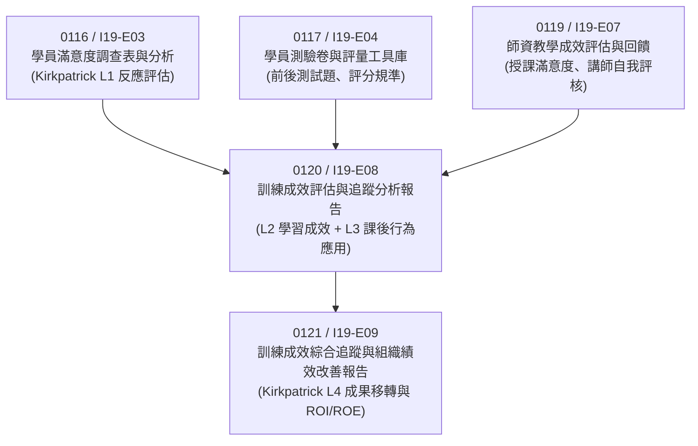
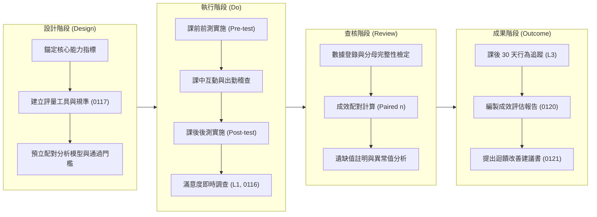
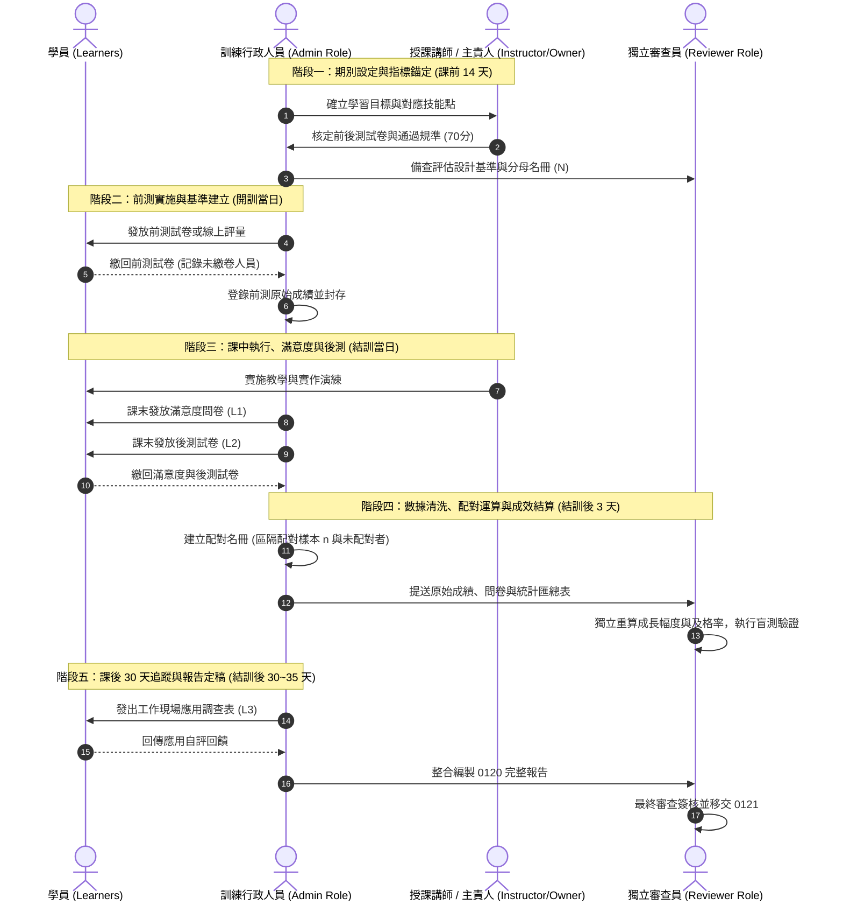
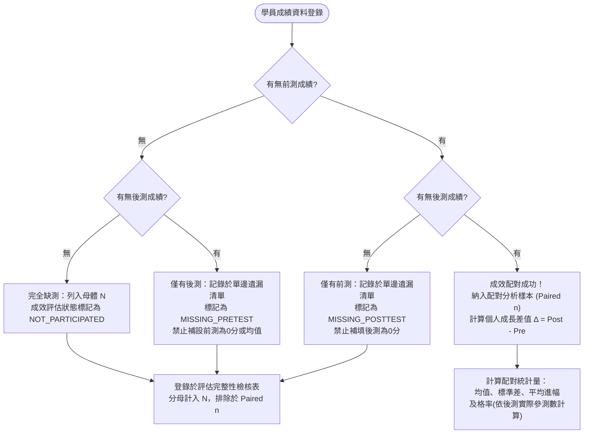

# 訓練成效評估與追蹤分析報告（作業指引與空白作業表單）

## 【文件部次標記：第 1 部（共 4 部） / Part 1 of 4】
**本文件涵蓋範圍**：扉頁使用指引與示範邊界聲明、文件基本身分與管控狀態、全流程標準作業程序（SOP）、空白 REAL 課程與期別身分表單、學習目標錨定表單、評量機制設計規範表單、期別學員出缺席與評估完整性檢核表單，以及資料驗證簽核表單。

---

# 第一章 扉頁規範與示範資料邊界宣告

## 1.1 示範資料邊界與品質保證警語（SAMPLE / SYNTHETIC Boundary Warning）

> [!CAUTION]
> **重要警語與資料邊界聲明（SAMPLE / SYNTHETIC BOUNDARY WARNING）**
> 1. **示範性質與候選狀態**：本文件所載之評估案例編號 `SYN-0120-2026-A01` 及其關聯數值、學員代碼、測驗分數、滿意度量值與追蹤調查紀錄，均屬**示範合成資料（SYNTHETIC DATA / SAMPLE ONLY）**。本文件於系統與稽核治理體系中之狀態確立為：
>    - **文件驗收狀態**：`CANDIDATE_SAMPLE_ONLY`
>    - **正式核准資格**：`formal acceptance NOT_GRANTED`
> 2. **嚴禁混淆與冒用**：本示範內容僅供受訓單位、訓練規劃人員、評估分析人員與品質稽核員作為「TTQS 訓練品質評核系統（Taiwan TrainQualiSytem）」產出物之**格式參照、邏輯驗證、欄位結構定義與運算勾稽示範**。未經實質辦訓與原始佐證資料之審查確認前，嚴禁將本示範資料或其部分內容抽換、冒充為受評機構之真實辦訓紀錄。
> 3. **真實資料（REAL）之填載規範**：凡屬「真實訓練業務（REAL）」之實作欄位，均必須留空或標記為 `UNKNOWN`、`PENDING_REAL_SOURCE`。嚴禁在未取得法定真實佐證前，虛構任何真實機關名稱、統一編號、學員個人身分識別資料、講師姓名或未經核定之成效數據。
> 4. **稽核責任溯源**：正式外部評核或內部品質稽核時，稽核員應查核「置換紀錄清冊（Replacement Register）」中登錄之每筆欄位，確認所有 `SYNTHETIC` 標記均已轉換為具備實體原始憑證（簽到表、實體測驗卷、線上系統原始 Log、滿意度原始問卷）支撐之真實紀錄，且經權責主管簽章核可。

---

## 1.2 文件身分與治理管控元資料（Document Identity & Control Metadata）

本產出物係依據勞動部勞動力發展署「TTQS 訓練品質評核系統」之規範標準，對接體系架構與評核要求所編製。其核心管控元資料登錄如下：

| 欄位名稱 | 管控內容 / 系統登錄值 | 規範與稽核說明 |
| :--- | :--- | :--- |
| **文件識別代碼 (doc_id)** | `0120` | 唯一產出物代碼，於 TTQS_ONE 產出物清單中對應成效評估與追蹤專卷。 |
| **對應指標要求代碼 (requirement_id)** | `I19-E08` | 對應 129 項指標要求至 142 項產出物交叉對照表（Crosswalk）項次。 |
| **官方檢核表序號 (official_checkbox_serial)**| `UNKNOWN_NOT_ASSERTED` | 依循官方檢核要求，本產出物編號與指標之對應關係未在官方勾選表建立單一序號，特此聲明不予以虛構斷言。 |
| **產出物標準名稱** | 訓練成效評估與追蹤分析報告 | 涵蓋學習成果評量（Level 2）與課後行為/工作應用追蹤（Level 3）。 |
| **產出物類型 (Genre)** | 成果評估報告 / 成效追蹤與統計分析卷 | 包含質性說明、量化數據統計、交叉分析及盲測驗證結構。 |
| **受評單位 / 辦訓機構** | `[REAL 來源：UNKNOWN]` | 實體導入時填寫受評組織立案名稱全銜。 |
| **適用體系與版本** | TTQS 企業機構版 / 訓練機構版 (R04) | 參照 R04 官方指標規範與說明。 |
| **文件管理版次** | R01（初版草案 / 示範範本） | 本次發行版次。 |
| **本案示範資料代碼** | `SYN-0120-2026-A01` | 合成案例群組代碼。 |
| **審查與核定狀態** | 審查中（待補實體佐證來源） | 尚未完成真實辦訓資料對應驗證。 |
| **機密等級** | 內部作業指引（限相關業管人員參閱） | 涉及受訓人員評估個資與組織評估數據，應落實資安與隱私管控。 |

---

## 1.3 產出物關聯界接與前後呼應說明（Deliverable Cross-Reference Mapping）

本產出物（`0120 / I19-E08`）在 TTQS 評核體系之「成果評估（Results, E-階段）」扮演承先啟後之關鍵整合角色。其與周邊產出物之邏輯與資料串接關係如下表所示：



### 1.3.1 與前端產出物之界接機制
1. **銜接 `0116 / I19-E03`（學員滿意度與反應評估）**：
   - 本報告直接收斂並整合 `0116` 之課後滿意度總評數據（五分量表）。
   - 在本案合成示範資料中，滿意度總評題發放 8 份、回收 7 份有效問卷，整體滿意度總分為 30 分，平均達 $4.29$ 分，問卷填答率為 $87.5\%$。
   - 稽核注意點：實體作業中，本報告之滿意度數值必須與 `0116` 原始問卷統計表完全一致，不得發生數字抄錄不符或遺漏統計母數之瑕疵。
2. **銜接 `0117 / I19-E04`（學習成果評量工具與規準設計）**：
   - 測驗題型、評分標準（Rubrics）、前後測難易度對等性及及格門檻（本示範設定為 70 分），均直接承襲 `0117` 所核定之規準。
   - 本報告專注於評量結果之「數據登錄」、「配對檢定分析（Paired Analysis）」及「能力增長幅度計算」，不自行創設未經核准之測驗標準。
3. **銜接 `0119 / I19-E07`（師資教學表現與教學品質回饋）**：
   - 講師教學成效評估側重於「教」的構面（如教材編撰、授課技巧、進度掌控）；本報告則聚焦於學員「學」的構面（認知吸收、技能養成、工作現場轉移）。
   - 兩者交叉比對，若出現學員滿意度極高但後測成效或行為追蹤不理想之情況，本報告需提出教學活動與評量工具一致性（Constructive Alignment）之反思與改善對策。

### 1.3.2 與後端產出物之開展機制
- **延伸至 `0121 / I19-E09`（訓練成效追蹤與組織績效連結）**：
  - 本報告所完成之「課後 30 天行為移轉與職務技能應用調查（Level 3）」為 `0121` 評估業務成效（Level 4）與持續改善（PDCA 之 Act 階段）之基礎輸入。
  - 本示範案例追蹤 8 位受訓學員，回收 6 份回饋，其中 4 位自評已於實際工作應用所學（應用率 $66.7\%$，佔全期學員 $50.0\%$），此項行為數據將作為 `0121` 計算關鍵行為指標（KBI）與關鍵績效指標（KPI）關聯度之第一手依據。

---

# 第二章 文件使用指南與標準實施程序（SOP）

## 2.1 適用範圍與實施對象

本指引與分析報告架構適用於受評機構舉辦之各類實體、混成或線上訓練專案。凡屬符合下列條件之訓練班次，均應依本規範建立完整之評估與追蹤紀錄：
1. **核心關鍵職能訓練**：涉及組織核心能力建構、技術移轉或合規認證之關鍵班次。
2. **跨部門或跨期別系列課程**：需要進行長期成效比對、效益評估與課程持續優化之專案。
3. **外部評核抽驗指標班次**：列入 TTQS 實地評核之重點代表性班次。

本作業指引明確區隔兩大實施群體：
- **示範模擬作業（SAMPLE Mode）**：供規劃人員與系統開發者於建立新評估系統、驗證試算邏輯時使用，採用前綴為 `SYN-` 之合成資料，進行全流程試跑。
- **真實辦訓作業（REAL Mode）**：正式辦訓時，由各指派角色（訓練行政人員、課程主責人員、獨立評核審查員）依真實辦訓紀錄逐項登錄、抽查並簽核，嚴格確保資料真實性（Authenticity）與可追溯性（Traceability）。

---

## 2.2 訓練成效評估生命週期架構（Kirkpatrick 模型之 TTQS 映射）

本標準作業流程將 Kirkpatrick 四層次評估模型深度融入 TTQS 之「設計（Design）」、「執行（Do）」、「查核（Review）」與「成果（Outcome）」階段，建構完整之評估閉環架構：



---

## 2.3 五階段標準作業程序（Standard Operating Procedures）



### 2.3.1 階段一：期別設定與評估機制錨定（課前 14 天至開訓前）
1. **建立期別身分**：指派真實訓練期別識別碼，確立課程類別、開結訓日期、預計參訓人數及最低出席標準（如：出勤率須達 $80\%$ 以上）。
2. **學習目標與評量對齊**：由課程主責人員依據「職能基準」或「任務分析清單」，擬定具體可評量的學習目標（K-知識、S-技能、A-態度），並將目標細化為明確之行為表現規準。
3. **評量工具檢核**：確認前後測試卷之題型、計分比重、及格通過分數（Threshold，本示範案為 70 分），並驗證前測與後測之效度與難易度均等性。
4. **預立分母與母體定義**：登錄報名且繳費或經遴選核定之正式參訓學員名冊，定義出勤母體總人數 $N$。

### 2.3.2 階段二：前測實施與基準收斂（開訓當日）
1. **實施施測說明**：向全體學員說明評估目的在於量測能力進幅與教學改善，而非進行惩戒性淘汰，降低學員評量焦慮。
2. **前測施測與監考**：於進入實質課程教學前（或於開訓儀式後立即執行），進行閉卷或線上獨立測驗，施測時間嚴格受控。
3. **前測紀錄封存**：即時收卷並登錄成績，若有學員因請假、遲到未參測，應註記為「缺前測」，不得於課後補測前測（以防學習效應干擾初始基線）。

### 2.3.3 階段三：課中互動、課後後測與滿意度施測（結訓當日）
1. **出缺席全程控管**：確實執行簽到退紀錄，並於結訓時計算各學員之最終出勤時數比例，查核是否符合結訓資格。
2. **滿意度調查（Kirkpatrick Level 1）**：課程結束前 15 分鐘，發放標準五分量表滿意度調查問卷，以不記名或獨立編碼方式蒐集學員對課程內容、講師教學、行政支援之主觀反饋。
3. **後測施測（Kirkpatrick Level 2）**：於課程內容全數講授完畢後立即實施，測試時間與環境條件應與前測保持一致。
4. **原始資料保全**：實體卷宗掃描歸檔，線上系統下載原始含時間戳記（Timestamp）之 Log，由行政主責人員妥善保管。

### 2.3.4 階段四：數據清洗、成效配對運算與盲測複核（結訓後 3 個工作天內）
1. **樣本分類與資料清洗**：
   - 總參訓學員數（Enrolled Cohort, $N$）：以註冊在冊且具參訓資格為準。
   - 具備完整前後測配對樣本數（Paired Samples, $n$）：僅限於「既有前測成績、亦有後測成績」之受測者。
   - 單邊遺漏值（One-sided Missing）：針對僅有前測無後測、或僅有後測無前測者，登錄遺失原因（請假、提早離席、中途退訓等），**嚴禁將其補填為 0 分納入平均運算**，以免人為扭曲增長幅度。
2. **統計指標標準運算公式**：
   - **結訓完成率（Completion Rate）**：
     $$\text{結訓率} = \frac{\text{符合出勤且完成規定評估之學員數}}{N} \times 100\%$$
   - **有效評量收斂率（Assessment Completion Rate）**：
     $$\text{成效完整率} = \frac{\text{完成前測且完成後測之學員數 (Paired } n)}{N} \times 100\%$$
   - **前測平均成績（Pre-test Mean）**：
     $$\overline{X}_{\text{pre}} = \frac{\sum_{i=1}^{n} X_{\text{pre}, i}}{n}$$
   - **後測平均成績（Post-test Mean）**：
     $$\overline{X}_{\text{post}} = \frac{\sum_{i=1}^{n} X_{\text{post}, i}}{n}$$
   - **個體能力平均成長幅度（Average Individual Gain）**：
     $$\overline{\Delta} = \frac{\sum_{i=1}^{n} (X_{\text{post}, i} - X_{\text{pre}, i})}{n} = \overline{X}_{\text{post}} - \overline{X}_{\text{pre}}$$
   - **測驗及格率（Passing Rate）**：
     $$\text{及格率} = \frac{\text{後測成績} \ge \text{門檻分數之學員數}}{\text{參加後測之學員總數}} \times 100\%$$
3. **獨立審查員盲測驗證**：指派獨立於開班行政外之審查人員，依據盲測原則，自原始評量檔案隨機抽查，重新執行計算，確認無計算或轉錄錯誤。

### 2.3.5 階段五：課後 30 天行為轉移追蹤與專卷定稿（結訓後 30 至 35 天）
1. **發放行為追蹤調查（Kirkpatrick Level 3）**：於結訓後滿 30 天當週，發送「學員工作現場技能應用自評與主管回饋表」。
2. **多元指標回收統計**：
   - **追蹤問卷回收率**：$\frac{\text{有效回覆人數}}{N} \times 100\%$
   - **實質應用率（基於回收樣本）**：$\frac{\text{回覆已應用所學之學員數}}{\text{有效回覆人數}} \times 100\%$
   - **全體學員實質應用普及率（基於全體名冊）**：$\frac{\text{回覆已應用所學之學員數}}{N} \times 100\%$
3. **質性回饋歸納與研究限制載明**：彙整學員於實務工作應用時遭遇之主要障礙（環境支援、工具缺乏、業務優先順序變動），誠實揭露評估限制（如：樣本規模、自評偏差），不得做過度因果推論。
4. **全卷核簽與歸檔**：完成本分析報告之編撰，由權責主管簽核後，正式發行並移交 `0121` 報告使用。

---

## 2.4 資料遺缺處理準則與數學統計約束（Statistical Rigor & Missing Data Rules）

為杜絕評核實務中常見之「美化數據」、「隨意刪除低分樣本」或「將缺考者填 0 分拉低基準藉以誇大增長」等道德風險，本程序訂定嚴格之統計約束準則：



1. **嚴禁以 0 分替代缺考值**：若受訓學員因公、病假缺席後測，該筆後測資料應登錄為 `MISSING`（或空白），其成效增長值 $\Delta$ 標記為 `NOT_CALCULABLE`。若將其填為 0 分，將導致個人成長值出現巨幅負值（如：$0 - 50 = -50$），嚴重扭曲教學成效之真確性。
2. **分母嚴格透明揭示**：所有百分比數據必須在分子與分母同時清楚標示其定義群體。例如：
   - 滿意度填答率：$7 / 8 = 87.5\%$（分子：實質填答問卷數 7；分母：在冊總人數 8）。
   - 學習配對率：$6 / 8 = 75.0\%$（分子：具備成對成績人數 6；分母：在冊總人數 8）。
   - 測驗及格率：依「實際完成後測人數」為分母（如：$4 / 7 = 57.1\%$），不得以未參測者逕行視為不及格而稀釋及格率，若採全體分母則須並列呈現（如：全體及格覆蓋率 $4 / 8 = 50.0\%$）。
3. **小樣本（$N < 30$）之推論邊界**：當訓練期別受訓人數較少時（例如本示範案例 $N = 8, n = 6$），統計檢定之統計考驗力（Statistical Power）有限，本報告明確定位為「描述性成效分析（Descriptive Analysis）」，嚴禁使用過度膨脹之因果結論，且應在報告中載明信賴區間受限之研究限制。

---

## 2.5 個資保護與去識別化規範（Privacy & De-identification Protocol）

在實體運作（REAL）中，評量成績與身心適應、滿意度意見屬於學員重要個人隱私。辦訓單位與審查人員應落實下列去識別化作業：
1. **內部匿名代碼對照表**：建立獨立之「真實姓名－代碼對照表」（如：`REAL-L01` 對應王大明），該對照表必須加密儲存於獨立伺服器目錄或受密碼保護之硬碟，僅限訓練主責主管與個資保護員有權調閱。
2. **報告公開與送審去識別**：呈報予評核委員之報告專卷，僅能列出學員匿名代碼（如：`L01`、`L02`）及其所屬職務、年資級距與評估數據，嚴禁直接揭露受訓人員之身分證字號、姓名或私人聯絡電話。
3. **質性意見之保密性**：若滿意度或訪談意見具有高度個人特徵（如指涉特定專案或抱怨特定主管），整理時應進行文字平滑化處理，避免學員遭受不利處遇。

---

# 第三章 空白 REAL 作業表單套組

> [!NOTE]
> **表單使用說明**：
> 本章所提供之 5 份作業表單為正式辦訓（REAL）時使用之標準規範範本。受評單位在將本文件導入真實班次前，應由指定權責人員依序填載。凡屬未定、尚未產出或待核實之欄位，一律填載 `UNKNOWN` 或維持留空。

---

## 3.1 表單 1：課程與訓練期別基本身分登錄表（REAL-FORM-01）

本表由「訓練行政主責人員」於開班前完成登錄，用以錨定本期訓練之組織治理與行政身分。

```markdown
### 【空白表單 REAL-FORM-01：課程與訓練期別基本身分登錄表】

| 欄位項次 | 登錄項目 | 實體辦訓紀錄登錄內容 (REAL 專用) | 查核與來源憑證要求 |
| :---: | :--- | :--- | :--- |
| **01** | **主辦單位全銜** | `[REAL 來源：UNKNOWN]` | 須與設立許可或商業登記名稱相符 |
| **02** | **承辦/執行單位** | `[REAL 來源：UNKNOWN]` | 實際執行訓練企劃之單位/部門 |
| **03** | **訓練方案名稱** | `[REAL 來源：UNKNOWN]` | 年度訓練計畫核定之方案名稱 |
| **04** | **課程標準名稱** | `[REAL 來源：UNKNOWN]` | 課程大綱登載之正式名稱 |
| **05** | **期別代碼 / 班別** | `[REAL 來源：UNKNOWN]` | 組織內部唯一期別識別碼 |
| **06** | **開班核准文號** | `[REAL 來源：UNKNOWN]` | 內部公文簽核文號或外部補助核定函號 |
| **07** | **開課日期** | `[REAL 年-月-日：UNKNOWN]` | 首次實體/線上授課起始日期 |
| **08** | **結訓日期** | `[REAL 年-月-日：UNKNOWN]` | 實體/線上課程最後授課完成日期 |
| **09** | **總訓練時數** | 共計 `[UNKNOWN]` 小時 | 課表核定之純授課時數（不含休息） |
| **10** | **授課地點 / 形式** | `[REAL：實體教室 / 混成遠距 / 線上同步]` | 載明上課教室或線上會議平臺 |
| **11** | **核定招收人數** | `[UNKNOWN]` 名 | 訓練企劃書原定參訓名額上限 |
| **12** | **實際報名人數** | `[UNKNOWN]` 名 | 填寫完成報名手續之學員總數 |
| **13** | **在冊受訓學員數 (N)**| `[UNKNOWN]` 名 | 開訓時完成報到並列入學籍之總數 |
| **14** | **合格出勤門檻** | 出席率須達 `[UNKNOWN]` % 以上 | 規範之最低結訓出席標準（通常為 80%） |
| **15** | **成效評估負責人** | 職稱：`[UNKNOWN]` / 姓名：`[UNKNOWN]` | 負責本期數據蒐集與報告編撰者 |
| **16** | **行政主管覆核人** | 職稱：`[UNKNOWN]` / 姓名：`[UNKNOWN]` | 負責初審出勤與行政數據之主管 |
```

---

## 3.2 表單 2：學習目標與能力行為指標錨定表（REAL-FORM-02）

本表由「課程主責人員」會同「授課師資」於開訓前完成填載，明確定義學習目標分類、評量規準與目標達成標準。

```markdown
### 【空白表單 REAL-FORM-02：學習目標與能力行為指標錨定表】

- **期別代碼 (Cohort ID)**：`[REAL 來源：UNKNOWN]`
- **課程主責主管 (Owner Role)**：`[REAL 來源：UNKNOWN]`
- **制定日期**：`[REAL 年-月-日：UNKNOWN]`

| 目標編號 | 學習目標描述 (Learning Objective) | 核心職能/能力構面 (K / S / A) | 對應具體工作行為指標 (Observable Behaviors) | 預定成效評量工具 | 目標合格基準 (Benchmark) |
| :---: | :--- | :---: | :--- | :--- | :--- |
| **OBJ-01** | `[REAL 目標一：UNKNOWN]` | 知識 (K) / 技能 (S) / 態度 (A) | `[REAL 行為描述：UNKNOWN]` | 筆試問答 / 選擇測驗 / 實作展示 | 分數 $\ge$ `[UNKNOWN]` 分 |
| **OBJ-02** | `[REAL 目標二：UNKNOWN]` | 知識 (K) / 技能 (S) / 態度 (A) | `[REAL 行為描述：UNKNOWN]` | 筆試問答 / 選擇測驗 / 實作展示 | 分數 $\ge$ `[UNKNOWN]` 分 |
| **OBJ-03** | `[REAL 目標三：UNKNOWN]` | 知識 (K) / 技能 (S) / 態度 (A) | `[REAL 行為描述：UNKNOWN]` | 實作演練 / 檢核表評定 / 案例演練 | 評等達 `[UNKNOWN]` 級 |
| **OBJ-04** | `[REAL 目標四：UNKNOWN]` | 知識 (K) / 技能 (S) / 態度 (A) | `[REAL 行為描述：UNKNOWN]` | 課後 30 天行為應用檢核表 | 滿意或落實度 $\ge$ `[UNKNOWN]` |

#### 學習目標與組織業務需求對齊性聲明
> **說明**：請具體陳述上述學習目標如何支援組織之策略方針、業務改善需求或關鍵績效指標（KPI）。
> 
> `[REAL 組織策略對齊說明：UNKNOWN_NOT_ASSERTED - 待真實專案規劃人員填寫]`
```

---

## 3.3 表單 3：評量機制與成效考核設計基準表（REAL-FORM-03）

本表由「評估工具主責人」填寫，明定評量題庫來源、評分 Rubrics、配對比較計算邏輯與遺缺值防弊處置措施。

```markdown
### 【空白表單 REAL-FORM-03：評量機制與成效考核設計基準表】

| 評量機制檢核項目 | 設計標準規範與約束原則 | 實體專案設定內容 (REAL 專用) | 審核查驗狀態 |
| :--- | :--- | :--- | :---: |
| **評估工具核准文號** | 須對應 `0117 / I19-E04` 題庫與量表 | 核定編號：`[REAL 來源：UNKNOWN]` | 待核驗 |
| **施測方式與環境** | 前後測需維持題型等價、時間等長 | 前測時間：`[UNKNOWN]` 分鐘<br/>後測時間：`[UNKNOWN]` 分鐘 | 待核驗 |
| **總分與及格門檻** | 滿分為 100 分，明確訂定通過門檻 | 滿分：100 分<br/>及格門檻值：`[UNKNOWN]` 分 | 待核驗 |
| **配對分析設計** | 僅針對同時具前後測者計算增長值 | 配對規則：`Paired n` 獨立欄位運算 | 待核驗 |
| **遺缺值處置準則** | 單邊缺考者嚴禁補填 0 分，排除於配對差值計算 | 缺測處理代碼：`MISSING_EXCLUDED` | 待核驗 |
| **滿意度量表維度** | 採用標準李克特（Likert）五分量表 | 1=非常不滿意 ~ 5=非常滿意<br/>目標均值：$\ge$ `[UNKNOWN]` 分 | 待核驗 |
| **行為追蹤天數** | 結訓後固定天數發放，建立應用檢核 | 追蹤時程：結訓後 `[30]` 天<br/>發放形式：`[線上表單 / 書面調查]` | 待核驗 |

#### 評分規準（Rubrics）簡述與通過標準
1. **認知認知測驗（Knowledge Test）**：包含觀念選擇題（`[UNKNOWN]` %）與情境問答題（`[UNKNOWN]` %），評分依據標準解答執行。
2. **實作表現評量（Performance Rubric）**：
   - 優等（90~100 分）：能獨立並熟練完成標準作業程序，無任何合規瑕疵。
   - 合格（`[門檻]`~89 分）：能遵循作業步驟，雖有微小瑕疵但能在提示下即刻修正。
   - 待加強（未達 `[門檻]` 分）：關鍵程序步驟錯誤，可能導致重大品質風險，判定不合格。
```

---

## 3.4 表單 4：期別學員出缺席與評估完整性檢核表（REAL-FORM-04）

本表用以落實「分母嚴格管理」，登錄全體在冊學員（$N$）之出勤時數、前後測收繳狀態、滿意度填寫狀態及 30 天追蹤回收狀態，作為運算前之基礎清冊。

```markdown
### 【空白表單 REAL-FORM-04：期別學員出缺席與評估完整性檢核表】

- **期別代碼**：`[REAL 來源：UNKNOWN]`
- **母體總人數 (Enrolled N)**：`[UNKNOWN]` 人
- **行政登錄人**：`[REAL 來源：UNKNOWN]`

| 匿名編號 (ID) | 參訓學員身分代碼 (內部系統碼) | 應到時數 (hr) | 實到時數 (hr) | 出勤率 (%) | 出勤達標 (是/否) | 前測繳交 (是/否) | 後測繳交 (是/否) | 配對有效性 (PAIRED / INCOMPLETE) | 滿意度填寫 (是/否) | 30天追蹤回覆 (是/否) | 備註 (遺缺原因說明) |
| :---: | :---: | :---: | :---: | :---: | :---: | :---: | :---: | :---: | :---: | :---: | :--- |
| **REAL-L01** | `[UNKNOWN]` | `[ ]` | `[ ]` | `[ ] %` | `[ ]` | `[ ]` | `[ ]` | `[ ]` | `[ ]` | `[ ]` | `[REAL 記錄：UNKNOWN]` |
| **REAL-L02** | `[UNKNOWN]` | `[ ]` | `[ ]` | `[ ] %` | `[ ]` | `[ ]` | `[ ]` | `[ ]` | `[ ]` | `[ ]` | `[REAL 記錄：UNKNOWN]` |
| **REAL-L03** | `[UNKNOWN]` | `[ ]` | `[ ]` | `[ ] %` | `[ ]` | `[ ]` | `[ ]` | `[ ]` | `[ ]` | `[ ]` | `[REAL 記錄：UNKNOWN]` |
| **REAL-L04** | `[UNKNOWN]` | `[ ]` | `[ ]` | `[ ] %` | `[ ]` | `[ ]` | `[ ]` | `[ ]` | `[ ]` | `[ ]` | `[REAL 記錄：UNKNOWN]` |
| **REAL-L05** | `[UNKNOWN]` | `[ ]` | `[ ]` | `[ ] %` | `[ ]` | `[ ]` | `[ ]` | `[ ]` | `[ ]` | `[ ]` | `[REAL 記錄：UNKNOWN]` |
| **REAL-L06** | `[UNKNOWN]` | `[ ]` | `[ ]` | `[ ] %` | `[ ]` | `[ ]` | `[ ]` | `[ ]` | `[ ]` | `[ ]` | `[REAL 記錄：UNKNOWN]` |
| **REAL-L07** | `[UNKNOWN]` | `[ ]` | `[ ]` | `[ ] %` | `[ ]` | `[ ]` | `[ ]` | `[ ]` | `[ ]` | `[ ]` | `[REAL 記錄：UNKNOWN]` |
| **REAL-L08** | `[UNKNOWN]` | `[ ]` | `[ ]` | `[ ] %` | `[ ]` | `[ ]` | `[ ]` | `[ ]` | `[ ]` | `[ ]` | `[REAL 記錄：UNKNOWN]` |
| *(視需要增列)* | `...` | `...` | `...` | `...` | `...` | `...` | `...` | `...` | `...` | `...` | `...` |

#### 本期出勤與評估完整度統計摘要
1. **符合出勤標準人數**：`[UNKNOWN]` 人（出勤合格率：`[UNKNOWN]` %）
2. **前後測配對成功人數 (Paired n)**：`[UNKNOWN]` 人（評估配對率：`[UNKNOWN]` %）
3. **單邊缺前測人數**：`[UNKNOWN]` 人；**單邊缺後測人數**：`[UNKNOWN]` 人
4. **滿意度問卷回收份數**：`[UNKNOWN]` 份（回收率：`[UNKNOWN]` %）
5. **30天追蹤問卷回收份數**：`[UNKNOWN]` 份（回收率：`[UNKNOWN]` %）
```

---

## 3.5 表單 5：資料驗證與授權審查簽核表（REAL-FORM-05）

本表為 TTQS 外部評核時驗證「資料治理真實性與審查獨立性」之核心憑證。所有角色均應依權責獨立簽署。

```markdown
### 【空白表單 REAL-FORM-05：資料驗證與授權審查簽核表】

- **期別專案名稱**：`[REAL 來源：UNKNOWN]`
- **專案識別代碼**：`[REAL 來源：UNKNOWN]`

| 審查關卡 | 審查負責角色 (Role) | 查核要點與責任陳述 | 簽署人姓名與專業職稱 | 審查日期 (年/月/日) | 查核意見與簽章 |
| :---: | :--- | :--- | :--- | :---: | :---: |
| **第一關<br/>行政真實性** | **訓練行政承辦人**<br/>(Training Admin Role) | 確認在冊學員名冊（$N$）、出缺勤刷卡紀錄、原始簽到退表單及問卷份數完全相符，無偽造變造情事。 | 姓名：`[UNKNOWN]`<br/>職稱：`[UNKNOWN]` | `[REAL：UNKNOWN]` | `[待簽章]` |
| **第二關<br/>專業規準性** | **課程與評估主責人**<br/>(Course Owner Role) | 確認學習目標（OBJ）、前後測試題難度等價性、及格分數線及評分規準符合原核定企劃書規範。 | 姓名：`[UNKNOWN]`<br/>職稱：`[UNKNOWN]` | `[REAL：UNKNOWN]` | `[待簽章]` |
| **第三關<br/>統計獨立性** | **獨立數據審查員**<br/>(Independent Reviewer) | 獨立重新抽查計算配對樣本（$n$）、平均增長值、及格率與遺失值標記，確認統計運算零瑕疵。 | 姓名：`[UNKNOWN]`<br/>職稱：`[UNKNOWN]` | `[REAL：UNKNOWN]` | `[待簽章]` |
| **第四關<br/>管理核定** | **辦訓機構最高主管**<br/>(Authorized Director) | 核定本期訓練成效評估報告正式發行，同意移交後續持續改善（PDCA）及組織績效分析專卷使用。 | 姓名：`[UNKNOWN]`<br/>職稱：`[UNKNOWN]` | `[REAL：UNKNOWN]` | `[待簽章]` |

#### 稽核合規聲明書（Audit Compliance Statement）
> 本期訓練成效評估作業係嚴格恪遵勞動部勞動力發展署 TTQS 評核規範執行。所有數據均有實體或電子原始憑證可供備查。
> 
> **機構品質授權印信 / 主管簽章欄**：`[REAL 蓋印處：UNKNOWN_NOT_ASSERTED]`
```

---

## 3.6 階段小結與後續部次指引（Transition to Part 2）

本文件（第 1 部 / Part 1 of 4）已完整建立訓練成效評估體系之**扉頁法定警語、身分元資料架構、關聯產出物界接矩陣、五階段標準實施程序（SOP）、統計處理約束**，以及**全套 5 份可直接於實體辦訓中套用之空白 REAL 作業表單**。

接續之**第 2 部（Part 2 of 4）**將正式導入示範案例群組 `SYN-0120-2026-A01`，展示完整的合成資料集結構（Synthetic Dataset，包含 8 位學員前後測、滿意度與 30 天行為追蹤數據之明細登錄）、置換清冊機制（Replacement Register，包含 R-01 至 R-15 逐項稽核要求）、盲測覆核計算步驟，以及二級成效（Kirkpatrick Level 2）之配對統計運算分析。
