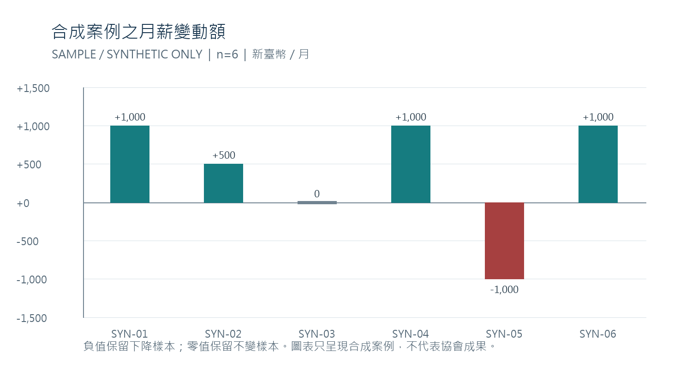

# 訓後薪資變化調查與分析表

> SAMPLE / SYNTHETIC ONLY　　本文件的日期、母數、薪資、分類、計算與建議均為完整合成示例，不代表屏東縣原始點關懷協會已執行調查、已核准或取得任何真實成效。

| 文件識別 | 內容 |
|---|---|
| 文件編號 | 0126 |
| 官方要求代碼 | I19-E14（不是官方印刷方框流水號） |
| 官方佐證資料表定位 | 第 8 頁 |
| 調查示範期間 | 2026-01-15 完訓；2026-04-15 追蹤，間隔 90 日（合成日期） |
| 資料狀態 | REAL 薪資資料未提供；正式接受未授予 |

本報告示範如何在取得明確同意及可核驗資料後，按同一學員的訓前基準月薪與訓後追蹤月薪進行配對、檢查可比性、重算變化並限制結論。六筆有效配對全部是合成值。

閱讀順序：先看決策摘要及母數流向，再看逐筆薪資與公式，最後使用分開標示的 REAL 調查工具及替換清冊。

---

## 一　調查摘要與適用範圍

官方要求原文為：「進行訓後薪資調查，部份訓後學員微幅調薪。」本件的用途，是建立可執行的調查方法與可重算的分析示例，並清楚指出現有資料能支持到哪裡。

| 摘要項目 | 合成示例結果 | 解讀界線 |
|---|---|---|
| 完訓母數 | 12 人 | 只供展示流程；不是協會班級或學員數。 |
| 有效且同意的配對 | 6 人 | 只有此分母進入薪資變化方向統計。 |
| 薪資上升／不變／下降 | 4／1／1 人 | 分別為 4/6、1/6、1/6；小樣本描述。 |
| 配對月薪總額 | 基準 211,000 元；追蹤 213,500 元 | 同幣別、同月薪與相同全職當量的合成條件。 |
| 加權總額變化率 | 2,500 ÷ 211,000 = 1.1848% | 不是個人變化率的平均，也不代表訓練造成調薪。 |
| 描述性微幅上升區間 | 0% < 個人變化率 ≤ 5%；4/6 = 66.7% | 僅是本示例分組，不是官方門檻或評分標準。 |

> 目前沒有可驗證的協會薪資原件、學員同意紀錄或正式核准。本示例只能說明方法；不得寫成協會已有四位學員加薪。

### 本報告回答的問題

- 誰進入薪資比較：完訓母數中，具有效同意、基準與追蹤資料可配對且口徑一致的人。

- 如何避免錯誤分母：未回覆、拒絕、未授權、缺值及未驗證均分別列出，不補成零變動。

- 結果能支持什麼：僅描述合成樣本在兩個月份的薪資差異；不能推論全體學員或訓練因果。

- 升級 REAL 需要什麼：合法同意、真實且可核對的薪資與訓練連結、比較口徑、計算記錄及權限覆核。

## 二　調查設計與資料規則

### 調查單位與追蹤時點

分析單位是一位完成同一訓練的學員。示範案例以 2026-01-15 為合成完訓日，2026-04-15 作為第 90 日追蹤日。基準月薪記錄於 2026-01，追蹤月薪記錄於 2026-04。這些日期只用來演示期間對齊，不是實際辦訓或調查紀錄。

### 納入有效配對的條件

- 已有明確、可留存的薪資資料使用同意；不同意或未回覆同意，不收集薪資數值。

- 同一匿名配對 ID 可連結訓練完成資料、基準月薪與追蹤月薪，且連結權限合法。

- 兩期使用同一幣別、月薪週期、工時或全職當量口徑。若工時或職務型態不同，先取得可比換算依據；無法換算則排除。

- 基準月薪與追蹤月薪皆為正數且可核驗。基準為零、缺漏、幣別不同或薪資期間不明時，變化率列 N/A，不硬算。

- 同一人只計一筆；重複或無法去重的紀錄先 HOLD，完成核對後才決定是否納入。

### 資料取得與最小化

優先以受訪者授權的薪資證明或依法可查證資料核對金額與月份。只保存分析所需欄位；姓名與配對碼對照表分開保存、限制存取。薪資證明不放進公開 GitHub。協會正式保存期限及聯絡窗口未提供，因此本候選不宣稱任何既定保存期限；實際使用前須依正式個資政策核定。

### 資料品質狀態

| 狀態 | 使用規則 | 後續處理 |
|---|---|---|
| 納入 | 同意、前後配對、口徑一致且已驗證。 | 進入有效配對分母與公式。 |
| HOLD | 有回覆但證明不足、期間不明或配對待核。 | 補件或覆核前，不進任何結果分子或分母。 |
| 排除 | 不同意、未回覆、無薪資機會、缺基準或無法比較。 | 保留流程原因；不以零變動代替。 |
| 拒收 | 把合成資料當真實、偽造原件、混淆分母或算式無法重現。 | 拒收該版本並記錄具體缺陷。 |

## 三　完訓母數流向與資料品質

合成完訓母數為 12 人，分流後只有 6 筆符合納入條件。下表的每一類互斥，合計必須回到 12；未回覆和未授權者不是薪資零變動，也不屬於有效配對分母。

| 流向類別 | 人數 | 分母處理 | 合成識別及原因 |
|---|---|---|---|
| 有效且同意的薪資配對 | 6 | 納入 | SYN-0126-01 至 SYN-0126-06；六筆有基準與追蹤月薪；本例均採相同幣別、月薪及全職當量口徑。 |
| 追蹤時沒有可比薪資機會 | 1 | 排除 | SYN-0126-07；保留為無可比資料；不將薪資變化記為零。 |
| 未授權使用薪資資料 | 2 | 不收集／排除 | SYN-0126-08、SYN-0126-09；不留存薪資金額；只計流程狀態。 |
| 未回覆 | 1 | 排除 | SYN-0126-10；結果未知；不得推定沒有變動。 |
| 僅自陳、尚未驗證 | 1 | HOLD | SYN-0126-11；等待合法同意及可核對資料；未驗證前不納入。 |
| 缺少基準月薪 | 1 | 排除 | SYN-0126-12；無法形成前後配對；不以零補值。 |
| 合計 | 12 | 母數檢查 | 6 + 1 + 2 + 1 + 1 + 1 = 12。 |

結果方向使用 n=6。4/6 的分母不是 12 人完訓母數；6/12 只是有效配對覆蓋率。兩個比率回答不同問題，不能混用。

## 四　指標定義與計算方法

| 指標 | 公式 | 示例計算 | 使用限制 |
|---|---|---|---|
| 個人薪資變化額 | 追蹤月薪 − 基準月薪 | SYN-0126-01：33,000 − 32,000 = +1,000 元 | 同一人、同幣別、同月薪口徑。 |
| 個人變化率 | 變化額 ÷ 基準月薪 × 100% | 1,000 ÷ 32,000 × 100% = 3.1250% | 基準月薪須大於零；否則 N/A。 |
| 薪資上升比例 | 上升人數 ÷ 有效配對人數 | 4 ÷ 6 = 66.7% | 不得用完訓母數或回覆人數替代。 |
| 不變比例 | 變化額為零的人數 ÷ 有效配對人數 | 1 ÷ 6 = 16.7% | 零變動必須有可比的有效配對。 |
| 下降比例 | 下降人數 ÷ 有效配對人數 | 1 ÷ 6 = 16.7% | 不得隱藏不利結果。 |
| 加權總額變化率 | (追蹤月薪總額 − 基準月薪總額) ÷ 基準月薪總額 | 2,500 ÷ 211,000 = 1.1848% | 這不是個人變化率的算術平均。 |

金額以新臺幣整數顯示；個人百分比至小數四位；人數比例至小數一位；加權總額變化率至小數四位。計算先保留原始精度，最後才四捨五入。

## 五　六筆合成薪資配對明細

下列六筆均為 SAMPLE / SYNTHETIC。示範設定為新臺幣月薪、相同薪資週期與相同全職當量；表內不存在真實姓名、薪資單或雇主證明。

| 合成 ID | 基準月薪 NTD／月 | 追蹤月薪 NTD／月 | 變化額 NTD／月 | 個人變化率 | 方向 |
|---|---|---|---|---|---|
| SYN-0126-01 | 32,000 | 33,000 | +1,000 | 3.1250% | 上升 |
| SYN-0126-02 | 28,000 | 28,500 | +500 | 1.7857% | 上升 |
| SYN-0126-03 | 40,000 | 40,000 | 0 | 0.0000% | 不變 |
| SYN-0126-04 | 36,000 | 37,000 | +1,000 | 2.7778% | 上升 |
| SYN-0126-05 | 30,000 | 29,000 | -1,000 | -3.3333% | 下降 |
| SYN-0126-06 | 45,000 | 46,000 | +1,000 | 2.2222% | 上升 |

> 表內月份與金額是合成值。若任一真實資料的幣別、月薪週期、工時或全職當量不同，先作有依據的可比換算；無法換算就標 N/A 並排除。

### 逐筆重算例

SYN-0126-05 的變化額為 29,000 − 30,000 = −1,000 元；個人變化率為 −1,000 ÷ 30,000 × 100% = −3.3333%。該下降列照實保留，不用其他平均值抵銷或隱去。

## 六　總額與結果方向核對

| 核對項目 | 可重算算式 | 結果 |
|---|---|---|
| 基準月薪總額 | 32,000 + 28,000 + 40,000 + 36,000 + 30,000 + 45,000 | 211,000 元 |
| 追蹤月薪總額 | 33,000 + 28,500 + 40,000 + 37,000 + 29,000 + 46,000 | 213,500 元 |
| 總額變化 | 213,500 − 211,000 | +2,500 元 |
| 加權總額變化率 | 2,500 ÷ 211,000 × 100% | 1.1848% |
| 上升／不變／下降 | 4／6；1／6；1／6 | 66.7%／16.7%／16.7% |
| 描述性微幅上升 | 0% < 個人變化率 ≤ 5%；4 ÷ 6 | 66.7% |

本表只列加權總額變化率，不把它稱為「平均個人調薪率」。若日後同時呈現個人率平均，須另列公式、樣本權重及名稱，避免讀者把兩種統計量混為一談。

## 七　合成分群與變動圖

為示範分群，本例以基準月薪 35,000 元分成兩組。這個切點只是合成分析設定，不是官方門檻。每組僅三人，結果只供檢查表格與圖表是否能保留不同方向。

| 基準薪資帶 | n | 方向分布 | 基準總額 | 追蹤總額 | 變化額 | 加權變化率 |
|---|---|---|---|---|---|---|
| 低於 35,000 元 | 3 | 2 上升、0 不變、1 下降 | 90,000 | 90,500 | +500 | 0.5556% |
| 35,000 元以上 | 3 | 2 上升、1 不變、0 下降 | 121,000 | 123,000 | +2,000 | 1.6529% |
| 合計 | 6 | 4 上升、1 不變、1 下降 | 211,000 | 213,500 | +2,500 | 1.1848% |

分群總額可重算：低於 35,000 元組的基準為 90,000 元、追蹤為 90,500 元；35,000 元以上組的基準為 121,000 元、追蹤為 123,000 元。組別差異可能同時受到職務、工時、產業及其他因素影響，不能由這個小樣本推定群體差異。

## 八　發現、證據強度與限制

### 合成案例的描述性發現

- 有效配對中四筆上升、一筆不變、一筆下降；上升比例為 4/6。

- 六筆月薪總額增加 2,500 元；按總額加權的變化率為 1.1848%。

- 按本報告自訂的描述性分組，四筆正變化均落在 0% 至 5% 以內；此區間不是官方績效門檻。

- 十二人母數中只有六筆有效配對；其餘六筆各有未授權、未回覆、未驗證、無薪資機會或缺基準等不同狀態。

### 這些數字不能支持的主張

合成資料不能證明協會曾進行薪資調查，也不能證明任何真實學員調薪。單組前後比較只能描述兩期差異，不能說訓練造成調薪；未觀察的職等、工時、通膨、雇主政策及產業變化都可能影響薪資。六筆配對也不足以外推到全體學員。

### 本文件的內部證據層級

| 層級 | 證據狀態 | 本件位置 | 可以說什麼 |
|---|---|---|---|
| 示範層 | SAMPLE / SYNTHETIC | 第 5–7 節與替換清冊 | 只說明欄位、計算及流程如何運作。 |
| 自陳層 | 尚未驗證 | 母數流向的 HOLD 示例 | 不納入變化率；補證前不作結果主張。 |
| 可核對層 | 須有合法同意與前後原件 | REAL 工具及升級清單 | 取得原件後才能核算真實配對。 |
| 覆核層 | 須有覆核記錄及來源鏈 | REAL 替換流程 | 可說明誰依何證據覆核；仍不等同正式核准。 |

以上層級是本報告用來管理證據強度的內部描述，不是 TTQS 官方分級或評分規則。

## 九　建議措施與追蹤安排

以下是供協會決策者確認的建議流程，不表示協會已經核准或指派任何人。使用前應由有權角色確認合法依據、資料保存期限及實際責任人。

| 措施 | 建議職務角色 | 操作內容 | 時點 | 完成檢查 |
|---|---|---|---|---|
| 確認調查授權 | 訓練行政角色＋個資管理角色 | 核准目的、同意文字、可取得欄位及存取人員。 | 發送前 | 保存核准依據；未核准不收薪資。 |
| 建立匿名配對 | 受限資料管理角色 | 另存姓名對照表；分析表只使用隨機配對碼。 | 建立名單時 | 對照表存取記錄；不得公開。 |
| 邀請與追蹤 | 訓練行政角色 | 逐一記錄邀請、同意、拒絕、未回覆及聯絡日期。 | 基準與第 90 日 | 母數流向總和一致。 |
| 驗證薪資可比性 | 資料覆核角色 | 檢查月份、幣別、薪資週期、工時與全職當量。 | 分析前 | 缺件標 HOLD／排除，不補零。 |
| 重算與覆核 | 分析角色＋第二覆核角色 | 保留公式、版本、例外與修正記錄。 | 初稿完成後 | 逐列及總額可重算。 |
| 核准對外表述 | 有權主管角色 | 確認樣本數、限制、個資及不作因果推論。 | 發布前 | 保留正式核准記錄；未核准不發布。 |

小樣本控制建議：有效配對數較少時只呈現描述性統計，說明未回覆與排除狀態，避免點名或外推。這是本報告提出的風險控制建議，不是官方最低樣本門檻。

## 十　REAL 資料收集工具

> REAL 作業工具　以下是經正式授權後可由協會填用的空白欄位，不是已發送問卷或已執行調查。使用前需填入正式資料管理聯絡窗口、保存期限及適用個資告知文字；在此之前不得收集真實薪資。

### 受訪者同意與配對

| 欄位 | 作答或記錄 | 規則 |
|---|---|---|
| 調查用途告知 | 說明用於訓後薪資追蹤；列出資料項目、存取角色、保存期限與聯絡窗口。 | 正式告知內容須先經協會有權角色確認。 |
| 自願同意 | □ 同意薪資資料用於本次分析　□ 不同意　□ 需先詢問 | 不同意或未作答，不收集薪資金額。 |
| 匿名配對碼 | 由受限資料管理角色產生：________________ | 不可直接用姓名或身分證號作分析 ID。 |
| 訓練完成日 | ____年__月__日；課程／班次代碼：____________ | 以正式訓練紀錄核對。 |
| 基準月份 | ____年__月 | 記錄原始月份，不以調查回覆日替代。 |
| 追蹤月份 | ____年__月；距完訓日 ____ 天 | 按預先核准的追蹤窗記錄。 |

### 薪資欄位與核對

| 欄位 | 填寫內容或選項 | 核對與缺值處理 |
|---|---|---|
| 基準月薪 | 金額：________　幣別：____　週期：□月 □週 □時 | 需有來源且週期明確；不一致則先換算或排除。 |
| 追蹤月薪 | 金額：________　幣別：____　週期：□月 □週 □時 | 與基準期採同一口徑。 |
| 工時／全職當量 | 基準：____ 小時／週或 FTE ____；追蹤：____ | 不同時須有合法、可核對的比較換算。 |
| 薪資資料來源 | □ 受訪者授權證明　□ 雇主證明　□ 可查核薪資紀錄　□ 僅自陳 | 記錄檔案識別與核對日；原件不公開上傳。 |
| 就業或薪資機會 | □ 有可比薪資　□ 無薪資機會　□ 不適用　□ 未回覆 | 未回覆、無機會不能記為零變動。 |
| 結果狀態 | □ 可納入　□ HOLD待核　□ 排除；原因：____________ | HOLD 未解除前不納入分子或分母。 |
| 覆核紀錄 | 覆核角色：________　日期：________　差異處理：________ | 不得預填姓名、簽章或核准。 |

拒絕、撤回或未回覆時，只保留法定或核准流程所需的狀態，不另行追問薪資金額。實際保存期限與刪除方式須依正式政策決定；本文件不代替法律或個資告知審查。

## 十一　SAMPLE／REAL 替換清冊與資料治理

清冊逐筆列出本示例中的日期、母數、匿名識別、薪資金額、衍生結果及分群設定。REAL 替換時以合法原件及同意記錄替換來源，不沿用合成值；若沒有原件，該列維持 SAMPLE 或標為未提供。

| 清冊鍵 | 合成事實 | 示例值 | 文件位置 | 真實替換方式 |
|---|---|---|---|---|
| SYN-001 | 示範完訓日 | 2026-01-15 | 封面、§2 | 以正式完訓紀錄替換；否則保留合成標示。 |
| SYN-002 | 示範追蹤日 | 2026-04-15（距完訓90日） | 封面、§2 | 以核准追蹤窗及真實聯絡日期替換。 |
| SYN-003 | 完訓母數 | 12 | §1、§3 | 以具名班次完成名冊及排除核對替換。 |
| SYN-004 | 有效同意配對數 | 6 | §1、§3 | 需同意記錄與前後配對原件。 |
| SYN-005 | 無薪資機會狀態 | 1 人；SYN-0126-07 | §3 | 以實際狀態替換；不得填零薪資。 |
| SYN-006 | 未授權狀態 | 2 人；SYN-0126-08、09 | §3 | 以流程數量替換，不保存未授權金額。 |
| SYN-007 | 未回覆狀態 | 1 人；SYN-0126-10 | §3 | 以邀請及追蹤紀錄替換；結果未知。 |
| SYN-008 | 未驗證自陳 | 1 人；SYN-0126-11 | §3 | 取得合法來源後重新判定；之前維持 HOLD。 |
| SYN-009 | 缺基準狀態 | 1 人；SYN-0126-12 | §3 | 補到合法基準資料才可配對；不得以零補值。 |
| SYN-010 | SYN-0126-01 基準月薪 | 32,000 NTD/月 | §5、§6、圖1 | 以同意範圍內的基準月份可核驗來源替換。 |
| SYN-016 | SYN-0126-01 追蹤月薪 | 33,000 NTD/月 | §5、§6、圖1 | 以同一匿名配對碼的追蹤月份來源替換。 |
| SYN-011 | SYN-0126-02 基準月薪 | 28,000 NTD/月 | §5、§6、圖1 | 以同意範圍內的基準月份可核驗來源替換。 |
| SYN-017 | SYN-0126-02 追蹤月薪 | 28,500 NTD/月 | §5、§6、圖1 | 以同一匿名配對碼的追蹤月份來源替換。 |
| SYN-012 | SYN-0126-03 基準月薪 | 40,000 NTD/月 | §5、§6、圖1 | 以同意範圍內的基準月份可核驗來源替換。 |
| SYN-018 | SYN-0126-03 追蹤月薪 | 40,000 NTD/月 | §5、§6、圖1 | 以同一匿名配對碼的追蹤月份來源替換。 |
| SYN-013 | SYN-0126-04 基準月薪 | 36,000 NTD/月 | §5、§6、圖1 | 以同意範圍內的基準月份可核驗來源替換。 |
| SYN-019 | SYN-0126-04 追蹤月薪 | 37,000 NTD/月 | §5、§6、圖1 | 以同一匿名配對碼的追蹤月份來源替換。 |
| SYN-014 | SYN-0126-05 基準月薪 | 30,000 NTD/月 | §5、§6、圖1 | 以同意範圍內的基準月份可核驗來源替換。 |
| SYN-020 | SYN-0126-05 追蹤月薪 | 29,000 NTD/月 | §5、§6、圖1 | 以同一匿名配對碼的追蹤月份來源替換。 |
| SYN-015 | SYN-0126-06 基準月薪 | 45,000 NTD/月 | §5、§6、圖1 | 以同意範圍內的基準月份可核驗來源替換。 |
| SYN-021 | SYN-0126-06 追蹤月薪 | 46,000 NTD/月 | §5、§6、圖1 | 以同一匿名配對碼的追蹤月份來源替換。 |
| SYN-022 | 合成基準總額 | 211,000 NTD/月 | §1、§6、§7 | 由真實有效配對基準值重新加總。 |
| SYN-023 | 合成追蹤總額 | 213,500 NTD/月 | §1、§6、§7 | 由真實有效配對追蹤值重新加總。 |
| SYN-024 | 合成總額差 | +2,500 NTD/月 | §1、§6、§7 | 重新相減；不得手動沿用示例結果。 |
| SYN-025 | 描述性微幅分組 | 0% < 變化率 ≤ 5% | §1、§4、§8 | 依經核准的真實分析目的重新定義；非官方門檻。 |
| SYN-026 | 基準薪資帶切點 | 35,000 NTD/月 | §7、圖1 | 重新檢查切點適切性；樣本不足時取消分群。 |

### 資料治理檢查

- 正式使用前先核准目的、告知文字、資料存取角色、保存期限與聯絡窗口。

- 配對鍵與薪資欄位分開存放；報告以匿名 ID 與必要彙總為主。

- 公開版本只含合成示例。真實薪資單、姓名、雇主資訊、同意原件及對照表不放公開儲存庫。

- 任何欄位未取得合法授權或來源不明，標記未提供／HOLD；不得以推測或歷史草稿補值。

## 十二　官方要求對照與退件條件

| 官方需求 | 本件回應位置 | 可核對內容 | 目前證據狀態 |
|---|---|---|---|
| I19-E14；官方原文：進行訓後薪資調查，部份訓後學員微幅調薪。 | §2–§6；薪資流程、六筆配對及逐步公式 | 調查單位、同意、前後配對、分母、上升／不變／下降與總額變化。 | 僅合成示範；REAL 未提供。 |
| 鄰件 I19-E13；文件 0125 | 本件排除界線 | 所學運用於職務的追蹤不是薪資變化證據。 | 不代替 0125。 |
| 鄰件 I19-E16；文件 0127 | 本件排除界線 | 市場與顧客價值不是個人薪資變化指標。 | 不代替 0127。 |

### 接受前檢查

- 六筆逐人金額、變化額、變化率、分母及總額公式均能重算；任何不一致即退件。

- 母數流向類別必須互斥且合計一致；未回覆、未授權、缺值及 HOLD 不得變成零變動。

- 每筆 REAL 資料須有同意範圍內的來源、比較期間、幣別、月薪週期與工時／全職當量。

- 分群樣本過小或不可比時，只呈現必要的描述，不外推、不作因果結論。

- SAMPLE 值不得被寫成協會實績；不得偽造薪資單、真人、雇主核章、協會決議或第三方原件。

- 正式對外表述須由協會有權角色依真實原件覆核；本文件沒有預填核准、簽章或正式接受。

> 來源與狀態：TTQS 查核佐證文件資料表（訓練機構版）第 8 頁；要求及鄰件界線見 §12。本候選依本案來源包與唯一 Blueprint 製作，不沿用歷史 0126 正文。SAMPLE / SYNTHETIC ONLY；REAL EVIDENCE NOT PROVIDED；FORMAL ACCEPTANCE NOT GRANTED。

